[TgWitness](../README.md)

<picture>
  <source media="(max-width: 640px) and (prefers-reduced-motion: reduce)" srcset="../docs/assets/presentation/section-integrations-mobile-static.svg">
  <source media="(prefers-reduced-motion: reduce)" srcset="../docs/assets/presentation/section-integrations-static.svg">
  <source media="(max-width: 640px)" srcset="../docs/assets/presentation/section-integrations-mobile.svg">
  
</picture>

# Archive access skills

Task instructions for clients that use the TgWitness command line to read a saved
archive. The available skill is listed in [skills/](skills/README.md).

For command syntax, authentication and access scope, use the
[CLI reference](../docs/CLI.md). For an MCP connection, use the separate
[MCP guide](../docs/MCP.md).
