[TgWitness](../../README.md) / [.agents](../README.md)

<picture>
  <source media="(max-width: 640px) and (prefers-reduced-motion: reduce)" srcset="../../docs/assets/presentation/section-integrations-mobile-static.svg">
  <source media="(prefers-reduced-motion: reduce)" srcset="../../docs/assets/presentation/section-integrations-static.svg">
  <source media="(max-width: 640px)" srcset="../../docs/assets/presentation/section-integrations-mobile.svg">
  
</picture>

# Available skills

| Skill | Use |
| --- | --- |
| [TgWitness CLI](tgwitness-cli/README.md) | Search saved messages, read context and versions, inspect activity and export JSON Lines |

Each skill keeps its task instructions in `SKILL.md`. The
[CLI reference](../../docs/CLI.md) documents the commands and their access limits.
