[TgWitness](../../../README.md) / [Skills](../README.md)

<picture>
  <source media="(max-width: 640px) and (prefers-reduced-motion: reduce)" srcset="../../../docs/assets/presentation/section-integrations-mobile-static.svg">
  <source media="(prefers-reduced-motion: reduce)" srcset="../../../docs/assets/presentation/section-integrations-static.svg">
  <source media="(max-width: 640px)" srcset="../../../docs/assets/presentation/section-integrations-mobile.svg">
  
</picture>

# TgWitness CLI skill

Instructions for reading a TgWitness archive through the command line.
Start with [SKILL.md](SKILL.md) for the task workflow and output conventions.

| Task | Result |
| --- | --- |
| Search saved messages | Matching records for words, domains or handles |
| Read context and versions | The recorded conversation and its captured changes |
| Inspect activity | Statistics derived from the saved archive |
| Export a selection | JSON Lines for further processing |

Use a scoped token with a running panel, or the local data directory of a stopped
workspace. The [CLI reference](../../../docs/CLI.md) explains connection options,
JSON output and exit codes. Keep credentials outside the repository.
