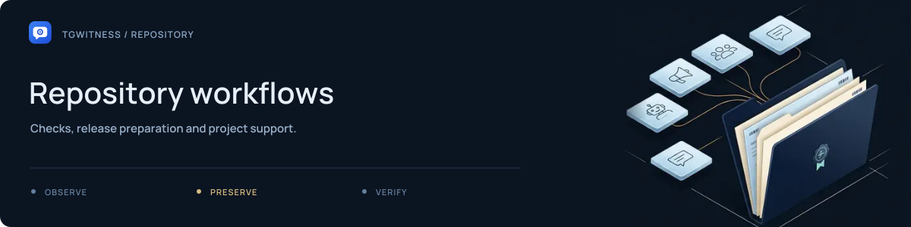

# Repository workflows

[Project](../README.md) · [Documentation](../docs/README.md) · [Wiki](../docs/wiki/Home.md) · [Support](SUPPORT.md)

GitHub configuration for TgWitness: automation, issue forms and contribution prompts.

Keep this guide named `AUTOMATION.md`: GitHub gives a `.github/README.md` priority
over the project README at the repository root.

| Directory or file | Purpose |
| --- | --- |
| [`workflows/`](workflows/README.md) | Checks, website, release and wiki workflows |
| [`ISSUE_TEMPLATE/`](ISSUE_TEMPLATE/README.md) | Bug, feature and documentation forms |
| [`dependabot.yml`](dependabot.yml) | Dependency update configuration |
| [`pull_request_template.md`](pull_request_template.md) | Contributor review checklist |

Workflow definitions describe configured jobs. Their existence is not a passing
status or evidence that a release has been published.
For current qualification, consult the [verification record](../docs/VERIFICATION.md).

Pull requests run both panel browser suites on disposable hosted runners, plus
Firefox/WebKit download checks. Failed scenarios retain individual logs and synthetic
screenshots. These jobs receive no operator credentials and cannot publish a release.

The release workflow also calls the dependency, CodeQL and actual-container audits
from the same revision. Source, wheel, portable and container publication all depend
on that audit succeeding. The HIGH/CRITICAL image gate includes unfixed findings;
a successful functional test cannot override it. A manual Security audit can check
a candidate branch before tagging it.
