[TgWitness](../../README.md) / [.github](../AUTOMATION.md)

<picture>
  <source media="(max-width: 640px) and (prefers-reduced-motion: reduce)" srcset="../../docs/assets/presentation/section-github-mobile-static.svg">
  <source media="(prefers-reduced-motion: reduce)" srcset="../../docs/assets/presentation/section-github-static.svg">
  <source media="(max-width: 640px)" srcset="../../docs/assets/presentation/section-github-mobile.svg">
  
</picture>

# Issue forms

| File | Use |
| --- | --- |
| [`bug_report.yml`](bug_report.yml) | Reproduction steps and observed behavior |
| [`documentation.yml`](documentation.yml) | Missing, confusing or incorrect documentation |
| [`feature_request.yml`](feature_request.yml) | A proposed capability and its use case |
| [`config.yml`](config.yml) | Issue chooser settings and support links |

Keep field labels aligned with [Support](../SUPPORT.md) and
[Contributing](../CONTRIBUTING.md). Vulnerability reports follow
[Security](../SECURITY.md). Examples and attachments should use synthetic data.
