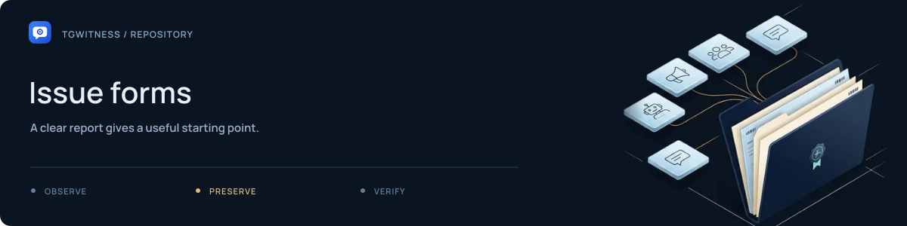

# Issue forms

[Project](../../README.md) · [Documentation](../../docs/README.md) · [Wiki](../../docs/wiki/Home.md) · [Support](../../SUPPORT.md)

| File | Use |
| --- | --- |
| [`bug_report.yml`](bug_report.yml) | Reproduction steps and observed behavior |
| [`documentation.yml`](documentation.yml) | Missing, confusing or incorrect documentation |
| [`feature_request.yml`](feature_request.yml) | A proposed capability and its use case |
| [`config.yml`](config.yml) | Issue chooser settings and support links |

Keep field labels aligned with [Support](../../SUPPORT.md) and
[Contributing](../../CONTRIBUTING.md). Vulnerability reports follow
[Security](../../SECURITY.md). Examples and attachments should use synthetic data.
