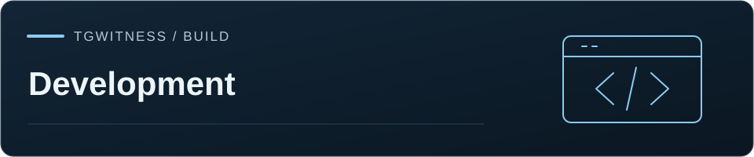

[TgWitness](../README.md) / [Documentation](../docs/README.md)

# Contribute and publish

Project checks, contribution guidance and release automation.

| Task | Start here |
| --- | --- |
| Propose a code or documentation change | [Contribution guide](CONTRIBUTING.md) |
| Report a problem or request a feature | [Issue forms](ISSUE_TEMPLATE/README.md) |
| Report a security issue | [Security policy](SECURITY.md) |
| Get help with setup or an export | [Support](SUPPORT.md) |
| Understand CI jobs and publication | [Automation](AUTOMATION.md) · [Workflows](workflows/README.md) |

The [verification record](../docs/VERIFICATION.md) describes completed tests with
their revisions and limits. [Actions](https://github.com/phishdestroy/TgWitness/actions)
shows the checks for individual changes.
