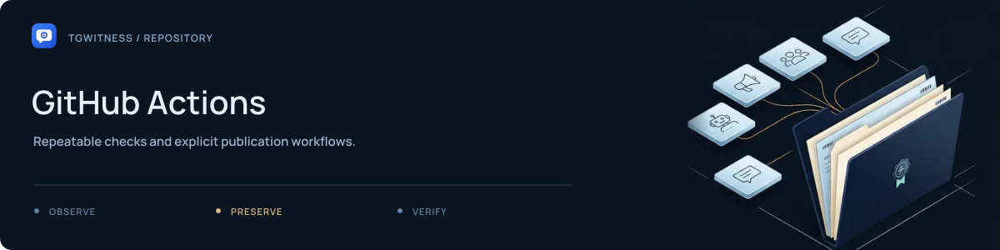

# GitHub Actions

[Project](../../README.md) · [Documentation](../../docs/README.md) · [Wiki](../../docs/wiki/Home.md) · [Support](../SUPPORT.md)

| Workflow | Purpose |
| --- | --- |
| [`checks.yml`](checks.yml) | Linux checks on the project runner; full Windows/macOS matrix on request |
| [`pr-check.yml`](pr-check.yml) | Read-only GitHub-hosted PR/merge-queue gate: lint, synthetic installation and notification redirect checks, pinned dependency audits |
| [`security-audit.yml`](security-audit.yml) | CodeQL on main, pull requests and merge queue; nightly/manual default-branch dependency and built-container scans |
| [`pages.yml`](pages.yml) | Public website build and Pages workflow |
| [`release.yml`](release.yml) | Release preparation and configured release jobs |
| [`wiki.yml`](wiki.yml) | Downloadable wiki bundle |

Read each workflow's `on:` triggers and `permissions:` before changing it. The wiki
bundle workflow prepares artifacts; publishing the separate GitHub Wiki is described
in the [wiki maintenance guide](../../docs/internal/WIKI.md).

Use [local tooling](../../tools/README.md) to inspect outputs before enabling or
triggering publication.

The `tgwitness-ci` runner handles trusted main-branch, maintainer-dispatched and
published-release jobs. Pull-request code is checked on GitHub-hosted runners;
the CodeQL job uses `build-mode: none` and does not execute the checked-out source.
Self-hosted runner findings therefore mark an operational trust boundary that
still requires runner isolation and maintenance, not a reason to run public PRs
on that host.

Routine jobs use the repository's `tgwitness-ci` Linux runner. Full platform
checks and Windows release packages still use GitHub-hosted Windows/macOS
machines. See [runner operations](../../docs/internal/CI-RUNNER.md) for triggers,
artifact retention, host replacement and troubleshooting.

Checks runs its fixed browser and panel check lists in separate processes, at most
two at a time. A failed check does not skip the remaining scripts; per-check logs
(capped at 4 MiB), JSON results and durations are retained, with a ten-minute
per-check timeout and bounded cleanup. A deliberately detached descendant may
survive best-effort process-tree termination, but cannot hold the runner open.
Write-only form checks remain a separate step. Small dependency, lint and source
gates share one fresh virtual environment; independent gates still run after a
failure. Browser jobs install the constrained `dev,mcp` dependencies once. The
self-hosted runner reuses its native pip cache, Playwright's revision-specific
browser files and the default BuildKit layer cache used by Compose; it does not
restore virtual environments or upload these warm caches on every job. Hosted
platform jobs use dependency-keyed pip caching. Site checks run independently
after the strict build. These changes reduce repeated setup and sequential work;
overall completion still depends on runner queues, load and individual checks.

The PR gate runs on fresh GitHub-hosted Ubuntu runners. It uses no repository
secrets, persists no checkout credentials, and never calls the self-hosted Checks
workflow. There is no `pull_request_target` execution path. All action references
in the new security workflows use full commit hashes. Enable the two PR job
checks in the repository's branch rules to make them required: `Lint and synthetic
smoke` and `Locked dependency audit` from the `PR checks` workflow. Confirm their
check-run names after the first real PR run, require them on `main`, and require
an up-to-date branch (or merge queue). Adding a failing workflow alone does not
block merging or change those rules automatically.

The audit runs nightly at 07:23 UTC and supports manual dispatch, only on the
default branch in both cases. GitHub may delay scheduled runs during high load.
Only its CodeQL and Trivy jobs receive `security-events: write` to upload SARIF.
CodeQL covers Python, JavaScript/TypeScript and GitHub Actions. Trivy builds the
runtime, sealed collector and media-worker images locally and checks both OS and
installed library packages; it publishes no image. High/critical vulnerabilities
fail the container job, including findings without a published fix. Dependency
audits fail on any reported advisory or collection error and retain JSON results.
These scans identify known advisories and supported code patterns; they do not
prove the absence of vulnerabilities or replace the browser/evidence checks.

Dependabot checks Python's root `pyproject.toml`, Actions, and the actual Docker/
Compose directories weekly. Minor/patch version updates and security updates
have separate groups. Version-update PR limits are 3 for Python and 2 each for
Actions and Docker; GitHub separately limits security-update PRs. No auto-merge
is configured. This publication has no maintained npm manifest, so there is no
empty npm job or configuration for the removed witness-controller package.

Do not assume Dependabot updates the custom hash locks or the project's
constraints files. Maintainers must review `deploy/constraints.txt` and
`deploy/constraints-mcp.txt`, regenerate the runtime, build, audit, browser,
MCP and site locks with `python tools/lock_requirements.py` (requires `uv`),
and commit the results with dependency changes. PR checks run the offline
`python tools/lock_requirements.py --check` input-consistency guard before
installation. CI installs third-party tooling from the separate hash locks,
then installs reviewed local source without resolving dependencies and runs
`pip check`. The scheduled dependency audit checks exact runtime, build, MCP,
audit, browser, site and media worker pins without resolving or installing
the audited project. Keep the approved sealed
release/attestation policy separate from an ordinary dependency refresh.

The chosen scanners are pip-audit for the Python manifests, CodeQL for source,
and Trivy for built images. Additional Semgrep, Bandit or OSV jobs are deliberately
omitted to avoid overlapping reports and maintenance without demonstrated extra
coverage. Scanner versions and action pins should be reviewed along with normal
dependency updates. See the [Dependabot options](https://docs.github.com/en/code-security/reference/supply-chain-security/dependabot-options-reference),
[CodeQL workflow options](https://docs.github.com/en/code-security/reference/code-scanning/workflow-configuration-options),
and [Trivy action](https://github.com/aquasecurity/trivy-action) for their actual scopes.

The [1 November 2026 audit review](../../docs/internal/SECURITY-AUDIT-2026-11-01.md)
records the first real scan, source-alert triage, and unresolved container findings.
