[TgWitness](../../README.md) / [.github](../AUTOMATION.md)

<picture>
  <source media="(max-width: 640px) and (prefers-reduced-motion: reduce)" srcset="../../docs/assets/presentation/section-github-mobile-static.svg">
  <source media="(prefers-reduced-motion: reduce)" srcset="../../docs/assets/presentation/section-github-static.svg">
  <source media="(max-width: 640px)" srcset="../../docs/assets/presentation/section-github-mobile.svg">
  
</picture>

# GitHub Actions

Public CI builds packages, checks installed command interfaces and runs dependency
and source-security audits. Regression tests and browser/evidence fixtures are
maintained privately; these workflows do not run or attest that private suite.

| Workflow | Purpose |
| --- | --- |
| [`checks.yml`](checks.yml) | Lint, publication allowlist, source/wheel/container builds, installed CLI readiness and optional Windows/macOS packaging |
| [`evidence-checks.yml`](evidence-checks.yml) | Standalone verifier source agreement and command-interface smoke |
| [`pr-check.yml`](pr-check.yml) | Hosted PR/merge-queue lint, source packaging, installed-package smoke and dependency audits |
| [`security-audit.yml`](security-audit.yml) | CodeQL, dependency advisories, OCR upstream advisories and built-image Trivy scans |
| [`pages.yml`](pages.yml) | Public website build and configured Pages deployment |
| [`release.yml`](release.yml) | Release source/wheel/portable/container publication, immutable version guard and download checksums |
| [`installer.yml`](installer.yml) | Signed installer artifacts and configured immutable-download publication |
| [`installer-acceptance.yml`](installer-acceptance.yml) | Signed artifact authentication and installed-wheel smoke on Linux/Windows; on installer pull requests, two runs of `install.sh` and `install.ps1` against a local test site |
| [`sealed-checks.yml`](sealed-checks.yml) | Sealed image build, imports and release caller/collector pin guard |
| [`optional-capture.yml`](optional-capture.yml) | Capture image builds, installed recorder smoke and image vulnerability audits |
| [`fuzz.yml`](fuzz.yml) | ClusterFuzzLite fuzzing of the verifier's archive, manifest and JSON parsing on verifier pull requests and weekly |
| [`provenance.yml`](provenance.yml) | Public source archive, dependency SBOM and hosted build attestations |
| [`wiki.yml`](wiki.yml) | Downloadable Wiki bundle; does not publish the separate GitHub Wiki |

Pull-request code runs on disposable GitHub-hosted runners without repository
secrets or persisted checkout credentials. The project runner handles reviewed
main/release builds. Action references remain pinned to full commit hashes;
publication jobs retain their individual permissions and environment gates.

Installer publication requires package and security workflows for the exact main
revision. Signature checks use the pinned release key; ephemeral keys are accepted
only for explicitly requested `.invalid` builds. Installed-wheel smoke does not
qualify service setup, temporary tunnels or PowerShell bootstrap behavior.
See the [installer publication guide](../../deploy/installer/README.md#automatic-publication-from-github).

Dependency changes must regenerate the reviewed hash locks. CI checks lock inputs,
installs locked dependencies and installs the local wheel without dependency
resolution. CodeQL, pip-audit and Trivy report supported code patterns and known
advisories. Image audits fail
on high/critical findings, including findings without an available fix.

Inspect each run and its artifacts before claiming a build or deployment succeeded.
Private regression results require their own recorded revision and scope. Required
branch-check names must match the actual check runs; workflow edits do not update
repository branch rules automatically.

The PR contexts `Lint and synthetic smoke` and `Locked dependency audit` retain
their existing names. Installer local-job names are also retained for compatibility;
their current steps cover signed artifacts and installed wheels only.
