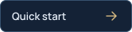
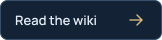
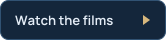
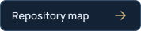

<picture>
  <source media="(max-width: 640px)" srcset="docs/assets/presentation/mobile.svg">
  <source media="(prefers-reduced-motion: reduce)" srcset="docs/assets/presentation/tgwitness-investigation-static.svg">
  
</picture>

  <strong>Your Telegram observation workspace.</strong> 
  Captured conversations. Preserved changes. Independently verifiable exports. 
  On your own computer or server. With your own accounts.

  <a href="docs/CHANGELOG.md">v0.6.1 · pre-release</a> &nbsp; · &nbsp;
  <a href="docs/QUICKSTART.md">Python 3.11+</a> &nbsp; · &nbsp;
  <a href="LICENSE">Restricted license</a>

  
  
  
  

<a href="#screenshots">Take a look at the workspace</a> · <a href="docs/SHOWCASE.md">Films and animations</a> · <a href=".github/CONTRIBUTING.md">Contribute</a>

## Watch the investigation

**Follow the trail. Preserve the evidence.** Sources connect, records enter the
case file, and a signed handoff preserves what was observed.

https://github.com/user-attachments/assets/caeec3e4-6156-4f3e-a840-d4c2f346717e

12 seconds · Silent · Illustrated workflow with fictional records · <a href="docs/assets/presentation/investigation-overview.mp4">Download MP4</a>

## Inside the workspace

<picture>
  <source media="(prefers-color-scheme: dark)" srcset="docs/assets/chats-dark.png">
  
</picture>

The conversation, its changes, and the record behind it. Light and dark themes. Fictional demo data.

## Features

<table>
<tr>
<td width="50%" valign="top"><h3>Conversations with a history</h3>
Read saved messages in context. Compare captured edits. Keep content after a deletion notice.
</td>
<td width="50%" valign="top"><h3>Your scope, your workspace</h3>
Observe selected chats, a folder, or the whole account. Separate accounts keep separate journals and settings.
</td>
</tr>
<tr>
<td valign="top"><h3>A handoff you can verify</h3>
Signed records, preserved attachments, an offline report and a standalone verifier. Optional password protection.
</td>
<td valign="top"><h3>Follow the connections</h3>
Search across saved conversations. Review cited timelines, people profiles and file connections within a workspace.
</td>
</tr>
<tr>
<td valign="top"><h3>A workspace for daily use</h3>
Light and dark themes, 13 interface languages, keyboard navigation and actions directly from Chats.
</td>
<td valign="top"><h3>Go further when you need to</h3>
Add a witness, external timestamps, notifications or a public Proof page. Each has its own setup guide.
</td>
</tr>
</table>

[Collection and scope](https://github.com/phishdestroy/TgWitness/wiki/Collection) · [Investigations](https://github.com/phishdestroy/TgWitness/wiki/Investigations) · [All capabilities and limits](docs/PROJECT-GUIDE.md)

## Quick start

**Try the demo first:** fictional conversations, no Telegram account needed.

| Windows | Linux / macOS |
| --- | --- |
| Double-click **`scripts\Demo.cmd`** | Run **`sh start.sh --demo`** |

Install **Python 3.11+** first. The launcher prepares the environment and dependencies.
Then open **http://127.0.0.1:8787**.

**Your own workspace:** stop the demo, run `Start.cmd` or `sh start.sh` and follow
[account setup](https://github.com/phishdestroy/TgWitness/wiki/Accounts). The panel token is in
`data/live/panel-token.txt`. Use a dedicated Telegram account you can afford to lose.

[Installation and Docker →](docs/QUICKSTART.md) &nbsp;·&nbsp; [Tested environments →](docs/VERIFICATION.md)

## Screenshots

| Compare captured edits | Choose what to observe |
| --- | --- |
|  |  |
| **Prepare a signed handoff** | **Review the observation journal** |
|  |  |

All screenshots use fictional demonstration data. Open any image for the full-size view.

## A message changes. The captured history stays.

An announcement moves from **14:00** to **16:30**, then disappears. The local
record keeps both captured versions and the deletion notice.

https://github.com/user-attachments/assets/ab0f56e8-1834-47ce-9fff-c88dc5887389

12 seconds · Silent · Concept film with fictional records · <a href="docs/assets/presentation/message-history.mp4">Download MP4</a> · <a href="docs/SHOWCASE.md">All three films</a>

## How it works

Each observed change adds a record. The previous hash links it to the journal;
a signature lets the recipient check its integrity against a trusted key.

<picture>
  <source media="(prefers-reduced-motion: reduce)" srcset="docs/assets/presentation/evidence-chain-static.svg">
  
</picture>

1. **Observe** the sources your Telegram account can access.
2. **Preserve** delivered events, captured versions and coverage gaps in a signed journal.
3. **Verify** the export independently, using a key fingerprint retained outside the collector.

A signature establishes integrity relative to a trusted key. It does not prove
Telegram origin, complete capture or the truth of the content.

[The evidence model](docs/HOW-IT-WORKS.md) · [Animated explanations](docs/SHOWCASE.md#how-the-record-holds-together) · [Export and verify](https://github.com/phishdestroy/TgWitness/wiki/Exports-and-Verification)

## The investigation handbook

**Get started** · [Install and try the demo](https://github.com/phishdestroy/TgWitness/wiki/Getting-Started) · [Connect an account](https://github.com/phishdestroy/TgWitness/wiki/Accounts) · [Configure a proxy](https://github.com/phishdestroy/TgWitness/wiki/Proxies)

**Work a case** · [Choose sources](https://github.com/phishdestroy/TgWitness/wiki/Collection) · [Investigate across chats](https://github.com/phishdestroy/TgWitness/wiki/Investigations) · [Prepare a handoff](https://github.com/phishdestroy/TgWitness/wiki/Exports-and-Verification)

**Keep it running** · [Server and Docker](https://github.com/phishdestroy/TgWitness/wiki/Server-and-Docker) · [Backup and recovery](https://github.com/phishdestroy/TgWitness/wiki/Backup-and-Recovery) · [Troubleshooting](https://github.com/phishdestroy/TgWitness/wiki/Troubleshooting)

[All Wiki pages](https://github.com/phishdestroy/TgWitness/wiki) · [Offline handbook](docs/wiki/Home.md) · [Complete project guide](docs/PROJECT-GUIDE.md) · [Technical reference](docs/README.md)

## Licence and use restriction

The [TgWitness Restricted License](LICENSE) includes the
[Taylor Wessing exclusion](docs/TAYLOR-WESSING-EXCLUSION.md).
Read the restriction before using, evaluating, integrating or redistributing
the software. The documentation includes the maintainer's full statement and
source reference.

## Repository map

Source, deployment, tests and documentation

| Directory | Contents |
| --- | --- |
| [`tgwitness/`](tgwitness/README.md) | Application, collector, journal, verifier and web panel |
| [`docs/`](docs/README.md) | Guides, Wiki source, screenshots and verification record |
| [`deploy/`](deploy/README.md) | Optional Compose configurations and service templates |
| [`scripts/`](scripts/README.md) | Additional launchers: demo, setup only and Docker |
| [`tests/`](tests/README.md) | Synthetic regression tests |
| [`tools/`](tools/README.md) | Builds, checks, packaging and documentation tooling |
| [`website/`](website/README.md) | Documentation website and translations |
| [`.github/`](.github/AUTOMATION.md) | Workflows, issue forms and contribution guides |

Read the project overview in your language

**English** · [Русский](docs/ru/README.md) · [Українська](docs/uk/README.md) · [Español](docs/es/README.md) · [Português (Brasil)](docs/pt/README.md) · [Türkçe](docs/tr/README.md) · [العربية](docs/ar/README.md) · [فارسی](docs/fa/README.md) · [اردو](docs/ur/README.md) · [हिन्दी](docs/hi/README.md) · [Bahasa Indonesia](docs/id/README.md) · [Tiếng Việt](docs/vi/README.md) · [简体中文](docs/zh/README.md)

Pre-release. See the [verification record](docs/VERIFICATION.md) and the [audit findings and their fixes](docs/internal/RECHECK-2026-10-29.md) for tested behavior and remaining work. All screens and films use fictional data.

<a href=".github/SUPPORT.md">Get help</a> · <a href=".github/CONTRIBUTING.md">Contribute</a> · <a href=".github/SECURITY.md">Report a vulnerability</a> · <a href="LICENSE">Restricted license</a> · Built by <a href="https://github.com/phishdestroy">PhishDestroy</a>

