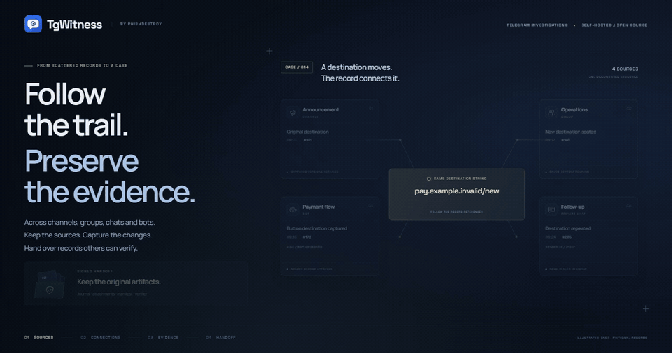

<picture>
  <source media="(max-width: 600px)" srcset="docs/assets/presentation/mobile.svg">
  <source media="(prefers-reduced-motion: reduce)" srcset="docs/assets/presentation/brand.svg">
  
</picture>

# TgWitness

**A Telegram investigation workspace that keeps the record.** Capture conversations,
preserve the edits and deletion notices you observe, follow connections across chats,
and hand over a signed archive someone else can verify. Run it on your own computer
or server, with your own accounts.

  
  
  
  

<a href="docs/CHANGELOG.md">0.6.1 · pre-release</a> &nbsp; / &nbsp; Python 3.11+ &nbsp; / &nbsp; <a href="LICENSE">MIT</a> &nbsp; / &nbsp; Self-hosted · No telemetry

## The workspace

<picture>
  <source media="(prefers-color-scheme: dark)" srcset="docs/assets/chats-dark.png">
  
</picture>

Saved conversations in context. Light and dark themes. 13 interface languages. Fictional demo data.

See message history, collection settings and exports

| Compare captured versions | Choose what to observe |
| --- | --- |
|  |  |
| **Prepare a signed handoff** | **Review the journal** |
|  |  |

## See it in motion

**Follow the trail. Preserve the evidence.** A 12-second concept film connecting
channels, groups, bots and private chats to one investigation. Fictional records.

<picture>
  <source media="(prefers-reduced-motion: reduce)" srcset="docs/assets/presentation/tgwitness-investigation-static.svg">
  
</picture>

[Watch both films and explore the animations →](docs/SHOWCASE.md) &nbsp; · &nbsp; [Download MP4](docs/assets/presentation/investigation.mp4)

## Capture, investigate, verify

| Follow the investigation | Preserve the record |
| --- | --- |
| **Work across conversations.** Search saved chats, build cited timelines and review people and file connections. | **Keep observed changes.** Captured edits remain separate versions; a deletion notice does not erase content already saved. |
| **Choose your scope.** Selected chats, a folder or a dedicated account. Each workspace has its own journal, keys and settings. | **Make a verifiable handoff.** Signed records, preserved attachments, coverage gaps, an offline report and a standalone verifier. |

## Quick start

**Try the demo first.** It uses fictional conversations and needs no Telegram account.

| Windows | Linux / macOS |
| --- | --- |
| Double-click **`scripts\Demo.cmd`** | Run **`sh start.sh --demo`** |

From a source checkout, install Python 3.11+ first. The launcher prepares the
environment and pinned dependencies. Open **http://127.0.0.1:8787**.

**Start your own workspace:** stop the demo, run `Start.cmd` or `sh start.sh`,
then follow [account setup](https://github.com/phishdestroy/TgWitness/wiki/Accounts).
The panel token is in `data/live/panel-token.txt`. Use a dedicated Telegram account
you can afford to lose; Telegram can restrict or ban accounts.

[Installation and Docker →](docs/QUICKSTART.md) &nbsp; · &nbsp; [Tested environments and limits →](docs/VERIFICATION.md)

## How it works

<picture>
  <source media="(prefers-reduced-motion: reduce)" srcset="docs/assets/presentation/evidence-chain-static.svg">
  
</picture>

Every captured event links to the previous record with SHA-256 and is signed with
Ed25519. Export the journal and verify it against a fingerprint retained outside
the collector. Add an independent witness when you need a separate checkpoint.

**What this establishes:** integrity relative to a trusted key. It does not prove
Telegram origin, complete capture or the truth of the content.

[The evidence model →](docs/HOW-IT-WORKS.md) &nbsp; · &nbsp; [Export and verify →](https://github.com/phishdestroy/TgWitness/wiki/Exports-and-Verification) &nbsp; · &nbsp; [Witness and Proof →](https://github.com/phishdestroy/TgWitness/wiki/Witness-and-Proof)

## The investigation handbook

| Get started | Work a case | Keep it running |
| --- | --- | --- |
| [Install and try the demo](https://github.com/phishdestroy/TgWitness/wiki/Getting-Started) | [Choose sources](https://github.com/phishdestroy/TgWitness/wiki/Collection) | [Server and Docker](https://github.com/phishdestroy/TgWitness/wiki/Server-and-Docker) |
| [Connect an account](https://github.com/phishdestroy/TgWitness/wiki/Accounts) | [Investigate across chats](https://github.com/phishdestroy/TgWitness/wiki/Investigations) | [Backup and recovery](https://github.com/phishdestroy/TgWitness/wiki/Backup-and-Recovery) |
| [Configure a proxy](https://github.com/phishdestroy/TgWitness/wiki/Proxies) | [Prepare a handoff](https://github.com/phishdestroy/TgWitness/wiki/Exports-and-Verification) | [Troubleshooting](https://github.com/phishdestroy/TgWitness/wiki/Troubleshooting) |

[All Wiki pages](https://github.com/phishdestroy/TgWitness/wiki) · [Offline handbook](docs/wiki/Home.md) · [Complete project guide](docs/PROJECT-GUIDE.md) · [Technical reference](docs/README.md)

## Repository map

Source, deployment, tests and documentation

| Directory | Contents |
| --- | --- |
| [`tgwitness/`](tgwitness/README.md) | Application, collector, journal, verifier and web panel |
| [`docs/`](docs/README.md) | Guides, Wiki source, screenshots and verification record |
| [`deploy/`](deploy/README.md) | Optional Compose configurations and service templates |
| [`scripts/`](scripts/README.md) | Additional launchers: demo, setup only and Docker |
| [`tests/`](tests/README.md) | Synthetic regression tests |
| [`tools/`](tools/README.md) | Builds, checks, packaging and documentation tooling |
| [`website/`](website/README.md) | Documentation website and translations |
| [`.github/`](.github/AUTOMATION.md) | Workflows, issue forms and contribution guides |

Read the project overview in your language

**English** · [Русский](docs/ru/README.md) · [Українська](docs/uk/README.md) · [Español](docs/es/README.md) · [Português (Brasil)](docs/pt/README.md) · [Türkçe](docs/tr/README.md) · [العربية](docs/ar/README.md) · [فارسی](docs/fa/README.md) · [اردو](docs/ur/README.md) · [हिन्दी](docs/hi/README.md) · [Bahasa Indonesia](docs/id/README.md) · [Tiếng Việt](docs/vi/README.md) · [简体中文](docs/zh/README.md)

TgWitness is a pre-release project. See the [verification record](docs/VERIFICATION.md)
and the [audit findings and their fixes](docs/internal/RECHECK-2026-10-29.md) for tested behavior and remaining work.

[Get help](.github/SUPPORT.md) · [Contribute](.github/CONTRIBUTING.md) · [Report a vulnerability](.github/SECURITY.md) · [MIT license](LICENSE) · Built by [PhishDestroy](https://github.com/phishdestroy)
