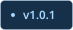
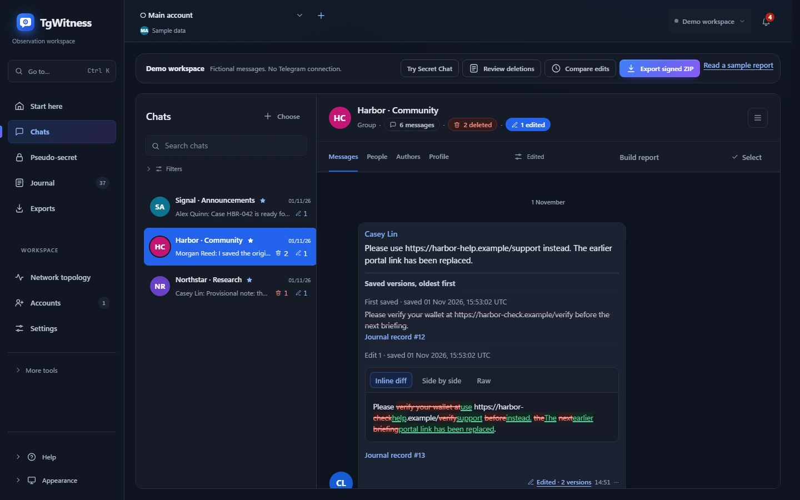

<picture>
  <source media="(max-width: 640px) and (prefers-reduced-motion: reduce)" srcset="docs/assets/presentation/casework-hero-mobile-static.svg">
  <source media="(prefers-reduced-motion: reduce)" srcset="docs/assets/presentation/casework-hero-static.svg">
  <source media="(max-width: 640px)" srcset="docs/assets/presentation/casework-hero-mobile.svg">
  
</picture>

**A self-hosted workspace for preserving and investigating Telegram conversations.** Download history, retain captured edits and deletion notices, trace connections across chats, and deliver reports with independently verifiable records.

<p align="center">
  <a href="#quick-start"><strong>Install</strong></a> ·
  <a href="https://phishdestroy.github.io/TgWitness/demo/"><strong>Try the demo</strong></a> ·
  <a href="docs/README.md"><strong>Documentation</strong></a> ·
  <a href="https://github.com/phishdestroy/TgWitness/wiki">Handbook</a> ·
  <a href="docs/CHANGELOG.md">Changelog</a>
</p>

<p align="center">
  <a href="docs/CHANGELOG.md"></a>
  <a href="LICENSE"></a>
</p>

<a name="screenshots"></a><a name="see-it-in-action"></a>

<a href="https://phishdestroy.github.io/TgWitness/demo/">
<picture>
  <source media="(max-width: 640px)" srcset="docs/assets/presentation/readme-workspace-mobile-dark-still.webp">
  
</picture>
</a>

<p align="center"><sub>Actual interface, fictional case. <a href="https://phishdestroy.github.io/TgWitness/demo/">Explore without signing in</a> · <a href="https://tgwitness-demo.destroy.tools/">Watch live capture</a></sub></p>

<a name="what-tgwitness-does"></a><a name="from-a-conversation-to-a-case"></a><a name="why-tgwitness"></a>

## From conversation to case

| Workflow | What you can do |
| --- | --- |
| **Collect** | Export chats or accounts with media. Load history with resumable cursors, standard requests or Takeout, and distribute supported chat exports across accounts. [Collection modes →](docs/COLLECTION-MODES.md) |
| **Follow changes** | Observe new messages, keep captured versions, compare edits and review deletion notices alongside preserved content. [Collection →](docs/COLLECTION.md) |
| **Investigate** | Search across saved chats, build subject cards and Case Boards, follow forwarded sources, find repeated media, and use watchlists, OCR and transcription. [Investigation tools →](docs/INVESTIGATION-MODE.md) |
| **Prepare a report** | Select chats or individual messages, choose a design, add a cover and charts, then export PDF, HTML or JSON. Create minimized copies for sharing. [Report studio →](docs/CASE_REPORTS.md) |
| **Verify and hand over** | Deliver signed archives, file hashes, checkpoints and timestamp receipts with a standalone verifier. [Evidence format →](docs/EVIDENCE.md) |

Separate account workspaces keep sessions and signing keys apart. The panel also supports [Secret Chats](docs/PSEUDO-SECRET.md) created or accepted by TgWitness, [message images and history forwarding](docs/PANEL.md), and automation through the [CLI](docs/CLI.md), [MCP](docs/MCP.md) and [signed webhooks](docs/WEBHOOKS.md).

<a name="quick-start"></a><a name="run-it-on-your-machine"></a>

## Install

The installer includes Python, verifies package hashes and release signatures, and records the source revision. Run the same command again to update.

**Linux / macOS**

```sh
curl -fsSL https://get.destroy.tools/install.sh | bash
```

**Windows · PowerShell or Command Prompt**

```powershell
powershell.exe -NoProfile -ExecutionPolicy Bypass -Command "irm https://get.destroy.tools/install.ps1 | iex"
```

On an Ubuntu server, run as root to install the background service. On a desktop, run as your normal user. The Windows execution policy applies only to this process.

[Inspect and verify the installer](docs/INSTALLATION.md#verify-before-running) · [Docker](docs/DEPLOYMENT.md) · [From source](docs/QUICKSTART.md) · [Releases](https://github.com/phishdestroy/TgWitness/releases)

<a name="start-simple"></a>

### Your first workspace

1. **Choose a task:** **Just download**, **Follow chats** or **Evidence for a case**.
2. **Connect a collection account:** use QR, phone sign-in or a supported session import.
3. **Select chats and scope:** choose the history period, files and observation settings, then start.

Progress, saved records, pauses and retry status stay visible in the panel. [First-run guide →](docs/SETTINGS.md)

<details>
<summary><strong>What is inside an export?</strong></summary>

- **Account export:** `index.html` opens the archive; choose HTML and JSON together to include the chat reader and `result.json`.
- **Chat export:** `chat.html` for offline reading, `chat.json` for analysis and the selected downloaded media.
- **Case report:** selected records, cover, charts and verification material in the formats you choose.

Keep the original signed ZIP alongside any working or sharing copy. [Account export](docs/ACCOUNT-EXPORT.md) · [Chat export](docs/wiki/Chat-Export.md) · [Case reports](docs/CASE_REPORTS.md)

</details>

<a name="how-it-works"></a><a name="a-record-someone-else-can-check"></a>

## Verification built into the record

Every journal observation joins a hash chain and receives an Ed25519 signature. Export manifests cover the delivered files. Recipients can check the archive independently with a separately trusted signing-key fingerprint.

| Layer | What the recipient checks |
| --- | --- |
| **Journal and files** | Signatures, ordering, attachment hashes and the delivered manifest. |
| **Continuity and time** | Retained checkpoints, independent witness records, RFC 3161 timestamps and OpenTimestamps receipts. |
| **Collection environment** | For the selected acquisition mode: GitHub workflow attestations or Intel TDX measurements, freshness and collector-key binding. |

Coverage gaps, unavailable data and acquisition context travel with the record. [Verification guide](docs/VERIFICATION.md) · [Timestamps](docs/TIMESTAMP.md) · [Independent witness](docs/WITNESS.md) · [Intel TDX](docs/HIGH-ASSURANCE.md)

**Published qualification:** 3,598,381 records across 48 verified archives in the public-history runs of 6 November 2026. These are selected documented runs; [the report](docs/EXPORT-BENCHMARK-2026-11-06.md) records their workload, environment and results. [Capabilities and qualification](docs/STATUS.md) · [CI by revision](https://github.com/phishdestroy/TgWitness/actions)

<details>
<summary><strong>Run the verifier on a sample archive</strong></summary>

The fictional sample includes `verify.py`. With Python 3.11+ and `cryptography` installed:

```sh
curl -LO https://phishdestroy.github.io/TgWitness/demo/downloads/tgwitness-demo.zip
unzip -o tgwitness-demo.zip verify.py
python verify.py tgwitness-demo.zip
```

This checks the sample's internal integrity and displays its signing-key fingerprint. For a real handover, obtain the expected fingerprint separately. With TgWitness installed, check an evidence package against the trusted key and timestamp authority:

```sh
python -m tgwitness.verify evidence.zip --fingerprint TRUSTED_SHA256 --tsa-ca TSA-ROOT.pem --require evidence
```

[Verification walkthrough →](docs/wiki/Exports-and-Verification.md)

</details>

<!-- authors-manifesto:start -->

<a name="manifesto"></a>

TgWitness applies the same checks to the operator and the project. [Questions and checks](docs/QUESTIONS-AND-CHECKS.md) · [A signed-export case study](https://phishdestroy.github.io/TgWitness/docs/signed-export/) · [Export Clinic](https://phishdestroy.github.io/TgWitness/docs/export-clinic/)

<!-- authors-manifesto:end -->

<a name="operations"></a><a name="layout-review"></a><a name="explore-more"></a>

## Run it on your terms

Run on your computer or server, in Docker, on a GitHub capture runner or in a Phala Intel TDX environment. Sessions and credentials stay in an encrypted vault; the panel binds to localhost by default. The [System map](docs/SYSTEM-MAP.md) shows configured connections to Telegram, proxies, storage, witnesses and optional services.

| Need | Start here |
| --- | --- |
| Set up accounts and connections | [Accounts](docs/ACCOUNTS.md) · [Connection security](docs/CONNECTION-SECURITY.md) · [Access control](docs/ACCESS.md) |
| Deploy, update or recover | [Installation](docs/INSTALLATION.md) · [Deployment](docs/DEPLOYMENT.md) · [Operations](docs/OPERATIONS.md) |
| Choose an acquisition environment | [Collection modes](docs/COLLECTION-MODES.md) · [GitHub capture](docs/SEALED-ACTIONS.md) · [Official-client capture](docs/TRUSTED-LIVE.md) |
| Understand formats and architecture | [Evidence model](docs/EVIDENCE.md) · [Security model](docs/SECURITY-MODEL.md) · [Code map](docs/CODE-MAP.md) |

<a name="review-notes"></a><a name="repository-map"></a>

## Project and contributions

TgWitness is MIT-licensed. Start with the [contribution guide](.github/CONTRIBUTING.md) and [code map](docs/CODE-MAP.md). The private regression harness uses synthetic accounts and fault injection; public CI records source checks, dependency audits, packaging, installer verification and security analysis for each revision. [Development history and validation](docs/QUESTIONS-AND-CHECKS.md)

[Get help](.github/SUPPORT.md) · [Report a vulnerability](.github/SECURITY.md) · [Release notes](docs/CHANGELOG.md) · [Machine-readable index](llms.txt)

<details>
<summary><strong>Project position and operator notice</strong></summary>

<!-- operator-notice:start -->

<a href="docs/OPERATOR-INCOMPATIBILITY.md">
<picture>
  <source media="(max-width: 640px) and (prefers-reduced-motion: reduce)" srcset="docs/assets/presentation/readme-gdpr-impunity-mobile-static.svg">
  <source media="(prefers-reduced-motion: reduce)" srcset="docs/assets/presentation/readme-gdpr-impunity-static.svg">
  <source media="(max-width: 640px)" srcset="docs/assets/presentation/readme-gdpr-impunity-mobile.svg">
  
</picture>
</a>

[Read the operator notice →](docs/OPERATOR-INCOMPATIBILITY.md) · [Source record](https://phishdestroy.io/steam_dossier/taylor_wessing)

<!-- operator-notice:end -->

</details>

<details>
<summary><strong>Read the overview in your language</strong></summary>

25 interface languages · 26 guide languages.

**English** · [Українська](docs/uk/README.md) · [Español](docs/es/README.md) · [Português (Brasil)](docs/pt/README.md) · [Türkçe](docs/tr/README.md) · [العربية](docs/ar/README.md) · [فارسی](docs/fa/README.md) · [اردو](docs/ur/README.md) · [हिन्दी](docs/hi/README.md) · [Bahasa Indonesia](docs/id/README.md) · [Tiếng Việt](docs/vi/README.md) · [简体中文](docs/zh/README.md) · [繁體中文](docs/zh-Hant/README.md) · [Français](docs/fr/README.md) · [Deutsch](docs/de/README.md) · [Italiano](docs/it/README.md) · [Polski](docs/pl/README.md) · [O‘zbekcha](docs/uz/README.md) · [한국어](docs/ko/README.md) · [日本語](docs/ja/README.md) · [Bahasa Melayu](docs/ms/README.md) · [ไทย](docs/th/README.md) · [עברית](docs/he/README.md) · [বাংলা](docs/bn/README.md) · [አማርኛ](docs/am/README.md) · [Русский](docs/ru/README.md)

</details>

<p align="center"><a href="docs/README.md">Documentation</a> · <a href="https://github.com/phishdestroy/TgWitness/wiki">Handbook</a> · <a href="https://phishdestroy.github.io/TgWitness/demo/">Interactive demo</a> · <a href="LICENSE">MIT license</a></p>
