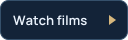
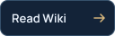
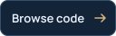
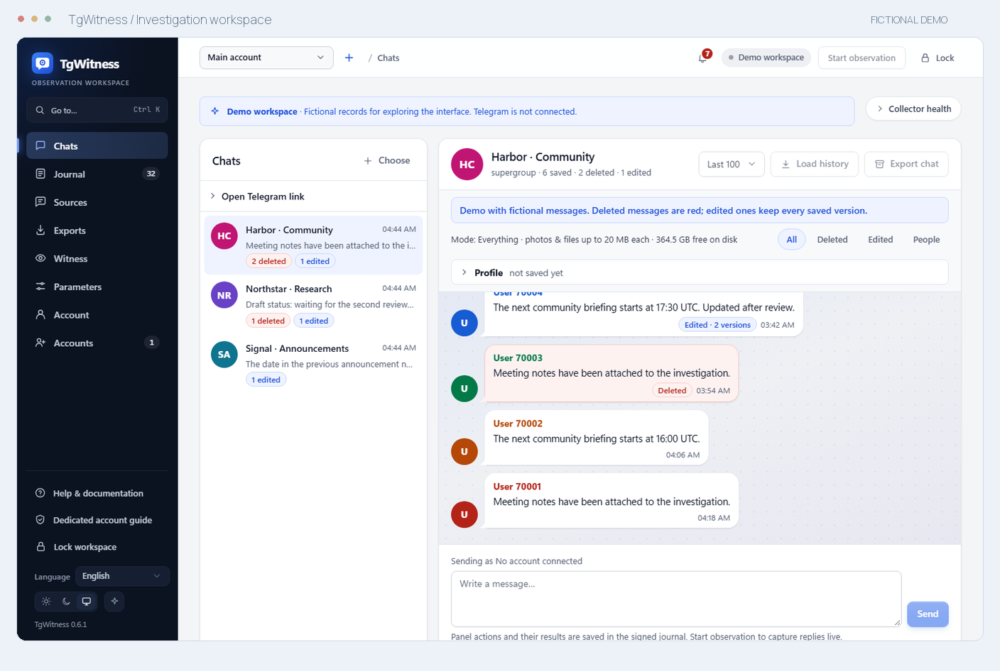

<picture>
  <source media="(max-width: 640px)" srcset="docs/assets/presentation/readme-cover-mobile.svg">
  <source media="(prefers-reduced-motion: reduce)" srcset="docs/assets/presentation/readme-cover-static.svg">
  
</picture>

  <strong>Your accounts. Your workspace. A record you can verify.</strong> 
  Capture Telegram conversations, follow their changes and prepare a signed handoff.

  
  
  
  

<a href="docs/CHANGELOG.md">v0.6.1 · pre-release</a> &nbsp; / &nbsp; Python 3.11+ &nbsp; / &nbsp; 13 interface languages &nbsp; / &nbsp; <a href="LICENSE">Restricted license</a>

## Inside the workspace

<picture>
  <source media="(prefers-color-scheme: dark)" srcset="docs/assets/presentation/workspace-preview-dark.png">
  
</picture>

One conversation. Its captured changes. The record behind it. &nbsp; <a href="docs/assets/chats.png">Light</a> · <a href="docs/assets/chats-dark.png">Dark</a>

- **Capture the conversation.** Observe selected chats, a folder or a dedicated account. Keep captured versions and attachments.
- **Follow the connections.** Search across chats, compare edits and review people, files and cited timelines.
- **Verify the handoff.** Export signed records, an offline report and a standalone verifier. Check against a trusted key.

<strong>More screens</strong> — edits, sources, exports and the journal

### Screenshots

| Compare captured edits | Choose what to observe |
| --- | --- |
|  |  |
| **Prepare a signed handoff** | **Review the observation journal** |
|  |  |

All screens use fictional demonstration data. Open an image for the full-size view.

## Quick start

**Try it in your browser:** the read-only [online demo](https://phishdestroy.github.io/TgWitness/demo/) runs the real panel on fictional records.

**Or run the demo locally:** fictional conversations, no Telegram account needed.

[Download the source](https://github.com/phishdestroy/TgWitness/archive/refs/heads/main.zip), unpack it and install **Python 3.11+**.

| Windows | Linux / macOS |
| --- | --- |
| Double-click **`scripts\Demo.cmd`** | Run **`sh start.sh --demo`** |

The launcher prepares the environment. Open **http://127.0.0.1:8787**.

**Connect your own account:** stop the demo, run `Start.cmd` or `sh start.sh`, then follow
[account setup](https://github.com/phishdestroy/TgWitness/wiki/Accounts).
The panel token is in `data/live/panel-token.txt`. Use a dedicated account you can afford to lose.

[Installation and Docker →](docs/QUICKSTART.md) &nbsp; · &nbsp; [Tested environments →](docs/VERIFICATION.md)

## Watch the investigation

**01 — Follow the trail** &nbsp; · &nbsp; 12 seconds

Sources connect. Records enter the case file. A signed handoff preserves what was observed.

https://github.com/user-attachments/assets/caeec3e4-6156-4f3e-a840-d4c2f346717e

Illustrated workflow · Silent · <a href="docs/assets/presentation/investigation-overview.mp4">Download MP4</a>

**02 — Keep the captured history** &nbsp; · &nbsp; 12 seconds

An announcement moves from **14:00** to **16:30**, then disappears. Both captured versions remain in the local record.

https://github.com/user-attachments/assets/ab0f56e8-1834-47ce-9fff-c88dc5887389

Concept film · Silent · <a href="docs/assets/presentation/message-history.mp4">Download MP4</a> · <a href="docs/SHOWCASE.md">All three films and animated explanations →</a>

All films use fictional records. For the application itself, see the workspace above.

## The investigation handbook

**Get started** · [Install](https://github.com/phishdestroy/TgWitness/wiki/Getting-Started) · [Accounts](https://github.com/phishdestroy/TgWitness/wiki/Accounts) · [Proxies](https://github.com/phishdestroy/TgWitness/wiki/Proxies)

**Work a case** · [Choose sources](https://github.com/phishdestroy/TgWitness/wiki/Collection) · [Investigate](https://github.com/phishdestroy/TgWitness/wiki/Investigations) · [Export and verify](https://github.com/phishdestroy/TgWitness/wiki/Exports-and-Verification)

**Keep it running** · [Server and Docker](https://github.com/phishdestroy/TgWitness/wiki/Server-and-Docker) · [Backups](https://github.com/phishdestroy/TgWitness/wiki/Backup-and-Recovery) · [Troubleshooting](https://github.com/phishdestroy/TgWitness/wiki/Troubleshooting)

[Technical documentation](docs/README.md) · [Complete project guide](docs/PROJECT-GUIDE.md) · [Offline handbook](docs/wiki/Home.md)

**What verification establishes:** integrity relative to a trusted key. It does not prove
Telegram origin, complete capture or the truth of the content. [Read the evidence model →](docs/HOW-IT-WORKS.md)

## Licence and use restriction

The [TgWitness Restricted License](LICENSE) includes the
[Taylor Wessing exclusion](docs/TAYLOR-WESSING-EXCLUSION.md).
Read the restriction before use, evaluation, integration or redistribution.
The documentation includes the maintainer's full statement and source reference.

<!-- operator-notice:start -->

### NOTICE — Operator Incompatibility

> **Taylor Wessing PartG mbB — German core, Hamburg office.**
> PhishDestroy's operator notice accompanies the [use restriction](LICENSE).
> [Full notice and context](docs/OPERATOR-INCOMPATIBILITY.md) · [Original text](NOTICE) · [Source record](https://phishdestroy.io/steam_dossier/taylor_wessing)

The following records the maintainer's statement and allegations, not an
independent judicial or regulatory finding.

<strong>Read the complete notice</strong> — statement by PhishDestroy

<blockquote lang="en" dir="ltr" translate="no">

This software produces SHA-256 hash chains and Ed25519 signatures. Its output is designed to be verifiable by any third party, in any jurisdiction, without reference to the authority of the person who produced it.

It is therefore structurally incompatible with the following operator, its successors, affiliates, rebrandings, spin-outs and personnel:

Taylor Wessing PartG mbB — German core, Hamburg office.

Including, without limitation:

<ul><li>Dr. Tobias Schelinski (signatory, doc. 42282474)</li><li>Dr. Patrick Vincent Zurheide (signatory, doc. 42603633)</li></ul>

The incompatibility is evidentiary, not technical.

Under the signature of the above:

<ul><li>94.28 % of a GDPR Art. 15 disclosure (70,717 words) was transmitted under black overlays that did not delete the underlying text;</li><li>page 444, first visible row, carried the slur &quot;pidor&quot; in plain text, from a firm publicly ranked Stonewall Top 100;</li><li>50 retained &quot;reports&quot; were submitted as proof of user misconduct at Jaccard 1.000, joint probability 1e-153, dated after the account was already blocked;</li><li>on personal notice of the exposure, the response on record was: &quot;amusing&quot;;</li><li>twelve months later, no Art. 33 filing, no Art. 34 notice, no remediation;</li><li>GDPR Art. 17 was then invoked — not to protect a data subject, but to delist the reporting of the above.</li></ul>

The founder of the residual structure is documented in the Reichstags-Handbuch 1938, p. 223 — NSDAP № 1,033,215, member of the Criminal Law Commission that rewrote § 175, the statute under which men were sent to the camps with a pink triangle. The English heritage left on 1 June 2026 as Winston Taylor. What remains is addressed here.

A workflow whose output is required to contradict its input has no use for this software. The only configuration in which this software behaves as designed in that environment is: unavailable.

Mathematik verhandelt nicht. Diese Lizenz auch nicht.

</blockquote>

<!-- operator-notice:end -->

## Repository map

Source, deployment, tests and contribution guides

| Directory | Contents |
| --- | --- |
| [`tgwitness/`](tgwitness/README.md) | Application, collector, journal, verifier and web panel |
| [`docs/`](docs/README.md) | Guides, Wiki source, screenshots and verification record |
| [`deploy/`](deploy/README.md) | Compose configurations and service templates |
| [`scripts/`](scripts/README.md) | Demo, setup and Docker launchers |
| [`tests/`](tests/README.md) | Synthetic regression tests |
| [`tools/`](tools/README.md) | Builds, checks and packaging |
| [`website/`](website/README.md) | Documentation website and translations |
| [`.github/`](.github/AUTOMATION.md) | Workflows and contribution guides |

Read the project overview in your language

**English** · [Русский](docs/ru/README.md) · [Українська](docs/uk/README.md) · [Español](docs/es/README.md) · [Português (Brasil)](docs/pt/README.md) · [Türkçe](docs/tr/README.md) · [العربية](docs/ar/README.md) · [فارسی](docs/fa/README.md) · [اردو](docs/ur/README.md) · [हिन्दी](docs/hi/README.md) · [Bahasa Indonesia](docs/id/README.md) · [Tiếng Việt](docs/vi/README.md) · [简体中文](docs/zh/README.md)

---

<a href=".github/SUPPORT.md">Get help</a> &nbsp; · &nbsp; <a href=".github/CONTRIBUTING.md">Contribute</a> &nbsp; · &nbsp; <a href=".github/SECURITY.md">Report a vulnerability</a> &nbsp; · &nbsp; Built by <a href="https://github.com/phishdestroy">PhishDestroy</a>

