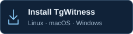

<picture>
  <source media="(max-width: 640px) and (prefers-reduced-motion: reduce)" srcset="docs/assets/presentation/casework-hero-mobile-static.svg">
  <source media="(prefers-reduced-motion: reduce)" srcset="docs/assets/presentation/casework-hero-static.svg">
  <source media="(max-width: 640px)" srcset="docs/assets/presentation/casework-hero-mobile.svg">
  
</picture>

<p align="center"><strong>Capture Telegram history. Follow the changes. Build a report others can verify.</strong></p>

<p align="center">
  <a href="#quick-start"></a>
  <a href="https://phishdestroy.github.io/TgWitness/demo/"></a>
  <a href="https://github.com/phishdestroy/TgWitness/wiki"></a>
</p>

<p align="center"><a href="https://tgwitness-demo.destroy.tools/">Watch live capture</a> · <a href="#what-tgwitness-does">What you can do</a> · <a href="docs/CHANGELOG.md">Release notes</a></p>

<p align="center">
  <a href="docs/CHANGELOG.md"></a>
  <a href="docs/VERIFICATION.md"></a>
  
  <a href="LICENSE"></a>
</p>

<a name="screenshots"></a>
<a name="see-it-in-action"></a>

<a href="https://phishdestroy.github.io/TgWitness/demo/">
<picture>
  <source media="(max-width: 640px) and (prefers-reduced-motion: reduce)" srcset="docs/assets/presentation/readme-workspace-mobile-dark-still.webp">
  <source media="(prefers-reduced-motion: reduce)" srcset="docs/assets/presentation/readme-workspace-dark-still.webp">
  <source media="(max-width: 640px)" srcset="docs/assets/presentation/readme-workspace-mobile-dark.webp">
  
</picture>
</a>

<p align="center"><sub>The actual workspace with fictional records. Click to explore — no Telegram login needed.</sub></p>

<a name="quick-start"></a>
<a name="run-it-on-your-machine"></a>

## Install

Python is included. Run the same command again to update.

**Linux / macOS**

```sh
curl -fsSL https://get.destroy.tools/install.sh | bash
```

**Windows · PowerShell or CMD**

```powershell
powershell.exe -NoProfile -ExecutionPolicy Bypass -Command "irm https://get.destroy.tools/install.ps1 | iex"
```

<sub>Ubuntu server: run as root. Desktop: run as your normal user. The PowerShell policy applies to this process only.</sub>

The installer checks package hashes and release signatures against its embedded key. Each signed build identifies its source revision.
[Verify before running](docs/INSTALLATION.md#verify-before-running) · [Releases](https://github.com/phishdestroy/TgWitness/releases) · [Docker](docs/DEPLOYMENT.md) · [Install from source](docs/QUICKSTART.md)

<a name="start-simple"></a>

**First run:** choose **Just download**, **Follow chats** or **Evidence for a case** → connect an account → choose chats. The panel shows the controls for that task. [Setup guide →](docs/SETTINGS.md)

<a name="what-tgwitness-does"></a>

## Why TgWitness

<picture>
  <source media="(max-width: 640px) and (prefers-reduced-motion: reduce)" srcset="docs/assets/presentation/readme-features-mobile-static.svg">
  <source media="(prefers-reduced-motion: reduce)" srcset="docs/assets/presentation/readme-features-static.svg">
  <source media="(max-width: 640px)" srcset="docs/assets/presentation/readme-features-mobile.svg">
  
</picture>

Choose a task when you open the panel:

| Task | Result |
| --- | --- |
| **Just download** | Read chats offline in a Telegram-style HTML view, keep Telegram Desktop-compatible JSON and save the selected media. |
| **Follow chats** | Collect accessible history and keep observing new messages, captured edits and deletion notices. |
| **Evidence for a case** | Select records, add a cover and charts, then share PDF, HTML or JSON reports with verification data. |

<details>
<summary><strong>All capabilities · people, reports, accounts, Secret Chats and verification</strong></summary>

| You want to… | What you get |
| --- | --- |
| **Keep what was said** | Messages, captured edits, deletion notices and preserved files in a signed journal. [Collection →](docs/COLLECTION.md) |
| **Understand the people** | Available profiles, avatar and gift observations with dates, bio links and a history of changes. Collection can pause and resume. [Panel →](docs/PANEL.md) |
| **Make a clear report** | Pick chats or individual messages, edit the cover, choose a design and charts, then preview and download PDF, HTML or JSON. [Reports →](docs/CASE_REPORTS.md) |
| **Export once or keep watching** | Account exports, accessible history and continuous observation, with separate workspaces and keys for each account. [Collection modes →](docs/COLLECTION-MODES.md) |
| **Work with Secret Chats** | An integrated conversation view and exports for chats created or accepted by TgWitness, using a protocol module the panel installs with one button. [Secret Chats →](docs/PSEUDO-SECRET.md) |
| **Let someone check the result** | Signed archives, a standalone verifier, retained checkpoints and optional timestamps, GitHub acquisition attestations or Intel TDX measurements. [Checks →](docs/EVIDENCE.md) |

</details>

<details>
<summary><strong>Inside a download · readable chats, JSON, media and reports</strong></summary>

For an account export, extract the ZIP and open `index.html`. It links to the selected chat views, report, coverage information and verification steps. Choose HTML and JSON together to include both the Telegram-style reader and `result.json` for other tools. Downloaded media stays with the archive.

A one-chat export includes `chat.html` for offline reading and `chat.json` for analysis. Reports have their own controls for the cover, selected messages, charts and output format. Keep the original signed ZIP when sharing or making a working copy.

[Account downloads](docs/ACCOUNT-EXPORT.md) · [Export one chat](docs/wiki/Chat-Export.md) · [Report studio](docs/CASE_REPORTS.md)

</details>

Self-hosted. Encrypted session storage. Localhost panel by default. No telemetry.
Source visibility, unavailable data and collection gaps remain visible in the saved record.

<a name="from-a-conversation-to-a-case"></a>

<details>
<summary><strong>From a conversation to a case · collect, investigate, share</strong></summary>

1. **Collect.** Choose chats, history and file limits. Progress, pauses and retries stay visible.
2. **Investigate.** Search saved material, compare versions and connect findings on a Case Board.
3. **Share.** Select relevant records, preview the report and deliver it with its verification data.

[Search](docs/SEARCH.md) · [Investigation tools](docs/INVESTIGATION-MODE.md) · [Chat exports](docs/wiki/Chat-Export.md) · [Case packages](docs/CASE_REPORTS.md)

</details>

<a name="how-it-works"></a>

## A record someone else can check

Captured observations form a signed, hash-linked journal. Exports include preserved files and a verifier; recipients can check them against a signing-key fingerprint received separately.

<picture>
  <source media="(max-width: 640px) and (prefers-reduced-motion: reduce)" srcset="docs/assets/presentation/casework-chain-mobile-static.svg">
  <source media="(prefers-reduced-motion: reduce)" srcset="docs/assets/presentation/casework-chain-static.svg">
  <source media="(max-width: 640px)" srcset="docs/assets/presentation/casework-chain-mobile.svg">
  
</picture>

**3,598,381 records · 48 verified archives.** Documented public-history runs from 6 November 2026. [Measurements and verification →](docs/EXPORT-BENCHMARK-2026-11-06.md)

<details>
<summary><strong>Try the verifier on a sample archive</strong></summary>

The fictional sample includes `verify.py`. Use Python 3.11+ with `cryptography` installed:

```sh
curl -LO https://phishdestroy.github.io/TgWitness/demo/downloads/tgwitness-demo.zip
unzip -o tgwitness-demo.zip verify.py
python verify.py tgwitness-demo.zip
```

The verifier reports the records, journal head and signing-key fingerprint. To check an evidence package against a separately trusted key and timestamp authority:

```sh
python -m tgwitness.verify evidence.zip --fingerprint TRUSTED_SHA256 --tsa-ca TSA-ROOT.pem --require evidence
```

[Verification steps](docs/wiki/Exports-and-Verification.md) · [Timestamps](docs/TIMESTAMP.md) · [Independent witness](docs/WITNESS.md)

</details>

<!-- authors-manifesto:start -->

<a name="manifesto"></a>

<details>
<summary><strong>What each check covers</strong></summary>

| Check | What it checks |
| --- | --- |
| Journal signatures and manifest | Recorded bytes, ordering and delivered files against the expected signing key. |
| Retained checkpoint or independent witness | The journal against a separately retained length and head hash. |
| External timestamp | The covered hash, authority's signature and timestamp validation evidence. |
| GitHub Actions capture | The archive against its acquisition attestation, approved workflow and collector revision. |
| Intel TDX | The attested environment, expected measurements, fresh challenge and bound collector key. |

TgWitness takes no side: the same checks apply to the operator and the project.
[Questions and checks](docs/QUESTIONS-AND-CHECKS.md) · [GitHub capture](docs/SEALED-ACTIONS.md) · [Intel TDX](docs/HIGH-ASSURANCE.md) · [Export Clinic](https://phishdestroy.github.io/TgWitness/docs/export-clinic/)

</details>

<!-- authors-manifesto:end -->

<a name="review-notes"></a>

<details>
<summary><strong>Review notes · development history, tests, verifier and defaults</strong></summary>

- **History.** TgWitness was developed and tested for about six months before publication. This repository starts with a squashed import (`8fb40fe0e`, 658 files). [Development history](docs/QUESTIONS-AND-CHECKS.md#development-history)
- **Tests.** The regression suite of 126 test modules (about 950 test functions) runs in a private validation environment with synthetic accounts and a fake Telegram transport; test files are excluded from Git and source archives. Public CI runs lint, dependency audits, wheel installs, installer signature checks, CodeQL, Trivy and verifier fuzzing. [Tests and CI](docs/QUESTIONS-AND-CHECKS.md#tests-and-continuous-integration)
- **Verifier.** `tgwitness/verify.py` is assembled from 21 modules in `tgwitness/verifier/`. The journal and signature checks (`common`, `chain`, `journal`) total 22 KB; a third of the file is compressed translation data. [Verifier sources](tgwitness/verifier/README.md)
- **Telegram client.** Sign-in uses built-in public API pairs unless you enter your own, and each observation records which pair was used. [API pairs](docs/QUESTIONS-AND-CHECKS.md#built-in-api-pairs-identify-a-client-not-an-account)
- **Defaults.** New workspaces connect through public MTProxy lists. The vault key stays in the data directory unless a new installation uses an external master key. [Connection security](docs/CONNECTION-SECURITY.md#external-master-key)

</details>

## Explore more

<details>
<summary><strong>Investigation tools and integrations</strong></summary>

| Area | Guides |
| --- | --- |
| People, communities and cases | [Subject cards, watchlists, conversations and court documents](docs/INVESTIGATION-MODE.md) |
| Accounts and routes | [Account groups and session imports](docs/ACCOUNTS.md) · [Proxies and IP modes](docs/CONNECTION-SECURITY.md) |
| Saved content | [Full-text search](docs/SEARCH.md) · [Local OCR and transcription](docs/MEDIA-ANALYSIS.md) · [Analysis and optional AI](docs/ANALYSIS.md) |
| Automation | [CLI](docs/CLI.md) · [Scoped MCP access](docs/MCP.md) · [Signed webhooks](docs/WEBHOOKS.md) |
| Official-client capture | [Optional recorders](docs/OPTIONAL-CAPTURE.md) · [Trusted Live](docs/TRUSTED-LIVE.md) · [Sealed official Web](docs/OFFICIAL-WITNESS.md) |
| Shared review | [Access tokens and chat scopes](docs/ACCESS.md) · [Archive verification](docs/VERIFICATION.md) |

The [capability record](docs/STATUS.md) lists each acquisition mode and its qualification. The interactive demo uses fictional records.

</details>

<a name="operations"></a>
<a name="layout-review"></a>

<details>
<summary><strong>Deployment, updates and recovery</strong></summary>

Run on your computer or server, in Docker, on a GitHub-hosted capture runner or in a Phala Intel TDX environment. Each account keeps its own workspace, session and signing key.

The installer uses signed builds from the [Installer workflow](.github/workflows/installer.yml). Rerunning it updates an installation; tagged packages are also available under [Releases](https://github.com/phishdestroy/TgWitness/releases).

Sessions and credentials stay in the encrypted vault. The [System map](docs/SYSTEM-MAP.md) shows configured connections to Telegram, proxies, storage, witnesses and optional services.

[Install and update](docs/INSTALLATION.md) · [Deployment](docs/DEPLOYMENT.md) · [Operations](docs/OPERATIONS.md) · [Security model](docs/SECURITY-MODEL.md) · [Dedicated account](https://phishdestroy.github.io/TgWitness/docs/dedicated-account/)

</details>

<a name="repository-map"></a>

<details>
<summary><strong>For developers</strong></summary>

| Directory | Purpose |
| --- | --- |
| [tgwitness/](tgwitness/README.md) | Collector, signed journal, API, panel, reports and verification |
| [website/](website/README.md) | Public site, translated guides and fictional interactive demo |
| [docs/](docs/README.md) | Product guides, formats, qualification and architecture |
| [tools/](tools/README.md) | Builds, packaging and publication checks |
| [.github/](.github/AUTOMATION.md) | CI, releases and delivery |
| [integrations/](integrations/README.md) | Webhook schema and n8n example |

[Repository guide](docs/CODE-MAP.md) · [Contributing](.github/CONTRIBUTING.md) · [Project guide](docs/PROJECT-GUIDE.md)

</details>

<!-- operator-notice:start -->

<a href="docs/OPERATOR-INCOMPATIBILITY.md">
<picture>
  <source media="(max-width: 640px) and (prefers-reduced-motion: reduce)" srcset="docs/assets/presentation/readme-gdpr-impunity-mobile-static.svg">
  <source media="(prefers-reduced-motion: reduce)" srcset="docs/assets/presentation/readme-gdpr-impunity-static.svg">
  <source media="(max-width: 640px)" srcset="docs/assets/presentation/readme-gdpr-impunity-mobile.svg">
  
</picture>
</a>

[Read the operator notice →](docs/OPERATOR-INCOMPATIBILITY.md) · [Source record](https://phishdestroy.io/steam_dossier/taylor_wessing)

<!-- operator-notice:end -->

<details>
<summary><strong>Read the project overview in your language</strong></summary>

**English** · [Українська](docs/uk/README.md) · [Español](docs/es/README.md) · [Português (Brasil)](docs/pt/README.md) · [Türkçe](docs/tr/README.md) · [العربية](docs/ar/README.md) · [فارسی](docs/fa/README.md) · [اردو](docs/ur/README.md) · [हिन्दी](docs/hi/README.md) · [Bahasa Indonesia](docs/id/README.md) · [Tiếng Việt](docs/vi/README.md) · [简体中文](docs/zh/README.md) · [繁體中文](docs/zh-Hant/README.md) · [Français](docs/fr/README.md) · [Deutsch](docs/de/README.md) · [Italiano](docs/it/README.md) · [Polski](docs/pl/README.md) · [O‘zbekcha](docs/uz/README.md) · [한국어](docs/ko/README.md) · [日本語](docs/ja/README.md) · [Bahasa Melayu](docs/ms/README.md) · [ไทย](docs/th/README.md) · [עברית](docs/he/README.md) · [বাংলা](docs/bn/README.md) · [አማርኛ](docs/am/README.md) · [Русский](docs/ru/README.md)

</details>

<p align="center">
  <a href="docs/README.md">Documentation</a> ·
  <a href="https://github.com/phishdestroy/TgWitness/wiki">Handbook</a> ·
  <a href=".github/SUPPORT.md">Get help</a> ·
  <a href=".github/SECURITY.md">Report a vulnerability</a> ·
  <a href="LICENSE">MIT license</a>
</p>

[Machine-readable index](llms.txt) · [Complete text handbook](https://phishdestroy.github.io/TgWitness/llms-full.txt)
