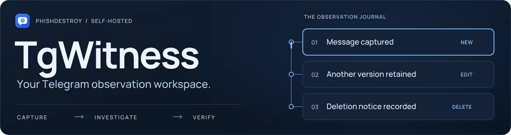
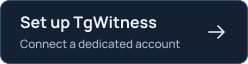
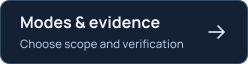

<picture>
  <source media="(max-width: 640px) and (prefers-reduced-motion: reduce)" srcset="docs/assets/presentation/repository-cover-mobile.svg">
  <source media="(prefers-reduced-motion: reduce)" srcset="docs/assets/presentation/repository-cover-static.svg">
  <source media="(max-width: 640px)" srcset="docs/assets/presentation/repository-cover-mobile.webp">
  
</picture>

<p align="center">
  <a href="https://phishdestroy.github.io/TgWitness/demo/"></a>
  <a href="https://phishdestroy.github.io/TgWitness/demo/guide.html"></a>
  <a href="https://phishdestroy.github.io/TgWitness/guides/modes.html"></a>
</p>

<p align="center">Capture conversations, preserve observed changes and hand over a verifiable record.<br>Your accounts, on your own computer or server.</p>

<p align="center"><a href="https://phishdestroy.github.io/TgWitness/">Website</a> &nbsp; · &nbsp; <a href="docs/README.md">Documentation</a> &nbsp; · &nbsp; <a href="https://github.com/phishdestroy/TgWitness/wiki">Wiki</a> &nbsp; · &nbsp; <a href="#off-site-copy--s3">S3 & recovery</a></p>

<p align="center"><sub><a href="docs/CHANGELOG.md">v0.6.1 · pre-release</a> &nbsp; / &nbsp; Python 3.11+ &nbsp; / &nbsp; 13 interface languages · 26 guide languages &nbsp; / &nbsp; <a href="LICENSE">MIT</a></sub></p>

## Inside the workspace

Read a conversation, expand its saved versions and review deletion notices in context.

<a href="https://phishdestroy.github.io/TgWitness/demo/">
<picture>
  <source media="(max-width: 640px) and (prefers-reduced-motion: reduce) and (prefers-color-scheme: dark)" srcset="docs/assets/presentation/readme-workspace-mobile-dark-still.webp">
  <source media="(max-width: 640px) and (prefers-reduced-motion: reduce)" srcset="docs/assets/presentation/readme-workspace-mobile-light-still.webp">
  <source media="(prefers-reduced-motion: reduce) and (prefers-color-scheme: dark)" srcset="docs/assets/presentation/readme-workspace-dark-still.webp">
  <source media="(prefers-reduced-motion: reduce)" srcset="docs/assets/presentation/readme-workspace-light-still.webp">
  <source media="(max-width: 640px) and (prefers-color-scheme: dark)" srcset="docs/assets/presentation/readme-workspace-mobile-dark.webp">
  <source media="(max-width: 640px)" srcset="docs/assets/presentation/readme-workspace-mobile-light.webp">
  <source media="(prefers-color-scheme: dark)" srcset="docs/assets/presentation/readme-workspace-dark.webp">
  
</picture>
</a>

<p align="center"><sub>Recorded from the application with fictional data. Conversation → saved edits → deletion notices.<br><a href="https://phishdestroy.github.io/TgWitness/demo/">Open the interactive demo ↗</a></sub></p>

## What you can do

<table>
<tr>
<td width="50%" valign="top">
<h3>01 &nbsp; Choose your scope</h3>
<p>Observe chosen chats, a Telegram folder or a dedicated account. Investigation mode adds source profiles and an initial history snapshot.</p>
<p><a href="docs/COLLECTION.md">Collection modes →</a></p>
</td>
<td width="50%" valign="top">
<h3>02 &nbsp; Keep observed changes</h3>
<p>Retain captured message versions, deletion notices and original attachment bytes. Review capture gaps alongside the record.</p>
<p><a href="docs/EVIDENCE.md">Events and coverage →</a></p>
</td>
</tr>
<tr>
<td width="50%" valign="top">
<h3>03 &nbsp; Follow connections</h3>
<p>Search saved conversations, inspect profiles across chats and trace shared files and extracted leads back to their source records.</p>
<p><a href="docs/INVESTIGATION.md">Investigation tools →</a></p>
</td>
<td width="50%" valign="top">
<h3>04 &nbsp; Record your actions</h3>
<p>Send replies, follow supported bot buttons and preview Telegram links from the panel. Requests and results enter the signed journal.</p>
<p><a href="docs/INVESTIGATION.md">Panel interactions →</a></p>
</td>
</tr>
<tr>
<td width="50%" valign="top">
<h3>05 &nbsp; Hand over a record</h3>
<p>Export a signed ZIP with records, preserved files and an offline report. A recipient can check it with a separately trusted key and checkpoint.</p>
<p><a href="#export-and-verify">Export and verify →</a></p>
</td>
<td width="50%" valign="top">
<h3>06 &nbsp; Keep an off-site copy</h3>
<p>Encrypt the journal and files before upload to S3-compatible storage. Retain the recovery key and verify the copy before restoring it.</p>
<p><a href="#off-site-copy--s3">S3 and recovery →</a></p>
</td>
</tr>
</table>

**Four collection choices. Eight verification layers.** [Explore modes, scenarios and their limits →](https://phishdestroy.github.io/TgWitness/guides/modes.html)

<a name="screenshots"></a>

<details>
<summary><strong>More of the interface</strong> — sources, saved versions, exports and the journal</summary>

| Compare captured versions | Choose what to observe |
| --- | --- |
| [](docs/assets/detail.png) | [](docs/assets/sources.png) |
| **Prepare a signed handoff** | **Review the observation journal** |
| [](docs/assets/exports.png) | [](docs/assets/workspace-dark.png) |

All screenshots use fictional demonstration data. Open an image for its full-size view.

</details>

## Off-site copy · S3

**The storage provider receives encrypted objects.** The journal, preserved photos and
files, checkpoints with their timestamps, and completed chat exports are encrypted
on your machine with **AES-256-GCM** before upload.

| Keep | Recover |
| --- | --- |
| AWS S3 or another S3-compatible service | Restore to an empty directory with the downloaded recovery key |
| Separate destination and encryption key per workspace | Verify the journal, checkpoints and preserved media before publishing restored files |
| Object Lock retention, where supported by the bucket | Reject inconsistent, incomplete or altered material |

Configure it under **Exports → Off-site copy**. It is off by default. Keep the
downloaded key separately: the encrypted copy cannot be read without it.

[**S3 setup and recovery →**](https://phishdestroy.github.io/TgWitness/docs/exports/#s3) · [Verification details](docs/EVIDENCE.md#off-site-copy-and-restore-s3) · [Full service backups](docs/wiki/Backup-and-Recovery.md)

<details>
<summary><strong>See the S3 controls</strong> — destination, schedule, retention and recovery key</summary>


The off-site copy preserves collected material. Keep a separate service backup for
account sessions, configuration and signing secrets.

</details>

## Export and verify

**One handoff, independently checked.** Each recorded event links to the previous
SHA-256 hash and carries an Ed25519 signature. The signed ZIP manifest binds the
exported files together.

| Layer | What the recipient can check |
| --- | --- |
| **Record + package** | Event signatures, hash links, file hashes and the signed manifest |
| **Retained checkpoint** | Whether the export agrees with a boundary previously kept outside the collector |
| **External time + witness** | Timestamp proofs and observations signed by a separately operated witness |
| **Coverage + provenance** | Reported gaps, captured counts and self-reported program measurements |

With a trusted copy of TgWitness installed:

```sh
python -m tgwitness.verify evidence.zip --fingerprint TRUSTED_SHA256 --checkpoint checkpoint.json
```

Use a fingerprint and checkpoint obtained independently. Take the verifier from a
trusted copy, rather than the archive being checked.

[Evidence model](docs/EVIDENCE.md) · [Timestamps](docs/TIMESTAMP.md) · [Independent witness](docs/WITNESS.md) · [Public Proof monitor](docs/PROOF.md) · [Hardened deployment](docs/HIGH-ASSURANCE.md)

<details>
<summary><strong>See how verification works</strong> — linked events, changed content and retained checkpoints</summary>

<picture>
  <source media="(prefers-reduced-motion: reduce)" srcset="docs/assets/presentation/evidence-chain-static.svg">
  
</picture>

<picture>
  <source media="(prefers-reduced-motion: reduce)" srcset="docs/assets/presentation/evidence-tamper-static.svg">
  
</picture>

<picture>
  <source media="(prefers-reduced-motion: reduce)" srcset="docs/assets/presentation/evidence-checkpoint-static.svg">
  
</picture>

[Evidence model and formulas](docs/HOW-IT-WORKS.md) · [Interactive explanation](https://phishdestroy.github.io/TgWitness/docs/concepts/) · [Films and static alternatives](docs/SHOWCASE.md)

</details>

## Run it on your machine

[Download the source](https://github.com/phishdestroy/TgWitness/archive/refs/heads/main.zip),
unpack it and install **Python 3.11+**. The launcher prepares the environment.

| | Windows | Linux / macOS |
| --- | --- | --- |
| **Try fictional records** | Double-click `scripts\Demo.cmd` | `sh start.sh --demo` |
| **Connect your account** | Double-click `Start.cmd` | `sh start.sh` |

Open **http://127.0.0.1:8787**. For a connected account, the panel token is in
`data/live/panel-token.txt`. Stop the demo before starting live mode.

[**Setup guide →**](https://phishdestroy.github.io/TgWitness/demo/guide.html) · [Dedicated account](https://phishdestroy.github.io/TgWitness/demo/dedicated-account.html) · [Docker & servers](docs/DEPLOYMENT.md) · [Tested environments](docs/VERIFICATION.md)

## Know the boundaries

- **Visible to the connected account.** No secret chats or automatic access to private sources.
- **Observed, not reconstructed.** No capture during downtime; recovery can leave gaps and miss intermediate edits.
- **Integrity relative to a trusted key.** Signatures do not prove Telegram origin, complete delivery, the truth of a message or a person's identity.
- **Separate trust where needed.** An operator with the signing key can sign fabricated input. Independent witnesses and timestamps constrain later changes; they do not establish source truth.
- **Use a dedicated account.** Telegram can restrict accounts for request volume. Two workspaces on one machine are not two independent witnesses.

[Collection limits](docs/COLLECTION.md) · [Evidence and trust boundaries](docs/EVIDENCE.md) · [Security](.github/SECURITY.md)

## Find your next step

| Start collecting | Investigate & verify | Operate & recover |
| --- | --- | --- |
| [Connect an account](https://github.com/phishdestroy/TgWitness/wiki/Accounts) | [Work across chats](docs/INVESTIGATION.md) | [Server & Docker](docs/DEPLOYMENT.md) |
| [Choose sources](docs/COLLECTION.md) | [Export & verify](docs/EVIDENCE.md) | [S3 copy & recovery](https://phishdestroy.github.io/TgWitness/docs/exports/#s3) |
| [Configure a proxy](https://github.com/phishdestroy/TgWitness/wiki/Proxies) | [Witness & Proof](docs/wiki/Witness-and-Proof.md) | [Troubleshooting](https://github.com/phishdestroy/TgWitness/wiki/Troubleshooting) |

[All Wiki pages](https://github.com/phishdestroy/TgWitness/wiki) · [Offline handbook](docs/wiki/Home.md) · [Technical reference](docs/README.md) · [Setup guides in 26 languages](https://phishdestroy.github.io/TgWitness/demo/guide.html)

<!-- operator-notice:start -->

## Licence and operator notice

[MIT License](LICENSE) · [Our position on Taylor Wessing](docs/TAYLOR-WESSING-EXCLUSION.md)

> **NOTICE — Operator Incompatibility**
> Our statement on **Taylor Wessing PartG mbB — German core, Hamburg office.**
> [Full notice](docs/OPERATOR-INCOMPATIBILITY.md) · [Original text](NOTICE) · [Source record](https://phishdestroy.io/steam_dossier/taylor_wessing)

<details>
<summary><strong>Read the complete notice</strong></summary>

<p>This is our position as the authors of TgWitness. It is not a condition of the MIT License.</p>

<blockquote>
<p>This software produces SHA-256 hash chains and Ed25519 signatures. Its output is designed to be verifiable by any third party, in any jurisdiction, without reference to the authority of the person who produced it.</p>
<p>It is therefore structurally incompatible with the following operator, its successors, affiliates, rebrandings, spin-outs and personnel:</p>
<p>Taylor Wessing PartG mbB — German core, Hamburg office.</p>
<p>Including, without limitation:</p>
<ul><li>Dr. Tobias Schelinski (signatory, doc. 42282474)</li><li>Dr. Patrick Vincent Zurheide (signatory, doc. 42603633)</li></ul>
<p>The incompatibility is evidentiary, not technical.</p>
<p>Under the signature of the above:</p>
<ul><li>94.28 % of a GDPR Art. 15 disclosure (70,717 words) was transmitted under black overlays that did not delete the underlying text;</li><li>page 444, first visible row, carried the slur &quot;pidor&quot; in plain text, from a firm publicly ranked Stonewall Top 100;</li><li>50 retained &quot;reports&quot; were submitted as proof of user misconduct at Jaccard 1.000, joint probability 1e-153, dated after the account was already blocked;</li><li>on personal notice of the exposure, the response on record was: &quot;amusing&quot;;</li><li>twelve months later, no Art. 33 filing, no Art. 34 notice, no remediation;</li><li>GDPR Art. 17 was then invoked — not to protect a data subject, but to delist the reporting of the above.</li></ul>
<p>The founder of the residual structure is documented in the Reichstags-Handbuch 1938, p. 223 — NSDAP № 1,033,215, member of the Criminal Law Commission that rewrote § 175, the statute under which men were sent to the camps with a pink triangle. The English heritage left on 1 June 2026 as Winston Taylor. What remains is addressed here.</p>
<p>A workflow whose output is required to contradict its input has no use for this software. The only configuration in which this software behaves as designed in that environment is: unavailable.</p>
<p>Mathematik verhandelt nicht.</p>
</blockquote>

</details>

<!-- operator-notice:end -->

<details>
<summary><strong>Repository map</strong> — source, deployment and contribution guides</summary>

| Directory | Contents |
| --- | --- |
| [`tgwitness/`](tgwitness/README.md) | Application, collector, journal, verifier and web panel |
| [`docs/`](docs/README.md) | Guides, Wiki source, screenshots and verification record |
| [`deploy/`](deploy/README.md) | Compose configurations and service templates |
| [`scripts/`](scripts/README.md) | Demo, setup and Docker launchers |
| [`tests/`](tests/README.md) | Synthetic regression tests |
| [`tools/`](tools/README.md) | Builds, checks and packaging |
| [`website/`](website/README.md) | Documentation website and translations |
| [`.github/`](.github/AUTOMATION.md) | Workflows and contribution guides |

[Complete project guide](docs/PROJECT-GUIDE.md) · [Technical documentation](docs/README.md)

</details>

<details>
<summary>Read the project overview in your language</summary>

**English** · [Русский](docs/ru/README.md) · [Українська](docs/uk/README.md) · [Español](docs/es/README.md) · [Português (Brasil)](docs/pt/README.md) · [Türkçe](docs/tr/README.md) · [العربية](docs/ar/README.md) · [فارسی](docs/fa/README.md) · [اردو](docs/ur/README.md) · [हिन्दी](docs/hi/README.md) · [Bahasa Indonesia](docs/id/README.md) · [Tiếng Việt](docs/vi/README.md) · [简体中文](docs/zh/README.md)

</details>


<p align="center"><sub>Built by <a href="https://github.com/phishdestroy">PhishDestroy</a> &nbsp; · &nbsp; <a href=".github/CONTRIBUTING.md">Contribute</a> &nbsp; · &nbsp; <a href=".github/SUPPORT.md">Get help</a> &nbsp; · &nbsp; <a href=".github/SECURITY.md">Security</a></sub></p>
