<picture>
  <source media="(max-width: 640px) and (prefers-reduced-motion: reduce)" srcset="docs/assets/presentation/casework-hero-mobile-static.svg">
  <source media="(prefers-reduced-motion: reduce)" srcset="docs/assets/presentation/casework-hero-static.svg">
  <source media="(max-width: 640px)" srcset="docs/assets/presentation/casework-hero-mobile.svg">
  
</picture>

<p align="center">
  <a href="https://tgwitness-demo.destroy.tools/"><picture><source media="(max-width: 640px)" srcset="docs/assets/presentation/readme-nav-live-mobile.svg"></picture></a>
  <a href="#quick-start"><picture><source media="(max-width: 640px)" srcset="docs/assets/presentation/readme-nav-download-mobile.svg"></picture></a>
  <a href="https://github.com/phishdestroy/TgWitness/wiki"><picture><source media="(max-width: 640px)" srcset="docs/assets/presentation/readme-nav-handbook-mobile.svg"></picture></a>
</p>

<p align="center"><strong>Your Telegram investigation, from the first capture to a verified handoff.</strong><br>Save conversations, connect the findings and keep a record others can check.</p>

<p align="center">
  <a href="docs/CHANGELOG.md"></a>
  <a href="docs/VERIFICATION.md"></a>
  
  <a href="LICENSE"></a>
</p>

<a name="what-tgwitness-does"></a>

## Why TgWitness

- **[Keep the history as it changes](docs/COLLECTION.md).** Capture messages, observed edits and deletion notices. Earlier captured versions stay in your journal.
- **[Share an archive others can verify](docs/wiki/Exports-and-Verification.md).** Signed, hash-linked records, preserved files and an offline verifier travel together.
- **[Turn conversations into a case](docs/INVESTIGATION-MODE.md).** Search saved chats, follow subjects and watchlist matches, and connect findings on a Case Board with journal references.
- **[Choose what to collect](docs/COLLECTION-MODES.md).** Export accessible history or follow selected chats. Each account has its own workspace, journal and signing key.
- **[Add independent checks](docs/EVIDENCE.md).** Retained checkpoints, external timestamps and optional GitHub Actions or Intel TDX capture provide additional checks on the recorded evidence.
- **[Run it on your infrastructure](docs/SECURITY-MODEL.md).** Self-hosted, with encrypted session storage, a localhost panel by default and no telemetry.

> **3,598,381 records · 48 verified archives.** A documented public-history run on 6 November 2026. [Read the measurements, setup and verification results →](docs/EXPORT-BENCHMARK-2026-11-06.md)

<p align="center"><strong>ZERO TRUST.</strong> TgWitness takes no side: the same checks apply to the operator, to PhishDestroy and to anyone else.<br>Only what a third party or the math confirms counts. <a href="docs/QUESTIONS-AND-CHECKS.md">Questions and checks</a></p>

## See it in action

- **[Watch live capture ↗](https://tgwitness-demo.destroy.tools/)** — a public, read-only view of incoming messages, masked edits and deletion notices.
- **[Explore the interactive workspace ↗](https://phishdestroy.github.io/TgWitness/demo/)** — open a fictional case, compare captured versions and explore exports. No Telegram login needed.

<a name="screenshots"></a>

<a href="https://phishdestroy.github.io/TgWitness/demo/">
<picture>
  <source media="(max-width: 640px) and (prefers-reduced-motion: reduce)" srcset="docs/assets/presentation/readme-workspace-mobile-dark-still.webp">
  <source media="(prefers-reduced-motion: reduce)" srcset="docs/assets/presentation/readme-workspace-dark-still.webp">
  <source media="(max-width: 640px)" srcset="docs/assets/presentation/readme-workspace-mobile-dark.webp">
  
</picture>
</a>

<p align="center"><sub>Explore the actual interface with fictional records. Click the workspace to try it.</sub></p>

<p align="center"><picture><source media="(prefers-reduced-motion: reduce)" srcset="docs/assets/presentation/readme-divider-static.svg"></picture></p>

<a name="quick-start"></a>
<a name="run-it-on-your-machine"></a>

## Install

Python included. Use the same commands to update.

**Linux / macOS**

```sh
curl -fsSL https://get.destroy.tools/install.sh | bash
```

**Windows · PowerShell or CMD**

```powershell
powershell.exe -NoProfile -ExecutionPolicy Bypass -Command "irm https://get.destroy.tools/install.ps1 | iex"
```

<sub>Ubuntu server: run as root. Desktop: run as your normal user. `-ExecutionPolicy Bypass` applies to this one PowerShell process.</sub>

Signed builds come from the public [Installer workflow](.github/workflows/installer.yml), and the installer checks the SHA-256 and RSA signature of every package before installing.

[Verify the script first](docs/INSTALLATION.md#verify-before-running) · [First setup](docs/SETTINGS.md) · [Releases](https://github.com/phishdestroy/TgWitness/releases) · [Docker](docs/DEPLOYMENT.md)

<details>
<summary><strong>How the installer and your data are protected</strong></summary>

`get.destroy.tools` is the project's download site. The public
[Installer workflow](.github/workflows/installer.yml) builds it from
[`deploy/installer/`](deploy/installer/README.md) for the exact `main` revision,
publishes it after the Linux and Windows installation tests pass, and signs the
installer scripts and application packages with the release key in
[`release-signing.pub`](deploy/installer/release-signing.pub). The installer checks
the SHA-256 and RSA signature of the package and dependency lock before installing.
To check the script itself first, download it with its signature and run the
[verify-first commands](docs/INSTALLATION.md#verify-before-running). A failed build
keeps the previous download; installed panels update when you rerun the installer.
GitHub [Releases](https://github.com/phishdestroy/TgWitness/releases), source and
[Docker](docs/DEPLOYMENT.md) are the other ways to install.

**Your sessions and data.** TgWitness runs on your computer or server, and the panel
listens on localhost by default. Telegram sessions, proxy credentials and access-token
hashes are stored in each workspace's encrypted vault, with an optional
[external master key](docs/SECURITY-MODEL.md#external-master-key). The application
has no telemetry. It connects to Telegram and to the services its settings use:
public MTProxy lists, your proxies, S3 storage, a witness bot, timestamp
authorities, AI providers and webhooks. The [System map](docs/SYSTEM-MAP.md) lists
the connections the application process makes.
Observe with a [dedicated Telegram account](https://phishdestroy.github.io/TgWitness/docs/dedicated-account/).

The version badge describes this source tree. Installable builds are listed under
[Releases](https://github.com/phishdestroy/TgWitness/releases); a feature merged into
`main` reaches those downloads with the next release.

[Setup & panel access](docs/INSTALLATION.md) ·
[Signatures & SHA-256](https://get.destroy.tools/#verification) ·
[Update](docs/INSTALLATION.md#update-an-existing-installation) ·
[Current capabilities and qualification](docs/STATUS.md) ·
[Choose a collection method](docs/COLLECTION-MODES.md)

</details>

<p align="center"><picture><source media="(prefers-reduced-motion: reduce)" srcset="docs/assets/presentation/readme-divider-static.svg"></picture></p>

<a name="how-it-works"></a>

## A record someone else can check

Check it without an account or an install. The published sample carries its own verifier:

```sh
curl -LO https://phishdestroy.github.io/TgWitness/demo/downloads/tgwitness-demo.zip
unzip -o tgwitness-demo.zip verify.py        # the verifier ships inside the archive
python verify.py tgwitness-demo.zip          # Python 3.11+, needs only `cryptography`
```

It prints the signed records, the head hash and the signer fingerprint and exits `0`.
The sample is fictional; the same verifier runs on any real export.

An export carries the messages, files and the verifier. Send the recipient your
key fingerprint through another channel and they can check it themselves:

```sh
python -m tgwitness.verify evidence.zip --fingerprint TRUSTED_SHA256 --tsa-ca TSA-ROOT.pem --require evidence
```

The verifier checks the signatures, the journal chain, the file list and the attachments.
For evidence it needs your key fingerprint and a third-party time stamp covering the last
record, such as an RFC 3161 time stamp checked against the authority's root certificate.

**Where the messages come from.** TgWitness receives them from Telegram over the
account's encrypted MTProto session, as the official apps do, and signs each one into the
journal as it arrives. [GitHub Actions capture](docs/SEALED-ACTIONS.md) and
[Phala Intel TDX](docs/HIGH-ASSURANCE.md) also attest the collector that received them.

<picture>
  <source media="(max-width: 640px) and (prefers-reduced-motion: reduce)" srcset="docs/assets/presentation/casework-chain-mobile-static.svg">
  <source media="(prefers-reduced-motion: reduce)" srcset="docs/assets/presentation/casework-chain-static.svg">
  <source media="(max-width: 640px)" srcset="docs/assets/presentation/casework-chain-mobile.svg">
  
</picture>

[Archive verification](docs/wiki/Exports-and-Verification.md) · [Evidence format](docs/EVIDENCE.md) · [Independent witness](docs/WITNESS.md) · [External timestamps](docs/TIMESTAMP.md) · [Checks and tested scale](docs/VERIFICATION.md)

<p align="center"><picture><source media="(prefers-reduced-motion: reduce)" srcset="docs/assets/presentation/readme-divider-static.svg"></picture></p>

## From a conversation to a case

<picture>
  <source media="(max-width: 640px) and (prefers-reduced-motion: reduce)" srcset="docs/assets/presentation/readme-features-mobile-static.svg">
  <source media="(prefers-reduced-motion: reduce)" srcset="docs/assets/presentation/readme-features-static.svg">
  <source media="(max-width: 640px)" srcset="docs/assets/presentation/readme-features-mobile.svg">
  
</picture>

<p align="center">
  <a href="docs/wiki/Chat-Export.md"><picture><source media="(max-width: 640px)" srcset="docs/assets/presentation/readme-nav-export-mobile.svg"></picture></a>
  <a href="docs/INVESTIGATION.md"><picture><source media="(max-width: 640px)" srcset="docs/assets/presentation/readme-nav-investigate-mobile.svg"></picture></a>
  <a href="docs/COLLECTION.md"><picture><source media="(max-width: 640px)" srcset="docs/assets/presentation/readme-nav-history-mobile.svg"></picture></a>
</p>

Two ways to use it: [export your account](docs/ACCOUNT-EXPORT.md) once, or
[follow an investigation](docs/INVESTIGATION.md) and keep saving changes.
Pick a few chats, a Telegram folder or the whole account. Each account gets its
own workspace, session and signing key.

<p align="center"><picture><source media="(prefers-reduced-motion: reduce)" srcset="docs/assets/presentation/readme-divider-static.svg"></picture></p>

## Explore more

<details>
<summary><strong>Measured exports · 6 November 2026</strong> · 56,329 messages, both archives verified</summary>

**56,329 messages exported in two fresh runs.** Both signed archives passed verification with pinned collector keys.

[](https://phishdestroy.github.io/TgWitness/docs/validation/)

| Run | Messages | Collection time | Collection speed | Complete export | End-to-end speed |
| --- | ---: | ---: | ---: | ---: | ---: |
| Server A | 27,030 | 189.043 s | **142.983 messages/s** | 211.647 s | 127.713 messages/s |
| Server B | 29,299 | 182.513 s | **160.531 messages/s** | 206.650 s | 141.781 messages/s |

Text and metadata through WARP, two accounts per server, no attachments or reused records.
Measured on revision [`92e539af`](https://github.com/phishdestroy/TgWitness/commit/92e539af40d8368d198ff5e040f1d876f2c1310e).
Each published run lists its source revision, workload, timings and verification result:
[workload, timings and verification](docs/EXPORT-BENCHMARK-2026-11-06.md). Changes to `main`
run the public [CI workflows](.github/workflows/README.md), including Linux and Windows
installer tests and the standalone verifier build.

[**Explore the English demo →**](https://phishdestroy.github.io/TgWitness/demo/?lang=en) ·
[**Measurements, dates and method →**](https://phishdestroy.github.io/TgWitness/docs/validation/) ·
[Download a fictional sample export](https://phishdestroy.github.io/TgWitness/demo/downloads/tgwitness-demo.zip) ·
[Signed English audit](website/validation/audit/REPORT.md)

</details>

<a name="start-simple"></a>

<details>
<summary><strong>Start simple. See every route.</strong> · first start and the system map</summary>

<picture>
  <source media="(max-width: 640px) and (prefers-reduced-motion: reduce)" srcset="docs/assets/presentation/readme-start-map-mobile-static.svg">
  <source media="(prefers-reduced-motion: reduce)" srcset="docs/assets/presentation/readme-start-map-static.svg">
  <source media="(max-width: 640px)" srcset="docs/assets/presentation/readme-start-map-mobile.svg">
  
</picture>

The first start asks one question: **Just download**, **Follow chats** or
**Evidence for a case**. The answer sets the goal and the interface level, so the
panel shows only the sections that task needs. Connection, Telegram sign-in and
the chat choice follow in five stages. The connection check runs by itself, and
route options open only when it fails. Expert tools stay one switch away.

The **System map** shows how the installation reaches Telegram and outside
services: panel access, each account's route and Telegram target, the journal and
witness path, and the latest network observations. A missing observation is
labelled as missing.

[First setup](docs/SETTINGS.md) · [System map](docs/SYSTEM-MAP.md)

</details>

<details>
<summary><strong>Built for the rest of the investigation</strong> · subject cards, watchlists, wallets, online watch, court documents</summary>

<picture>
  <source media="(max-width: 640px) and (prefers-reduced-motion: reduce)" srcset="docs/assets/presentation/readme-capabilities-mobile-static.svg">
  <source media="(prefers-reduced-motion: reduce)" srcset="docs/assets/presentation/readme-capabilities-static.svg">
  <source media="(max-width: 640px)" srcset="docs/assets/presentation/readme-capabilities-mobile.svg">
  
</picture>

<p align="center">
  <a href="docs/INVESTIGATION.md#4-connect-observations-across-chats"><picture><source media="(max-width: 640px)" srcset="docs/assets/presentation/readme-nav-people-mobile.svg"></picture></a>
  <a href="docs/COLLECTION.md#act-from-the-panel"><picture><source media="(max-width: 640px)" srcset="docs/assets/presentation/readme-nav-bots-mobile.svg"></picture></a>
</p>
<p align="center">
  <a href="https://phishdestroy.github.io/TgWitness/docs/archive/"><picture><source media="(max-width: 640px)" srcset="docs/assets/presentation/readme-nav-archive-mobile.svg"></picture></a>
  <a href="docs/HIGH-ASSURANCE.md"><picture><source media="(max-width: 640px)" srcset="docs/assets/presentation/readme-nav-cloud-mobile.svg"></picture></a>
</p>

<picture>
  <source media="(max-width: 640px) and (prefers-reduced-motion: reduce)" srcset="docs/assets/presentation/readme-documentation-mobile-static.svg">
  <source media="(prefers-reduced-motion: reduce)" srcset="docs/assets/presentation/readme-documentation-static.svg">
  <source media="(max-width: 640px)" srcset="docs/assets/presentation/readme-documentation-mobile.svg">
  
</picture>

**Document the conversation.** Start a record for a chat in the **Documentation**
drawer and every step writes itself: panel actions, replies with the delay before
them, edits, deletion notices, notes and AI drafts. Each step cites its journal
record and SHA-256. Fixing the document signs it and writes the statement hash into
the journal.

| | |
| --- | --- |
| [Subject cards](docs/INVESTIGATION-MODE.md#subject-cards) | Profile snapshots of a bot, person, channel or group with Telegram's BOT, VERIFIED, SCAM and FAKE labels; a later snapshot lists what changed |
| [Conversation plans](docs/INVESTIGATION-MODE.md#conversation-plans) | Goals for the payment route, infrastructure or people, prepared messages, reply times, activity by hour and the other side's writing style |
| [Translation](docs/INVESTIGATION-MODE.md#machine-translation) | Shown under the original with languages, model and journal record |
| [Watchlists](docs/INVESTIGATION-MODE.md#watchlists) | Words, patterns, wallets, @usernames, IDs, domains, phones and links, matched in text, edits, hidden link targets, bot buttons, QR codes and OCR |
| [Online watch](docs/INVESTIGATION-MODE.md#online-watch) | Checks every 1–60 minutes, up to 100 accounts per request, with a pattern by hour and weekday |
| [Codes and wallets](docs/INVESTIGATION-MODE.md#codes-in-images) | Payment QR codes; EVM addresses checked against EIP-55, TON in raw form, XRP Ledger checksums, payment links with chain, amount and token |
| [Client traces](docs/INVESTIGATION-MODE.md#what-a-client-and-an-upload-time-show) | Encoder traces of round videos and voice messages; upload time against send time exposes pre-recorded "live" proof |
| [Cover and authority](docs/INVESTIGATION-MODE.md#cover-and-authority) | Personas, authorisations and an undercover activity record that flags messages outside the authorised chats or period |
| [Account control](docs/INVESTIGATION-MODE.md#account-control) | Profile and privacy editing with before/after records, an exposure check and offline right after each action |
| [Documents for court](docs/INVESTIGATION-MODE.md#documents-for-court) | BagIt case package with a Rule 902(13)/(14) certification template, exhibit index, request annex and WebVTT/SRT captions for screen recordings |

Content marked 18+, violence or personal data stays in the court copy, sealed with
AES-256-GCM; the keys travel separately.

[Export settings](docs/EXPORT_HASHES.md) cover regular API and Takeout acquisition,
message history before attachments, file downloads or server hashes, and compatible
Telegram Desktop JSON/HTML views. [Distributed chat export](docs/DISTRIBUTED-EXPORT.md#history-acquisition)
offers an opt-in Takeout path for public history, signed checkpoints every 100 messages,
and recovery within a range using the same account; its
[performance design](docs/FAST-ACQUISITION.md) lists the tested acquisition behavior
and the planned live measurements.

</details>

<details>
<summary><strong>Everything else</strong> · history, accounts, proxies, AI, integrations</summary>

| | |
| --- | --- |
| [Load older messages](docs/HISTORY.md) | Pull past history of selected chats, pause and resume any time |
| [Several accounts](docs/ACCOUNTS.md#multiple-accounts) | Separate workspaces, each with its own Telegram session, journal and signing key |
| [Batch import](docs/ACCOUNTS.md#bulk-import-and-account-groups) | Drop in a pile of session files, sort accounts into groups with shared settings |
| [MTProxy pool](docs/wiki/Proxies.md#pool-dashboard-and-custom-sources) | Ping, countries, filters, your own lists |
| [Existing sessions](docs/ACCOUNTS.md) | TData, Telethon, Pyrogram, StringSession, auth key or a `key:DC` line; optional independent QR authorization from an imported donor |
| [Account security](docs/ACCOUNTS.md#create-an-independent-authorization) | Alerts for new sessions, ending other sessions, an only-session mode that also sets a two-step password, and a [witness probe](docs/ACCOUNTS.md#witness-probe) that notices when live updates stop reaching this session |
| [Resumable chat export](docs/EXPORT_HASHES.md#restricted-github-capture-and-single-chat-export) | A stopped export keeps a signed partial copy: resume it, start over or download what was saved |
| [Proxies](docs/CONNECTION-SECURITY.md#ip-modes) | SOCKS5, HTTP CONNECT or MTProxy per workspace. **Hide IP** never falls back to direct |
| [Search and AI](docs/ANALYSIS.md) | Local search, optional AI with sources you can check |
| [Full-text search](docs/SEARCH.md) | Word forms, exact phrases, domains, @usernames and Chinese without spaces, best matches first (**Preview**) |
| [MCP](docs/MCP.md) | Read-only access for MCP clients, limited to the chats you pick |
| [Command line](docs/CLI.md) | `search`, `context`, `messages`, `stats` and JSON Lines `export` with `--json` for scripts and agents, locally or with a scoped token (**Preview**) |
| [OCR and transcription](docs/MEDIA-ANALYSIS.md) | Runs locally, originals stay untouched |
| [Independent capture](docs/OPTIONAL-CAPTURE.md) | Optional browser/AyuGram recorders under **More tools → Extras** (preview, off by default) |
| [Trusted Live](docs/TRUSTED-LIVE.md) | Official Desktop/Web session, guarded video and native-export continuity analysis (preview; live qualification pending) |
| [Sealed official Web](docs/OFFICIAL-WITNESS.md) | Fresh official browser on GitHub Actions, restricted controls, signed video and independently expected source/settings |
| [Webhooks](docs/WEBHOOKS.md) | Signed outgoing events with retries, n8n example included |
| [Shared access](docs/ACCESS.md) | Give someone selected chats only, with expiry and IP limits |
| [Missing message numbers](docs/EVIDENCE.md#missing-message-numbers-gap_summary) | Numbers Telegram assigned that were never observed, per channel and for the whole account, in coverage, reports and MCP (**Preview**) |
| [Chat state snapshots](docs/COLLECTION.md) | Periodic signed snapshots of title, description, pins, administrators and gifts, with what changed (**Preview**) |
| [System map](docs/SYSTEM-MAP.md) | Live map of panel access, account routes, Telegram targets and outside services, with the latest 200 of up to 2,000 network observations |

</details>

<details>
<summary><strong>Choose what backs the record</strong> · local, audited cloud, GitHub Actions or Intel TDX</summary>

Run locally, add an audited cloud deployment, or collect inside a **Phala Cloud
confidential VM with Intel TDX**. Each option keeps the signed journal; the extra
checks address the environment where it was collected.

<picture>
  <source media="(max-width: 640px) and (prefers-reduced-motion: reduce)" srcset="docs/assets/presentation/casework-assurance-mobile-static.svg">
  <source media="(prefers-reduced-motion: reduce)" srcset="docs/assets/presentation/casework-assurance-static.svg">
  <source media="(max-width: 640px)" srcset="docs/assets/presentation/casework-assurance-mobile.svg">
  
</picture>

The TDX verifier checks the quote against Intel's pinned root and revocation data,
binds it to a signed collector statement and a fresh challenge, and compares the
measured OS and application with independently expected inputs. The report lists
each result separately, so the measured environment, collector identity, capture
records and coverage can be reviewed together.

**Capture with GitHub provenance** (preview). Collect a chat on a GitHub-hosted runner
with a pinned TgWitness and a fresh Telegram session, then download the encrypted
archive with its GitHub attestation. The verifier checks the approved workflow and
collector version, the archive digest, the journal and attachments. Also available
under **Exports** in the panel.
[Open the capture page](https://phishdestroy.github.io/TgWitness/docs/capture/) · [Instructions](docs/SEALED-ACTIONS.md)

For live observation, history or a one-off export, choose a
[collection method](docs/COLLECTION-MODES.md). Private cloud chats are available
when the connected account can access them. The published application also includes
[Secret Chat integration](docs/PSEUDO-SECRET.md): install the optional protocol
dependency and enable it per account to record chats created or accepted there.
See [collection scope](docs/COLLECTION.md) for the available acquisition paths.

[Phala / Intel TDX and audited deployments](docs/HIGH-ASSURANCE.md) ·
[Live Phala qualification](docs/VERIFICATION.md#live-phala-cloud-deployment--4-november-2026) ·
[Trust boundaries](docs/SECURITY-MODEL.md)

</details>

<!-- authors-manifesto:start -->

<a name="manifesto"></a>

<details>
<summary><strong>Check the capture and the saved record</strong> · what the recipient verifies and the Export Clinic</summary>

<picture>
  <source media="(max-width: 640px)" srcset="docs/assets/presentation/readme-manifesto-mobile.svg">
  
</picture>

TgWitness records content delivered to the connected Telegram account, with
chat, message and sender identifiers, captured versions and collection metadata.
The archive brings those records, preserved attachments and verification data
together for review.

| Check | What the recipient verifies |
| --- | --- |
| Signed journal and manifest | Record signatures, the hash chain and delivered files against the expected signing key. |
| Separately retained checkpoint | The journal against a previously recorded length and head hash. |
| Independent witness | The journal against checkpoints retained by a separate witness. |
| GitHub Actions capture | The archive against its attestation, approved hosted workflow and collector version. |

[Export Clinic](https://phishdestroy.github.io/TgWitness/docs/export-clinic/)
shows a Telegram conversation beside deliberately altered Desktop export files.
Compare the versions, inspect the changes, and follow the collection and
verification steps for a signed TgWitness archive.

[Verification steps](docs/wiki/Exports-and-Verification.md) ·
[GitHub capture](docs/SEALED-ACTIONS.md) ·
[Technical trust model](docs/SECURITY-MODEL.md)

</details>

<!-- authors-manifesto:end -->

<a name="operations"></a>
<a name="layout-review"></a>

<details>
<summary><strong>Keep the investigation running</strong> · notifications, storage and recovery</summary>

<picture>
  <source media="(max-width: 640px) and (prefers-reduced-motion: reduce)" srcset="docs/assets/presentation/readme-services-mobile-static.svg">
  <source media="(prefers-reduced-motion: reduce)" srcset="docs/assets/presentation/readme-services-static.svg">
  <source media="(max-width: 640px)" srcset="docs/assets/presentation/readme-services-mobile.svg">
  
</picture>

[Notifications](docs/OPERATIONS.md#notifications) · [Encrypted off-site copy](docs/wiki/Off-site-Copy.md) · [Backup and recovery](docs/wiki/Backup-and-Recovery.md) · [Troubleshooting](docs/OPERATIONS.md)

<p align="center">
  <a href="https://phishdestroy.github.io/TgWitness/docs/start/"><picture><source media="(max-width: 640px)" srcset="docs/assets/presentation/readme-nav-setup-mobile.svg"></picture></a>
  <a href="https://phishdestroy.github.io/TgWitness/docs/dedicated-account/"><picture><source media="(max-width: 640px)" srcset="docs/assets/presentation/readme-nav-account-mobile.svg"></picture></a>
  <a href="docs/DEPLOYMENT.md"><picture><source media="(max-width: 640px)" srcset="docs/assets/presentation/readme-nav-deploy-mobile.svg"></picture></a>
</p>

</details>

<a name="repository-map"></a>

<details>
<summary><strong>Explore the repository</strong> · where the code, docs and tools live</summary>

| Directory | Start here |
| --- | --- |
| [docs/](docs/README.md) | Setup, investigation workflows and technical reference |
| [tgwitness/](tgwitness/README.md) | Main application, collector, journal and web panel |
| [tgwitness_capture/](tgwitness_capture/README.md) | Independent recorders and their verification code |
| [addons/](addons/README.md) | Optional capture installation, configuration and tests |
| [deploy/](deploy/README.md) | Installers, containers and background services |
| [examples/](examples/README.md) | Account-export and sealed-capture configurations |
| [integrations/](integrations/README.md) | Signed webhooks and an n8n receiver |
| [.agents/](.agents/README.md) | Task instructions for reading the archive through the CLI |
| [scripts/](scripts/README.md) | Launchers and CI utilities |
| [tools/](tools/README.md) | Builds, checks and packaging |
| [website/](website/README.md) | Public site, translated guides and interactive demo |
| [.github/](.github/AUTOMATION.md) | Workflows, contribution guidelines and support |

[Complete project guide](docs/PROJECT-GUIDE.md) ·
[Contributing](.github/CONTRIBUTING.md) · [Get help](.github/SUPPORT.md)

</details>

<!-- operator-notice:start -->

<a href="docs/OPERATOR-INCOMPATIBILITY.md">
<picture>
  <source media="(max-width: 640px) and (prefers-reduced-motion: reduce)" srcset="docs/assets/presentation/readme-gdpr-impunity-mobile-static.svg">
  <source media="(prefers-reduced-motion: reduce)" srcset="docs/assets/presentation/readme-gdpr-impunity-static.svg">
  <source media="(max-width: 640px)" srcset="docs/assets/presentation/readme-gdpr-impunity-mobile.svg">
  
</picture>
</a>

[Read the operator notice →](docs/OPERATOR-INCOMPATIBILITY.md) · [Source record](https://phishdestroy.io/steam_dossier/taylor_wessing)

<!-- operator-notice:end -->

<details>
<summary><strong>Read the project overview in your language</strong></summary>

**English** · [Русский](docs/ru/README.md) · [Українська](docs/uk/README.md) · [Español](docs/es/README.md) · [Português (Brasil)](docs/pt/README.md) · [Türkçe](docs/tr/README.md) · [العربية](docs/ar/README.md) · [فارسی](docs/fa/README.md) · [اردو](docs/ur/README.md) · [हिन्दी](docs/hi/README.md) · [Bahasa Indonesia](docs/id/README.md) · [Tiếng Việt](docs/vi/README.md) · [简体中文](docs/zh/README.md) · [繁體中文](docs/zh-Hant/README.md) · [Français](docs/fr/README.md) · [Deutsch](docs/de/README.md) · [Italiano](docs/it/README.md) · [Polski](docs/pl/README.md) · [O‘zbekcha](docs/uz/README.md) · [한국어](docs/ko/README.md) · [日本語](docs/ja/README.md) · [Bahasa Melayu](docs/ms/README.md) · [ไทย](docs/th/README.md) · [עברית](docs/he/README.md) · [বাংলা](docs/bn/README.md) · [አማርኛ](docs/am/README.md)

</details>

<p align="center">
  <a href="docs/README.md"></a>
  <a href="https://github.com/phishdestroy/TgWitness/wiki"></a>
  <a href="https://github.com/phishdestroy"></a>
  <a href=".github/CONTRIBUTING.md"></a>
  <a href=".github/SUPPORT.md"></a>
  <a href=".github/SECURITY.md"></a>
</p>

[Machine-readable project index](llms.txt) · [Complete text handbook](https://phishdestroy.github.io/TgWitness/llms-full.txt) · [Repository rules for agents](AGENTS.md)
