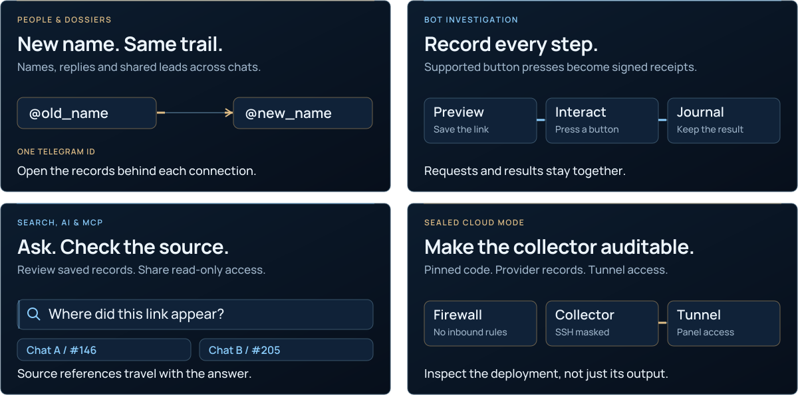

<picture>
  <source media="(max-width: 640px) and (prefers-reduced-motion: reduce)" srcset="docs/assets/presentation/casework-hero-mobile-static.svg">
  <source media="(prefers-reduced-motion: reduce)" srcset="docs/assets/presentation/casework-hero-static.svg">
  <source media="(max-width: 640px)" srcset="docs/assets/presentation/casework-hero-mobile.svg">
  
</picture>

<p align="center">
  <a href="https://phishdestroy.github.io/TgWitness/demo/"><picture><source media="(max-width: 640px)" srcset="docs/assets/presentation/readme-nav-demo-mobile.svg"></picture></a>
  <a href="#quick-start"><picture><source media="(max-width: 640px)" srcset="docs/assets/presentation/readme-nav-download-mobile.svg"></picture></a>
  <a href="https://github.com/phishdestroy/TgWitness/wiki"><picture><source media="(max-width: 640px)" srcset="docs/assets/presentation/readme-nav-handbook-mobile.svg"></picture></a>
</p>

<p align="center"><strong>Your Telegram investigation workspace.</strong><br>Export chats, preserve observed changes and trace connections back to the source.<br>Self-hosted. Separate accounts. Signed handoffs.</p>

<p align="center">
  <a href="docs/CHANGELOG.md"></a>
  <a href="docs/VERIFICATION.md"></a>
  
  <a href="LICENSE"></a>
</p>

<a name="screenshots"></a>

<a href="https://phishdestroy.github.io/TgWitness/demo/">
<picture>
  <source media="(max-width: 640px) and (prefers-reduced-motion: reduce) and (prefers-color-scheme: dark)" srcset="docs/assets/presentation/readme-workspace-mobile-dark-still.webp">
  <source media="(max-width: 640px) and (prefers-reduced-motion: reduce)" srcset="docs/assets/presentation/readme-workspace-mobile-light-still.webp">
  <source media="(prefers-reduced-motion: reduce) and (prefers-color-scheme: dark)" srcset="docs/assets/presentation/readme-workspace-dark-still.webp">
  <source media="(prefers-reduced-motion: reduce)" srcset="docs/assets/presentation/readme-workspace-light-still.webp">
  <source media="(max-width: 640px) and (prefers-color-scheme: dark)" srcset="docs/assets/presentation/readme-workspace-mobile-dark.webp">
  <source media="(max-width: 640px)" srcset="docs/assets/presentation/readme-workspace-mobile-light.webp">
  <source media="(prefers-color-scheme: dark)" srcset="docs/assets/presentation/readme-workspace-dark.webp">
  
</picture>
</a>

<p align="center"><sub>Explore the actual interface with fictional records. Click the workspace to try it.</sub></p>

<p align="center"><picture><source media="(prefers-reduced-motion: reduce)" srcset="docs/assets/presentation/readme-divider-static.svg"></picture></p>

## From a conversation to a case

<picture>
  <source media="(max-width: 640px) and (prefers-reduced-motion: reduce)" srcset="docs/assets/presentation/readme-features-mobile-static.svg">
  <source media="(prefers-reduced-motion: reduce)" srcset="docs/assets/presentation/readme-features-static.svg">
  <source media="(max-width: 640px)" srcset="docs/assets/presentation/readme-features-mobile.svg">
  
</picture>

<p align="center">
  <a href="docs/wiki/Chat-Export.md"><picture><source media="(max-width: 640px)" srcset="docs/assets/presentation/readme-nav-export-mobile.svg"></picture></a>
  <a href="docs/INVESTIGATION.md"><picture><source media="(max-width: 640px)" srcset="docs/assets/presentation/readme-nav-investigate-mobile.svg"></picture></a>
  <a href="docs/COLLECTION.md"><picture><source media="(max-width: 640px)" srcset="docs/assets/presentation/readme-nav-history-mobile.svg"></picture></a>
</p>

**Choose your scope:** selected chats, a Telegram folder or the whole account.
Keep each account in its own workspace, with separate sources, session and signing key.

## Built for the rest of the investigation

<picture>
  <source media="(max-width: 640px) and (prefers-reduced-motion: reduce)" srcset="docs/assets/presentation/readme-capabilities-mobile-static.svg">
  <source media="(prefers-reduced-motion: reduce)" srcset="docs/assets/presentation/readme-capabilities-static.svg">
  <source media="(max-width: 640px)" srcset="docs/assets/presentation/readme-capabilities-mobile.svg">
  
</picture>

<p align="center">
  <a href="docs/INVESTIGATION.md#4-connect-observations-across-chats"><picture><source media="(max-width: 640px)" srcset="docs/assets/presentation/readme-nav-people-mobile.svg"></picture></a>
  <a href="docs/COLLECTION.md#act-from-the-panel"><picture><source media="(max-width: 640px)" srcset="docs/assets/presentation/readme-nav-bots-mobile.svg"></picture></a>
</p>
<p align="center">
  <a href="https://phishdestroy.github.io/TgWitness/docs/archive/"><picture><source media="(max-width: 640px)" srcset="docs/assets/presentation/readme-nav-archive-mobile.svg"></picture></a>
  <a href="docs/HIGH-ASSURANCE.md"><picture><source media="(max-width: 640px)" srcset="docs/assets/presentation/readme-nav-cloud-mobile.svg"></picture></a>
</p>

**Current source adds more:** load the history of enabled chats with pause/resume,
review sources before asking AI, connect read-only MCP clients, run local OCR or
transcription, and send HMAC-signed webhooks. The 0.7.0 portable preview predates
these additions; use `main` to try them.

<details>
<summary><strong>Pick the tools for your case</strong> · history, accounts, media and integrations</summary>

| Task | What you get |
| --- | --- |
| [Load older messages](docs/HISTORY.md) | Enabled sources → workspace history, with pause/resume and a signed progress report. |
| [Export with several accounts](docs/ACCOUNTS.md#multiple-accounts) | Split one chat's acquisition across eligible accounts; each keeps its own session and signing key. |
| [Import a batch of accounts](docs/ACCOUNTS.md#bulk-import-and-account-groups) | Pair session files automatically, see each login result and organize workspaces into groups with shared settings. |
| [Manage the MTProxy pool](docs/wiki/Proxies.md#pool-dashboard-and-custom-sources) | Ping, countries, filters and your own lists; one shared catalog with separate account routes. |
| [Bring an existing session](docs/ACCOUNTS.md) | Telegram Desktop TData, Telethon, Pyrogram, StringSession or an auth key. |
| [Route through a proxy](docs/CONNECTION-SECURITY.md#ip-modes) | Per-workspace SOCKS5, HTTP CONNECT or MTProxy. **Hide IP** mode refuses direct fallback. |
| [Search and review](docs/ANALYSIS.md) | Local search, optional AI, cited observations and separate analytical reports. |
| [Connect via MCP](docs/MCP.md) | Seven read-only tools, selected workspaces/chats, expiry and revocation. |
| [Read images and audio](docs/MEDIA-ANALYSIS.md) | Optional local OCR and transcription; original files stay unchanged. |
| [Send webhooks](docs/WEBHOOKS.md) | Scoped outgoing events, HMAC signatures, retries and an n8n example. |
| [Share a focused view](docs/ACCESS.md) | Selected accounts/chats, permissions, expiry and IP restrictions. |

</details>

<p align="center"><picture><source media="(prefers-reduced-motion: reduce)" srcset="docs/assets/presentation/readme-divider-static.svg"></picture></p>

<a name="quick-start"></a>
<a name="run-it-on-your-machine"></a>

## Your first capture

**Windows portable:** [download TgWitness 0.7.0](https://github.com/phishdestroy/TgWitness/releases/download/v0.7.0/TgWitness-0.7.0-windows-amd64-portable.zip),
extract it and run **`TgWitness.cmd`**. Python is included.

**From source:** [download the source](https://github.com/phishdestroy/TgWitness/archive/refs/heads/main.zip)
with **Python 3.11+** installed. The launcher prepares the environment.

| | Windows | Linux / macOS |
| --- | --- | --- |
| Try the demo | `scripts\Demo.cmd` | `sh start.sh --demo` |
| Connect Telegram | `Start.cmd` | `sh start.sh` |

Open **http://127.0.0.1:8787**. Use a separate Telegram account. Stop the demo before
starting live mode; the live panel token is in `data/live/panel-token.txt`.

<p align="center">
  <a href="https://phishdestroy.github.io/TgWitness/docs/start/"><picture><source media="(max-width: 640px)" srcset="docs/assets/presentation/readme-nav-setup-mobile.svg"></picture></a>
  <a href="https://phishdestroy.github.io/TgWitness/docs/dedicated-account/"><picture><source media="(max-width: 640px)" srcset="docs/assets/presentation/readme-nav-account-mobile.svg"></picture></a>
  <a href="docs/DEPLOYMENT.md"><picture><source media="(max-width: 640px)" srcset="docs/assets/presentation/readme-nav-deploy-mobile.svg"></picture></a>
</p>

<details>
<summary><strong>Export through GitHub Actions</strong> · preview</summary>

Run the pinned collector from your fork, select one chat and download an encrypted
archive with GitHub provenance. The capture helper is also available under
**Exports** in the panel.

[Open the capture page](https://phishdestroy.github.io/TgWitness/docs/capture/) · [Instructions](docs/SEALED-ACTIONS.md) · [Русский](docs/ru/SEALED-ACTIONS.md)

</details>

<p align="center"><picture><source media="(prefers-reduced-motion: reduce)" srcset="docs/assets/presentation/readme-divider-static.svg"></picture></p>

<a name="how-it-works"></a>

## A record someone else can check

Export the observations and preserved files together. Give the recipient an
independently trusted key fingerprint and checkpoint to verify the handoff.

```sh
python -m tgwitness.verify evidence.zip --fingerprint TRUSTED_SHA256 --checkpoint checkpoint.json
```

Verification checks integrity against those trusted inputs. A local signing key
alone does not prove Telegram origin or complete history.

[Verification guide](docs/TRUST.md) · [Checks and tested scale](docs/VERIFICATION.md)

<details>
<summary><strong>Inside the signed record</strong> · hashes, signatures and independent checkpoints</summary>

<picture>
  <source media="(max-width: 640px) and (prefers-reduced-motion: reduce)" srcset="docs/assets/presentation/casework-chain-mobile-static.svg">
  <source media="(prefers-reduced-motion: reduce)" srcset="docs/assets/presentation/casework-chain-static.svg">
  <source media="(max-width: 640px)" srcset="docs/assets/presentation/casework-chain-mobile.svg">
  
</picture>

[Evidence format](docs/EVIDENCE.md) · [Independent witness](docs/WITNESS.md) · [External timestamps](docs/TIMESTAMP.md)

</details>

<a name="operations"></a>
<a name="layout-review"></a>

<details>
<summary><strong>Keep the investigation running</strong> · notifications, storage and recovery</summary>

<picture>
  <source media="(max-width: 640px) and (prefers-reduced-motion: reduce)" srcset="docs/assets/presentation/readme-services-mobile-static.svg">
  <source media="(prefers-reduced-motion: reduce)" srcset="docs/assets/presentation/readme-services-static.svg">
  <source media="(max-width: 640px)" srcset="docs/assets/presentation/readme-services-mobile.svg">
  
</picture>

[Notifications](docs/OPERATIONS.md#notifications) · [Encrypted off-site copy](docs/wiki/Off-site-Copy.md) · [Backup and recovery](docs/wiki/Backup-and-Recovery.md) · [Troubleshooting](docs/OPERATIONS.md)

</details>

TgWitness can only collect what the connected account can access. It cannot recover
unseen deleted messages or Secret Chats; downtime may leave gaps.

<p align="center">
  <a href="docs/README.md"></a>
  <a href="https://github.com/phishdestroy/TgWitness/wiki"></a>
  <a href="docs/VERIFICATION.md"></a>
</p>

<p align="center"><picture><source media="(prefers-reduced-motion: reduce)" srcset="docs/assets/presentation/readme-divider-static.svg"></picture></p>

<!-- operator-notice:start -->

<details>
<summary><strong>⚖️ Ethical Notice &amp; Historical Continuity</strong></summary>

We have recently learned that for certain law firms—and specifically Dr. Tobias Schelinski and Dr. Patrick Vincent Zurheide—mathematics and objective facts are irrelevant.

Selling GDPR non-compliance to corporations as a commercial service while failing at basic data handling yourselves is not legal expertise.

Operating under the delusion that you are the law, or that an elite signature on a falsified claim magically turns a lie into truth, does not mask technical incompetence.

This tool is incompatible with jurisdictions where the following prevail:

- Corporatocracy
- Privatized or commercial justice
- Plutocracy
- Kleptocracy and institutional corruption

A special mention to Dr. Patrick Zurheide, Dr. Tobias Schelinski, and those attempting to weaponize the "Right to be Forgotten" to bury their own data-processing failures, sanitize their institutional lineage, and erase the historical record:

> Taylor Wessing (Dr. Tobias Schelinski & Dr. Patrick Vincent Zurheide) → Wessing & Berenberg-Gossler → Stonewall Top 100 → Dr. Graf von der Goltz Dr. Wessing & Partner (since 1957) → Rüdiger Graf von der Goltz → Paragraph 175 in its 1935 revision

To strictly comply with the MIT License, we do not restrict the use of this software. However, let it be clear: corporate retainers, legal intimidation, and demands for digital erasure cannot override history, rewrite lineage, or conceal the truth.

[Source record](https://phishdestroy.io/steam_dossier/taylor_wessing)

[MIT License](LICENSE) · [Technical notice](docs/OPERATOR-INCOMPATIBILITY.md) · [Original NOTICE](NOTICE)

</details>

<!-- operator-notice:end -->

<a name="repository-map"></a>

<details>
<summary><strong>Repository map</strong> — source, deployment and contribution guides</summary>

| Directory | Contents |
| --- | --- |
| [`tgwitness/`](tgwitness/README.md) | Application, collector, journal, verifier and web panel |
| [`docs/`](docs/README.md) | Guides, Wiki source, screenshots and verification record |
| [`deploy/`](deploy/README.md) | Compose configurations and service templates |
| [`scripts/`](scripts/README.md) | Demo, setup and Docker launchers |
| [`tools/`](tools/README.md) | Builds, checks and packaging |
| [`website/`](website/README.md) | Documentation website and translations |
| [`.github/`](.github/AUTOMATION.md) | Workflows and contribution guides |

[Complete project guide](docs/PROJECT-GUIDE.md) · [Technical documentation](docs/README.md)

</details>

<details>
<summary><strong>Read the project overview in your language</strong></summary>

**English** · [Русский](docs/ru/README.md) · [Українська](docs/uk/README.md) · [Español](docs/es/README.md) · [Português (Brasil)](docs/pt/README.md) · [Türkçe](docs/tr/README.md) · [العربية](docs/ar/README.md) · [فارسی](docs/fa/README.md) · [اردو](docs/ur/README.md) · [हिन्दी](docs/hi/README.md) · [Bahasa Indonesia](docs/id/README.md) · [Tiếng Việt](docs/vi/README.md) · [简体中文](docs/zh/README.md)

</details>


<p align="center">
  <a href="https://github.com/phishdestroy"></a>
  <a href=".github/CONTRIBUTING.md"></a>
  <a href=".github/SUPPORT.md"></a>
  <a href=".github/SECURITY.md"></a>
</p>
