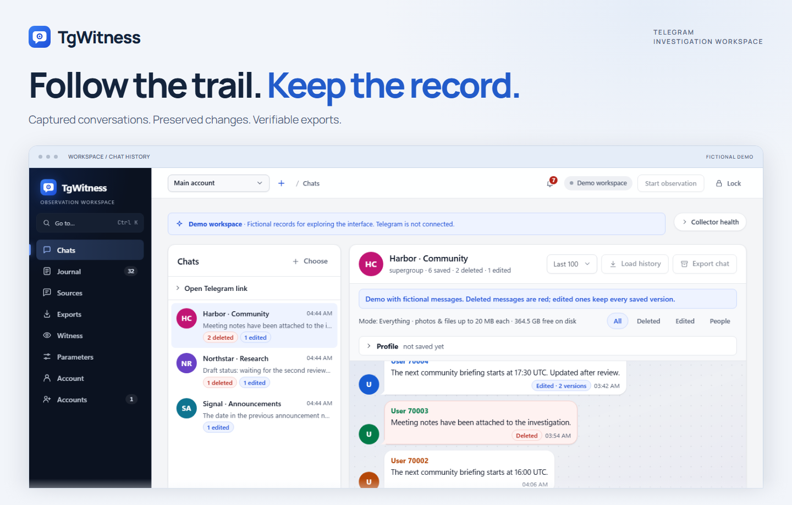

<picture>
  <source media="(max-width: 640px) and (prefers-color-scheme: dark)" srcset="docs/assets/presentation/readme-product-mobile-dark.png">
  <source media="(max-width: 640px)" srcset="docs/assets/presentation/readme-product-mobile-light.png">
  <source media="(prefers-color-scheme: dark)" srcset="docs/assets/presentation/readme-product-dark.png">
  
</picture>

  <a href="https://phishdestroy.github.io/TgWitness/demo/"><strong>Open live demo ↗</strong></a> &nbsp;&nbsp; · &nbsp;&nbsp;
  <a href="https://phishdestroy.github.io/TgWitness/docs/">Documentation</a> &nbsp;&nbsp; · &nbsp;&nbsp;
  <a href="https://github.com/phishdestroy/TgWitness/wiki">Wiki</a> &nbsp;&nbsp; · &nbsp;&nbsp;
  <a href="#quick-start">Install</a>

Self-hosted &nbsp; / &nbsp; 13 interface languages &nbsp; / &nbsp; Python 3.11+ &nbsp; / &nbsp; <a href="docs/CHANGELOG.md">v0.6.1 · pre-release</a>

TgWitness is a Telegram investigation workspace. Capture conversations your account observes,
keep their changes, and export a record another person can verify.

## Watch it work

**01 / From sources to a signed handoff**

https://github.com/user-attachments/assets/caeec3e4-6156-4f3e-a840-d4c2f346717e

12 seconds · Illustrated workflow · Silent · <a href="docs/assets/presentation/investigation-overview.mp4">Download MP4</a>

**02 / A message changes. Its captured history stays.**

https://github.com/user-attachments/assets/ab0f56e8-1834-47ce-9fff-c88dc5887389

12 seconds · Concept film · Silent · <a href="docs/assets/presentation/message-history.mp4">Download MP4</a> · <a href="docs/SHOWCASE.md">Full film gallery →</a>

## Capture → investigate → verify

- **Capture.** Observe selected chats, a folder or a dedicated account. Retain captured messages, versions and attachments.
- **Investigate.** Search across conversations, compare edits and follow people, files and cited timelines.
- **Verify.** Prepare signed exports, an offline report and a standalone verifier for the handoff.

<strong>Explore the interface</strong> — edits, sources, exports and the journal

| Compare captured versions | Choose what to observe |
| --- | --- |
|  |  |
| **Prepare a signed export** | **Review the observation journal** |
|  |  |

[Full workspace: light](docs/assets/chats.png) · [Dark](docs/assets/chats-dark.png) · [Interactive demo](https://phishdestroy.github.io/TgWitness/demo/)

Screens and films use fictional records. The films illustrate the workflow; the screenshots show the application.

## Quick start

**Explore first:** [open the read-only demo](https://phishdestroy.github.io/TgWitness/demo/). No installation or Telegram account needed.

**Run locally:** [download the source](https://github.com/phishdestroy/TgWitness/archive/refs/heads/main.zip), unpack it and install **Python 3.11+**.

| Windows | Linux / macOS |
| --- | --- |
| Double-click **`scripts\Demo.cmd`** | Run **`sh start.sh --demo`** |

The launcher prepares the environment. Open **http://127.0.0.1:8787**.

To connect your own account, stop the demo and run `Start.cmd` or `sh start.sh`.
Follow [account setup](https://github.com/phishdestroy/TgWitness/wiki/Accounts); the panel token is in `data/live/panel-token.txt`.
Use a dedicated account you can afford to lose.

[Installation & Docker →](docs/QUICKSTART.md) &nbsp; · &nbsp; [Tested environments →](docs/VERIFICATION.md)

## Your next step

| Task | Handbook |
| --- | --- |
| **Set up** | [Accounts](https://github.com/phishdestroy/TgWitness/wiki/Accounts) · [Proxies](https://github.com/phishdestroy/TgWitness/wiki/Proxies) · [Server & Docker](https://github.com/phishdestroy/TgWitness/wiki/Server-and-Docker) |
| **Investigate** | [Choose sources](https://github.com/phishdestroy/TgWitness/wiki/Collection) · [Work a case](https://github.com/phishdestroy/TgWitness/wiki/Investigations) · [Export & verify](https://github.com/phishdestroy/TgWitness/wiki/Exports-and-Verification) |
| **Maintain** | [Backups](https://github.com/phishdestroy/TgWitness/wiki/Backup-and-Recovery) · [Troubleshooting](https://github.com/phishdestroy/TgWitness/wiki/Troubleshooting) · [Offline handbook](docs/wiki/Home.md) |

Verification establishes **integrity relative to a trusted key**. It does not prove Telegram origin,
complete capture or the truth of the content. [Evidence model →](docs/HOW-IT-WORKS.md)

<!-- operator-notice:start -->

## Licence and operator notice

[TgWitness Restricted License](LICENSE) · [Taylor Wessing use restriction](docs/TAYLOR-WESSING-EXCLUSION.md)

> **NOTICE — Operator Incompatibility**
> PhishDestroy's statement concerning **Taylor Wessing PartG mbB — German core, Hamburg office.**
> [Full notice and context](docs/OPERATOR-INCOMPATIBILITY.md) · [Original text](NOTICE) · [Source record](https://phishdestroy.io/steam_dossier/taylor_wessing)

<strong>Read the complete notice</strong> — statement by PhishDestroy

The following records the maintainer's statement and allegations, not an independent judicial or regulatory finding. The operative use restriction is in the licence linked above.

<blockquote lang="en" dir="ltr" translate="no">

This software produces SHA-256 hash chains and Ed25519 signatures. Its output is designed to be verifiable by any third party, in any jurisdiction, without reference to the authority of the person who produced it.

It is therefore structurally incompatible with the following operator, its successors, affiliates, rebrandings, spin-outs and personnel:

Taylor Wessing PartG mbB — German core, Hamburg office.

Including, without limitation:

<ul><li>Dr. Tobias Schelinski (signatory, doc. 42282474)</li><li>Dr. Patrick Vincent Zurheide (signatory, doc. 42603633)</li></ul>

The incompatibility is evidentiary, not technical.

Under the signature of the above:

<ul><li>94.28 % of a GDPR Art. 15 disclosure (70,717 words) was transmitted under black overlays that did not delete the underlying text;</li><li>page 444, first visible row, carried the slur &quot;pidor&quot; in plain text, from a firm publicly ranked Stonewall Top 100;</li><li>50 retained &quot;reports&quot; were submitted as proof of user misconduct at Jaccard 1.000, joint probability 1e-153, dated after the account was already blocked;</li><li>on personal notice of the exposure, the response on record was: &quot;amusing&quot;;</li><li>twelve months later, no Art. 33 filing, no Art. 34 notice, no remediation;</li><li>GDPR Art. 17 was then invoked — not to protect a data subject, but to delist the reporting of the above.</li></ul>

The founder of the residual structure is documented in the Reichstags-Handbuch 1938, p. 223 — NSDAP № 1,033,215, member of the Criminal Law Commission that rewrote § 175, the statute under which men were sent to the camps with a pink triangle. The English heritage left on 1 June 2026 as Winston Taylor. What remains is addressed here.

A workflow whose output is required to contradict its input has no use for this software. The only configuration in which this software behaves as designed in that environment is: unavailable.

Mathematik verhandelt nicht. Diese Lizenz auch nicht.

</blockquote>

<!-- operator-notice:end -->

## Repository map

<strong>Repository map</strong> — source, deployment and contribution guides

| Directory | Contents |
| --- | --- |
| [`tgwitness/`](tgwitness/README.md) | Application, collector, journal, verifier and web panel |
| [`docs/`](docs/README.md) | Guides, Wiki source, screenshots and verification record |
| [`deploy/`](deploy/README.md) | Compose configurations and service templates |
| [`scripts/`](scripts/README.md) | Demo, setup and Docker launchers |
| [`tests/`](tests/README.md) | Synthetic regression tests |
| [`tools/`](tools/README.md) | Builds, checks and packaging |
| [`website/`](website/README.md) | Documentation website and translations |
| [`.github/`](.github/AUTOMATION.md) | Workflows and contribution guides |

[Complete project guide](docs/PROJECT-GUIDE.md) · [Technical documentation](docs/README.md)

Read the project overview in your language

**English** · [Русский](docs/ru/README.md) · [Українська](docs/uk/README.md) · [Español](docs/es/README.md) · [Português (Brasil)](docs/pt/README.md) · [Türkçe](docs/tr/README.md) · [العربية](docs/ar/README.md) · [فارسی](docs/fa/README.md) · [اردو](docs/ur/README.md) · [हिन्दी](docs/hi/README.md) · [Bahasa Indonesia](docs/id/README.md) · [Tiếng Việt](docs/vi/README.md) · [简体中文](docs/zh/README.md)

Built by <a href="https://github.com/phishdestroy">PhishDestroy</a> &nbsp; · &nbsp; <a href=".github/CONTRIBUTING.md">Contribute</a> &nbsp; · &nbsp; <a href=".github/SUPPORT.md">Get help</a> &nbsp; · &nbsp; <a href=".github/SECURITY.md">Security</a>

