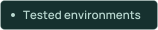
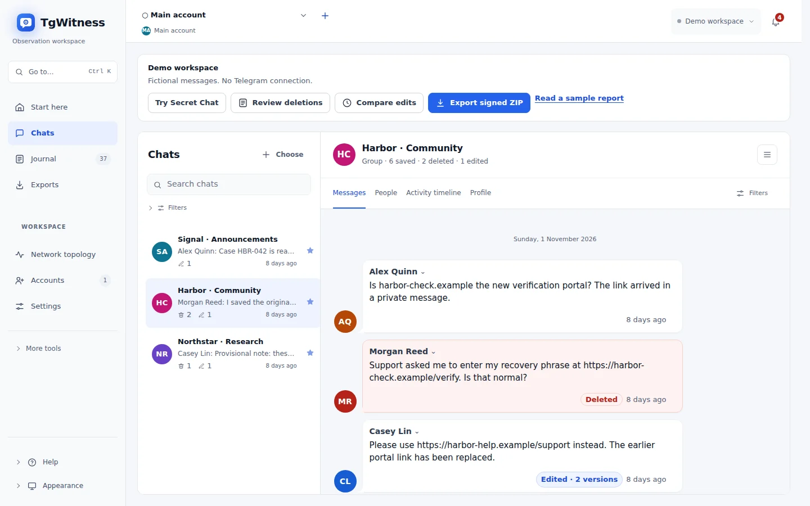
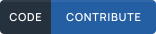

<picture>
  <source media="(max-width: 640px) and (prefers-reduced-motion: reduce)" srcset="docs/assets/presentation/casework-hero-mobile-static.svg">
  <source media="(prefers-reduced-motion: reduce)" srcset="docs/assets/presentation/casework-hero-static.svg">
  <source media="(max-width: 640px)" srcset="docs/assets/presentation/casework-hero-mobile.svg">
  
</picture>

<p align="center">
  <a href="https://phishdestroy.github.io/TgWitness/demo/"><picture><source media="(max-width: 640px)" srcset="docs/assets/presentation/readme-nav-demo-mobile.svg"></picture></a>
  <a href="#quick-start"><picture><source media="(max-width: 640px)" srcset="docs/assets/presentation/readme-nav-download-mobile.svg"></picture></a>
  <a href="https://github.com/phishdestroy/TgWitness/wiki"><picture><source media="(max-width: 640px)" srcset="docs/assets/presentation/readme-nav-handbook-mobile.svg"></picture></a>
</p>

<p align="center"><strong>Self-hosted workspace for Telegram investigations.</strong><br>Save chats, keep edits and deletions, see who's connected to whom<br>and hand over signed exports anyone can check.</p>

<p align="center">
  <a href="docs/CHANGELOG.md"></a>
  <a href="docs/VERIFICATION.md"></a>
  
  <a href="LICENSE"></a>
</p>

<a name="quick-start"></a>
<a name="run-it-on-your-machine"></a>

## Install

Python included. Use the same commands to update.

**Linux / macOS**

```sh
curl -fsSL https://get.destroy.tools/install.sh | bash
```

**Windows · PowerShell or CMD**

```powershell
powershell.exe -NoProfile -ExecutionPolicy Bypass -Command "irm https://get.destroy.tools/install.ps1 | iex"
```

<sub>Ubuntu server: run as root. Desktop: run as your normal user.</sub>

[Setup & panel access](docs/INSTALLATION.md) ·
[Signatures & SHA-256](https://get.destroy.tools/#verification) ·
[Update](docs/INSTALLATION.md#update-an-existing-installation) ·
[ZIP downloads](https://github.com/phishdestroy/TgWitness/releases)

<a name="screenshots"></a>

<a href="https://phishdestroy.github.io/TgWitness/demo/">
<picture>
  <source media="(max-width: 640px) and (prefers-reduced-motion: reduce) and (prefers-color-scheme: dark)" srcset="docs/assets/presentation/readme-workspace-mobile-dark-still.webp">
  <source media="(max-width: 640px) and (prefers-reduced-motion: reduce)" srcset="docs/assets/presentation/readme-workspace-mobile-light-still.webp">
  <source media="(prefers-reduced-motion: reduce) and (prefers-color-scheme: dark)" srcset="docs/assets/presentation/readme-workspace-dark-still.webp">
  <source media="(prefers-reduced-motion: reduce)" srcset="docs/assets/presentation/readme-workspace-light-still.webp">
  <source media="(max-width: 640px) and (prefers-color-scheme: dark)" srcset="docs/assets/presentation/readme-workspace-mobile-dark.webp">
  <source media="(max-width: 640px)" srcset="docs/assets/presentation/readme-workspace-mobile-light.webp">
  <source media="(prefers-color-scheme: dark)" srcset="docs/assets/presentation/readme-workspace-dark.webp">
  
</picture>
</a>

<p align="center"><sub>Explore the actual interface with fictional records. Click the workspace to try it.</sub></p>

<p align="center"><picture><source media="(prefers-reduced-motion: reduce)" srcset="docs/assets/presentation/readme-divider-static.svg"></picture></p>

## From a conversation to a case

<picture>
  <source media="(max-width: 640px) and (prefers-reduced-motion: reduce)" srcset="docs/assets/presentation/readme-features-mobile-static.svg">
  <source media="(prefers-reduced-motion: reduce)" srcset="docs/assets/presentation/readme-features-static.svg">
  <source media="(max-width: 640px)" srcset="docs/assets/presentation/readme-features-mobile.svg">
  
</picture>

<p align="center">
  <a href="docs/wiki/Chat-Export.md"><picture><source media="(max-width: 640px)" srcset="docs/assets/presentation/readme-nav-export-mobile.svg"></picture></a>
  <a href="docs/INVESTIGATION.md"><picture><source media="(max-width: 640px)" srcset="docs/assets/presentation/readme-nav-investigate-mobile.svg"></picture></a>
  <a href="docs/COLLECTION.md"><picture><source media="(max-width: 640px)" srcset="docs/assets/presentation/readme-nav-history-mobile.svg"></picture></a>
</p>

Two ways to use it: [export your account](docs/ACCOUNT-EXPORT.md) once, or
[follow an investigation](docs/INVESTIGATION.md) and keep saving changes.
Pick a few chats, a Telegram folder or the whole account. Each account gets its
own workspace, session and signing key.

## Built for the rest of the investigation

<picture>
  <source media="(max-width: 640px) and (prefers-reduced-motion: reduce)" srcset="docs/assets/presentation/readme-capabilities-mobile-static.svg">
  <source media="(prefers-reduced-motion: reduce)" srcset="docs/assets/presentation/readme-capabilities-static.svg">
  <source media="(max-width: 640px)" srcset="docs/assets/presentation/readme-capabilities-mobile.svg">
  
</picture>

<p align="center">
  <a href="docs/INVESTIGATION.md#4-connect-observations-across-chats"><picture><source media="(max-width: 640px)" srcset="docs/assets/presentation/readme-nav-people-mobile.svg"></picture></a>
  <a href="docs/COLLECTION.md#act-from-the-panel"><picture><source media="(max-width: 640px)" srcset="docs/assets/presentation/readme-nav-bots-mobile.svg"></picture></a>
</p>
<p align="center">
  <a href="https://phishdestroy.github.io/TgWitness/docs/archive/"><picture><source media="(max-width: 640px)" srcset="docs/assets/presentation/readme-nav-archive-mobile.svg"></picture></a>
  <a href="docs/HIGH-ASSURANCE.md"><picture><source media="(max-width: 640px)" srcset="docs/assets/presentation/readme-nav-cloud-mobile.svg"></picture></a>
</p>

<details>
<summary><strong>Everything else</strong> · history, accounts, proxies, AI, integrations</summary>

| | |
| --- | --- |
| [Load older messages](docs/HISTORY.md) | Pull past history of selected chats, pause and resume any time |
| [Several accounts](docs/ACCOUNTS.md#multiple-accounts) | Export one chat through several accounts, each with its own session and key |
| [Batch import](docs/ACCOUNTS.md#bulk-import-and-account-groups) | Drop in a pile of session files, sort accounts into groups with shared settings |
| [MTProxy pool](docs/wiki/Proxies.md#pool-dashboard-and-custom-sources) | Ping, countries, filters, your own lists |
| [Existing sessions](docs/ACCOUNTS.md) | TData, Telethon, Pyrogram, StringSession, auth key |
| [Proxies](docs/CONNECTION-SECURITY.md#ip-modes) | SOCKS5, HTTP CONNECT or MTProxy per workspace. **Hide IP** never falls back to direct |
| [Search and AI](docs/ANALYSIS.md) | Local search, optional AI with sources you can check |
| [MCP](docs/MCP.md) | Read-only access for MCP clients, limited to the chats you pick |
| [OCR and transcription](docs/MEDIA-ANALYSIS.md) | Runs locally, originals stay untouched |
| [Independent capture](docs/OPTIONAL-CAPTURE.md) | Optional browser/AyuGram recorders in Extras (preview, off by default) |
| [Webhooks](docs/WEBHOOKS.md) | Signed outgoing events with retries, n8n example included |
| [Shared access](docs/ACCESS.md) | Give someone selected chats only, with expiry and IP limits |

</details>

<p align="center"><picture><source media="(prefers-reduced-motion: reduce)" srcset="docs/assets/presentation/readme-divider-static.svg"></picture></p>

<p align="center">
  <a href="https://phishdestroy.github.io/TgWitness/docs/start/"><picture><source media="(max-width: 640px)" srcset="docs/assets/presentation/readme-nav-setup-mobile.svg"></picture></a>
  <a href="https://phishdestroy.github.io/TgWitness/docs/dedicated-account/"><picture><source media="(max-width: 640px)" srcset="docs/assets/presentation/readme-nav-account-mobile.svg"></picture></a>
  <a href="docs/DEPLOYMENT.md"><picture><source media="(max-width: 640px)" srcset="docs/assets/presentation/readme-nav-deploy-mobile.svg"></picture></a>
</p>

<details>
<summary><strong>Export through GitHub Actions</strong> · preview</summary>

Run the pinned collector from your fork, pick one chat, get an encrypted archive
with GitHub provenance. Also available under **Exports** in the panel.

[Open the capture page](https://phishdestroy.github.io/TgWitness/docs/capture/) · [Instructions](docs/SEALED-ACTIONS.md)

</details>

<p align="center"><picture><source media="(prefers-reduced-motion: reduce)" srcset="docs/assets/presentation/readme-divider-static.svg"></picture></p>

<a name="how-it-works"></a>

## A record someone else can check

An export carries the messages, files and the verifier. Send the recipient your
key fingerprint and a checkpoint through another channel and they can check it
themselves:

```sh
python -m tgwitness.verify evidence.zip --fingerprint TRUSTED_SHA256 --checkpoint checkpoint.json
```

This proves the archive wasn't changed. It doesn't prove the messages came from
Telegram or that the history is complete.

[Verification guide](docs/TRUST.md) · [Checks and tested scale](docs/VERIFICATION.md)

<details>
<summary><strong>Inside the signed record</strong> · hashes, signatures and independent checkpoints</summary>

<picture>
  <source media="(max-width: 640px) and (prefers-reduced-motion: reduce)" srcset="docs/assets/presentation/casework-chain-mobile-static.svg">
  <source media="(prefers-reduced-motion: reduce)" srcset="docs/assets/presentation/casework-chain-static.svg">
  <source media="(max-width: 640px)" srcset="docs/assets/presentation/casework-chain-mobile.svg">
  
</picture>

[Evidence format](docs/EVIDENCE.md) · [Independent witness](docs/WITNESS.md) · [External timestamps](docs/TIMESTAMP.md)

</details>

<p align="center"><picture><source media="(prefers-reduced-motion: reduce)" srcset="docs/assets/presentation/readme-divider-static.svg"></picture></p>

<!-- authors-manifesto:start -->

<a name="manifesto"></a>

## What nobody can prove, including us

<picture>
  <source media="(max-width: 640px)" srcset="docs/assets/presentation/readme-manifesto-mobile.svg">
  
</picture>

**We publish this under a project name, not a person's.** No title, degree or prefix
belongs in front of it: a credential describes who is speaking, not what
happened. The same bytes that would be doubted in one pair of hands do not become
true in another. Whoever brings evidence is an interested party — we are no
exception — so we would rather you checked the file than believed the author.

We do not think a method exists that makes Telegram content certain. The one
thing that would settle it is a signature from Telegram, over the message, that
a third party can check. Telegram does not do that — not in an export, not
anywhere else. Everything after that, ours included, is a record of what somebody
saw.

<details>
<summary><strong>What we found looking into this</strong><br><sub>unequal standards, borrowed reputation, and why an export settles nothing</sub></summary>

We read through cases where chat material decided the outcome, and we collected
such material ourselves, recently, the same way everyone does. Two things became
clear.

**The standard moves with the accusation.** Where one side is already assumed to be
right, a screenshot settles the matter. Where the other side has to clear its
name, a full export filmed from beginning to end is waved away. The same
artifact, opposite weight.

**Filming does not fix it.** An export recorded on video, with the archive signed on
camera, shows that a file existed and was signed. It says nothing about where the
content came from.

We name no tools, because the problem is not in any of them. Capture software,
page archiving and device extraction all preserve faithfully what they were
given. The question none of them answers is who gave it to them. Ask that
instead: who is telling you this, who signed the file, who answers for the data.
Telegram did not sign it, and Telegram is not on anyone's side here. What is left
is the motive of whoever collected it, and the ways in are many.

A vendor's standing says nothing about the person holding the tool. Neither does
its price, its customer list, nor how much it would lose by being wrong. Those
are facts about a company, and the question in front of you is the motive of
whoever ran it that day. A trusted signature over a false record is worse than no
signature at all: it does not fail quietly, it lends the falsehood someone else's
reputation.

Where such material is accepted today, it is usually accepted on the examiner's
oath, their licence, and the fact that forging every background request and
cached fragment of a page by hand is tedious. Those are procedural guarantees,
not mathematical ones. Tedious is not impossible, an oath is worth whatever the
person swearing it is worth, and both weigh unevenly — they help most whoever
already has standing to lose.

**This is why an export should not be the thing that decides.** Open one in a text
editor, change a 1 to a 2, save. Nothing complains, and there is nothing to
compare it against. No cache tricks, no DNS, no interception — a text editor.

We are not saying Telegram's export is insecure. Registration, payments and
account protection are defended deliberately and well. Export is simply not that
kind of feature: forks export too, the format carries no integrity of any kind,
and it was never meant to vouch for its own contents.

</details>

> **We take no side in what is recorded.** Who runs the tool is not the tool's
> business, and its purpose is plain: preserve what was there, as completely and as
> checkably as it can be preserved. This software is not on its operator's side. It
> is on the side of the record staying what it was — about everyone in it,
> including whoever collected it.

So we claim no proof. TgWitness signs what the connected account saw, links every
record to the one before it, and ships the verifier inside the archive, so the
outcome is not ours to assert. Where a record can be anchored outside this
machine — an independent witness, an external timestamp — we do that and show it.
What stays unproven is written down, in the verifier's own output and in the
[trust model](docs/SECURITY-MODEL.md).

<!-- authors-manifesto:end -->

<p align="center"><picture><source media="(prefers-reduced-motion: reduce)" srcset="docs/assets/presentation/readme-divider-static.svg"></picture></p>

<a name="operations"></a>
<a name="layout-review"></a>

<details>
<summary><strong>Keep the investigation running</strong> · notifications, storage and recovery</summary>

<picture>
  <source media="(max-width: 640px) and (prefers-reduced-motion: reduce)" srcset="docs/assets/presentation/readme-services-mobile-static.svg">
  <source media="(prefers-reduced-motion: reduce)" srcset="docs/assets/presentation/readme-services-static.svg">
  <source media="(max-width: 640px)" srcset="docs/assets/presentation/readme-services-mobile.svg">
  
</picture>

[Notifications](docs/OPERATIONS.md#notifications) · [Encrypted off-site copy](docs/wiki/Off-site-Copy.md) · [Backup and recovery](docs/wiki/Backup-and-Recovery.md) · [Troubleshooting](docs/OPERATIONS.md)

</details>

It only sees what the connected account sees. Messages deleted before it saw them
and Secret Chats are out of reach, and downtime leaves gaps.

<p align="center">
  <a href="docs/README.md"></a>
  <a href="https://github.com/phishdestroy/TgWitness/wiki"></a>
  <a href="docs/VERIFICATION.md"></a>
</p>

<p align="center"><picture><source media="(prefers-reduced-motion: reduce)" srcset="docs/assets/presentation/readme-divider-static.svg"></picture></p>

<!-- operator-notice:start -->

<details>
<summary><strong>⚖️ Ethical Notice &amp; Historical Continuity</strong></summary>

We have recently learned that for certain law firms—and specifically Dr. Tobias Schelinski and Dr. Patrick Vincent Zurheide—mathematics and objective facts are irrelevant.

Selling GDPR non-compliance to corporations as a commercial service while failing at basic data handling yourselves is not legal expertise.

Operating under the delusion that you are the law, or that an elite signature on a falsified claim magically turns a lie into truth, does not mask technical incompetence.

This tool is incompatible with jurisdictions where the following prevail:

- Corporatocracy
- Privatized or commercial justice
- Plutocracy
- Kleptocracy and institutional corruption

A special mention to Dr. Patrick Zurheide, Dr. Tobias Schelinski, and those attempting to weaponize the "Right to be Forgotten" to bury their own data-processing failures, sanitize their institutional lineage, and erase the historical record:

> Taylor Wessing (Dr. Tobias Schelinski & Dr. Patrick Vincent Zurheide) → Wessing & Berenberg-Gossler → Stonewall Top 100 → Dr. Graf von der Goltz Dr. Wessing & Partner (since 1957) → Rüdiger Graf von der Goltz → Paragraph 175 in its 1935 revision

To strictly comply with the MIT License, we do not restrict the use of this software. However, let it be clear: corporate retainers, legal intimidation, and demands for digital erasure cannot override history, rewrite lineage, or conceal the truth.

[Source record](https://phishdestroy.io/steam_dossier/taylor_wessing)

[MIT License](LICENSE) · [Technical notice](docs/OPERATOR-INCOMPATIBILITY.md) · [Original NOTICE](NOTICE)

</details>

<!-- operator-notice:end -->

<a name="repository-map"></a>

<details>
<summary><strong>Repository map</strong> — source, deployment and contribution guides</summary>

| Directory | Contents |
| --- | --- |
| [`tgwitness/`](tgwitness/README.md) | Application, collector, journal, verifier and web panel |
| [`docs/`](docs/README.md) | Guides, Wiki source, screenshots and verification record |
| [`deploy/`](deploy/README.md) | Compose configurations and service templates |
| [`scripts/`](scripts/README.md) | Demo, setup and Docker launchers |
| [`tools/`](tools/README.md) | Builds, checks and packaging |
| [`website/`](website/README.md) | Documentation website and translations |
| [`.github/`](.github/AUTOMATION.md) | Workflows and contribution guides |

[Complete project guide](docs/PROJECT-GUIDE.md) · [Technical documentation](docs/README.md)

</details>

<details>
<summary><strong>Read the project overview in your language</strong></summary>

**English** · [Русский](docs/ru/README.md) · [Українська](docs/uk/README.md) · [Español](docs/es/README.md) · [Português (Brasil)](docs/pt/README.md) · [Türkçe](docs/tr/README.md) · [العربية](docs/ar/README.md) · [فارسی](docs/fa/README.md) · [اردو](docs/ur/README.md) · [हिन्दी](docs/hi/README.md) · [Bahasa Indonesia](docs/id/README.md) · [Tiếng Việt](docs/vi/README.md) · [简体中文](docs/zh/README.md)

</details>


<p align="center">
  <a href="https://github.com/phishdestroy"></a>
  <a href=".github/CONTRIBUTING.md"></a>
  <a href=".github/SUPPORT.md"></a>
  <a href=".github/SECURITY.md"></a>
</p>
