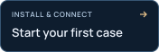
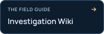
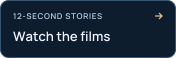

<picture>
  <source media="(max-width: 640px) and (prefers-reduced-motion: reduce)" srcset="docs/assets/presentation/tgwitness-investigation-mobile-static.svg">
  <source media="(prefers-reduced-motion: reduce)" srcset="docs/assets/presentation/tgwitness-investigation-static.svg">
  <source media="(max-width: 640px)" srcset="docs/assets/presentation/tgwitness-investigation-mobile-animated.svg">
  
</picture>

<p align="center">
  <a href="https://phishdestroy.github.io/TgWitness/demo/"></a>
  <a href="https://phishdestroy.github.io/TgWitness/demo/guide.html"></a>
  <a href="https://github.com/phishdestroy/TgWitness/wiki"></a>
  <a href="https://github.com/phishdestroy/TgWitness/blob/main/docs/SHOWCASE.md"></a>
</p>

**Your Telegram investigation workspace.** Follow a lead across conversations,
keep the changes you captured and give someone else a record they can verify.
Runs on your own computer or server, with your own accounts.

<p><sub><a href="docs/CHANGELOG.md">v0.6.1 · pre-release</a> &nbsp; / &nbsp; Python 3.11+ &nbsp; / &nbsp; 13 interface languages · 26 guide languages &nbsp; / &nbsp; <a href="LICENSE">MIT</a></sub></p>

<a name="screenshots"></a>

## One case. Every captured detail.

Move from the conversation to its saved versions and deletion notices, with the
source still in view. This is the actual app, recorded with fictional data.

<a href="https://phishdestroy.github.io/TgWitness/demo/">
<picture>
  <source media="(max-width: 640px) and (prefers-reduced-motion: reduce) and (prefers-color-scheme: dark)" srcset="docs/assets/presentation/readme-workspace-mobile-dark-still.webp">
  <source media="(max-width: 640px) and (prefers-reduced-motion: reduce)" srcset="docs/assets/presentation/readme-workspace-mobile-light-still.webp">
  <source media="(prefers-reduced-motion: reduce) and (prefers-color-scheme: dark)" srcset="docs/assets/presentation/readme-workspace-dark-still.webp">
  <source media="(prefers-reduced-motion: reduce)" srcset="docs/assets/presentation/readme-workspace-light-still.webp">
  <source media="(max-width: 640px) and (prefers-color-scheme: dark)" srcset="docs/assets/presentation/readme-workspace-mobile-dark.webp">
  <source media="(max-width: 640px)" srcset="docs/assets/presentation/readme-workspace-mobile-light.webp">
  <source media="(prefers-color-scheme: dark)" srcset="docs/assets/presentation/readme-workspace-dark.webp">
  
</picture>
</a>

<p align="center"><sub>Conversation → saved edits → deletion notices.<br><a href="https://phishdestroy.github.io/TgWitness/demo/">Explore the interactive workspace ↗</a> &nbsp; · &nbsp; <a href="docs/SHOWCASE.md">Watch the investigation films ↗</a></sub></p>

<details>
<summary><strong>More of the interface</strong> — sources, saved versions, exports and the journal</summary>

| Compare captured versions | Choose what to observe |
| --- | --- |
| [](docs/assets/detail.png) | [](docs/assets/sources.png) |
| **Prepare a signed handoff** | **Review the observation journal** |
| [](docs/assets/exports.png) | [](docs/assets/workspace-dark.png) |

All screenshots use fictional demonstration data. Open an image for its full-size view.

</details>

## From a lead to a verifiable handoff

<picture>
  <source media="(max-width: 640px) and (prefers-reduced-motion: reduce)" srcset="docs/assets/presentation/case-path-mobile-static.svg">
  <source media="(prefers-reduced-motion: reduce)" srcset="docs/assets/presentation/case-path-static.svg">
  <source media="(max-width: 640px)" srcset="docs/assets/presentation/case-path-mobile.svg">
  
</picture>

- **Choose the scope.** Selected chats, a Telegram folder or a dedicated account;
  investigation mode adds source profiles and an initial history snapshot. [Collection →](docs/COLLECTION.md)
- **Connect the records.** Search across conversations, inspect people and shared
  files, then follow each lead back to its source. Supported replies and bot-button
  actions are recorded in the journal. [Investigations →](docs/INVESTIGATION.md)
- **Keep the context.** Captured versions, original attachment bytes and reported
  collection gaps stay alongside the record. [Events & coverage →](docs/EVIDENCE.md)
- **Prepare the handoff.** Export a signed ZIP with records, preserved files and
  an offline report; the recipient verifies it against a separately trusted key.
  [Export & verify →](#export-and-verify)

[Four collection choices, eight verification layers, and their limits →](https://phishdestroy.github.io/TgWitness/guides/modes.html)

<a name="quick-start"></a>
<a name="run-it-on-your-machine"></a>

## Start your first case

**Try it first:** [open the demo](https://phishdestroy.github.io/TgWitness/demo/).
No installation or Telegram login needed.

**Run your own workspace:** [download the source](https://github.com/phishdestroy/TgWitness/archive/refs/heads/main.zip),
unpack it and install **Python 3.11+**. The launcher prepares the environment.

| | Windows | Linux / macOS |
| --- | --- | --- |
| Explore fictional records | Double-click `scripts\Demo.cmd` | `sh start.sh --demo` |
| Connect your account | Double-click `Start.cmd` | `sh start.sh` |

Open **http://127.0.0.1:8787**. For a connected account, the panel token is in
`data/live/panel-token.txt`. Stop the demo before starting live mode.
Use a dedicated account you can afford to lose.

[Setup guide →](https://phishdestroy.github.io/TgWitness/demo/guide.html) · [Dedicated account](https://phishdestroy.github.io/TgWitness/demo/dedicated-account.html) · [Docker & servers](docs/DEPLOYMENT.md) · [Tested environments](docs/VERIFICATION.md)

<a name="how-it-works"></a>

## Export and verify

**The record should stand up to a check.** Each captured event links to the previous
SHA-256 hash and carries an Ed25519 signature. The signed ZIP manifest binds the
exported files together.

<picture>
  <source media="(max-width: 640px) and (prefers-reduced-motion: reduce)" srcset="docs/assets/presentation/case-chain-mobile-static.svg">
  <source media="(prefers-reduced-motion: reduce)" srcset="docs/assets/presentation/evidence-chain-static.svg">
  <source media="(max-width: 640px)" srcset="docs/assets/presentation/case-chain-mobile.svg">
  
</picture>

With a trusted copy of TgWitness installed:

```sh
python -m tgwitness.verify evidence.zip --fingerprint TRUSTED_SHA256 --checkpoint checkpoint.json
```

Obtain the fingerprint and checkpoint independently. Use a verifier from a trusted
copy of the project. Verification establishes **integrity relative to that key**;
it does not establish Telegram origin, complete capture or the truth of a message.

<details>
<summary><strong>What happens when someone changes the record?</strong></summary>

<picture>
  <source media="(prefers-reduced-motion: reduce)" srcset="docs/assets/presentation/evidence-tamper-static.svg">
  
</picture>

An operator who holds the signing key can sign fabricated input. A hash chain
alone cannot establish source truth. [Evidence model and trust boundaries →](docs/EVIDENCE.md)

</details>

<details>
<summary><strong>Keep an independent point of comparison</strong> — checkpoints, timestamps and witnesses</summary>

<picture>
  <source media="(prefers-reduced-motion: reduce)" srcset="docs/assets/presentation/evidence-checkpoint-static.svg">
  
</picture>

A separately retained checkpoint fixes a boundary to compare against. External
timestamps and a separately operated witness add independent observations;
two workspaces on one machine do not provide that separation.

[Timestamps](docs/TIMESTAMP.md) · [Independent witness](docs/WITNESS.md) · [Public Proof monitor](docs/PROOF.md) · [Hardened deployment](docs/HIGH-ASSURANCE.md)

</details>

[Explore the interactive explanation →](https://phishdestroy.github.io/TgWitness/docs/concepts/) · [Read the formulas](docs/HOW-IT-WORKS.md) · [Films & animations](docs/SHOWCASE.md)

## Off-site copy · S3

**Keep a second copy, encrypted before it leaves your machine.** The journal,
preserved photos and files, checkpoints with their timestamps, and completed chat
exports use **AES-256-GCM** before upload to S3-compatible storage.

Configure **Exports → Off-site copy**; it is off by default. Keep the recovery key
separately. Restore into an empty directory and verify the recovered record.

[S3 setup & recovery →](https://phishdestroy.github.io/TgWitness/docs/exports/#s3) · [Verification details](docs/EVIDENCE.md#off-site-copy-and-restore-s3)

<details>
<summary><strong>Storage settings and recovery</strong> — destination, schedule, retention and keys</summary>


Each workspace has its own destination and encryption key. Object Lock retention
depends on bucket support. Recovery rejects inconsistent, incomplete or altered
material. Without the recovery key, the encrypted copy cannot be read.

Keep a separate [service backup](docs/wiki/Backup-and-Recovery.md) for account
sessions, configuration and signing secrets.

</details>

## The investigation handbook

| Set up | Work a case | Maintain |
| --- | --- | --- |
| [Connect an account](https://github.com/phishdestroy/TgWitness/wiki/Accounts) | [Follow the sources](docs/INVESTIGATION.md) | [Server & Docker](docs/DEPLOYMENT.md) |
| [Choose collection scope](docs/COLLECTION.md) | [Export & verify](docs/EVIDENCE.md) | [Back up & recover](docs/wiki/Backup-and-Recovery.md) |
| [Configure a proxy](https://github.com/phishdestroy/TgWitness/wiki/Proxies) | [Witness & Proof](docs/wiki/Witness-and-Proof.md) | [Troubleshooting](https://github.com/phishdestroy/TgWitness/wiki/Troubleshooting) |

[All Wiki pages](https://github.com/phishdestroy/TgWitness/wiki) · [Offline handbook](docs/wiki/Home.md) · [Technical reference](docs/README.md) · [Setup guides in 26 languages](https://phishdestroy.github.io/TgWitness/demo/guide.html)

**Capture has boundaries.** TgWitness observes what the connected account can
access. It does not support secret chats or recover every missed event: downtime
and catch-up can leave gaps and omit intermediate edits. [Collection limits](docs/COLLECTION.md) · [Security](.github/SECURITY.md)

<!-- operator-notice:start -->

## Licence and operator notice

[MIT License](LICENSE) · [Our position on Taylor Wessing](docs/TAYLOR-WESSING-EXCLUSION.md)

> **NOTICE — Operator Incompatibility**
> Our statement on **Taylor Wessing PartG mbB — German core, Hamburg office.**
> [Full notice](docs/OPERATOR-INCOMPATIBILITY.md) · [Original text](NOTICE) · [Source record](https://phishdestroy.io/steam_dossier/taylor_wessing)

<details>
<summary><strong>Read the complete notice</strong></summary>

<p>This is our position as the authors of TgWitness. It is not a condition of the MIT License.</p>

<blockquote>
<p>This software produces SHA-256 hash chains and Ed25519 signatures. Its output is designed to be verifiable by any third party, in any jurisdiction, without reference to the authority of the person who produced it.</p>
<p>It is therefore structurally incompatible with the following operator, its successors, affiliates, rebrandings, spin-outs and personnel:</p>
<p>Taylor Wessing PartG mbB — German core, Hamburg office.</p>
<p>Including, without limitation:</p>
<ul><li>Dr. Tobias Schelinski (signatory, doc. 42282474)</li><li>Dr. Patrick Vincent Zurheide (signatory, doc. 42603633)</li></ul>
<p>The incompatibility is evidentiary, not technical.</p>
<p>Under the signature of the above:</p>
<ul><li>94.28 % of a GDPR Art. 15 disclosure (70,717 words) was transmitted under black overlays that did not delete the underlying text;</li><li>page 444, first visible row, carried the slur &quot;pidor&quot; in plain text, from a firm publicly ranked Stonewall Top 100;</li><li>50 retained &quot;reports&quot; were submitted as proof of user misconduct at Jaccard 1.000, joint probability 1e-153, dated after the account was already blocked;</li><li>on personal notice of the exposure, the response on record was: &quot;amusing&quot;;</li><li>twelve months later, no Art. 33 filing, no Art. 34 notice, no remediation;</li><li>GDPR Art. 17 was then invoked — not to protect a data subject, but to delist the reporting of the above.</li></ul>
<p>The founder of the residual structure is documented in the Reichstags-Handbuch 1938, p. 223 — NSDAP № 1,033,215, member of the Criminal Law Commission that rewrote § 175, the statute under which men were sent to the camps with a pink triangle. The English heritage left on 1 June 2026 as Winston Taylor. What remains is addressed here.</p>
<p>A workflow whose output is required to contradict its input has no use for this software. The only configuration in which this software behaves as designed in that environment is: unavailable.</p>
<p>Mathematik verhandelt nicht.</p>
</blockquote>

</details>

<!-- operator-notice:end -->

<a name="repository-map"></a>

<details>
<summary><strong>Repository map</strong> — source, deployment and contribution guides</summary>

| Directory | Contents |
| --- | --- |
| [`tgwitness/`](tgwitness/README.md) | Application, collector, journal, verifier and web panel |
| [`docs/`](docs/README.md) | Guides, Wiki source, screenshots and verification record |
| [`deploy/`](deploy/README.md) | Compose configurations and service templates |
| [`scripts/`](scripts/README.md) | Demo, setup and Docker launchers |
| [`tests/`](tests/README.md) | Synthetic regression tests |
| [`tools/`](tools/README.md) | Builds, checks and packaging |
| [`website/`](website/README.md) | Documentation website and translations |
| [`.github/`](.github/AUTOMATION.md) | Workflows and contribution guides |

[Complete project guide](docs/PROJECT-GUIDE.md) · [Technical documentation](docs/README.md)

</details>

<details>
<summary>Read the project overview in your language</summary>

**English** · [Русский](docs/ru/README.md) · [Українська](docs/uk/README.md) · [Español](docs/es/README.md) · [Português (Brasil)](docs/pt/README.md) · [Türkçe](docs/tr/README.md) · [العربية](docs/ar/README.md) · [فارسی](docs/fa/README.md) · [اردو](docs/ur/README.md) · [हिन्दी](docs/hi/README.md) · [Bahasa Indonesia](docs/id/README.md) · [Tiếng Việt](docs/vi/README.md) · [简体中文](docs/zh/README.md)

</details>


<p align="center"><sub>Built by <a href="https://github.com/phishdestroy">PhishDestroy</a> &nbsp; · &nbsp; <a href=".github/CONTRIBUTING.md">Contribute</a> &nbsp; · &nbsp; <a href=".github/SUPPORT.md">Get help</a> &nbsp; · &nbsp; <a href=".github/SECURITY.md">Security</a></sub></p>
