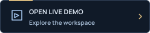
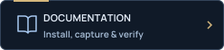
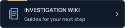
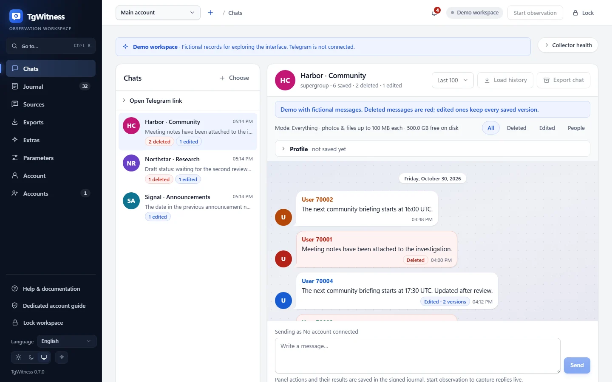
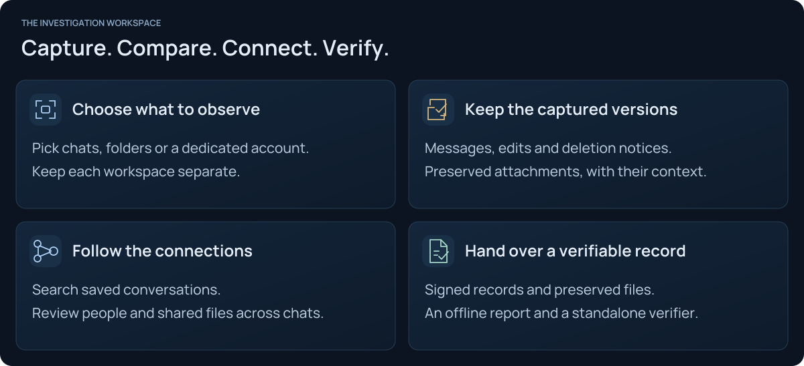

<picture>
  <source media="(max-width: 640px) and (prefers-reduced-motion: reduce)" srcset="docs/assets/presentation/tgwitness-investigation-mobile-static.svg">
  <source media="(prefers-reduced-motion: reduce)" srcset="docs/assets/presentation/tgwitness-investigation-static.svg">
  <source media="(max-width: 640px)" srcset="docs/assets/presentation/tgwitness-investigation-mobile-animated.svg">
  
</picture>

# TgWitness

**Your Telegram investigation workspace.**

Capture the conversations you observe, compare saved versions and prepare a signed handoff.
Your accounts, on your own computer or server.

  
  
  

<picture>
  <source media="(prefers-reduced-motion: reduce)" srcset="docs/assets/presentation/readme-typing-static.svg">
  
</picture>

<a href="docs/CHANGELOG.md">v0.6.1 · pre-release</a> &nbsp; / &nbsp; Python 3.11+ &nbsp; / &nbsp; 13 interface languages &nbsp; / &nbsp; <a href="LICENSE">MIT license</a>

## The workspace

<a href="https://phishdestroy.github.io/TgWitness/demo/">
<picture>
  <source media="(max-width: 640px) and (prefers-reduced-motion: reduce) and (prefers-color-scheme: dark)" srcset="docs/assets/presentation/readme-workspace-mobile-dark-still.webp">
  <source media="(max-width: 640px) and (prefers-reduced-motion: reduce)" srcset="docs/assets/presentation/readme-workspace-mobile-light-still.webp">
  <source media="(prefers-reduced-motion: reduce) and (prefers-color-scheme: dark)" srcset="docs/assets/presentation/readme-workspace-dark-still.webp">
  <source media="(prefers-reduced-motion: reduce)" srcset="docs/assets/presentation/readme-workspace-light-still.webp">
  <source media="(max-width: 640px) and (prefers-color-scheme: dark)" srcset="docs/assets/presentation/readme-workspace-mobile-dark.webp">
  <source media="(max-width: 640px)" srcset="docs/assets/presentation/readme-workspace-mobile-light.webp">
  <source media="(prefers-color-scheme: dark)" srcset="docs/assets/presentation/readme-workspace-dark.webp">
  
</picture>
</a>

Conversation → saved versions → deletion notices. Recorded from the app with fictional data. <a href="https://phishdestroy.github.io/TgWitness/demo/">Explore the workspace ↗</a> &nbsp; · &nbsp; <a href="docs/SHOWCASE.md">Films & animations</a>

<picture>
  <source media="(max-width: 640px)" srcset="docs/assets/presentation/capabilities-mobile.svg">
  
</picture>

[Collection & scope](https://github.com/phishdestroy/TgWitness/wiki/Collection) · [Investigations](https://github.com/phishdestroy/TgWitness/wiki/Investigations) · [Capabilities & limits](docs/PROJECT-GUIDE.md)

<strong>More screenshots</strong> — message history, sources, exports and the journal

| Compare captured versions | Choose what to observe |
| --- | --- |
|  |  |
| **Prepare a signed handoff** | **Review the observation journal** |
|  |  |

All screenshots use fictional demonstration data. Open an image for its full-size view.

## Quick start

**Explore first:** [open the read-only demo](https://phishdestroy.github.io/TgWitness/demo/). No installation or Telegram account needed.

**Run locally:** [download the source](https://github.com/phishdestroy/TgWitness/archive/refs/heads/main.zip), unpack it and install **Python 3.11+**.

| Windows | Linux / macOS |
| --- | --- |
| Double-click **`scripts\Demo.cmd`** | Run **`sh start.sh --demo`** |

The launcher prepares the environment. Open **http://127.0.0.1:8787**.

To connect your own account, stop the demo and run `Start.cmd` or `sh start.sh`.
Follow [account setup](https://github.com/phishdestroy/TgWitness/wiki/Accounts); the panel token is in `data/live/panel-token.txt`.
Use a dedicated account you can afford to lose.

[Installation & Docker →](docs/QUICKSTART.md) &nbsp; · &nbsp; [Tested environments →](docs/VERIFICATION.md)

## How it works

Each captured event includes the previous record's hash. Signatures let a recipient
check the exported record against an independently trusted key.

<picture>
  <source media="(prefers-reduced-motion: reduce)" srcset="docs/assets/presentation/evidence-chain-static.svg">
  
</picture>

<strong>When a record changes</strong> — watch verification detect the mismatch

<picture>
  <source media="(prefers-reduced-motion: reduce)" srcset="docs/assets/presentation/evidence-tamper-static.svg">
  
</picture>

[Static diagram](docs/assets/presentation/evidence-tamper-static.svg) · [Evidence model and formulas](docs/HOW-IT-WORKS.md)

<strong>A checkpoint outside the collector</strong> — retain an independent reference

<picture>
  <source media="(prefers-reduced-motion: reduce)" srcset="docs/assets/presentation/evidence-checkpoint-static.svg">
  
</picture>

[Static diagram](docs/assets/presentation/evidence-checkpoint-static.svg) · [Witness and proof](docs/wiki/Witness-and-Proof.md)

Verification establishes **integrity relative to a trusted key**. It does not prove
Telegram origin, complete capture or the truth of the content.

[The evidence model →](docs/HOW-IT-WORKS.md) · [Try the interactive explanation →](https://phishdestroy.github.io/TgWitness/docs/concepts/) · [Export & verify →](https://github.com/phishdestroy/TgWitness/wiki/Exports-and-Verification)

## The investigation handbook

| Start | Investigate | Maintain |
| --- | --- |
| [Install & try the demo](https://github.com/phishdestroy/TgWitness/wiki/Getting-Started) | [Choose sources](https://github.com/phishdestroy/TgWitness/wiki/Collection) | [Server & Docker](https://github.com/phishdestroy/TgWitness/wiki/Server-and-Docker) |
| [Connect an account](https://github.com/phishdestroy/TgWitness/wiki/Accounts) | [Work across chats](https://github.com/phishdestroy/TgWitness/wiki/Investigations) | [Backup & recovery](https://github.com/phishdestroy/TgWitness/wiki/Backup-and-Recovery) |
| [Configure a proxy](https://github.com/phishdestroy/TgWitness/wiki/Proxies) | [Export & verify](https://github.com/phishdestroy/TgWitness/wiki/Exports-and-Verification) | [Troubleshooting](https://github.com/phishdestroy/TgWitness/wiki/Troubleshooting) |

[All Wiki pages](https://github.com/phishdestroy/TgWitness/wiki) · [Offline handbook](docs/wiki/Home.md) · [Complete project guide](docs/PROJECT-GUIDE.md) · [Technical reference](docs/README.md)

<!-- operator-notice:start -->

## Licence and operator notice

[MIT License](LICENSE) · [Our position on Taylor Wessing](docs/TAYLOR-WESSING-EXCLUSION.md)

> **NOTICE — Operator Incompatibility**
> Our statement on **Taylor Wessing PartG mbB — German core, Hamburg office.**
> [Full notice](docs/OPERATOR-INCOMPATIBILITY.md) · [Original text](NOTICE) · [Source record](https://phishdestroy.io/steam_dossier/taylor_wessing)

<strong>Read the complete notice</strong>

This is our position as the authors of TgWitness. It is not a condition of the MIT License.

<blockquote>

This software produces SHA-256 hash chains and Ed25519 signatures. Its output is designed to be verifiable by any third party, in any jurisdiction, without reference to the authority of the person who produced it.

It is therefore structurally incompatible with the following operator, its successors, affiliates, rebrandings, spin-outs and personnel:

Taylor Wessing PartG mbB — German core, Hamburg office.

Including, without limitation:

<ul><li>Dr. Tobias Schelinski (signatory, doc. 42282474)</li><li>Dr. Patrick Vincent Zurheide (signatory, doc. 42603633)</li></ul>

The incompatibility is evidentiary, not technical.

Under the signature of the above:

<ul><li>94.28 % of a GDPR Art. 15 disclosure (70,717 words) was transmitted under black overlays that did not delete the underlying text;</li><li>page 444, first visible row, carried the slur &quot;pidor&quot; in plain text, from a firm publicly ranked Stonewall Top 100;</li><li>50 retained &quot;reports&quot; were submitted as proof of user misconduct at Jaccard 1.000, joint probability 1e-153, dated after the account was already blocked;</li><li>on personal notice of the exposure, the response on record was: &quot;amusing&quot;;</li><li>twelve months later, no Art. 33 filing, no Art. 34 notice, no remediation;</li><li>GDPR Art. 17 was then invoked — not to protect a data subject, but to delist the reporting of the above.</li></ul>

The founder of the residual structure is documented in the Reichstags-Handbuch 1938, p. 223 — NSDAP № 1,033,215, member of the Criminal Law Commission that rewrote § 175, the statute under which men were sent to the camps with a pink triangle. The English heritage left on 1 June 2026 as Winston Taylor. What remains is addressed here.

A workflow whose output is required to contradict its input has no use for this software. The only configuration in which this software behaves as designed in that environment is: unavailable.

Mathematik verhandelt nicht.

</blockquote>

<!-- operator-notice:end -->

<strong>Repository map</strong> — source, deployment and contribution guides

| Directory | Contents |
| --- | --- |
| [`tgwitness/`](tgwitness/README.md) | Application, collector, journal, verifier and web panel |
| [`docs/`](docs/README.md) | Guides, Wiki source, screenshots and verification record |
| [`deploy/`](deploy/README.md) | Compose configurations and service templates |
| [`scripts/`](scripts/README.md) | Demo, setup and Docker launchers |
| [`tests/`](tests/README.md) | Synthetic regression tests |
| [`tools/`](tools/README.md) | Builds, checks and packaging |
| [`website/`](website/README.md) | Documentation website and translations |
| [`.github/`](.github/AUTOMATION.md) | Workflows and contribution guides |

[Complete project guide](docs/PROJECT-GUIDE.md) · [Technical documentation](docs/README.md)

Read the project overview in your language

**English** · [Русский](docs/ru/README.md) · [Українська](docs/uk/README.md) · [Español](docs/es/README.md) · [Português (Brasil)](docs/pt/README.md) · [Türkçe](docs/tr/README.md) · [العربية](docs/ar/README.md) · [فارسی](docs/fa/README.md) · [اردو](docs/ur/README.md) · [हिन्दी](docs/hi/README.md) · [Bahasa Indonesia](docs/id/README.md) · [Tiếng Việt](docs/vi/README.md) · [简体中文](docs/zh/README.md)

Built by <a href="https://github.com/phishdestroy">PhishDestroy</a> &nbsp; · &nbsp; <a href=".github/CONTRIBUTING.md">Contribute</a> &nbsp; · &nbsp; <a href=".github/SUPPORT.md">Get help</a> &nbsp; · &nbsp; <a href=".github/SECURITY.md">Security</a>

