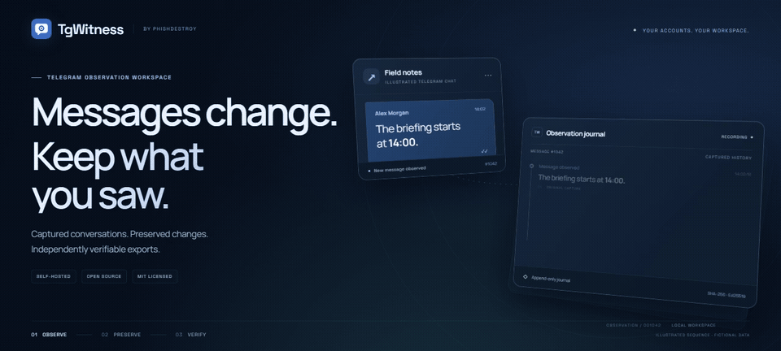

<picture>
  <source media="(max-width: 600px)" srcset="docs/assets/presentation/mobile.svg">
  <source media="(prefers-reduced-motion: reduce)" srcset="docs/assets/presentation/tgwitness-investigation-static.svg">
  
</picture>

<h1 align="center">TgWitness</h1>

<b>The Telegram investigation workspace that keeps the record.</b> 
Capture conversations · keep every edit and deletion you saw · trace connections · hand over evidence anyone can verify

  
  
  
  

<a href="docs/CHANGELOG.md">0.6.1 · pre-release</a> &nbsp;/&nbsp; Python 3.11+ &nbsp;/&nbsp; <a href="LICENSE">MIT</a> &nbsp;/&nbsp; Self-hosted &nbsp;/&nbsp; No telemetry &nbsp;/&nbsp; 13 languages

## Messages change. Keep what you saw.

<picture>
  <source media="(prefers-reduced-motion: reduce)" srcset="docs/assets/presentation/message-history-static.png">
  
</picture>

[Download the film (MP4)](docs/assets/presentation/message-history.mp4) · [Watch both films and explore the animations](docs/SHOWCASE.md)

<picture>
  <source media="(max-width: 600px)" srcset="docs/assets/presentation/capabilities-mobile.svg">
  
</picture>

## The workspace

<picture>
  <source media="(prefers-color-scheme: dark)" srcset="docs/assets/chats-dark.png">
  
</picture>

<b>More screens:</b> message history, capture policy, exports, journal

| Compare captured versions | Choose what to observe |
| --- | --- |
|  |  |
| **Prepare a signed handoff** | **Review the journal** |
|  |  |

## Quick start

**Try the demo first:** fictional conversations, no Telegram account needed.

| Windows | Linux / macOS |
| --- | --- |
| Double-click **`scripts\Demo.cmd`** | Run **`sh start.sh --demo`** |

Install **Python 3.11+** first. The launcher prepares the environment and dependencies.
Then open **http://127.0.0.1:8787**.

**Your own workspace:** stop the demo, run `Start.cmd` or `sh start.sh` and follow
[account setup](https://github.com/phishdestroy/TgWitness/wiki/Accounts). The panel token is in
`data/live/panel-token.txt`. Use a dedicated Telegram account you can afford to lose.

[Installation and Docker →](docs/QUICKSTART.md) &nbsp;·&nbsp; [Tested environments →](docs/VERIFICATION.md)

## How it works

<picture>
  <source media="(prefers-reduced-motion: reduce)" srcset="docs/assets/presentation/evidence-chain-static.svg">
  
</picture>

Each record is chained with SHA-256 and signed with Ed25519. Anyone can verify an export
against a fingerprint kept outside the collector. It proves integrity relative to that key,
not Telegram origin or the truth of the content.

[The evidence model →](docs/HOW-IT-WORKS.md) &nbsp;·&nbsp; [Export and verify →](https://github.com/phishdestroy/TgWitness/wiki/Exports-and-Verification) &nbsp;·&nbsp; [Witness and Proof →](https://github.com/phishdestroy/TgWitness/wiki/Witness-and-Proof) &nbsp;·&nbsp; [All animations →](docs/SHOWCASE.md)

## The investigation handbook

**Get started** · [Install and try the demo](https://github.com/phishdestroy/TgWitness/wiki/Getting-Started) · [Connect an account](https://github.com/phishdestroy/TgWitness/wiki/Accounts) · [Configure a proxy](https://github.com/phishdestroy/TgWitness/wiki/Proxies)

**Work a case** · [Choose sources](https://github.com/phishdestroy/TgWitness/wiki/Collection) · [Investigate across chats](https://github.com/phishdestroy/TgWitness/wiki/Investigations) · [Prepare a handoff](https://github.com/phishdestroy/TgWitness/wiki/Exports-and-Verification)

**Keep it running** · [Server and Docker](https://github.com/phishdestroy/TgWitness/wiki/Server-and-Docker) · [Backup and recovery](https://github.com/phishdestroy/TgWitness/wiki/Backup-and-Recovery) · [Troubleshooting](https://github.com/phishdestroy/TgWitness/wiki/Troubleshooting)

[All Wiki pages](https://github.com/phishdestroy/TgWitness/wiki) · [Offline handbook](docs/wiki/Home.md) · [Complete project guide](docs/PROJECT-GUIDE.md) · [Technical reference](docs/README.md)

## Repository map

Source, deployment, tests and documentation

| Directory | Contents |
| --- | --- |
| [`tgwitness/`](tgwitness/README.md) | Application, collector, journal, verifier and web panel |
| [`docs/`](docs/README.md) | Guides, Wiki source, screenshots and verification record |
| [`deploy/`](deploy/README.md) | Optional Compose configurations and service templates |
| [`scripts/`](scripts/README.md) | Additional launchers: demo, setup only and Docker |
| [`tests/`](tests/README.md) | Synthetic regression tests |
| [`tools/`](tools/README.md) | Builds, checks, packaging and documentation tooling |
| [`website/`](website/README.md) | Documentation website and translations |
| [`.github/`](.github/AUTOMATION.md) | Workflows, issue forms and contribution guides |

Read the project overview in your language

**English** · [Русский](docs/ru/README.md) · [Українська](docs/uk/README.md) · [Español](docs/es/README.md) · [Português (Brasil)](docs/pt/README.md) · [Türkçe](docs/tr/README.md) · [العربية](docs/ar/README.md) · [فارسی](docs/fa/README.md) · [اردو](docs/ur/README.md) · [हिन्दी](docs/hi/README.md) · [Bahasa Indonesia](docs/id/README.md) · [Tiếng Việt](docs/vi/README.md) · [简体中文](docs/zh/README.md)

Pre-release. See the [verification record](docs/VERIFICATION.md) and the [audit findings and their fixes](docs/internal/RECHECK-2026-10-29.md) for tested behavior and remaining work. All screens and films use fictional data.

<a href=".github/SUPPORT.md">Get help</a> · <a href=".github/CONTRIBUTING.md">Contribute</a> · <a href=".github/SECURITY.md">Report a vulnerability</a> · <a href="LICENSE">MIT license</a> · Built by <a href="https://github.com/phishdestroy">PhishDestroy</a>

