<picture>
  <source media="(max-width: 640px) and (prefers-reduced-motion: reduce)" srcset="docs/assets/presentation/identity-hero-mobile-static.svg">
  <source media="(prefers-reduced-motion: reduce)" srcset="docs/assets/presentation/identity-hero-static.svg">
  <source media="(max-width: 640px)" srcset="docs/assets/presentation/identity-hero-mobile.svg">
  
</picture>

<p align="center">
  <a href="https://phishdestroy.github.io/TgWitness/demo/"></a>
  <a href="#quick-start"></a>
  <a href="https://github.com/phishdestroy/TgWitness/wiki"></a>
</p>

<p align="center"><strong>Your Telegram investigation workspace.</strong><br>Capture what you observe. Follow the connections. Hand over a verifiable record.<br>Self-hosted, on your own computer or server.</p>

<a name="screenshots"></a>

## Keep the conversation. Keep the changes.

Read messages alongside their captured edits and deletion notices. Follow people,
shared files and extracted leads back to the source record.

<a href="https://phishdestroy.github.io/TgWitness/demo/">
<picture>
  <source media="(max-width: 640px) and (prefers-reduced-motion: reduce) and (prefers-color-scheme: dark)" srcset="docs/assets/presentation/readme-workspace-mobile-dark-still.webp">
  <source media="(max-width: 640px) and (prefers-reduced-motion: reduce)" srcset="docs/assets/presentation/readme-workspace-mobile-light-still.webp">
  <source media="(prefers-reduced-motion: reduce) and (prefers-color-scheme: dark)" srcset="docs/assets/presentation/readme-workspace-dark-still.webp">
  <source media="(prefers-reduced-motion: reduce)" srcset="docs/assets/presentation/readme-workspace-light-still.webp">
  <source media="(max-width: 640px) and (prefers-color-scheme: dark)" srcset="docs/assets/presentation/readme-workspace-mobile-dark.webp">
  <source media="(max-width: 640px)" srcset="docs/assets/presentation/readme-workspace-mobile-light.webp">
  <source media="(prefers-color-scheme: dark)" srcset="docs/assets/presentation/readme-workspace-dark.webp">
  
</picture>
</a>

<p align="center"><sub>The actual application, with fictional demonstration records.<br><a href="https://phishdestroy.github.io/TgWitness/demo/">Try it in your browser ↗</a></sub></p>

<details>
<summary><strong>More of the interface</strong> — sources, saved versions, exports and the journal</summary>

| Compare captured versions | Choose what to observe |
| --- | --- |
| [](docs/assets/detail.png) | [](docs/assets/sources.png) |
| **Prepare a signed handoff** | **Review the observation journal** |
| [](docs/assets/exports.png) | [](docs/assets/workspace-dark.png) |

All screenshots use fictional demonstration data. Open an image for its full-size view.

</details>

**Choose your scope:** selected chats, a Telegram folder or a dedicated account.
Investigation mode adds source profiles and an initial history snapshot. Supported
replies and bot-button actions also enter the signed journal.

[Collection & scope](docs/COLLECTION.md) · [Investigation tools](docs/INVESTIGATION.md) · [Modes & evidence](https://phishdestroy.github.io/TgWitness/guides/modes.html)

<a name="quick-start"></a>
<a name="run-it-on-your-machine"></a>

## Your workspace. Your machine.

[Explore the demo](https://phishdestroy.github.io/TgWitness/demo/) without an account,
or [download the source](https://github.com/phishdestroy/TgWitness/archive/refs/heads/main.zip)
and run it with **Python 3.11+**. The launcher prepares the environment.

| | Windows | Linux / macOS |
| --- | --- | --- |
| **Try fictional records** | `scripts\Demo.cmd` | `sh start.sh --demo` |
| **Connect your account** | `Start.cmd` | `sh start.sh` |

Open **http://127.0.0.1:8787**. Stop the demo before starting live mode. For a connected
account, the panel token is in `data/live/panel-token.txt`. Use a dedicated account
you can afford to lose.

<p align="center">
  <a href="https://phishdestroy.github.io/TgWitness/demo/guide.html"><picture><source media="(prefers-reduced-motion: reduce)" srcset="docs/assets/presentation/identity-action-setup-static.svg"></picture></a>
  <a href="https://phishdestroy.github.io/TgWitness/demo/dedicated-account.html"><picture><source media="(prefers-reduced-motion: reduce)" srcset="docs/assets/presentation/identity-action-account-static.svg"></picture></a>
  <a href="docs/DEPLOYMENT.md"><picture><source media="(prefers-reduced-motion: reduce)" srcset="docs/assets/presentation/identity-action-deploy-static.svg"></picture></a>
</p>

<p><sub><a href="docs/CHANGELOG.md">v0.6.1 · pre-release</a> &nbsp; / &nbsp; <a href="docs/VERIFICATION.md">Tested environments</a> &nbsp; / &nbsp; 13 interface languages · 26 guide languages &nbsp; / &nbsp; <a href="LICENSE">MIT</a></sub></p>

<a name="how-it-works"></a>

## Export and verify

**Let the record speak for itself.** Export the captured events, preserved files
and an offline report in one signed package. Each event links to the previous
SHA-256 hash and carries an Ed25519 signature.

<picture>
  <source media="(max-width: 640px) and (prefers-reduced-motion: reduce)" srcset="docs/assets/presentation/case-chain-mobile-static.svg">
  <source media="(prefers-reduced-motion: reduce)" srcset="docs/assets/presentation/evidence-chain-static.svg">
  <source media="(max-width: 640px)" srcset="docs/assets/presentation/case-chain-mobile.svg">
  
</picture>

Verification establishes **integrity relative to a separately trusted key**.
It does not establish Telegram origin, complete capture or the truth of a message.

<details>
<summary><strong>Verify a handoff</strong> — the command and what to trust</summary>

With a trusted copy of TgWitness installed:

```sh
python -m tgwitness.verify evidence.zip --fingerprint TRUSTED_SHA256 --checkpoint checkpoint.json
```

Obtain the fingerprint and checkpoint independently. Use a verifier from a trusted
copy of the project. The signed manifest binds the exported files together;
reported coverage gaps stay alongside the record.

[Export and verification guide →](docs/EVIDENCE.md)

</details>

<details>
<summary><strong>What happens when someone changes the record?</strong></summary>

<picture>
  <source media="(prefers-reduced-motion: reduce)" srcset="docs/assets/presentation/evidence-tamper-static.svg">
  
</picture>

An operator who holds the signing key can sign fabricated input. A hash chain
alone cannot establish source truth. [Evidence model and trust boundaries →](docs/EVIDENCE.md)

</details>

<details>
<summary><strong>Keep an independent point of comparison</strong> — checkpoints, timestamps and witnesses</summary>

<picture>
  <source media="(prefers-reduced-motion: reduce)" srcset="docs/assets/presentation/evidence-checkpoint-static.svg">
  
</picture>

A separately retained checkpoint fixes a boundary to compare against. External
timestamps and a separately operated witness add independent observations;
two workspaces on one machine do not provide that separation.

[Timestamps](docs/TIMESTAMP.md) · [Independent witness](docs/WITNESS.md) · [Public Proof monitor](docs/PROOF.md) · [Hardened deployment](docs/HIGH-ASSURANCE.md)

</details>


[Explore the interactive explanation →](https://phishdestroy.github.io/TgWitness/docs/concepts/) · [Read the evidence model](docs/HOW-IT-WORKS.md)

## Off-site copy · S3

Keep a second copy, encrypted with **AES-256-GCM before upload**. Optional S3-compatible
storage preserves the journal, original files, checkpoints and completed chat exports.
Keep the recovery key separately and verify the recovered record.

[S3 setup & recovery →](https://phishdestroy.github.io/TgWitness/docs/exports/#s3)

<details>
<summary><strong>Storage settings and recovery</strong> — destination, schedule, retention and keys</summary>


Each workspace has its own destination and encryption key. Object Lock retention
depends on bucket support. Recovery rejects inconsistent, incomplete or altered
material. Without the recovery key, the encrypted copy cannot be read.

Keep a separate [service backup](docs/wiki/Backup-and-Recovery.md) for account
sessions, configuration and signing secrets.

</details>


## Follow your next lead

| Set up | Work a case | Maintain |
| --- | --- | --- |
| [Accounts](https://github.com/phishdestroy/TgWitness/wiki/Accounts) | [Investigations](docs/INVESTIGATION.md) | [Server & Docker](docs/DEPLOYMENT.md) |
| [Collection](docs/COLLECTION.md) | [Export & verify](docs/EVIDENCE.md) | [Backup & recovery](docs/wiki/Backup-and-Recovery.md) |
| [Proxies](https://github.com/phishdestroy/TgWitness/wiki/Proxies) | [Witness & Proof](docs/wiki/Witness-and-Proof.md) | [Troubleshooting](https://github.com/phishdestroy/TgWitness/wiki/Troubleshooting) |

[Investigation Wiki](https://github.com/phishdestroy/TgWitness/wiki) · [Offline handbook](docs/wiki/Home.md) · [Technical reference](docs/README.md)

**Capture has boundaries.** TgWitness observes what the connected account can
access. No secret chats; downtime and catch-up can leave gaps and miss intermediate
edits. [Collection limits](docs/COLLECTION.md) · [Security](.github/SECURITY.md)

<!-- operator-notice:start -->

## ⚖️ Ethical Notice & Historical Continuity

We have recently learned that for certain "elite" law firms and their Hamburg partners—specifically **Dr. Tobias Schelinski** (`Doc. No. 42282474`) and **Dr. Patrick Vincent Zurheide** (`Doc. No. 42603633`)—mathematics, Shannon entropy, and objective facts are irrelevant. Some arrogant legal entities operate under the delusion that they *are* the law—believing that a qualified electronic signature (*qualifiziert elektronisch signiert*) on a fabricated claim magically turns a lie into truth, or that drawing a black rectangle over text in a PDF constitutes data sanitization.

This tool is incompatible with jurisdictions where the following prevail:
* **Corporatocracy**
* **Privatized or commercial justice**
* **Plutocracy**
* **Kleptocracy and institutional corruption**

A special salute to **Dr. Patrick Zurheide** and **Dr. Tobias Schelinski**, and to those attempting to weaponize the *"Right to be Forgotten"* (Art. 17 GDPR) to cover up their own data leaks, sanitize their institutional lineage, and erase the historical record:

> **[Taylor Wessing](https://phishdestroy.io/steam_dossier/taylor_wessing) (Dr. Tobias Schelinski & Dr. Patrick Vincent Zurheide)** $\rightarrow$ **Wessing & Berenberg-Gossler** $\rightarrow$ **Stonewall Top 100 (Row No. 1, p. 444: *"pidor"*)** $\rightarrow$ **Dr. Graf von der Goltz Dr. Wessing & Partner (since 1957)** $\rightarrow$ **Rüdiger Graf von der Goltz** $\rightarrow$ **Paragraph 175 in its 1935 revision**

To strictly comply with the MIT License, we do not restrict the use of this software—even by Hamburg *Doctors of Law* and university lecturers who still use 2020 PDF engines to leak 70,717 words of third-party data while finding the exposure "amusing." However, let it be clear: corporate retainers, threats of prosecution, and demands for digital erasure cannot override arithmetic, rewrite lineage, or conceal the truth.

📄 **Full Forensic & Historical Record:** [https://phishdestroy.io/steam_dossier/taylor_wessing](https://phishdestroy.io/steam_dossier/taylor_wessing)

[MIT License](LICENSE) · [Technical notice](docs/OPERATOR-INCOMPATIBILITY.md) · [Original NOTICE](NOTICE)

<!-- operator-notice:end -->

<a name="repository-map"></a>

<details>
<summary><strong>Repository map</strong> — source, deployment and contribution guides</summary>

| Directory | Contents |
| --- | --- |
| [`tgwitness/`](tgwitness/README.md) | Application, collector, journal, verifier and web panel |
| [`docs/`](docs/README.md) | Guides, Wiki source, screenshots and verification record |
| [`deploy/`](deploy/README.md) | Compose configurations and service templates |
| [`scripts/`](scripts/README.md) | Demo, setup and Docker launchers |
| [`tests/`](tests/README.md) | Synthetic regression tests |
| [`tools/`](tools/README.md) | Builds, checks and packaging |
| [`website/`](website/README.md) | Documentation website and translations |
| [`.github/`](.github/AUTOMATION.md) | Workflows and contribution guides |

[Complete project guide](docs/PROJECT-GUIDE.md) · [Technical documentation](docs/README.md)

</details>

<details>
<summary>Read the project overview in your language</summary>

**English** · [Русский](docs/ru/README.md) · [Українська](docs/uk/README.md) · [Español](docs/es/README.md) · [Português (Brasil)](docs/pt/README.md) · [Türkçe](docs/tr/README.md) · [العربية](docs/ar/README.md) · [فارسی](docs/fa/README.md) · [اردو](docs/ur/README.md) · [हिन्दी](docs/hi/README.md) · [Bahasa Indonesia](docs/id/README.md) · [Tiếng Việt](docs/vi/README.md) · [简体中文](docs/zh/README.md)

</details>


<p align="center"><sub>Built by <a href="https://github.com/phishdestroy">PhishDestroy</a> &nbsp; · &nbsp; <a href=".github/CONTRIBUTING.md">Contribute</a> &nbsp; · &nbsp; <a href=".github/SUPPORT.md">Get help</a> &nbsp; · &nbsp; <a href=".github/SECURITY.md">Security</a></sub></p>
