<picture>
  <source media="(max-width: 640px) and (prefers-reduced-motion: reduce)" srcset="docs/assets/presentation/casework-hero-mobile-static.svg">
  <source media="(prefers-reduced-motion: reduce)" srcset="docs/assets/presentation/casework-hero-static.svg">
  <source media="(max-width: 640px)" srcset="docs/assets/presentation/casework-hero-mobile.svg">
  
</picture>

<p align="center">
  <a href="https://phishdestroy.github.io/TgWitness/demo/"><picture><source media="(prefers-reduced-motion: reduce)" srcset="docs/assets/presentation/casework-nav-demo-static.svg"></picture></a>
  <a href="#quick-start"><picture><source media="(prefers-reduced-motion: reduce)" srcset="docs/assets/presentation/casework-nav-start-static.svg"></picture></a>
  <a href="https://github.com/phishdestroy/TgWitness/wiki"><picture><source media="(prefers-reduced-motion: reduce)" srcset="docs/assets/presentation/casework-nav-wiki-static.svg"></picture></a>
</p>

<p align="center"><strong>Your Telegram investigation workspace.</strong><br>Capture what you observe. Follow the connections. Hand over a verifiable record.<br>Self-hosted, on your own computer or server.</p>

<p align="center">
  <a href="docs/CHANGELOG.md"></a>
  <a href="docs/VERIFICATION.md">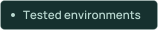</a>
  
  <a href="LICENSE"></a>
</p>

<p align="center"><picture><source media="(prefers-reduced-motion: reduce)" srcset="docs/assets/presentation/readme-divider-static.svg"></picture></p>

## From a chat to a case.

Export a conversation, follow leads across recorded chats, and keep the changes you observe.

<picture>
  <source media="(max-width: 640px) and (prefers-reduced-motion: reduce)" srcset="docs/assets/presentation/readme-features-mobile-static.svg">
  <source media="(prefers-reduced-motion: reduce)" srcset="docs/assets/presentation/readme-features-static.svg">
  <source media="(max-width: 640px)" srcset="docs/assets/presentation/readme-features-mobile.svg">
  
</picture>

Illustrated workflows. [Export a chat](docs/wiki/Chat-Export.md) · [Investigate](docs/wiki/Investigations.md) · [Capture changes](docs/wiki/Collection.md)

<a name="screenshots"></a>

## Keep the conversation. Keep the changes.

Captured messages, edits, deletion notices, people and files — linked to their source.

<a href="https://phishdestroy.github.io/TgWitness/demo/">
<picture>
  <source media="(max-width: 640px) and (prefers-reduced-motion: reduce) and (prefers-color-scheme: dark)" srcset="docs/assets/presentation/readme-workspace-mobile-dark-still.webp">
  <source media="(max-width: 640px) and (prefers-reduced-motion: reduce)" srcset="docs/assets/presentation/readme-workspace-mobile-light-still.webp">
  <source media="(prefers-reduced-motion: reduce) and (prefers-color-scheme: dark)" srcset="docs/assets/presentation/readme-workspace-dark-still.webp">
  <source media="(prefers-reduced-motion: reduce)" srcset="docs/assets/presentation/readme-workspace-light-still.webp">
  <source media="(max-width: 640px) and (prefers-color-scheme: dark)" srcset="docs/assets/presentation/readme-workspace-mobile-dark.webp">
  <source media="(max-width: 640px)" srcset="docs/assets/presentation/readme-workspace-mobile-light.webp">
  <source media="(prefers-color-scheme: dark)" srcset="docs/assets/presentation/readme-workspace-dark.webp">
  
</picture>
</a>

<p align="center"><sub>The actual application, with fictional demonstration records.<br><a href="https://phishdestroy.github.io/TgWitness/demo/">Try it in your browser ↗</a></sub></p>

<details>
<summary><strong>More of the interface</strong> — sources, saved versions, exports and the journal</summary>

| Compare captured versions | Choose what to observe |
| --- | --- |
| [](docs/assets/detail.png) | [](docs/assets/sources.png) |
| **Prepare a signed handoff** | **Review the observation journal** |
| [](docs/assets/exports.png) | [](docs/assets/workspace-dark.png) |

All screenshots use fictional demonstration data. Open an image for its full-size view.

</details>

**Collection:** chosen chats · Telegram folder · whole account · investigation mode.
Profiles, history snapshots and supported bot actions stay with the case.

[Collection & scope](docs/COLLECTION.md) · [Investigation tools](docs/INVESTIGATION.md) · [Modes & evidence](https://phishdestroy.github.io/TgWitness/guides/modes.html)

<p align="center"><picture><source media="(prefers-reduced-motion: reduce)" srcset="docs/assets/presentation/readme-divider-static.svg"></picture></p>

<a name="quick-start"></a>
<a name="run-it-on-your-machine"></a>

## Your workspace. Your machine.

**Windows in two clicks:** download the
[portable package](https://github.com/phishdestroy/TgWitness/releases/download/v0.7.0/TgWitness-0.7.0-windows-amd64-portable.zip),
extract it and double-click **`TgWitness.cmd`**. Python is included and the panel opens in your
browser; **`TgWitness-Demo.cmd`** opens the fictional demo.

[Download the source](https://github.com/phishdestroy/TgWitness/archive/refs/heads/main.zip).
Requires **Python 3.11+**; the launcher prepares the environment.

| Windows | Linux / macOS |
| --- | --- |
| **Try fictional records**<br>`scripts\Demo.cmd` | **Try fictional records**<br>`sh start.sh --demo` |
| **Connect your account**<br>`Start.cmd` | **Connect your account**<br>`sh start.sh` |

The launchers open **http://127.0.0.1:8787**. Use a **dedicated account**.

<details>
<summary>Panel access</summary>

Stop the demo before starting live mode. The live panel token is in
`data/live/panel-token.txt`.

</details>

<p align="center">
  <a href="https://phishdestroy.github.io/TgWitness/demo/guide.html"><picture><source media="(prefers-reduced-motion: reduce)" srcset="docs/assets/presentation/identity-action-setup-static.svg"></picture></a>
  <a href="https://phishdestroy.github.io/TgWitness/demo/dedicated-account.html"><picture><source media="(prefers-reduced-motion: reduce)" srcset="docs/assets/presentation/identity-action-account-static.svg"></picture></a>
  <a href="docs/DEPLOYMENT.md"><picture><source media="(prefers-reduced-motion: reduce)" srcset="docs/assets/presentation/identity-action-deploy-static.svg"></picture></a>
</p>

<p align="center"><picture><source media="(prefers-reduced-motion: reduce)" srcset="docs/assets/presentation/readme-divider-static.svg"></picture></p>

<a name="how-it-works"></a>

## Export and verify

Export observations, files and an offline report in a **signed ZIP**.
Each record carries a SHA-256 link and an Ed25519 signature.

<picture>
  <source media="(max-width: 640px) and (prefers-reduced-motion: reduce)" srcset="docs/assets/presentation/casework-chain-mobile-static.svg">
  <source media="(prefers-reduced-motion: reduce)" srcset="docs/assets/presentation/casework-chain-static.svg">
  <source media="(max-width: 640px)" srcset="docs/assets/presentation/casework-chain-mobile.svg">
  
</picture>

Verification establishes **integrity relative to a separately trusted key**.
It does not establish Telegram origin, complete capture or the truth of a message.

<details>
<summary><strong>Verify a handoff</strong> — the command and what to trust</summary>

With a trusted copy of TgWitness installed:

```sh
python -m tgwitness.verify evidence.zip --fingerprint TRUSTED_SHA256 --checkpoint checkpoint.json
```

Obtain the fingerprint and checkpoint independently. Use a verifier from a trusted
copy of the project. The signed manifest binds the exported files together;
reported coverage gaps stay alongside the record.

[Export and verification guide →](docs/EVIDENCE.md)

</details>

<details>
<summary><strong>What happens when someone changes the record?</strong></summary>

<picture>
  <source media="(max-width: 640px) and (prefers-reduced-motion: reduce)" srcset="docs/assets/presentation/casework-tamper-mobile-static.svg">
  <source media="(prefers-reduced-motion: reduce)" srcset="docs/assets/presentation/casework-tamper-static.svg">
  <source media="(max-width: 640px)" srcset="docs/assets/presentation/casework-tamper-mobile.svg">
  
</picture>

An operator who holds the signing key can sign fabricated input. A hash chain
alone cannot establish source truth. [Evidence model and trust boundaries →](docs/EVIDENCE.md)

</details>

<details>
<summary><strong>Keep an independent point of comparison</strong> — checkpoints, timestamps and witnesses</summary>

<picture>
  <source media="(max-width: 640px) and (prefers-reduced-motion: reduce)" srcset="docs/assets/presentation/casework-checkpoint-mobile-static.svg">
  <source media="(prefers-reduced-motion: reduce)" srcset="docs/assets/presentation/casework-checkpoint-static.svg">
  <source media="(max-width: 640px)" srcset="docs/assets/presentation/casework-checkpoint-mobile.svg">
  
</picture>

A separately retained checkpoint fixes a boundary to compare against. External
timestamps and a separately operated witness add independent observations;
two workspaces on one machine do not provide that separation.

[Timestamps](docs/TIMESTAMP.md) · [Independent witness](docs/WITNESS.md) · [Hardened deployment](docs/HIGH-ASSURANCE.md)

</details>


<p align="center">
  <a href="https://phishdestroy.github.io/TgWitness/docs/concepts/"></a>
  <a href="docs/HOW-IT-WORKS.md">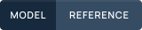</a>
</p>

<p align="center"><picture><source media="(prefers-reduced-motion: reduce)" srcset="docs/assets/presentation/readme-divider-static.svg"></picture></p>

## Keep the investigation running

<a name="layout-review"></a>

<picture>
  <source media="(max-width: 640px) and (prefers-reduced-motion: reduce)" srcset="docs/assets/presentation/readme-services-mobile-static.svg">
  <source media="(prefers-reduced-motion: reduce)" srcset="docs/assets/presentation/readme-services-static.svg">
  <source media="(max-width: 640px)" srcset="docs/assets/presentation/readme-services-mobile.svg">
  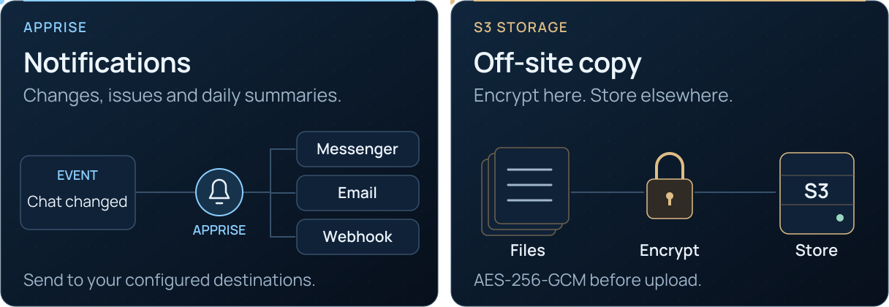
</picture>

<p align="center">
  <a href="docs/wiki/Notifications.md">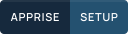</a>
  <a href="docs/wiki/Off-site-Copy.md">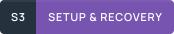</a>
  <a href="docs/wiki/Backup-and-Recovery.md"></a>
</p>

<details>
<summary><strong>Configure notifications</strong> — Apprise destinations and delivery</summary>

Problem alerts, chat changes and daily summaries via **Apprise**: messengers,
email or your own JSON webhook. Configure them in **Sources → Notifications**.

[Set up notifications →](docs/OPERATIONS.md#notifications)

</details>

<details>
<summary><strong>Storage settings and recovery</strong> — destination, schedule, retention and keys</summary>

Journal, files, checkpoints and chat exports — encrypted with **AES-256-GCM before upload**
to S3-compatible storage. Keep the recovery key separately.

[S3 setup & recovery →](https://phishdestroy.github.io/TgWitness/docs/exports/#s3)

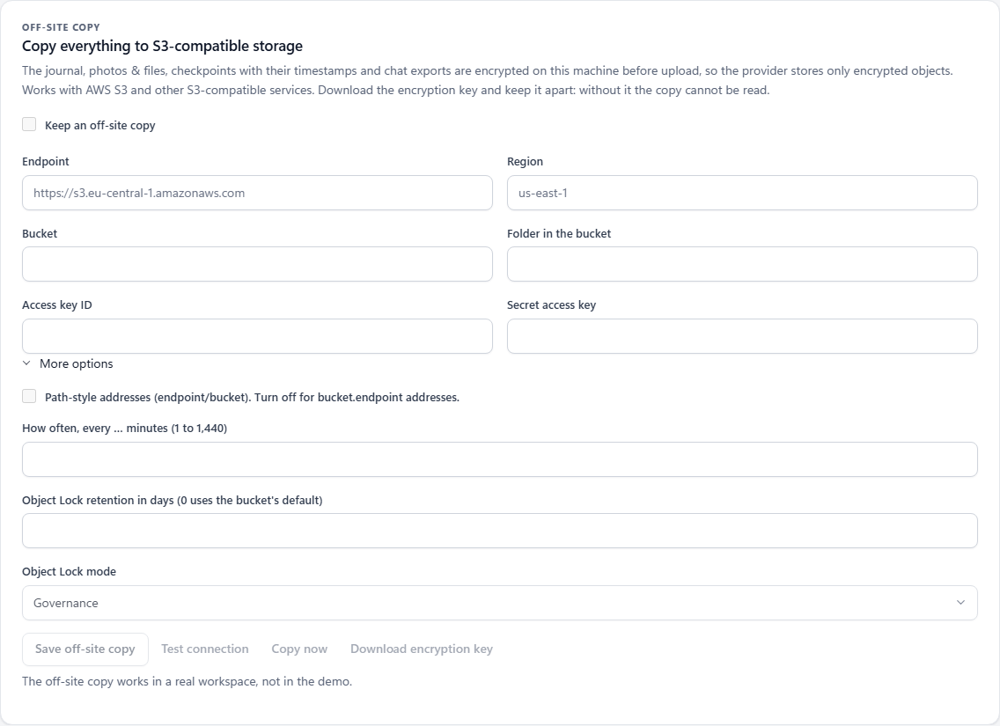

Each workspace has its own destination and encryption key. Object Lock retention
depends on bucket support. Recovery rejects inconsistent, incomplete or altered
material. Without the recovery key, the encrypted copy cannot be read.

Keep a separate [service backup](docs/wiki/Backup-and-Recovery.md) for account
sessions, configuration and signing secrets.

</details>


<p align="center"><picture><source media="(prefers-reduced-motion: reduce)" srcset="docs/assets/presentation/readme-divider-static.svg"></picture></p>

## Follow your next lead

<picture>
  <source media="(max-width: 640px) and (prefers-reduced-motion: reduce)" srcset="docs/assets/presentation/readme-handbook-mobile-static.svg">
  <source media="(prefers-reduced-motion: reduce)" srcset="docs/assets/presentation/readme-handbook-static.svg">
  <source media="(max-width: 640px)" srcset="docs/assets/presentation/readme-handbook-mobile.svg">
  
</picture>

<p align="center">
  <a href="https://github.com/phishdestroy/TgWitness/wiki/Accounts"></a>
  <a href="docs/INVESTIGATION.md"></a>
  <a href="docs/DEPLOYMENT.md"></a>
</p>

<p align="center">
  <a href="https://github.com/phishdestroy/TgWitness/wiki"></a>
  <a href="docs/wiki/Home.md"></a>
  <a href="docs/README.md">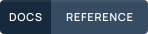</a>
</p>

<details>
<summary><strong>All handbook pages</strong> — accounts, collection, investigations and maintenance</summary>

| Set up | Work a case | Maintain |
| --- | --- | --- |
| [Accounts](https://github.com/phishdestroy/TgWitness/wiki/Accounts) | [Investigations](docs/INVESTIGATION.md) | [Server & Docker](docs/DEPLOYMENT.md) |
| [Collection](docs/COLLECTION.md) | [Export & verify](docs/EVIDENCE.md) | [Backup & recovery](docs/wiki/Backup-and-Recovery.md) |
| [Proxies](https://github.com/phishdestroy/TgWitness/wiki/Proxies) | [Independent witness](docs/wiki/Independent-Witness.md) | [Troubleshooting](https://github.com/phishdestroy/TgWitness/wiki/Troubleshooting) |

</details>

**Capture has boundaries.** TgWitness observes what the connected account can
access. No secret chats; downtime and catch-up can leave gaps and miss intermediate
edits. [Collection limits](docs/COLLECTION.md) · [Security](.github/SECURITY.md)

<p align="center"><picture><source media="(prefers-reduced-motion: reduce)" srcset="docs/assets/presentation/readme-divider-static.svg"></picture></p>

<!-- operator-notice:start -->

<details>
<summary><strong>⚖️ Ethical Notice &amp; Historical Continuity</strong></summary>

We have recently learned that for certain law firms—and specifically Dr. Tobias Schelinski and Dr. Patrick Vincent Zurheide—mathematics and objective facts are irrelevant.

Selling GDPR non-compliance to corporations as a commercial service while failing at basic data handling yourselves is not legal expertise.

Operating under the delusion that you are the law, or that an elite signature on a falsified claim magically turns a lie into truth, does not mask technical incompetence.

This tool is incompatible with jurisdictions where the following prevail:

- Corporatocracy
- Privatized or commercial justice
- Plutocracy
- Kleptocracy and institutional corruption

A special mention to Dr. Patrick Zurheide, Dr. Tobias Schelinski, and those attempting to weaponize the "Right to be Forgotten" to bury their own data-processing failures, sanitize their institutional lineage, and erase the historical record:

> Taylor Wessing (Dr. Tobias Schelinski & Dr. Patrick Vincent Zurheide) → Wessing & Berenberg-Gossler → Stonewall Top 100 → Dr. Graf von der Goltz Dr. Wessing & Partner (since 1957) → Rüdiger Graf von der Goltz → Paragraph 175 in its 1935 revision

To strictly comply with the MIT License, we do not restrict the use of this software. However, let it be clear: corporate retainers, legal intimidation, and demands for digital erasure cannot override history, rewrite lineage, or conceal the truth.

[Source record](https://phishdestroy.io/steam_dossier/taylor_wessing)

[MIT License](LICENSE) · [Technical notice](docs/OPERATOR-INCOMPATIBILITY.md) · [Original NOTICE](NOTICE)

</details>

<!-- operator-notice:end -->

<a name="repository-map"></a>

<details>
<summary><strong>Repository map</strong> — source, deployment and contribution guides</summary>

| Directory | Contents |
| --- | --- |
| [`tgwitness/`](tgwitness/README.md) | Application, collector, journal, verifier and web panel |
| [`docs/`](docs/README.md) | Guides, Wiki source, screenshots and verification record |
| [`deploy/`](deploy/README.md) | Compose configurations and service templates |
| [`scripts/`](scripts/README.md) | Demo, setup and Docker launchers |
| [`tests/`](tests/README.md) | Synthetic regression tests |
| [`tools/`](tools/README.md) | Builds, checks and packaging |
| [`website/`](website/README.md) | Documentation website and translations |
| [`.github/`](.github/AUTOMATION.md) | Workflows and contribution guides |

[Complete project guide](docs/PROJECT-GUIDE.md) · [Technical documentation](docs/README.md)

</details>

<details>
<summary><strong>Read the project overview in your language</strong></summary>

**English** · [Русский](docs/ru/README.md) · [Українська](docs/uk/README.md) · [Español](docs/es/README.md) · [Português (Brasil)](docs/pt/README.md) · [Türkçe](docs/tr/README.md) · [العربية](docs/ar/README.md) · [فارسی](docs/fa/README.md) · [اردو](docs/ur/README.md) · [हिन्दी](docs/hi/README.md) · [Bahasa Indonesia](docs/id/README.md) · [Tiếng Việt](docs/vi/README.md) · [简体中文](docs/zh/README.md)

</details>


<p align="center">
  <a href="https://github.com/phishdestroy"></a>
  <a href=".github/CONTRIBUTING.md">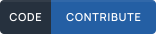</a>
  <a href=".github/SUPPORT.md"></a>
  <a href=".github/SECURITY.md"></a>
</p>
