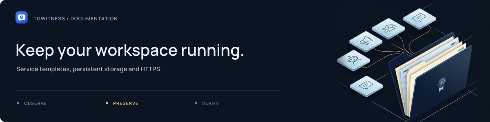

# Background services and HTTPS

Deployment files live here: [`Dockerfile`](Dockerfile), the shared
[`dependency constraints`](constraints.txt), the [`environment example`](env.example)
and [`Compose configurations`](compose/README.md). Copy `deploy/env.example` to
`.env` in the project root when configuration is needed. The root `compose.yaml`
still supports `docker compose up -d --build --wait`.

For the shortest server setup, use Docker Compose with automatic restart and the
optional [automatic HTTPS overlay](../docs/DEPLOYMENT.md#automatic-https-on-a-server).
Set your domain in `.env`, then run from the project root:

```sh
docker compose -f compose.yaml -f deploy/compose/compose.https.yaml up -d --build --wait
```

Docker must run at boot for the containers to resume. The overlay uses
`Caddyfile.docker`; `Caddyfile.example` below is for an existing host Caddy service.
For prebuilt images, updates, and backups, see [deployment](../docs/DEPLOYMENT.md).
Optional configurations live in [`compose/`](compose/README.md): HTTPS, Proof,
an operator proxy catalog and a standalone witness.

## Native service templates

The systemd, logon-task, and launchd files are examples, not an installer. They do not register or start
anything when TgWitness is launched. Linux/macOS, Caddy and Windows Task Scheduler
operation must be checked on the target machine; these templates were not run here.
Prepare the environment, run `python start.py --check` against the intended data path,
and complete the local foreground setup before enabling a background process.
Use one process for a data directory, persistent local storage, an encrypted volume,
and a dedicated OS identity where available. Keep credentials out of command arguments.

## Linux systemd

Create a system user/group named `tgwitness`. Place the project/environment at
`/opt/tgwitness`, readable by that user and not writable by the service. Install
`tgwitness.service` in `/etc/systemd/system/` after reviewing its paths. systemd
creates `/var/lib/tgwitness` with mode 0700. If migrating existing data, stop its old
process and copy the **whole** data directory and keys, with ownership set to this user.

```sh
sudo systemctl daemon-reload
sudo systemctl enable --now tgwitness
sudo systemctl status tgwitness
sudo journalctl -u tgwitness
sudo cat /var/lib/tgwitness/panel-token.txt
```

Use `sudo systemctl stop tgwitness` before backup or upgrade. An optional external
master key must be readable by this user and outside `/var/lib/tgwitness`.
Do not enable external-key mode on an existing local-key vault.


## Windows logon task

The script uses the current user's existing environment. It runs hidden with
`pythonw.exe`, starts at logon, and stops on sign-out. Windowless launches write
startup/server diagnostics to `logs/server.log` inside the selected data directory,
rotating at 5 MiB with two retained backups. HTTP access logging stays disabled.
This command's windowless startup is regression-tested with synthetic data;
Task Scheduler registration and logon/sign-out behavior still need target-machine
qualification. It cannot collect while the
computer sleeps. Review what it would register before executing without `-WhatIf`:

```powershell
.\deploy\windows-task.ps1 -ProjectPath 'E:\Tools\TgWitness' -DataPath 'E:\Private\TgWitnessData' -WhatIf
```

For an actual registration, repeat without `-WhatIf`, then use Task Scheduler or
`Start-ScheduledTask -TaskName TgWitness`. View the task result, `logs/server.log`
and panel for failures. If the data directory is not writable, logging cannot
start either; use a foreground run to diagnose that case.
Task Scheduler termination can be abrupt; pause observation in the panel before
stopping the task, and verify it has stopped before copying data. A task restart
cannot repair missed Telegram updates. The script refuses to overwrite a task.
Remove it with `Unregister-ScheduledTask -TaskName TgWitness` when no longer needed.

## macOS launchd user agent

Replace **all** `/ABSOLUTE/...` placeholders in the plist. Store data on a private
persistent local path. Save the file as
`~/Library/LaunchAgents/org.tgwitness.collector.plist` and check it with `plutil -lint`.

```sh
launchctl bootstrap gui/$(id -u) ~/Library/LaunchAgents/org.tgwitness.collector.plist
launchctl print gui/$(id -u)/org.tgwitness.collector
launchctl bootout gui/$(id -u) ~/Library/LaunchAgents/org.tgwitness.collector.plist
```

This is a user agent; sign-out and sleep interrupt collection. The last command
stops/unloads it. Use a deliberate foreground run to diagnose setup errors.


## HTTPS and remote access

An SSH tunnel to loopback needs no web-proxy configuration. For a domain, adapt
`Caddyfile.example`, run `caddy validate --config <file> --adapter caddyfile`, then
install through your existing Caddy service. It obtains TLS certificates using
your domain and ACME. Restrict network access where possible. The example allows
small API requests and waits up to ten minutes for export preparation; increase
that timeout deliberately for larger journals. It adds no access logging. If you
enable logging in your infrastructure, redact Authorization headers and tokens.

Container instructions and backup procedures: [DEPLOYMENT.md](../docs/DEPLOYMENT.md).

## Template index

| File | Purpose |
| --- | --- |
| [Caddyfile.docker](Caddyfile.docker) | HTTPS overlay for the Compose deployment |
| [Caddyfile.example](Caddyfile.example) | Existing host Caddy service |
| [Caddyfile.witness.example](Caddyfile.witness.example) | Witness endpoint example |
| [Caddyfile.proof.example](Caddyfile.proof.example) | Public Proof endpoint example |
| [tgwitness.service](tgwitness.service) | Linux systemd service template |
| [windows-task.ps1](windows-task.ps1) | Windows logon task script |
| [org.tgwitness.collector.plist.example](org.tgwitness.collector.plist.example) | macOS launchd user agent |
| [proof.config.example](proof.config.example) | Proof service configuration |
| [proxies.config.example](proxies.config.example) | Operator proxy catalogue configuration |
