[TgWitness](../../README.md) / [deploy](../README.md)

<picture>
  <source media="(max-width: 640px) and (prefers-reduced-motion: reduce)" srcset="../../docs/assets/presentation/section-deploy-mobile-static.svg">
  <source media="(prefers-reduced-motion: reduce)" srcset="../../docs/assets/presentation/section-deploy-static.svg">
  <source media="(max-width: 640px)" srcset="../../docs/assets/presentation/section-deploy-mobile.svg">
  
</picture>

# Optional Compose configurations

Run these commands from the **project root**. The main `compose.yaml` stays there
for ordinary startup. For the prebuilt image, use `--project-directory .` with
`-f deploy/compose/compose.image.yaml`; this keeps `.env`, overlay paths and the
existing named volumes rooted in the project directory.

| Configuration | Purpose |
| --- | --- |
| [`compose.image.yaml`](compose.image.yaml) | Run a published image instead of building the source |
| [`compose.https.yaml`](compose.https.yaml) | Add Caddy and automatic HTTPS |
| [`compose.proxies.yaml`](compose.proxies.yaml) | Mount an operator-managed proxy catalog |
| [`compose.proof.yaml`](compose.proof.yaml) | Independent proof-service deployment; see [high-assurance setup](../../docs/HIGH-ASSURANCE.md) |
| [`compose.witness.yaml`](compose.witness.yaml) | Run an independent witness on its own server |
| [`compose.capture-panel.yaml`](compose.capture-panel.yaml) | Connect the main panel to optional capture containers; use after both root and capture Compose files, as described in [Independent capture](../../docs/OPTIONAL-CAPTURE.md) |
| [`../../addons/capture/compose.yaml`](../../addons/capture/compose.yaml) | Optional independent browser/AyuGram recorders; separate profiles and controls, disabled capture by default |

For HTTPS, configure `.env` as described in the deployment guide, then run:

```sh
docker compose -f compose.yaml -f deploy/compose/compose.https.yaml up -d --build --wait
```

For an independent witness, configure its collector address and read-only token first:

```sh
docker compose --project-directory . -f deploy/compose/compose.witness.yaml up -d --build
```

`--project-directory .` keeps the standalone witness's build context and `.env`
relative to the project root. The collector's session and vault are never mounted
into the witness. See the [witness guide](../../docs/WITNESS.md).
