[TgWitness](../../README.md) / [deploy](../README.md)

<picture>
  <source media="(max-width: 640px) and (prefers-reduced-motion: reduce)" srcset="../../docs/assets/presentation/section-deploy-mobile-static.svg">
  <source media="(prefers-reduced-motion: reduce)" srcset="../../docs/assets/presentation/section-deploy-static.svg">
  <source media="(max-width: 640px)" srcset="../../docs/assets/presentation/section-deploy-mobile.svg">
  
</picture>

# Container dependency locks

Reviewed operating-system package sets for the runtime, media and build images.
Each profile has separate locks for `x86_64` and `aarch64`.

| Files | Purpose |
| --- | --- |
| `runtime.packages`, `media.packages`, `build.packages` | Requested root packages for each profile |
| `<profile>-<architecture>.lock` | Exact APK filenames and SHA-256 hashes |
| [`resolve-packages.sh`](resolve-packages.sh) | Resolve candidate locks inside the pinned Wolfi base |
| [`install-packages.sh`](install-packages.sh) | Install the reviewed packages after repository and hash checks |

## Update a package set

Edit the relevant `.packages` file, then use the
[Container dependency locks workflow](../../.github/workflows/container-locks.yml).
It resolves each profile on both architectures and retains candidate artifacts
for review. It does not edit the checked-in locks.

Review the candidate package versions and hashes together with the Dockerfile
change. The [release workflow guide](../../.github/workflows/README.md) covers
the separate image audit and publication gates.
