[TgWitness](../../README.md) / [deploy](../README.md)

<picture>
  <source media="(max-width: 640px) and (prefers-reduced-motion: reduce)" srcset="../../docs/assets/presentation/section-deploy-mobile-static.svg">
  <source media="(prefers-reduced-motion: reduce)" srcset="../../docs/assets/presentation/section-deploy-static.svg">
  <source media="(max-width: 640px)" srcset="../../docs/assets/presentation/section-deploy-mobile.svg">
  
</picture>

# One-command installation

This directory contains the installer templates and the static download page.
The builder packages the checked application, embeds SHA-256 hashes in the
installers and creates an immutable release directory. Hosting needs only static
HTTPS: a separate virtual host on the API server or Cloudflare Workers assets.

The public download address is [get.destroy.tools](https://get.destroy.tools/),
served as static Cloudflare Workers assets. It hosts program files and release
signatures, not users' panels or account data.

| System | Installation command |
| --- | --- |
| Linux / macOS | `curl -fsSL https://get.destroy.tools/install.sh \| bash` |
| Windows Command Prompt or PowerShell | `powershell.exe -NoProfile -ExecutionPolicy Bypass -Command "irm https://get.destroy.tools/install.ps1 \| iex"` |

The Windows command runs in a child PowerShell process, so your terminal stays
open with the result and launch instructions. If you prefer curl, use this
alternative in Command Prompt; it leaves any existing `install.cmd` untouched:

```bat
if exist install.cmd (echo install.cmd already exists. Choose another folder.) else (curl -fsSL https://get.destroy.tools/install.cmd -o install.cmd && call install.cmd && del install.cmd)
```

The installer verifies pinned SHA-256 checksums and RSA release signatures before
installing the application. Dependencies come only from a signed lock with a SHA-256 for every file
(`--require-hashes`), so a file added to a pinned version on PyPI is refused. It brings Python 3.12 through
a pinned uv build, then asks how to open the panel. Questions are read from the
terminal, so they work when the installer is piped into Bash.

- **This computer:** loopback access only. macOS and Windows open the normal local
  panel in the foreground; keep its terminal open.
- **Temporary HTTPS link (Ubuntu):** a checked cloudflared binary provides a
  trycloudflare.com address. No domain or Cloudflare account is needed. The panel
  still requires its own access key. Cloudflare carries the panel traffic through
  a temporary tunnel intended for trials. After a tunnel restart,
  `tgwitness open` shows its current address.
- **Own domain (Ubuntu, root):** point DNS at the server and allow inbound TCP 80
  and 443. A checked Caddy binary configures HTTPS and renews certificates.
- **Install only:** do not start or expose anything. Run `tgwitness setup` later.

On Linux with systemd, setup registers a background service. A root installation
uses a sandboxed dynamic service user, not root, and starts at boot. A user service
starts at login; lingering is needed to keep it running after sign-out. Domain
setup does not overwrite another web server or change firewall rules. Failed
readiness is reported as a failure, with a command to inspect logs.

Telegram sign-in and collection are separate, explicit actions in the panel. No
account, journal, session, panel token or signing key is sent to the download host.
The download host serves public program files only. Tunnel logs and current addresses
stay on the user's machine; there is no project-hosted address registry.

`--no-start` (Bash), `-NoStart` (PowerShell), or `TGWITNESS_NO_SETUP=1` installs without
questions or startup. On Unix, `TGWITNESS_NO_LINK=1` suppresses the optional launcher
shortcut. Shell profiles are not edited.

Default locations are `~/.local/share/tgwitness` and `%LOCALAPPDATA%\TgWitness`.
On Linux as root, the default is `/opt/tgwitness`, with a launcher in `/usr/local/bin`.
The system service keeps private data under `/var/lib/tgwitness-<installation ID>`;
the installer prints its exact path.
Set `TGWITNESS_INSTALL_DIR` for a different location. Program versions and data
are separate; the launcher switches only after the new environment passes its
checks. An installation failure keeps the previous launcher. Run `--plan` for
Bash or `-Plan` for Windows to inspect the destination without installing.

## Build and check

Use a clean application checkout and Python 3.11+ with setuptools, wheel and cryptography.
The release private key must stay outside the checkout and match
[release-signing.pub](release-signing.pub):

```sh
python tools/build_installer.py --base-url https://get.destroy.tools --signing-key /private/release-key.pem
```

The [installer acceptance workflow](../../.github/workflows/installer-acceptance.yml) checks
that build: it verifies the artifact signatures and source revision, installs the wheel with
its hash-locked dependencies on Ubuntu and Windows and, for pull requests that change the
installer, runs `install.sh` and `install.ps1` twice against a local HTTPS origin.

The output is `dist/installer-site/`. Each release path contains a wheel,
the hash-locked `requirements.lock`, installer copies, SHA-256 sidecars and a manifest linking
the build to its source commit. `install.cmd` pins the PowerShell child's hash.
The wheel inventory and RECORD are checked against the checkout before release.

The install acceptance check maps only the unpublished download origin to the
generated local files. uv, managed Python and package downloads use real HTTPS.
The basic check never starts a panel. The separate service acceptance check uses an
isolated empty installation; it never signs in to Telegram.

## On the existing API server

1. Put the built static directory in a separate location, for example
   `/var/www/tgwitness-installer`. Retain older `releases/` directories: previously
   downloaded installers refer to their immutable paths.
2. Add a separate virtual host for `get.destroy.tools`. Adapt
   [nginx.conf.example](nginx.conf.example) to the existing web server; preserve
   the API's host and upstream configuration.
3. Point the subdomain to the server and configure a valid HTTPS certificate.
   The example is an HTTP virtual host intended for certificate provisioning;
   it is not a complete HTTPS deployment by itself.
4. Check the web-server configuration before reloading. Fetch all three public
   scripts, compare them with the built checksums, then perform a fresh install.

Do not send these requests to a generic API or SPA fallback. A missing download
must return 404, and the wheel must be served as a binary file. The installers
reject downloads whose hashes do not match.

## Cloudflare alternative

The same output works as Workers static assets. Set the hostname in
[wrangler.toml](wrangler.toml), authenticate Wrangler for the `destroy.tools`
zone and deploy that configuration. The custom domain creates its DNS routing
and TLS through Cloudflare. No application server or Telegram credentials are
needed by this host.

Keep account IDs and API tokens in the operator environment or GitHub secrets.
The public hostname is already attached to the `tgwitness-install` Worker. The
application itself is installed on each user's own machine.

## Automatic publication from GitHub

The [Installer workflow](../../.github/workflows/installer.yml) rebuilds for
every commit on `main`, including documentation changes. It derives the software
version from `pyproject.toml`, records the commit, and signs the files. Before
publication, [installer-acceptance.yml](../../.github/workflows/installer-acceptance.yml)
authenticates the exact signed candidate, installs its wheel with the hash-locked
dependencies on clean Ubuntu and Windows runners and runs the readiness check.
Pull requests that change the installer also run `install.sh` and `install.ps1` twice
against a local HTTPS copy of the site built with a throwaway test key. Service
setup, tunnels and bootstrap regressions run outside the public workflows.
The application **Checks** and **Security audit** workflows must also succeed for
that same main commit; a triggered **Sealed capture validation** must finish
successfully too. Missing, queued, skipped or failed required checks do not qualify.
The publication wait is bounded to 45 minutes. A failure or timeout keeps the
previous installer on the site; after resolving it, rerun the failed workflow.
The permanent `/install.sh`, `/install.ps1` and `/install.cmd` addresses receive
the new build together with its checksums, signatures and download page.

Configure these repository Actions settings once:

| Setting | Kind | Value |
| --- | --- | --- |
| `TGWITNESS_INSTALLER_SIGNING_KEY` | Secret | Existing private release key matching `release-signing.pub`. |
| `CLOUDFLARE_API_TOKEN` | Secret | Cloudflare Workers deployment token, restricted to the publishing account and `destroy.tools` zone. |
| `CLOUDFLARE_ACCOUNT_ID` | Variable | The account that owns `tgwitness-install`. |
| `TGWITNESS_INSTALLER_DEPLOYMENT` | Variable | `cloudflare` enables publication. Unset it to keep build/check jobs without deployment. |

See [Cloudflare's GitHub Actions setup](https://developers.cloudflare.com/workers/ci-cd/external-cicd/github-actions/)
for the token. A local `wrangler login` is not a CI credential. Keep the signing
key in GitHub; Cloudflare receives public files only. Do not also enable native
Workers Builds for the same Worker: use one publisher to avoid competing deploys.
The publish job uses the `installer-production` GitHub environment; any required
reviewers configured there apply before its deployment credentials are used.

The publication job downloads the artifact from its own successful build, checks
its source commit and signatures, and copies previously published releases after
verifying their hashes and signatures against the repository key. The public
`releases.json` catalog lists these immutable paths. If retention fails, deployment
stops; it never silently removes old downloads. Publication is serialized and an
obsolete main commit is skipped. Forks, PRs and release tags cannot replace the
main preview channel. After deployment, CI compares all public bytes with its
artifact and checks that missing files return 404.

For the initial migration only, prepare a copy of the current site containing
**all** existing `releases/` directories, then generate its catalog before deploying:

```sh
python tools/installer_publication.py index --site dist/installer-site
npx --yes wrangler@4.156.1 deploy --config deploy/installer/wrangler.toml
```

Subsequent publications retain that catalog automatically. Old release IDs are
never overwritten with new bytes. Manual dispatch on `main` uses the same checks
and publishing path. Installed copies update only when their operator reruns the
installer; this workflow does not install an unattended updater on their machines.

To exercise the actual public download URLs on disposable Ubuntu and Windows
hosts, run **Installer artifact and wheel smoke** on `main` with **published** enabled:

```sh
gh workflow run installer-acceptance.yml --ref main -f published=true
```

This authenticates the public manifest and immutable artifacts against the checked
repository key and requires the selected main commit. It then installs the published
wheel with its hash-locked dependencies and runs the readiness check; it does not run
the `curl | bash` or `irm | iex` commands. A concurrent
publication or a main commit not published yet is reported as a mismatch, never
silently tested as if it were the requested build. Test installations contain no
Telegram accounts. To inspect the current publication locally, download it first:

```sh
python tools/installer_publication.py download-current --site build/public-installer --revision FULL_COMMIT
```

## Everyday commands

| Command | Result |
| --- | --- |
| `tgwitness open` | Show the current address and access key. |
| `tgwitness status` | Check availability without printing the access key. |
| `tgwitness stop` | Stop the panel and collection; retain all data. |
| `tgwitness start` | Start the configured service. |
| `tgwitness restart` | Apply the installed version and restart the service. |
| `tgwitness logs` | Read recent service diagnostics. |
| `tgwitness doctor` | Run the application readiness checks. |

These service commands apply to Linux systemd installations. The usual application
options, such as `tgwitness --demo`, remain available through the managed launcher.
To update, run the installer again and then `tgwitness restart`. Existing access
settings, data and keys are preserved. Take a complete stopped backup before an
application upgrade; a signed export is not a complete installation backup.

## Release signatures

The private signing key is held outside the repository. CI receives it through the
`TGWITNESS_INSTALLER_SIGNING_KEY` repository secret and removes its temporary file
after building. The builder refuses an unsigned release or a key that does not
match the reviewed public key. Test builds use an ephemeral key and are restricted
to `.invalid` origins.

The wheel, `requirements.lock`, manifest, checksum list and all three installer scripts have detached RSA-3072
PKCS#1 v1.5 / SHA-256 signatures. Bash verifies application and lock signatures
with OpenSSL; Windows uses the operating system's RSA implementation. A signature
failure stops before the application is installed or run. Native uv/Python and
optional bridge downloads retain their separate toolchain trust boundaries; these
are not claimed to be signed by TgWitness.

To inspect an installer before running it, download `install.sh` and `install.sh.sig`,
obtain `release-signing.pub` from an independently trusted repository revision, then:

```sh
openssl dgst -sha256 -verify release-signing.pub -signature install.sh.sig install.sh
```

Compare the public key's SHA-256 with a separately trusted copy. A key downloaded
only from the same endpoint as a disputed file is not an independent trust anchor.
The one-line bootstrap itself uses HTTPS; its embedded key verifies the subsequent
package downloads. Windows Authenticode signing is not configured.
