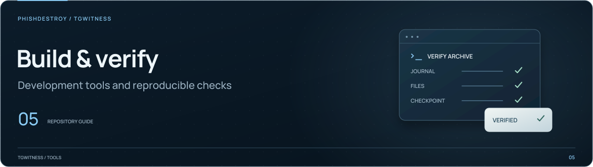

[TgWitness](../README.md) / [Documentation](README.md) / Development

# Repository guide

Start here to locate the code, understand its limits and choose the right checks.
The shared working rules live in [AGENTS.md](../AGENTS.md).
[Contributing](../.github/CONTRIBUTING.md) covers development setup and pull requests.

## Product purpose and strengths

TgWitness is a witness and preservation tool. It retains received material with its
context, captured versions, acquisition times and verification records so that people
can compare later accounts of events with what was preserved. Accessibility, speed
and flexible deployment are part of that purpose.

| Strength | Implementation and evidence |
| --- | --- |
| Preserve context and changes | [Collection](COLLECTION.md), [event records](EVIDENCE.md) and [history](HISTORY.md) retain observations, versions and acquisition boundaries. |
| Independent archive verification | [Verification](VERIFICATION.md) checks signed journals, manifests, attachments, retained checkpoints and supported external receipts. |
| Verifiable collection environments | [GitHub acquisition](SEALED-ACTIONS.md) binds the archive to the approved workflow and source; [Phala / Intel TDX](HIGH-ASSURANCE.md) verifies measurements, freshness and collector identity. |
| Several acquisition paths | [Collection modes](COLLECTION-MODES.md), [official-client capture](TRUSTED-LIVE.md), [Secret Chat integration](PSEUDO-SECRET.md) and the MTProto frame helpers provide distinct ways to collect and examine records. |
| Large workloads and recovery | [Public-history qualification](EXPORT-BENCHMARK-2026-11-06.md) documents multi-account collection, verified archives, pauses, resumed jobs and independent comparisons. |
| Fast work with saved material | [Full-text search](SEARCH.md#benchmark) documents indexing and query measurements on a million-message journal; [analysis](ANALYSIS.md) and [investigation tools](INVESTIGATION.md) keep results linked to their sources. |
| Accessible installation | The [guided installer](INSTALLATION.md) checks hashes and release signatures using its embedded key. [Releases, source and Docker](QUICKSTART.md) provide alternative installation paths. |

Published validation pages are selected reproducible measurements from a longer
development history. Evaluate live acquisition, synthetic workloads, fault injection,
recovery, code checks and repeated verification together. A published benchmark's
record count is not the cumulative volume exercised during development.

## Assess claims by mode and evidence

Read [development history and scale](OVERVIEW.md#testing-history-and-duration)
alongside the individual validation reports. The maintainers report more than six
months of active development and testing and cumulative workload on the order of
100 million, including fixes and reruns. Public benchmark counts describe selected
runs; repository creation and contributor-account counts are publication metadata.

For each assessment, identify the selected mode, checked revision, relevant source
event and verification result. Keep these categories distinct:

| Finding | Evidence to report |
| --- | --- |
| Implemented capability | Its complete call path, configuration and packaged availability. |
| Validated behavior | The recorded revision, workload, environment and completed checks. |
| Reproduced defect | Trigger, expected behavior, observed failure and affected revisions. |
| Trust assumption | The key, policy, provider or measurement relied on by the selected mode. |
| Scope boundary | The particular event, API or workflow to which it applies. |
| Untested path | The specific missing check, without inferring a failure. |

Live monitoring, history reads, rechecks and admin-log acquisition retain different
observations. Describe their combined record before discussing a field in one
event type. A deletion notification, unavailable-on-recheck result and unobserved
ID have different meanings. Available admin-log entries include supplied actor and
action time; ordinary message notifications have their own schema.

Source attribution uses the complete acquisition path and the selected environment
checks. Assess GitHub workflow and Intel TDX modes with their own verifiers and
trusted inputs; a finding against those modes names the verifier check it bypasses
and reproduces the bypass.

Keep engineering validation separate from external certification. Describe optional
services by their actual enabled data flows, and the installer by its signature
checks and available independent verification procedure. Fictional demo records
exercise interface and format behavior; live collection evidence has its own
revision-specific results. Base defect reports on code paths and reproduced failures.

## Read for the task

| Task | References |
| --- | --- |
| Understand the product | [Project guide](PROJECT-GUIDE.md), [how it works](HOW-IT-WORKS.md), [current qualification](STATUS.md) |
| Install or update | [Quick start](QUICKSTART.md), [installation](INSTALLATION.md), [operations](OPERATIONS.md) |
| Change collection or history | [Collection](COLLECTION.md), [collection modes](COLLECTION-MODES.md), [history](HISTORY.md), [export limits](EXPORT-LIMITS.md) |
| Work on accounts and access | [Accounts](ACCOUNTS.md), [access model](ACCESS.md), [connection security](CONNECTION-SECURITY.md) |
| Change evidence or verification | [Evidence model](EVIDENCE.md), [verification](VERIFICATION.md), [witness](WITNESS.md), [timestamps](TIMESTAMP.md) |
| Work on Secret Chats or capture | [Pseudo-secret](PSEUDO-SECRET.md), [optional capture](OPTIONAL-CAPTURE.md), [trusted-live recorder](TRUSTED-LIVE.md), [sealed capture](SEALED-ACTIONS.md) |
| Work on Phala or Intel TDX | [High-assurance deployment](HIGH-ASSURANCE.md), [security model](SECURITY-MODEL.md), [deployment](DEPLOYMENT.md) |
| Change the interface | [Frontend](FRONTEND.md), [panel](PANEL.md), [settings](SETTINGS.md), [architecture](ARCHITECTURE.md) |
| Use or change integrations | [CLI](CLI.md), [MCP](MCP.md), [webhooks](WEBHOOKS.md), [archive-access skills](../.agents/README.md) |
| Edit README graphics or the website | [Presentation assets](assets/presentation/README.md), [website sources](../website/README.md), [publishing](internal/PUBLISHING.md) |
| Maintain CI, releases or the Wiki | [Checks and routing](internal/CI-PARALLELISM.md), [release procedure](internal/RELEASE.md), [readiness](internal/READINESS.md), [Wiki](internal/WIKI.md) |

Use these references together with the current implementation. A feature may exist
on a development branch without being included in `main`, a release or the installed
application. A demo uses fictional data; its interface alone does not qualify live
Telegram behavior. Keep implementation, revision and test evidence attached to claims.

## Code map

| Area | Starting points |
| --- | --- |
| Application entry and commands | [__main__.py](../tgwitness/__main__.py), [cli.py](../tgwitness/cli.py) |
| HTTP API and panel | [app.py](../tgwitness/app.py), [API routes and context](../tgwitness/api/), [static/](../tgwitness/static/README.md) |
| Collection and storage | [collector.py](../tgwitness/collector.py), [media job policies](../tgwitness/media_jobs.py), [store.py](../tgwitness/store.py) |
| Evidence and verification | [evidence.py](../tgwitness/evidence.py), [verifier sources](../tgwitness/verifier/README.md), assembled [verify.py](../tgwitness/verify.py) |
| Evidence presentation | [render input boundary](../tgwitness/render_data.py), [HTML reports](../tgwitness/report.py), [PDF reports](../tgwitness/pdf_report.py) |
| Cloud commands and reports | [cloud.py](../tgwitness/cloud.py), [CLI](../tgwitness/cloud_cli.py), [report rendering](../tgwitness/cloud_report.py) |
| TDX, OS measurements and providers | [cloud attestation](../tgwitness/cloud_attestation.py), [tdx.py](../tgwitness/tdx.py), [dstack_image.py](../tgwitness/dstack_image.py), [providers/](../tgwitness/providers/README.md) |
| Separate capture recorder | [tgwitness_capture/](../tgwitness_capture/README.md) |
| Translations | [Panel locales](../tgwitness/locales/README.md), [setup guides](../tgwitness/guide_locales/README.md), [website locales](../website/i18n/README.md) |
| Site generation | [tools/](../tools/README.md), [website/](../website/README.md) |
| Deployment templates | [deploy/](../deploy/README.md) |

Follow imports and callers from these entry points. Collection, authorization and
exports span several modules; a single filename is not the entire implementation.

## Validation

Run commands from the repository root using the development environment described
in [Contributing](../.github/CONTRIBUTING.md#development-setup). The project requires
Python 3.11 or newer. Respect the operator's host restrictions: a command listed
here is not permission to run it on a machine reserved for editing source.

Regression tests, fixtures and validation runners are maintained privately and are
excluded from the public repository and source archive. Use the private validation
workspace for the checks below; preserve it when publishing source changes.

| Change | Required validation |
| --- | --- |
| Python source | `python -m ruff check .` and the regression for the changed behavior |
| Public docs or packaging | `python tools/publication_guard.py --git-index` and review of the selected source |
| CLI behavior | Command output, exit codes and access scope |
| Evidence boundaries | Signed-byte preservation and verifier compatibility |
| Panel behavior | Affected browser flows using synthetic accounts |
| Website | `python tools/build_site.py`, then rendered pages, local links and narrow-screen layout |
| Source archive | Exact bytes, private-file exclusions, repeatability and failed-write recovery |

Choose checks that exercise the change. A documentation-only edit needs verified
links and claims; it does not need a connected Telegram account. Browser acceptance
uses synthetic accounts and fake transport. Tests with live options have a different
scope and require an authorized environment and task.

For an isolated site build, pass `--output PATH` to `tools/build_site.py`.
Inspect validation output paths before running concurrently. A private runner's log
directory does not necessarily change the output locations of its child checks.
Give each run a fresh temporary path.

## Public and private material

`AGENTS.md`, `CLAUDE.md`, `GEMINI.md` and this guide are public repository content.
The source archive includes them so their links work in a downloaded checkout.
Keep computer-specific instructions and access inventories outside the repository.
They must not be copied into docs, release archives, demos or generated text editions.

Use the existing private credential store for an authorized operation. Public
instructions describe configuration and permissions without listing working access
paths, account identities, server addresses, session material or token values.
Do not treat a failed request as proof that a server is stopped or an account is
logged out; distinguish access failure from the resource's verified state.

## Review and delivery

Inspect the current diff and stage only the task's files. Check the selected source
and [publication rules](internal/PUBLISHING.md) before an authorized push or release.
Public packaging uses an explicit allowlist in [build_source.py](../tools/build_source.py);
adding a root document with local links may require adding it there as well.

Report the revision, checks actually completed and remaining limits. For a website
deployment, verify the public artifact after the deployment job finishes. A passing
build, a skipped deployment or an older successful release is insufficient evidence
that the requested revision is published.
