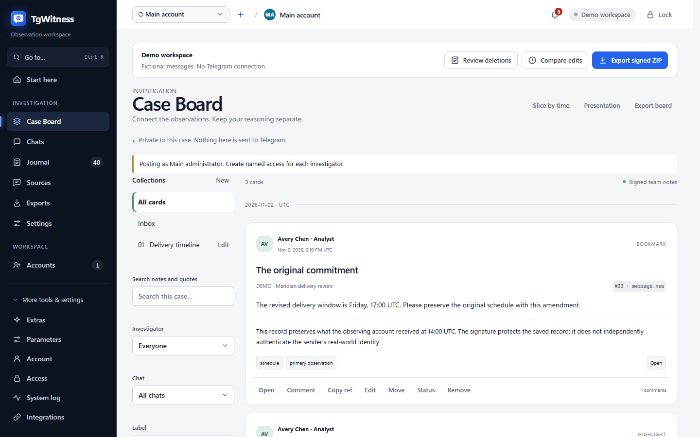

# Case Board

Case Board is the investigation team's private working feed. Bookmark a saved observation,
highlight an exact passage, save a range of actions, and discuss it with colleagues. Team notes
are opinions. They never become Telegram observations and are never sent to Telegram, webhooks,
Apprise or an AI provider by this feature.

[Evidence model](EVIDENCE.md) · [Access](ACCESS.md) · [Reports](CASE_REPORTS.md) · [Русский](ru/CASE-BOARD.md)



## Work with a case

Open **Investigation → Case Board** in Standard or Expert mode. The language follows the panel.
Use **To board** beside a journal record or saved chat message, or focus it and press **B**.
The bookmark is added to Inbox in one click. Edit its title, labels and note, or move it to a
collection. A changed card appends a signed revision; removing it preserves the history.

Select text inside a saved chat message to reveal **Highlight → board**. Select its colour and
add a note. The server checks the exact quote and saved version, including emoji, RTL text and
combining marks. The interface does not map a selection through masked or transformed text.

Shift-click two records in one chat for **Slice between**, use **Slice by time**, or save the
journal's current chat, period and event-kind filters. A saved slice has its own authoritative
predicate: opening it in Journal also applies multiple chats, message-number limits and actor
filters. **Show records added since bookmark** isolates the later additions. Changing Journal
filters exits the slice. From People, **Slice this person’s actions** uses the recorded actor ID;
it does not assume that the message author edited, deleted or reacted to a message.

The slice dialog previews counts before allowing creation. `all` includes every recorded kind,
including snapshots, edits, deletions, reactions, membership/service updates, own actions,
buttons, media outcomes, recovered messages and future event kinds. Nothing can display an
action that the collector never observed. Unknown-chat deletion notices are separate context,
available only to a whole-workspace access, never attributed to one of the chosen chats.

Collections have a declared chat scope. An empty scope means the whole workspace. A collection
cannot contain cards outside its scope; a chat-limited participant cannot read a broader
collection. Inbox is a virtual collection for unassigned cards. Search and filters cover visible
cards only; threads and mentions inherit the parent card's access. Removed comments have a
tombstone in the discussion. No viewer history is recorded.

**Presentation** opens all cards in the chosen collection, with Card, Source context and Team
comments views and keyboard Previous/Next controls. It provides no editing controls. The ordinary
feed is paginated; presentation loads its list in pages and retrieves one card's detail at a time.

## Permissions

All operations require `view`, workspace/chat scope and `board.read`. `board.write` adds cards,
comments, moves and open/review statuses. `board.manage` permits collection management,
confirmed/dismissed statuses, revisions/removal of someone else's card. A status is a team
decision, not a cryptographic verification result.

Access form presets: Reviewer = read; Analyst = read/write; Operator = read/write/manage,
in addition to their existing permissions. Existing grants do not silently acquire new rights.
The main administrator has all rights, and posts as **Main administrator**. Use named grants
for attribution. Mentions list only current accesses able to read the complete parent card.

A grant for chat A cannot obtain a card or slice for A+B, even by guessing its ID or supplying a
false `target.chat_id`. Target metadata is resolved from the signed event hash on the server.
Collections, discussion counts, related cards and live notifications are filtered before response.
Exports require `export` as well as `board.read`; an existing exporter without board access gets
the ordinary evidence archive without team notes. SSE rechecks current grants before each batch.

## Stored contracts

Like observations, annotations are written transactionally to an append-only SQLite table in
the workspace. `annotations.jsonl` is its exact canonical export from the same read snapshot as
`events.jsonl`. There is no second competing annotation store and no `board.activity` journal event.

Each line has exactly:

```json
{
  "seq": 1,
  "at": "2026-11-02T14:00:00.000+00:00",
  "access_id": "admin",
  "access_label": "Main administrator",
  "kind": "board.bookmark",
  "payload": {"id": "32 lowercase hex digits", "target": {"event_hash": "64 lowercase hex digits"}},
  "previous_hash": "64 zeroes for the first record",
  "hash": "SHA-256 described below",
  "signature": "base64 Ed25519 signature"
}
```

The abbreviated example above illustrates the envelope; actual payloads include their model
defaults and server-resolved target fields. API request schemas are under
[`tgwitness/schemas`](../tgwitness/schemas/board-bookmark.json), generated from the runtime Pydantic
models by `python tools/build_board_schemas.py`. Extra request fields are rejected. IDs are
generated server-side when omitted. Authorship, time, snapshot and signature cannot be supplied
by the caller. Named grant IDs follow Access's existing 16-hex format; card IDs are 32 hex.

Canonical JSON is UTF-8, sorted object keys, no whitespace between tokens, unescaped Unicode,
and no NaN/infinities. The annotation hash is SHA-256 of the canonical object containing
`format: "tgwitness-annotations-v1"` and all seven envelope fields through `previous_hash`.
This format tag separates its hash domain from observations. The signature is Ed25519 over the
32 raw hash bytes. Sequence starts at 1. Revisions retain the card ID and name the preceding
annotation hash in `supersedes`; they cannot change chat scope. Moves, statuses and removal are
separate records. The SQLite table rejects UPDATE and DELETE.

`case-board.json` contains `{statement, signature}`. The canonical statement is signed by the
workspace key and contains `format: "tgwitness-case-board-v1"`, `public_key`, `created_at`,
`journal_head`, `meaning`, and `state`. State is deterministic replay: `annotations_head`, an
ordered `items` array (collections, cards, comments including tombstones), and `status_history`.
Items retain their last annotation hash, sequence, author and time, as well as the original
creator and creation time across revisions. Replay checks revisions,
parents, collection references and duplicate action IDs. `manifest.json` and new checkpoints
also bind `annotations_head`. Retain a checkpoint independently to detect truncation or rewriting
with a copied signing key. A signature alone does not establish that its author told the truth.

### Text versions

`range.start` is a zero-based Unicode code-point offset, `length` is a positive code-point count,
and `quote` must equal the exact substring of `payload.text` or `payload.caption` at the target
event. No NFC/NFKC, case folding or grapheme normalization is applied. Python string slices and
JavaScript `Array.from(text)` implement the same indexing. Combining marks and ZWJ emoji may
occupy several code points. `range.version` is the target event hash, not the current message
version or Telegram's UTF-16 entity offset. Later edits never relocate a highlight automatically.

### Slice identity and time

`query` accepts exactly one `chat_id` or nonempty `chat_ids`, optional inclusive `from`/`to`,
inclusive message-ID bounds (one chat only), `kinds: "all"` or exact/prefix wildcard kinds,
explicit `actors`, `search`, `hide_system`, and `include_unscoped`. Journal kind groups expand to
their exact predicates. Search uses the journal's NFC/case-folded payload search without altering
signed source text. Dates require a timezone and normalize to UTC.
Dates filter **observed_at**. Telegram's `source_at` is displayed separately. A deletion without
a source timestamp has no invented deletion time. A late record observed outside a time interval
does not enter it; a message-ID slice can include a later deletion for those message IDs.

`snapshot` fixes creation time, the journal sequence/hash boundary, matching count, first/last
sequence and `result_hash`. The latter is SHA-256 of the UTF-8 canonical JSON array of matching
event hashes sorted lexicographically, including `[]` for an empty slice. It also carries exact
kind counts and a 24-bin observation-time miniature. A slice stores a query, not duplicate source
records. At export, `board/slices/<id>.json` lists current hashes and added/removed sequences.
The verifier reconstructs the original result at the creation boundary, then the current result.
Added records are reported as a change fact. Removing an original event breaks the immutable
evidence chain; it is not silently accepted as an ordinary removal from a slice.

Reaction snapshots have incomplete recent-actor lists. The explorer compares adjacent snapshots
of the same chat/message, including a predecessor outside the slice, and reports aggregate count
deltas **between observations**. Missing recent actors are not claimed to have removed a reaction.
The first snapshot has no inferred earlier state. Actor observations remain attributed to the
snapshot in which they were supplied, not to an invented action time.

## API and exports

`GET /api/board` accepts collection/chat/author/label/state/from/to/q/kind/comments, offset/limit
and newest/oldest order. `GET /api/board/card/{id}` returns a card, source preview, thread,
status history and related cards. The participants subroute returns eligible mention choices.
`POST /api/board/{bookmark|highlight|slice|collection|comment|status|move|remove}` appends a record.
`POST /api/board/slice-preview` calculates a query. Slice records are paged at
`GET /api/board/slice/{id}/records`; recomputation always uses the current stable read snapshot.
Live `/api/stream` emits payload-free `board` notifications, separately from journal cursors.

`GET /api/board/export` returns a signed document. Chat-limited access receives a clearly labelled
signed **disclosure**, never another chat's annotations or the full chain. Full evidence ZIPs
carry `annotations.jsonl`, signed `case-board.json` and slice JSON appendices. HTML/PDF/JSON report
settings select no board, bookmarks/slices without discussion, or cards with comments. The
section explicitly separates team opinions from observations. Report data filters restrict the
readable notes too; full signed source files in the evidence ZIP remain complete.

`GET /api/board/slice/{id}/export` produces a signed `tgwitness-board-selection-v1` JSON excerpt;
`?format=csv` produces a convenient table without a standalone signature. Keep the JSON and ZIP:

```sh
python verify.py evidence.zip --fingerprint TRUSTED_KEY_SHA256 --board
python verify.py board-slice.json --evidence evidence.zip --fingerprint TRUSTED_KEY_SHA256
python verify.py case-board.json --evidence evidence.zip --fingerprint TRUSTED_KEY_SHA256
```

The selection check authenticates the signed statement, exact source records and completeness
of its query at the specified boundary. The evidence ZIP may be newer but must contain that
prefix. A dangling target is reported explicitly. A different original slice snapshot, changed
annotation, mismatched replay state or changed source fails. Old archives without annotations
retain their existing verification behavior.

Handover defaults to **Do not include**. Explicit inclusion projects cards through the already
minimized records, omits inaccessible/omitted targets, withholds highlights whose source text
was minimized, cleans team text with the same mention/contact rules, and optionally replaces
investigator labels with R01, R02… in metadata and known occurrences in notes. No original
`annotations.jsonl` is disclosed. The signed `tgwitness-case-board-handover-v1` sidecar and report
contain the same minimized material. Slice counts describe disclosed records only, with original
snapshot/query actor details withheld. Free-text names not known to the minimizer still require
review, as they do in ordinary handovers. This derivative does not claim to preserve original
annotation signatures after redaction.

## Operating limits

Parameters include soft limits of 10,000 cards and 50,000 comments, a slice page of up to 5,000
records, and media-preview control. Soft limits warn without deleting history. Feed pages are
at most 200 cards. Standalone JSON slice excerpts are capped at 64 MiB; narrow the query or use
the signed ZIP for larger material. The standalone verifier caps annotations replay at 256 MiB.
No external comment notifications are enabled or implemented by Case Board.

The feature's automated acceptance uses fictional data and fake Telegram transport. It verifies
storage, access, rendering and exports; it does not establish Telegram completeness, trustworthy
wall-clock time, court admissibility or resistance to a host administrator who controls the key.
