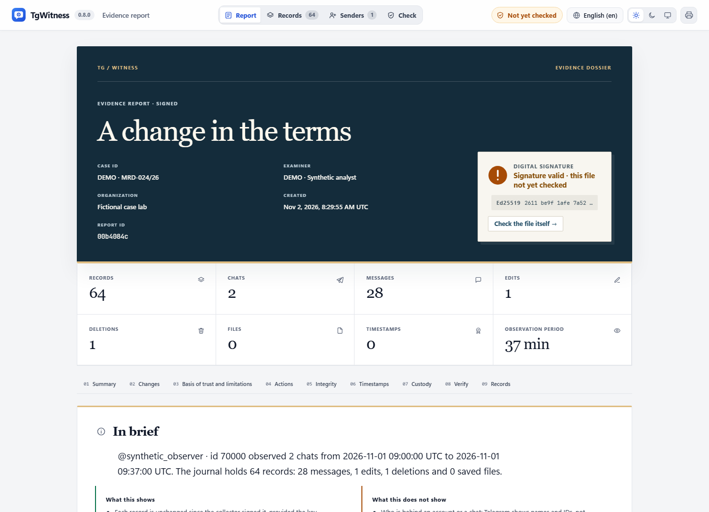
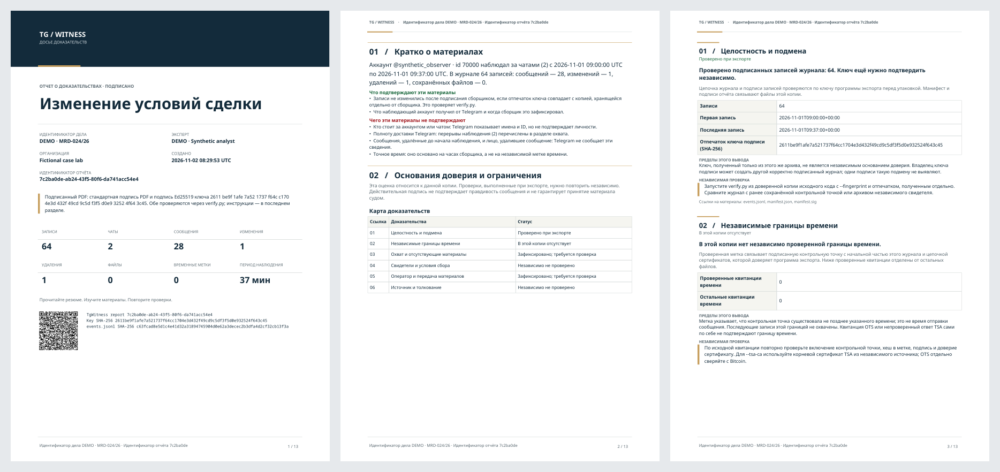

[TgWitness](../README.md) / [Documentation](README.md) · [Investigation](INVESTIGATION.md)


# Case reports: contents, design and verification

Turn selected observations into a readable account of the case: its question,
scope, saved changes, charts, findings and source references. Each report gives
the recipient a way to check the delivered material and inspect its collection
coverage.

The **Basis of trust** section appears in journal, handover, chat,
account and sharing reports. Journal and handover PDFs use the same assessment as
their signed `report.json`. ZIP manifests carry `case_assessment` in the signed
manifest. This assessment travels with the exported material. The original
observations retain their existing signatures.

## Document formats and reading order

### Report studio

Open **Exports → Configure and preview**. Work through **Data → Design & contents → Preview**:

1. Use the whole workspace or choose chats, authors, inclusive UTC observation
   dates and event types. Load the catalog to search chats and authors, or enter
   their Telegram IDs. Author filters match recorded sender IDs; a deletion
   notice without a sender does not match an author filter.
2. Pick a page design, then choose charts, participant labels, the transcript and
   your written findings. Changing the design keeps these choices.
3. Build the preview. It shows actual counts, activity, participants, sample
   records, saved changes and missing message-number ranges. Changing a choice
   marks the preview out of date. Save before downloading HTML, signed PDF,
   signed JSON or the evidence ZIP.

The data preview counts the complete stable journal prefix, not an initial sample.
Only displayed sample rows and long lists are bounded; their omitted counts are
shown. A later export takes a fresh stable snapshot, so ongoing collection may
increase the figures. Scope, counts and source identity are included in the
signed report. Opening or previewing the form does not save it.

**Jurisdiction guidance.** Under Document details, open **Jurisdiction guidance · optional**
to choose a jurisdiction and civil/commercial or criminal procedure. The appendix carries
the legal basis, source links, preparation notes and research status. Local-language
summaries and explanations of collection safeguards are optional. No jurisdiction is
selected by default. These choices belong to the workspace, and are excluded from
saved layout configurations and implicit sharing-copy defaults. See
[defaults, supported reports and research limits](JURISDICTION_GUIDANCE.md).

**Choose the recipient's copy.** Charts and the transcript use the selected records.
Integrity, custody and coverage describe the full source journal. The evidence ZIP
contains its original records and attachments. Use [a minimized handover](EVIDENCE.md#handover-extract)
when a recipient should receive only selected, permitted data.

### Read edits, deletions and missing IDs

An edit shows the saved **Before** and **After** text and highlights the changed
words. A deletion shows the last version saved before the notice. If no earlier
content was captured, the report says so. When you select only edits or deletions,
the preceding versions remain available as explicitly labelled context outside
the filters. Unrelated messages are not added to these histories.

**Unobserved message IDs** are gaps between known numbers in the chosen chats and
date-derived ID span. Every known source record is checked before declaring a
number unobserved: filtering out another author, an event type or a date cannot
create a false gap. Neighboring saved messages are labelled as context. A missing
number marks an unobserved position; deletion notices and unsuccessful rechecks are
reported as their own event types.

### Choose a design

Eight page designs are available for journal and single-chat HTML and signed PDF
reports. They use the same records and calculations, with different covers,
typography, chapter headings, tables and spacing.

| Design | Reading style |
| --- | --- |
| Classic | A traditional dossier with a dark cover and numbered sections. |
| Editorial | A framed serif title page, wide margins and a narrow chapter rail. |
| Briefing | A compact cover with a navy spine, short headings and close-set tables. |
| Analytics | A survey-style cover, modular chart plates and monospaced figures. |
| Technical | A ruled register, numbered reference rail and precise comparison tables. |
| Overview | A panoramic cover, generous spacing and prominent summary figures. |
| Reading series | A section rail and grouped chapters for findings, scope, changes and the observation journal. |
| Ledger & margin | Numbered chapters with a wide margin, exact chart tables and a separate message transcript. |

The design is saved per workspace and recorded in the signed export manifest.
HTML works offline, supports light and dark themes, and adapts to narrow screens
and right-to-left languages. Native PDFs use bundled fonts; the Editorial design
includes Noto Serif under its bundled SIL Open Font License. Reading series and
Ledger & margin also apply to account overviews, account chats and sharing copies.

Chinese, Japanese and Korean PDFs additionally need a suitable font on the server,
such as Noto Sans CJK, installed system-wide or placed in `TGWITNESS_FONT_DIR`.
When it is unavailable, the ZIP keeps the HTML and JSON reports.

These two designs include a readable journal without JavaScript. For large
exports this view contains up to 500 whole records within an 8 MiB input budget;
the report labels the limit and links to the complete viewer and source records.
The account directory and relationship index describe that same reading sample,
not all participants. Full-journal charts keep their separately stated scope.

### Choose the contents

| Contents preset | Included by default |
| --- | --- |
| Case dossier | Activity, observation times, participants, chats and the record transcript. |
| Briefing | An activity overview without participant rankings or the transcript. |
| Activity review | Activity, observation times, participants, chats and composition, with source references and exact figures. |
| Custom report | Your own combination of charts, transcript and previews. |

Changing a preset keeps your design, case details and written analysis. Integrity
checks, coverage, reading notes and verification instructions remain in every design.
Source records in the ZIP stay unchanged when a chart or transcript is hidden.

The optional **Examination notes** contain the question, method, findings and
conclusion written by the report's author. Cite the source file and record numbers
in the findings. The signature preserves these authored statements alongside the
report; source observations and the author's interpretation remain identifiable.
Minimized handovers omit these private notes and full-journal charts. Chart and
examination choices apply to journal reports.

Select activity over time, the UTC weekday/hour heatmap, participant rankings, chat
rankings and record composition. Choose 5–30 ranked groups and neutral participant
aliases or account IDs. Unknown senders and the remaining participants are separate
rows. Aliases affect charts only; source records still contain their identities.


The design preview updates from the unsaved draft using production cover, examination and
chart components, limited to matches within the first 50,000 source records. The data preview below
calculates the complete selection. It is explicitly
unsigned and does not persist edits. Cover and Charts buttons switch its section.
This is not a complete PDF preview. **Save report settings** applies the choices to
future exports; existing signed files are immutable. PDF uses the chosen cover,
typography, chapter layout and the same selected aggregates as HTML and signed JSON.

Trust assessment, coverage and verification instructions stay present.
Hiding charts or the readable transcript does not remove authoritative source rows
from the ZIP. Disabled chart series are omitted from the analytical JSON; use a
minimized export to restrict disclosure of source records.

Data-selection filters apply to journal reports; account and sharing exports retain
their own acquisition and disclosure scope.

Shared design/chart preferences are frozen into new chat/account exports and account
sharing previews. Account/sharing language and privacy settings remain independent;
private case and examination notes are not copied into these exports. Account and
sharing reports remain HTML protected by their signed archive manifest. Journal,
minimized journal handover and single-chat kits also provide signed PDFs.

### What the charts count

Journal activity and heatmaps count new, historical, recovered, edited, deleted and
missing-on-recheck **observations**, by collector observation time in UTC. Heartbeats
and attachment receipts are excluded. Participant rankings count only new, historical
and recovered message observations: a sender is not declared to be the editor or
deleter. Repeated observations can describe the same Telegram message.

Journal analytics retain counts by kind, first/last record references and the source
`events.jsonl` SHA-256. Figures include exact values in HTML and PDF. Daily buckets
switch to months beyond 366 recorded days; graphs combine these into at most 36
equal-width intervals. More than 100,000 distinct identifiers or 1,200 months marks
the affected chart unavailable, while exact overall counts remain available.

Snapshot and account-sharing charts count only included non-service message rows,
using their recorded message time. Sharing aggregates are calculated after redaction
and filtering. These charts use at most 90 equal-width UTC date intervals and retain
up to 10,000 grouping values; excess counts are explicitly declared and reconciled.
The last interval may be shorter. Unknown or naive dates do not enter time charts.

An empty interval means no included observations; consult coverage for gaps. These
charts describe saved activity. Unknown senders remain a separate category, and
each check is reported individually.

When included, `analytics.json` is protected by the archive's signed file hashes.
Journal `report.json` embeds the same selected aggregate. Signature verification
detects changed bytes. To check the figures, recompute journal aggregates with
`report_analytics.Analytics` and `selected`, or
snapshot aggregates with `snapshot_analytics.collect` and `project`.

### Anomaly indicators

**Preview.** Evidence reports add an **Anomaly indicators** section computed by
registered processors (`tgwitness/metrics/`, one file per metric). The report names every
processor that ran with its version, and prints its method under its table, so the
computation can be repeated from `events.jsonl` with `tgwitness.metrics.run`.

| Processor | What it shows |
| --- | --- |
| `first_time_posters_over_time` v1 | First-time posters and messages per UTC day. A flag requires at least five first-time posters and three times their median, with message volume at most 1.5 times its median. The baseline uses at least seven observed days within the previous 14 calendar days, after seven days of warm-up. |
| `service_vs_message_ratio` v1 | Distinct saved message numbers per chat and the share used by service messages. It describes a numbering; it does not explain a particular missing number. |
| `join_leave_per_month` v1 | Joins, departures and removals or bans per month, one per person, chat, change and day. |
| `pinned_per_month` v1 | Pin service messages, unpin notices, and pinned messages added or removed between chat-state snapshots, per month. |

**More tools → Parameters → Report metrics** selects processors and the number of displayed rows,
including in filtered reports. Daily and monthly tables show recent rows, service-share
tables rank chats by saved message count. Totals cover every row.

From a source checkout, build all eight designs listed above from the same fictional journal:

```sh
python tools/build_report_styles.py --output test-results/report-styles
```

Open the resulting `index.html` to compare complete HTML reports, signed PDFs and
ZIPs. Every design uses the same source journal. Use a new output directory for
each run so previously signed examples are preserved.



The HTML opens with a case cover and key figures. The numbered evidence map links
to each finding, its supporting facts, limits and independent review. Searchable
records and stable record references remain available in the offline viewer.
The design adapts to narrow screens, both themes and browsers without JavaScript.

The signed PDF has a dedicated A4 cover, report reference and QR, an executive
summary, an evidence map, numbered findings and document bookmarks. Its page
headers and footers identify the report. A QR identifies the material; it is not
an independent verification result. Browser printouts are separate from this
cryptographically signed PDF.

The observation timeline places recorded observation periods and interruptions
on the same UTC axis. Empty space is not inferred coverage; the detailed tables
retain the exact intervals. The ZIP contains the readable reports, signed JSON,
source records and verification instructions.

Generate a fresh, fictional English/Russian/German dossier with the development
environment installed:

```sh
python tools/build_dossier_example.py --output test-results/my-new-dossier
```

Each language directory contains `report.html`, `report.pdf`, `report.json` and
`dossier.zip`. Existing sample directories are never overwritten. No Telegram
account, external timestamp service or network connection is used to create it.



## Reading a concrete case

For a journal of 1,200 entries with a validated timestamp at entry 1,000, the
report identifies 200 later entries outside that timestamp's bound. The timestamp
fixes an upper bound on when the checkpoint existed; each message keeps its own
send time from Telegram. If three other timestamp files fail validation or cannot be validated,
they are counted separately and cannot supply a positive conclusion.

A usable timestamp must satisfy all of these checks: its imprint matches the
checkpoint, its signature chains to a trusted TSA root at the stamped time, and
the checkpoint's signature, key, count and head match the exact journal prefix.
Merely parsing a timestamp or having an OTS receipt is insufficient. The reader
must independently choose the trusted TSA root and repeat verification. OTS needs
its own Bitcoin confirmation check.

| Report status | Meaning |
| --- | --- |
| Checked during export | The exporter performed the stated check; independent repetition is still needed. |
| Recorded; review required | The underlying observation or operator statement is recorded; it is not independent confirmation. |
| Not included in this copy | The copy has no supporting artifact for this claim. It does not say none exists elsewhere. |
| Not independently checked | The report does not supply an independent verification result. |
| Incomplete or unavailable | Material or a required check is missing, incomplete or unsuccessful. |

Review each check separately, alongside the recorded collection coverage.

## What a strong configuration must preserve

1. Before relying on collection, retain the collector's key fingerprint through
   a separate trusted channel. Compare that reference with the export's signing key.
2. Retain independently timestamped checkpoints and, where used, a witness
   journal outside the collector's administrative control. Compare them against
   the exported journal to check its earlier boundaries.
3. Record acquisition scope, gaps, filters, limits and changes in collection.
   Explain missing periods relevant to the actual claim, keeping unobserved
   message IDs, deletion notices and unsuccessful rechecks distinct.
4. Preserve original ZIPs and their hashes. Record each holder, transfer, date
   and purpose. Retain the attributed operator statements and case notes with them.
5. For confidential VMs, preserve and independently verify the quote, challenge,
   Intel certificate chain, measurements, exact source and key-handling conditions.
   Keep the attestation verification result with the reviewed artifacts.

See [verification scope](EVIDENCE.md#verification-scope) for the checks of acquisition,
archive integrity, time and collection coverage in each mode.

## Recipient review

Use a trusted installation of TgWitness and an independently obtained fingerprint:

```sh
python -m tgwitness.verify evidence.zip --fingerprint TRUSTED_SHA256
python -m tgwitness.verify evidence.zip --fingerprint TRUSTED_SHA256 --tsa-ca tsa-root.pem
python -m tgwitness.verify evidence.zip --fingerprint TRUSTED_SHA256 --witness witness.zip --witness-fingerprint WITNESS_SHA256 --channel https://t.me/s/WITNESS_CHANNEL --require-witness
python -m tgwitness.verify evidence.zip --fingerprint TRUSTED_SHA256 --check-drand
```

The second and third commands can meet the minimum for evidence: a checked timestamp,
or the dates Telegram set on the witness posts, gives external time for the last record.
The witness ZIP must come from an independently trusted source; preserve its key
and provenance too. Retain the commands, tool version, outputs, reviewed input
hashes and unresolved questions. Beacon verification is a separate online check;
the report renderer never contacts a service merely to display a report.

For a dispute over a particular message, cite the archive reference, authoritative
file and record reference, then describe the relevant time bound, coverage gaps,
selection and corroborating material. For a sharing copy, also review the recorded
transformation and its references to the source archive. Private filters and identity
mappings stay outside its public assessment.

Verification of the signed PDF detects changes to covered bytes. Keep the original
digital file and verification result alongside any screenshots or printed reading copies.
