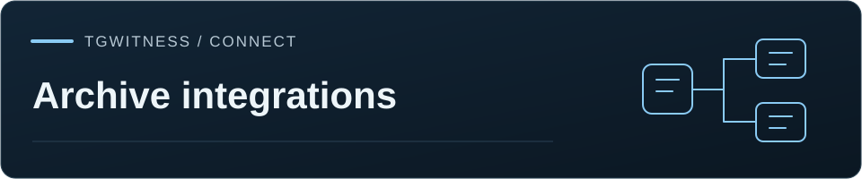

[TgWitness](../README.md) / [Documentation](README.md)

**English** · [Русский](ru/CLI.md)



# Command line for scripts and agents

[Read-only MCP](MCP.md) · [Full-text search](SEARCH.md) · [Wiki](wiki/Archive-and-Integrations.md)

**Preview.** `tgwitness search`, `context`, `messages`, `stats` and `export` read
saved observations for scripts and AI agents. They cannot send anything to
Telegram, change settings or modify the signed journal. `tgwitness index` and
`tgwitness backup` ([below](#index-and-backup)) work on a local data directory and
need no token.

With `--json`, stdout carries exactly one JSON document (`export` writes JSON Lines).
Progress, hints and errors go to stderr. Exit codes are stable:

| Code | Meaning |
| --- | --- |
| `0` | Success, including an empty result |
| `1` | Failure: unreachable panel, unreadable data, interrupted export |
| `2` | Usage error or invalid request: bad date, unknown option, search index off |
| `3` | Unavailable now: the workspace is open in a running panel, or the panel asks to retry later (rate limit, timeout) |
| `4` | Access refused: missing, expired or revoked token, a chat outside its scope, a tool it does not allow |
| `130` | `backup` stopped with Ctrl+C: nothing was written to the destination |

## Two ways to read

**Through the panel (`--url`).** The command uses the same scoped archive API as
MCP. Create a connection in **More tools → Integrations → MCP**: choose workspaces and chats,
tools and an expiry, then copy the token once. The connection is read-only, limited
to those chats, rate-limited to 60 requests per minute and can be revoked or
rotated at any time. Panel login tokens and Telegram credentials do not work here.

```sh
export TGWITNESS_URL=https://panel.example.org      # default http://127.0.0.1:8787
export TGWITNESS_MCP_TOKEN=tgw_mcp_...              # or --token-file path
tgwitness search 'перевод карта' --json
```

A remote panel needs HTTPS; plain HTTP is accepted only for `127.0.0.1`,
`localhost` and `::1`. Proxy environment variables are ignored and redirects are
refused, so the token reaches only the address you give.

**Directly from a stopped workspace (`--data-dir`).** Reads the data directory with
full local access, without a token. Use it on a copy of a data directory or while
collection is stopped. Signed records are never changed; like the panel, opening a
workspace may bring its derived indexes up to date. When the panel has the workspace open, the command exits with
code `3`; read through the panel instead. Without `--data-dir`, `TGWITNESS_DATA`,
`./data/live` or the data directory of the installation running the command is used.

`--workspace ID` selects a workspace (default `default`). `tgwitness messages
--workspaces` lists the ones you can read.

## Commands

| Command | Result |
| --- | --- |
| `tgwitness search QUERY [--chat ID] [--since] [--until] [--any] [--limit N] [--offset N]` | Best matches first, with word forms, exact phrases in quotes, domains and `@username` ([syntax](SEARCH.md#search-syntax)) |
| `tgwitness search QUERY --exact [--before SEQ]` | Exact text, newest first, without the index |
| `tgwitness context CHAT_ID MESSAGE_ID [--limit N] [--before SEQ]` | Saved messages within ten message IDs on either side |
| `tgwitness messages [--limit N] [--offset N]` | Chats you can read |
| `tgwitness messages CHAT_ID [--since] [--until] [--limit N] [--before SEQ]` | Saved messages of the chat, newest first |
| `tgwitness messages CHAT_ID --message ID` | Every saved version and deletion record of one message |
| `tgwitness stats [--chat ID] [--sender ID] [--since] [--until] [--top N]` | Activity statistics, below |
| `tgwitness export [--chat ID] [--since] [--until] [--output FILE]` | Saved observations as JSON Lines in journal order |

Dates are `2026-10-01` (UTC midnight) or ISO times with a timezone,
`2026-10-01T09:00+03:00`. For `search`, `messages` and `export` they select
observation time. Pages hold up to 50 records: follow `next_offset` (`--offset`) for
ranked search and `next_before` (`--before`) elsewhere.

Ranked search stops at 1,000 results. The final page may be shorter than `--limit`. When more observations match, the last page says so (`truncated: true` with `--json`); narrow the query, chat or period.

In plain output each record starts with its journal sequence and the time the collector saw it (`observed`), followed by the time Telegram reported when there is one: `sent` for a message, `edited` for an edited version. A deletion notice has only the observation time. `--json` carries both as `observed_at` and `source_at`.

Every message result carries `untrusted_content: true`, the workspace, chat and
message IDs, the journal sequence, the saved record hash and a panel link. Edits,
deletion notices and `missing_on_recheck` are separate records. Coverage in `stats`
shows the periods a search result speaks for.

### Activity statistics

`stats` counts saved observations for one chat, one sender, or every chat in scope:

- messages by UTC hour and by weekday (Monday first), busiest hours and days;
- edited, deleted and `missing_on_recheck` shares;
- senders with message counts and first and last message times;
- the most frequent domains and `@handles`, counted once per message across its
  saved versions;
- coverage: `coverage.gap` records and, for access to the whole workspace, periods
  without a connected collector heartbeat (`collector_liveness`).

The period selects **message time reported by Telegram**. Hour and weekday counts
help estimate a sender's time zone. Figures are computed on
request from the journal and are not stored. Each result names the journal head it
covers when your access spans the workspace. Reading stops after five seconds through
the panel, or `--timeout` seconds locally (default 30); then `complete` is false and
`partial` names the first record that was not read. Only the most recent records are
counted in that case.

### Export

`export` writes one JSON object per saved observation (new messages, snapshots,
edits, recovered messages, deletion notices, `missing_on_recheck` and saved media
records) in journal order. Each line has the same fields as other results, with
the full text. With `--output`, the file is written under a `.partial` name and
renamed only after the panel's completion record; an interrupted export leaves no
file and exits with code `1`. `--output` never overwrites an existing file. With
`--output` and `--json`, stdout carries a summary: record count, last journal
sequence and, for whole-workspace access, the journal head.

An export through the panel needs a connection that allows **Export messages
(command line only)**; it is not selected by default. This file is a working copy; for a verifiable
handover use the signed export in **Exports**, which `python -m tgwitness.verify`
checks.

The panel rechecks access before emitting each record, including the completion
record. Revoked or expired access leaves an incomplete export. Lazy page reads
share the archive worker limit with other queries and have a bounded wait.

### Index and backup

These two commands read the data directory directly and take no token or `--url`.

| Command | Result |
| --- | --- |
| `tgwitness index status [--workspace ID] [--data-dir DIR] [--json]` | Search index state of one workspace or, by default, every workspace: mode, `ready`, `building` or `not built`, indexed and journal head sequence. Works while the panel runs |
| `tgwitness index rebuild [--workspace ID] [--data-dir DIR] [--json]` | Rebuilds the index from the first journal record. Rewrites only the derived index, never the signed journal. Exits with code `3` while the panel has the workspace open. Nothing is built when the workspace keeps its index in memory or has search off |
| `tgwitness backup FOLDER [--data-dir DIR] [--json]` | Copies the whole data directory into a new or empty folder outside it while the panel keeps running, and writes `backup-manifest.json` with every file's SHA-256 and the journal heads. The folder appears only when the copy is complete; a failed or interrupted copy leaves nothing behind |
| `tgwitness verify-backup FOLDER [--json]` | Checks a backup folder without changing it: compares the size and SHA-256 of every file listed in the manifest, reports files that the manifest does not list, and compares the latest record of each journal with the manifest |

`index` accepts `--workspace default` or a workspace ID; the default is `all`. The
backup skips temporary exports, SQLite sidecar files and lock files. The folder
holds the Telegram session and signing keys, so keep it as private as the data
directory. [Backup, restore, and capacity](DEPLOYMENT.md#backup-restore-and-capacity)
describes restoring and what the next start records.

## Agent skill

[`.agents/skills/tgwitness-cli/SKILL.md`](../.agents/skills/tgwitness-cli/SKILL.md)
tells an agent how to use these commands, how to cite records and how to treat
captured text. Agents that read `.agents/skills` load it from a repository
checkout. For Claude Code, copy the `tgwitness-cli` folder to `.claude/skills/` in
your project or `~/.claude/skills/`.

## MCP and the command line

Both use the same connections, scope checks and limits. MCP results are limited to
one 64 KiB page, so MCP offers no bulk export; the command line streams it.
`get_activity_stats` is available to both.
