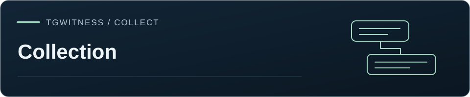

[TgWitness](../README.md) / [Documentation](README.md)

# Choose a collection method

Start with the result you need. These workflows preserve different observations;
choosing one does not silently start another or change the account's connection.

| Goal | Where | Result | Account use |
| --- | --- | --- | --- |
| Share material already saved | Exports → Saved observations | Signed journal archive, readable report or minimized handover | No Telegram reads; observation can continue |
| Keep future changes | Chats → Choose, then Start observation | Delivered messages, versions and deletion notices in the workspace | Owns the account while running |
| Add past history to the workspace | More tools → Sources → Chats in scope → Full history | Current visible messages, media outcomes and available Recent Actions in the signed journal | Pause observation first; choose Standard API or Takeout |
| Create a separate account snapshot | Exports → Telegram account | Selected chats, files and optional account data in a separate signed archive | Requires an idle account; observation sources do not define this selection |
| Export one chat | Chats → Export chat | Signed selected history and context, optionally split across eligible accounts | Every selected account must be idle and already have access |
| Preserve an official-client session | More tools → Extras → Independent capture → Trusted Live | Guarded video, preserved native JSON and continuity artifacts | Separate recorder and manual official-client login; preview |
| Capture with GitHub workflow provenance | Exports → Other formats & capture tools → GitHub Actions capture | Encrypted handoff and workflow attestation | Separate runner and explicitly authorized session; preview |

## Existing observations and fresh reads

An evidence ZIP exports the saved journal through a fixed boundary. It does not
query Telegram again and can be prepared while collection continues. A readable
report or minimized handover can select a subset; the full evidence ZIP retains
its documented complete-journal scope.

History and account/chat exports read Telegram now. They see what the selected
account can access during that run, not an atomic reconstruction of the past.
Changes and deletions that were never observed may be unavailable.

## One acquisition per account

Live observation, full history and account/chat acquisition are mutually exclusive
on one account. Starting a new task does not automatically pause another task.
Separate account workspaces can operate concurrently, with separate identities
and access rights.

During full history loading, that account's live handlers are paused. A later
catch-up or history read returns the current state of each message. Comparing saved
versions compares the observations each pass recorded.

Pause, resume and account identity rules are described in [History](HISTORY.md),
[Account export](ACCOUNT-EXPORT.md) and [Distributed export](DISTRIBUTED-EXPORT.md).

## Official-client capture

[Trusted Live](TRUSTED-LIVE.md) uses its recorder's explicitly selected connector.
The API acquisition settings do not turn an MTProto task into official-client
capture. Native export is manual; this preview preserves JSON without its linked
attachment tree. Video-only capture has no structured message IDs. Hybrid comparison
requires operator annotations linked to preserved frames.

Continuity annotations appear in a separate chat view. Missing IDs or replies are
observations to investigate; deletion is reported from Telegram's deletion notices.
WARP and pacing reduce request pressure, and Telegram decides account restrictions.

## Read the result before handing it over

Review the selected source scope, captured versions, source and observation times,
attachment outcomes and recovery intervals. Verify the archive against the trusted
inputs for its mode: collector or witness key, retained checkpoint, external time
receipts and applicable GitHub or Intel TDX acquisition evidence. The result should
identify which acquisition, integrity, continuity and time checks passed.

See [Current capabilities and qualification](STATUS.md) for what has been tested.
