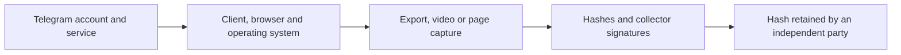

# Evidence, capture devices and legal weight

An export, screenshot or recording can be useful evidence. Its reliability depends
on how it was collected, preserved and corroborated. **A valid hash or signature
checks the saved material; it does not independently establish that the collecting
device received truthful source content.** This boundary also applies to TgWitness.

This guide separates technical verification from legal assessment. Product
documentation and the legal provisions below were reviewed on 1 November 2026;
the Hunchly comparison describes its published documentation, not a new product audit.

## Where trust enters the capture

The threat model here assumes an attacker or operator can alter the collection
environment before the evidence is committed. This is a conditional analysis, not
a claim that a particular device or product has been compromised.

An official client and an encrypted connection help protect normal use. They do
not make the surrounding operating system, browser or display independently
trustworthy. If content is substituted after decryption but before capture, the
exporter can save it accurately and the signer can sign it correctly. Neither
operation needs a broken hash algorithm or a forged signature.

A video made on the same device can record the same substituted presentation.
A separate camera can confirm what the display showed, but the display alone
does not authenticate what Telegram supplied. Likewise, matching HTML, JSON,
screenshots and browser logs from one controlled environment may share the same
failure. Their agreement is useful context; it is not automatically independent
corroboration.

## What each form of evidence contributes

| Material | Useful contribution | Remaining question |
| --- | --- | --- |
| Telegram Desktop export | Readable or machine-readable conversations and selected media | Who controlled the client and export files, and what was available or excluded? |
| Screenshot or screen recording | Visible context, sequence of actions and presentation | Does the presentation faithfully reflect the source, and what happened outside the recording? |
| Local web archive, including MHTML | Page content and associated resources for later examination | What did the browser supply to the archiver, and who controlled that browser? |
| Collector-signed archive | Changes to signed bytes can be detected relative to a trusted key and retained reference | Who controlled the signing key and the input before signing? |
| Independently retained checkpoint or verified timestamp | A retained hash or checkpoint for comparison with a later submission | Which bytes and boundary are covered, and what does the independent party actually attest? |

Telegram documents its Desktop export as an offline HTML/JSON copy and its Takeout
API as a way to retrieve selected account data. These descriptions do not provide
a Telegram signature over the final exported archive for a recipient to verify.
Our conclusion is limited to those documented export mechanisms; it is not a
claim that Telegram evidence has no legal value.
[Telegram Desktop export](https://telegram.org/blog/export-and-more),
[Takeout API](https://core.telegram.org/api/takeout).

The same distinction applies to background requests, cache entries and network
logs. They may reveal inconsistencies and help corroborate a collection. Their
complexity alone does not establish who produced them. An independently operated
archive or separately obtained service record introduces a different source to
compare, subject to its own collection and custody limitations.

## Hunchly illustrates the same boundary

Hunchly's documentation describes SHA-256 hashing of MHTML captures, photos and
attachments, with independent hash verification. It also explains why an altered
file accompanied by a newly calculated hash can pass that comparison, and points
to signatures and source corroboration as additional checks.
[Hunchly: content, photo and attachment hashing](https://support.maltego.com/support/solutions/articles/15000061289-content-photo-and-attachment-hashing).

Its published *Evidence Guide*, revision 1.0 of 17 October 2018, describes locally
generated GPG keys and signatures for MHTML captures. It explicitly identifies
access to the local private key as a way to sign modified material again. This is
a documented trust limitation, not evidence of an undisclosed current exploit.
The guide also says Chrome performs the MHTML capture. Describing Hunchly as
relying only on an investigator's reputation would omit these technical controls.
[Hunchly Evidence Guide, sections 2–4](https://hunch.ly/resources/Hunchly%20Evidence%20Guide.pdf).

Whether material collected with a particular product has been admitted in a case
requires the relevant decision and circumstances. We make no claim here about how
frequently courts accept Hunchly or TgWitness, or about either product having a
general court approval.

## What TgWitness adds, and where its protection stops

TgWitness records observations in a signed, linked journal and provides exports
that a recipient can check. Retained checkpoints, timestamps and a separate
witness give reviewers references beyond the collector's present files.
They help expose changes to previously committed records. Coverage records and
explicit collection outcomes help explain what was and was not captured.
[Evidence format and handoff](EVIDENCE.md), [collection scope](COLLECTION.md).

The time of a possible substitution matters:

1. **After signing, without access to the signing key:** changing a signed record
   or manifest-bound file fails verification with a trusted verifier and key.
2. **With the collector key, after an independent checkpoint was retained:** a
   replacement journal can have valid new signatures, but a changed prefix fails
   comparison with that earlier checkpoint. A checkpoint kept only on the same
   controlled device can be replaced along with the journal. Records beyond the
   retained boundary need their own coverage.
3. **Before a checkpoint covering an observation is independently retained:**
   false input can be signed and anchored successfully, including new records
   appended after an earlier checkpoint. The resulting checkpoint or timestamp
   still covers those false records; it does not establish their truth.

A TgWitness witness receives the collector's signed checkpoints; it does not independently
read the underlying Telegram conversation. Its key and retained records must be
trusted separately. When the entire submitted journal must be witnessed, use the
[handoff procedure requiring the final export boundary](WITNESS.md#require-a-witnessed-export-boundary).
An ordinary integrity pass can still report an unwitnessed tail.

A verified RFC 3161 response can support that a checkpoint existed by the
authority's stated time. It does not establish when a Telegram message was sent
or whether its content was true. A prepared request or an included response file
alone is insufficient. When verifying an export with `tgwitness.verify`, checking
included TSA signatures requires an explicitly trusted CA through `--tsa-ca`.
OpenTimestamps receipts need independent `ots verify`, with proof upgrades where
necessary.
[Timestamp procedure](TIMESTAMP.md), [RFC 3161](https://www.rfc-editor.org/rfc/rfc3161.html).

In [GitHub Actions capture](SEALED-ACTIONS.md), a temporary hosted runner collects
the messages. Attestation binds the archive to an approved workflow. This mode
still trusts GitHub, the approved software and dependencies, the helper/browser
and the tunnel. It is not confidential hardware, a Telegram signature, or proof
that nobody accessed the host. A local signed run receipt is also a self-reported
measurement, not hardware attestation.

## Legal weight depends on the foundation

Four questions should remain distinct: whether the item is what it is said to be,
whether the submitted bytes match the retained record, whether the content supports
the claimed facts, and whether applicable rules permit its use. A cryptographic
check addresses only part of that foundation.

In US federal proceedings, Rule 901 provides ways to authenticate evidence,
including knowledgeable witness testimony and evidence about a process or system.
Rules 902(13) and 902(14) provide certification routes for certain electronic
records and copies, with procedural requirements. Their committee notes distinguish
authentication from issues such as hearsay, relevance and attribution. A software
signature alone is not the qualified person's certification described there.
[Federal Rule of Evidence 901](https://www.law.cornell.edu/rules/fre/rule_901),
[Federal Rule of Evidence 902](https://www.law.cornell.edu/rules/fre/rule_902).

Where Canada's Evidence Act applies, section 31.1 addresses authentication of
electronic documents. Section 31.2 links the best evidence rule to system integrity
or an applicable presumption; section 31.3 specifies circumstances for a presumption
of integrity. These are defined evidentiary conditions, not a blanket presumption
that any licensed investigator or commercial product is infallible.
[Canada Evidence Act, 31.1](https://laws-lois.justice.gc.ca/eng/acts/C-5/section-31.1.html),
[31.2](https://laws-lois.justice.gc.ca/eng/acts/C-5/section-31.2.html),
[31.3](https://laws-lois.justice.gc.ca/eng/acts/C-5/section-31.3.html).

These examples do not settle admissibility in another jurisdiction or a particular
case. The technical checks should be applied consistently to material supporting
or challenging an allegation. This guide makes no claim that prosecution evidence
is generally easier to admit than defence evidence.

## Prepare a record another person can assess

- Describe the account, collection device, operator, software version, access
  rights, selected scope and collection period. Record interruptions and possible
  compromise instead of treating a successful signature check as a clean-device test.
- Keep original packages and record transfers, hashes and the source of time.
  Retain the key fingerprint and checkpoints through a separately trusted channel.
  Verify the actual witness or timestamp coverage before describing it in a report.
- Seek independent corroboration appropriate to the claim: another participant's
  records, an independent capture or lawfully obtained service records. Explain
  their independence and limitations; agreement between copies is not enough by itself.
- Preserve relevant context. Identify omitted files, unavailable history and
  redactions. Prepare a [separate minimized disclosure](ACCOUNT-EXPORT.md#prepare-a-disclosure-for-a-lawyer-or-another-recipient)
  when needed, and describe its transformations without presenting it as the full original.
- Give the recipient verification instructions and the material those checks need.
  Keep observations, technical findings and the analyst's conclusions distinguishable.

For a particular handoff, state the archive hash, trusted key, verification result
and the exact externally covered boundary. Describe source authenticity, account
attribution, completeness and legal conclusions separately. This gives the next
reviewer specific claims to examine.
