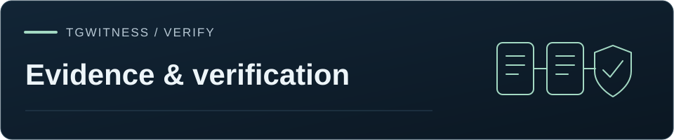

[TgWitness](../README.md) / [Documentation](README.md)



# Evidence format v1

TgWitness preserves account-visible Telegram observations in a signed journal.
Recipients can verify the saved records, attachments and reports against a trusted
collector key, check external time from a third party for the last record, and compare
the journal with a checkpoint they retained earlier.
This page describes the formats, the checks and the material to keep for handover.

Recipients can start with **VERIFY.cmd** on Windows: it asks for the original
ZIP and independently obtained key fingerprint, displays an explained result,
and saves a separate verification transcript. See [verification launchers and
the portable runtime](VERIFICATION_LAUNCHER.md) for setup and trust limits.

<details>
<summary>On this page</summary>

- [What is signed](#what-is-signed)
- [Comparing chat exports](#comparing-chat-exports)
- [Investigation handoff](#investigation-handoff)
- [Handover extract](#handover-extract)
- [Readable reports](#readable-reports)
- [Event canonicalization](#event-canonicalization)
- [Actor semantics](#actor-semantics)
- [Coverage: continuity, gaps and unobserved IDs](#coverage-continuity-gaps-and-unobserved-ids)
- [Producer](#producer)
- [People profiles](#people-profiles)
- [Independent witness](#independent-witness)
- [Manifest and checkpoints](#manifest-and-checkpoints)
- [Verification scope](#verification-scope)
- [Attachments](#attachments)
- [Durable collection and process receipts (0.2)](#durable-collection-and-process-receipts-02)
- [RFC 3161 preparation and response verification (0.2)](#rfc-3161-preparation-and-response-verification-02)
- [Optional records in evidence mode: drand and Telegram devices](#optional-records-in-evidence-mode-drand-and-telegram-devices)

</details>

## What is signed

| Material | Protection | What to retain |
| --- | --- | --- |
| Every journal observation, including operational events | SHA-256 chain and an Ed25519 signature per event | Original `events.jsonl`, the trusted key fingerprint, and a retained checkpoint |
| Evidence ZIP contents | `manifest.sig` signs the canonical manifest, which lists hashes of the content files | The complete ZIP, including its manifest and signature |
| Preserved attachments | SHA-256 and byte count in a signed `media.saved` event; file hash in the signed ZIP manifest | The original bytes inside the verified ZIP |
| Checkpoint | Ed25519 signature over journal length, head hash, public key, and creation time | An independent copy retained before a disputed change |
| Run receipt | Signed record of the collector version, source-file hashes and start settings, also included in `process.started` | The receipt, associated journal and the environment evidence for the selected verification mode |
| Readable reports: `report.html` and its parts, `report.json`, `report.pdf`, `chat.pdf` | An Ed25519 seal per file over its content; the PDF also carries a standard PDF signature (see [Readable reports](#readable-reports)) | The file as received and the trusted key fingerprint; the ZIP it describes |
| Standalone CSV | No standalone cryptographic signature; event hashes alone are insufficient | Use the exact copy inside the verified ZIP for integrity checking |
| Screenshots, printouts, or PDF produced by a browser | No TgWitness signature on the derivative | Keep the original verified package and document how the derivative was made |

The collector verifies journal signatures before generating every export format.
Readable HTML and PDF reports carry their own seals; standalone CSV is checked as
part of a signed ZIP. Keep the ZIP to retain the attachment bytes and manifest,
and a separate checkpoint to check the journal against an earlier boundary.

## Formats and verification paths

The acquisition mode and the output format answer different questions. The mode
supplies collection and environment evidence; each format preserves or presents
part of that record with the checks below.

| Output | Verification and use |
| --- | --- |
| Evidence ZIP | Canonical events, signed manifest, coverage, custody entries, attachments and available external receipts; check the archive and its selected acquisition mode. |
| HTML and JSON reports | Individually sealed views with source references, also listed in the ZIP manifest. Their recorded counts summarize journal event kinds. |
| PDF reports | Ed25519 seal plus CMS PDF signature over the byte range. The TgWitness verifier uses the trusted Ed25519 key; a viewer's certificate-trust display is a separate check. |
| CSV | A spreadsheet view covered by the ZIP manifest. Formula escaping protects spreadsheet use; original signed text remains in the journal. |
| JSONL | Signed event records, including attachment references. The evidence ZIP additionally carries the preserved attachment bytes. |
| Chat export and Desktop-compatible views | History acquisition and available admin-log records, with the requested rendering and signed archive. Live monitoring's saved versions are a separate acquisition path. |
| Media and hash-only records | Saved bytes are checked against their SHA-256 and message reference. Hash-only acquisition preserves the available hash metadata for later comparison with file bytes. |
| STIX/MISP and people profiles | Source-linked extracted observations, account IDs and analytical matches. Profile signatures and record hashes can be checked against the original evidence; avatar-cache provenance is labeled separately. |
| Handover extract | Signed disclosure rules, unchanged records and marked minimized records retaining original hashes/signatures. Use the retained original for a comparison requiring withheld fields. |
| Witness and time receipts | Earlier journal boundaries, continuity and the individual verified time claims. They accompany the acquisition and archive checks. |
| Password-protected delivery | Protects the enclosed package during transfer. `.tgwpw` uses AES-GCM authenticated encryption, including an authenticated final record; the enclosed journal keeps its signatures and acquisition receipts. |

A printout or screen capture is a presentation of the signed material. Its report
ID, key fingerprint and QR reference help locate the original file for verification.
Custody declarations record the supplied examiner and transfer information;
verifier results and acquisition receipts are retained as separate evidence.

## Comparing chat exports

Verify and compare two signed chat-export ZIPs with independently retained signer
fingerprints:

```sh
python -m tgwitness.verify first.zip --compare second.zip \
  --fingerprint FIRST_TRUSTED_KEY_SHA256 --compare-fingerprint SECOND_TRUSTED_KEY_SHA256
```

When both archives record the same numeric account and chat IDs, records are paired
by message ID. **Unchanged** means equality of the complete saved JSON record:
full text, author, dates, reply target, nested metadata and unknown fields are all
included. JSON object key order does not matter; absent fields, nulls, value types
and array order do. The 300-character preview is only for display. Changed entries
name the differing top-level `changed_fields`, including changes invisible in that preview.
Duplicate message IDs are rejected instead of overwriting one another during matching.

A difference can be a changed display name, view count, collection annotation or
other observation metadata. Telegram edits appear as their own edit events, and each
archive's verification shows whether that archive is intact. Unparsed records remain
in the comparison and are compared by their saved representation.

For different or missing account/chat identities, the tool finds candidate
correspondences using sender, complete text, file hash, media type and a five-second
time tolerance, and reports them as **Matched** rather than **Unchanged**. Unparsed
records remain unmatched. Differences in paired records are listed in `changed`,
including in content mode. With `--json`, `matched` counts candidate pairs and
`unchanged` counts pairs whose complete saved records are equal. The
existing `changed_fields` and integer `unchanged` output remain compatible with
earlier comparison results. Archive format and signature verification are unchanged.

## Investigation handoff

1. Record the case reference, operator, numeric Telegram account ID, selected
   sources, collection policy, and collection period in your case notes. TgWitness
   preserves observations and supports source-linked notes and collections in
   [Case Board](CASE-BOARD.md). Keep transfer and custody records with your case
   materials. Check the intended collection setup with the
   [live acceptance procedure](internal/LIVE_ACCEPTANCE.md).
2. Retain the workspace's public-key fingerprint independently before relying on
   its exports. Turn on evidence mode so checkpoints receive RFC 3161 and
   OpenTimestamps receipts. Save signed checkpoints outside the collector during
   collection. Record interruptions and the limits of the account's visibility.
3. Export a **signed ZIP** and retain the signed run receipt. Use a checkpoint at
   or before the exported journal boundary. A later checkpoint can correctly reject
   an earlier export as too short. Exports include the full workspace journal,
   regardless of panel filters; review the material before sharing it.
4. Have the recipient verify the ZIP with a trusted copy of the verifier, the
   independently supplied fingerprint and the timestamp authority's root
   certificate obtained separately. From a trusted checkout with its Python
   environment active:

   ```sh
   python -m tgwitness.verify evidence.zip --fingerprint TRUSTED_PUBLIC_KEY_SHA256 --tsa-ca TSA-ROOT.pem --checkpoint retained-checkpoint.json --require evidence
   ```

   The fingerprint and a checked timestamp of the last record meet the minimum for
   evidence; `--require evidence` exits with code 2 otherwise. The checkpoint is a
   supporting check, because it is signed with the collector key. Successful output
   reports `key_pinned: true` and `checkpoint_checked: true` when both inputs are
   supplied and accepted. Preserve the verification result.

    For a handover requiring the final exported record to be witnessed, use
    `--witness witness.zip --witness-fingerprint TRUSTED_WITNESS_SHA256 --require-witness`.
    This refuses an export with an unwitnessed tail. Add
    `--channel https://t.me/s/WITNESS_CHANNEL` to read the dates Telegram set on the
    witness posts as external time. See the
    [witness handover procedure](WITNESS.md#require-a-witnessed-export-boundary).
5. Record the archive's SHA-256, export boundary, transfer date, sender, and
   recipient in your custody record. Keep the original package intact and work
   from copies. Share evidence files rather than the application's private data
   directory, which also contains account sessions and signing secrets.
   For transfer, choose a password-protected AES-256 ZIP or the stronger `.tgwpw`
   container. ZIP uses WinZip's low-cost password derivation; use a long random
   passphrase. `.tgwpw` uses scrypt and AES-256-GCM and opens with the standalone
   verifier's `unseal-password` command. The password is not stored and only protects
   confidentiality; the recipient decrypts
   the archive and verifies the signed export inside, which is unchanged.
6. To timestamp a checkpoint outside evidence mode, follow the
   [RFC 3161 procedure](TIMESTAMP.md) and retain the request, checkpoint, trusted
   CA information, and verified authority response. Preparing a request alone
   does not obtain a timestamp.

For `.tgwpw`, use an independently obtained verifier and choose a new output file
with the original extension: `python verify.py unseal-password export.tgwpw --out evidence.zip`.
The command prompts for the password; `--password-stdin` reads one line for automation.
It never overwrites an existing file and publishes plaintext only after all records
authenticate. Run normal signature verification on the decrypted file afterwards.
The container uses scrypt (`N=131072`, `r=8`, `p=1`, 16-byte salt; about 128 MiB RAM)
and AES-256-GCM with 1 MiB records and an authenticated final record. An encrypted
metadata record stores the inner filename, so downloaded containers can be renamed.

Successful verification establishes integrity relative to the trusted collector
key and retained boundary. See [verification scope](#verification-scope) for the
trust assumptions and [validation results](VERIFICATION.md) for the checks performed.

## Handover extract

A signed ZIP carries the whole workspace journal. When a court, a lawyer or an abuse desk needs
only some chats, a period or certain people, **Exports → Handover extract** prepares a minimised
copy (`tgwitness-handover-v1`) according to the selected disclosure rules.
The operator states the purpose and chooses the chats, an optional period (UTC), the people the
extract is about, what happens to everyone else (shown, replaced by pseudonyms P01, P02… or left
out), which message texts stay, which attachments and profile photos are included, and whether
phone numbers and e-mail addresses in texts are masked. The purpose and these rules are in the
signed manifest and in the report; the journal records `handover.exported` with the access that
prepared it and the file's SHA-256, not the contents.

`verify.py` checks an extract in two ways. A record shown unchanged is verified in full: its
content against its hash, its Ed25519 signature and its link to an included predecessor. A
minimised record keeps the original hash and signature, so the signature still verifies, but the
withheld fields cannot be recomputed from it; the record names what was withheld and the report
marks it. The manifest names the journal length and head with the collector's signature over that
head, and counts the records left out; `coverage.json` describes the chosen chats. Names inside file
names are not detected. Review the final files before sharing: free text, file names and selected
attachments can still identify people. Keep the full signed ZIP: the extract is a disclosure, not a replacement.

## Readable reports

Signed evidence, handover and chat ZIPs carry readable HTML and JSON reports, plus
PDF when the required fonts are available, in the selected report language. Each
report is sealed with the workspace's Ed25519 key and can be verified separately:
`python -m tgwitness.verify FILE --fingerprint KEY [--evidence ZIP]`.

- `report.html` / `chat.html`: the seal statement (`tgwitness-report-seal-v1`) closes the file and
  signs the SHA-256 of every byte before it. Long journals and chats are split into parts of a
  configurable size (Report settings, 500 to 100,000 records; 5,000 by default):
  `records/records-0001.html` or `messages/messages-0001.html`, each sealed with its number, range
  and the total, and listed with its SHA-256 in the signed manifest. Runs of collector heartbeats
  are shown as one line unless Report settings list them one by one.
- `report.json` (`tgwitness-report-json-v1`, keys `format`, `report`, `seal`): the seal signs the
  SHA-256 of the canonical JSON of `report`, so the facts can be read by case systems and scripts
  and a selection for data protection can be made from them while the signed file stays whole.
- `report.pdf` / `chat.pdf`: a formal document for printing and filing, signed twice over the same
  bytes, the whole file except the signature value (`/ByteRange`). The standard PDF signature
  (`adbe.pkcs7.detached`, CMS with SHA-256 and ECDSA P-256) uses a self-issued document-signing
  certificate kept in the workspace vault; its subject serial number is the Ed25519 key
  fingerprint. The Ed25519 seal travels inside the CMS as the unsigned attribute
  `2.25.240684792623320047764573196045913242332` and names the certificate's SHA-256 with
  `"content": "pdf-byte-range"`, so the Ed25519 key vouches for the certificate. A PDF reader shows
  whether the file changed after signing and calls the signer unknown until the certificate is
  trusted; compare the Ed25519 fingerprint instead. Chinese, Japanese and Korean PDFs need a font
  on the server (or in `TGWITNESS_FONT_DIR`); without one the ZIP carries the HTML and JSON reports
  only.

In a channel or supergroup Telegram numbers messages 1, 2, 3… in order. A chat export lists the
first and last number, how many are present and every run of absent numbers in
`message-ids.json`, the manifest and the `chat.json` header, and marks each gap where it falls in
the transcript. `verify.py` recounts them from `chat.json`. An absent number is a message Telegram
did not return (deleted before the export, or not visible to the account); in private chats and
basic groups numbers are shared by all of the account's chats and gaps are not counted.

After reading the history, the export asks Telegram for every absent number again, by number
(`channels.getMessages`, up to 10,000 numbers). The result is in `message-ids.json` and the report.
An empty answer records that the number is unavailable to this account at recheck time;
it leaves the cause unspecified. A message returned on recheck is added to the export
and marked `found_on_recheck`.

Every report opens with **In brief**: one paragraph, then what the material shows and what it does
not (who is behind an account, completeness of delivery, deletions before observation, clock time
without a timestamp). The page's own seal stamp turns amber when the browser has checked the seal's
signature, not the page: a browser does not give a page its own bytes. It turns green only when
the reader drops the file into the check at the end of the page and every byte matches, and only if
the page shown is that file; otherwise it turns red.

Each report names the program exactly: the git commit when the collector runs from a checkout or
the installer sets `TGWITNESS_COMMIT`, and the SHA-256 of its source files (`source_tree_sha256`,
the canonical JSON of path → SHA-256 of every `.py`, `.js`, `.css`, `.html` and `.svg` file in the
package), which a checkout of that commit reproduces unless files were changed. The Telegram
client is named with its library, API layer and data centre. When observation starts and when a chat
export begins and ends, the collector asks Telegram for its time (`updates.getState`, whole
seconds) and records Telegram's time minus the collector's clock, with the uncertainty from the
round trip; the reports show these measurements under Chain of custody. A chat export also records
when it read the history, apart from the dates of the messages.

### Offline report viewer and archive guide

Extract the complete ZIP before opening `chat.html` or `report.html`. The viewer provides search,
filters, participants, indicators, record details and JSON/CSV selections without a server. Keep
`viewer/` and `media/` next to the report. Selections are derivatives: use `verify.py SELECTION.json
--evidence ARCHIVE.zip` to compare them with the signed archive.
The verifier checks the report ID, signing key, archive boundary and every selected item; edited,
missing and duplicate items fail. Selection notes and creation time remain unsigned metadata.

Message-number gaps are shown only for a complete, unfiltered ascending chat feed. Hiding a
category or failing to load a data chunk must not turn an omitted row into evidence of a missing
message. Search highlights operate on plain text before HTML escaping, preserving literal markup.

The browser checks manifest signatures, the report ID and key, and all listed file hashes. It
rejects ambiguous or malformed ZIP structures, duplicate names and unsafe paths, and caps files
at 256 MiB and declared total contents at 4 GiB. Use the standalone verifier for larger archives.
This browser check complements the verifier's checks of journal chains and data semantics.

`README.txt` contains a start guide, an aligned file inventory, verification instructions and data
format notes in the report language, followed by a complete English guide. `SHA256SUMS` covers the
files listed within it, excluding itself, `manifest.json` and `manifest.sig`; the signed manifest
also covers `SHA256SUMS`. Keep the original ZIP unchanged and save working files outside the
extracted folder. PDF reports include section bookmarks and case/report identification on later pages.

### The chat at export time

A chat export records what Telegram said about the chat when the export began: Telegram's own
labels (`scam`, `fake`, `restricted` with its reasons, `verified`), usernames, description, member
and admin counts, the linked discussion, content protection, whether new members see earlier
messages and from which message on this account sees the history (`available_min_id`), the date
of message 1 when it is the chat's creation, and the SHA-256 of the chat photo (saved in `media/`).
It records the exporting account's place in the chat: role, join date, who invited it and, for an
admin, its rights. A request Telegram refuses is named instead.

When the exporting account is an admin, the export reads the chat's admin log (Telegram keeps about
48 hours) into `admin-log.json`: deletions and edits with the supplied content,
acting account and source action date. These entries complement the live journal's
captured versions and deletion reception records.

### Indicators

The reports list, and the archive carries as `indicators.csv`, `indicators.stix.json` (STIX 2.1)
and `indicators.misp.json` (MISP event), what an abuse desk can act on in the recorded messages:
links and domains (also hidden behind text, in buttons and in link previews), cryptocurrency
addresses, Telegram usernames and invite links, phone numbers, e-mail addresses and saved pictures.
Bitcoin, Litecoin, Dogecoin and TRON addresses are listed only when their base58 checksum holds,
segwit addresses when their bech32 or bech32m checksum holds and TON addresses when their CRC
holds; EVM and Solana addresses are marked as not checked. Pictures carry SHA-256 and a perceptual
hash (dHash, 64 bits) that recompressed or resized copies keep nearly unchanged. Reports write
indicators so that they do not open by accident (`hxxps[://]example[.]com`); the files keep the
values as they were. Every indicator is marked unknown and not for automatic detection (STIX
`indicator_types: unknown`, MISP `to_ids: false`, distribution to the own organisation): being
listed says that a message contained it, not that it is malicious. A link whose text shows a
different address than it opens is marked in the report.

The PDF reports end with an examiner's declaration to sign by hand, a checklist for a notary or
court expert, and a QR code (also on the first page) with the report ID, the key fingerprint and
the SHA-256 of the authoritative data, so that a printout leads back to its archive.

## Event canonicalization

The hash input consists of exactly these fields:

~~~text
seq, observed_at, source_at, kind, chat_id, message_id, actor_id, payload, previous_hash
~~~

Serialize using Python-compatible JSON with UTF-8, sorted object keys, no ASCII
escaping, no insignificant whitespace, and no NaN/infinity:

~~~python
json.dumps(value, ensure_ascii=False, sort_keys=True,
           separators=(",", ":"), allow_nan=False).encode("utf-8")
~~~

SHA-256 of those bytes becomes the event hash. The signature is Ed25519 over the
32 raw hash bytes, then base64 encoded. The first previous_hash is 64 zeroes.
Sequence numbers start at 1 and increase by 1. All events, including operational
events, share one chain. There is no duplicate-delivery suppression: repeated
observations are distinct receipts, not a claim of distinct Telegram actions.

Raw Telegram dates are ISO strings; binary fields become objects containing
bytes_base64. Message text, entities, media descriptors, reply metadata, reactions,
and service actions are retained in raw message metadata when supplied.

`observed_at` is the collector's UTC observation time; `source_at` is the date
supplied by that Telegram event. Live edits retain the supplied edit date, history
snapshots retain the message date with a current observation time, and an ordinary
deletion notification records reception time with a null source date. Admin-log
entries retain their supplied action date separately. Reception order and source
event order are distinct timelines, with clock observations and external receipts
available for comparison.

## Actor semantics

Attribution follows the event source. `message.new.actor_id` and
`message.edited.payload.sender_id` retain the message sender. Ordinary
`message.deleted` notifications carry message IDs and have a null actor field;
available admin-log entries carry their supplied action, actor and date.
Membership service messages retain sender and action type, raw participant updates
retain the supplied `actor_id`, and reaction snapshots preserve their supplied
counts and visible identities. Read these records together with the captured
versions and [panel interaction receipts](COLLECTION.md#own-actions).

Deletion notifications for private chats and ordinary groups contain only message IDs.
Those chats share one account-wide ID sequence, so an ID identifies a single message of
this account. When a message with that ID was saved earlier in this journal, the
deletion is recorded in that chat as message.deleted with payload.chat_resolution
naming the method. IDs that were never saved are kept as `deletion.unscoped`: an
actual deletion notification whose chat has not been correlated. This is distinct
from `message.missing_on_recheck`, which records an unavailable query result, and
from a gap in saved message IDs. Channels and supergroups number messages per chat and are
never matched this way. When the deleted message was sent by the observed account,
payload.deleted_message_was_outgoing is true; the deleter is still not supplied.

An unscoped notice keeps its own label because the matching chat may be outside
the current observation scope or have no unique match. Recheck absence remains a
separate observation from a deletion notification in report counts, filters and
labels. A later recovery clears the current missing state while preserving the
earlier unsuccessful check in the signed history; deletion notices stay a separate
event type.

Multiple IDs resolved to the same chat from one notification are grouped as
`deletion.batch`, regardless of their count, with the message IDs exactly as Telegram
sent them and how many of them this account had sent. Telegram's notification lists
the messages; the chat's admin log names the acting administrator where the account
can read it.

## Coverage: continuity, gaps and unobserved IDs

Every signed ZIP carries `coverage.json`, the HTML report opens with the same summary, and
`verify.py` recomputes it from `events.jsonl` instead of trusting the file:

- **Continuously observed from X to Y.** A period starts with `observation.started` and
  ends at a pause, a stop, a lost Telegram connection, a sign-out, a process start without
  an orderly stop, or more than three minutes without any record while observing
  (heartbeats are written every minute, so silence means the process stopped, froze or the
  computer slept). When the heartbeat interval is changed in **Parameters**, each heartbeat
  records it and the allowed silence becomes three intervals, never less than three minutes.
- **Gaps** list the time between periods with the reason. A gap still open at the last
  record is marked `not_resumed_by_last_record`.
- **Message IDs not observed.** For channels and supergroups, which number messages per
  chat, the IDs missing between observed ones are listed as ranges. They are reported as
  *not observed* — deleted, never delivered, or outside the saved history — never as
  deleted. Private chats and ordinary groups share an account-wide sequence, so gaps inside
  one such chat mean nothing and are not listed there.
- Chat-level gap notices (for example Telegram asking for difference recovery in one
  channel) are counted as notes; they do not interrupt global coverage.

### Missing message numbers (`gap_summary`)

**Preview.** `coverage.json` → `gap_summary` measures the numbers Telegram assigned and this
collector never saw. Telegram numbers messages once per channel or supergroup, and once per
account across private chats, bots and ordinary groups. A number between two observed
messages is either observed or missing; a contiguous range is a positive statement that
every message numbered in it was observed. A gap names no actor and no reason.

| Field | Meaning |
| --- | --- |
| `status` | `on`, or `off` when turned off in **Parameters → Gap analysis** |
| `parameters` | The parameters that produced the result, so it can be repeated |
| `chats[]` | One entry per channel or supergroup, each numbered on its own |
| `account` | The account-wide sequence of private chats, bots and ordinary groups |
| `status` (per sequence) | `applicable`, or `not_applicable` with `reason` |
| `observed_from`, `observed_to`, `span` | First and last observed number and the size of the range |
| `observed`, `observed_without_content` | Observed numbers; those known only from a deletion or recheck record |
| `missing`, `density`, `gap_ranges`, `largest_gap` | Numbers never observed, their share of the range, how many runs, the longest run |
| `clusters[]` | Listed gaps: `low`, `high`, `missing`, and the neighbouring observed numbers `after` / `before` with their observation times |
| `service_estimate` | Only when enabled: how many missing numbers would be service messages at their observed share. Never subtracted from `missing` |

Validity is derived from the journal, never assumed:

- **Channels and supergroups** are measured per chat, also in an export of chosen chats.
  Records chosen by sender make the measurement `not_applicable`.
- **The account-wide sequence** is measured only from the first to the last message that
  arrived while whole-account collection was on and kept private chats, bots, ordinary
  groups and the account's own messages, with no such chat excluded (`scope.changed`).
  Numbers named by `deletion.unscoped` count as observed without content. An export or
  handover of chosen chats cannot measure it. If whole-account collection was switched
  off and on, a note says that numbers used meanwhile appear as gaps.
- Service messages are journal records with their own numbers, so they close their gaps
  themselves; the optional estimate is only context.

`verify.py` recomputes `gap_summary` from `events.jsonl` with the parameters in the signed
`coverage.json` member (defaults for older archives) and
prints the account-wide line in its coverage summary. The archive's `get_capture_status`
(MCP and the command line) returns the same measurement for the chats an access may read;
the account-wide sequence only to access covering the whole workspace.

Repeated observations of one service message count once, and the account service estimate
uses only numbers inside the measured range. An applied scope must explicitly preserve
the account's own messages before account-wide measurement is enabled; the measurement
starts from records that carry that information. The measured range covers running
observation, and resuming it is noted. The live archive query has a time
budget, including its database scan, and marks an unfinished measurement as partial.

Telegram documents the [separate message ID sequences](https://core.telegram.org/api/updates#message-id-sequences).
These numbers describe observations; deletion notices, rechecks and the admin log record
why a number is absent where Telegram reports it.

When Telegram stops accepting the account, the `coverage.gap` record that ends observation
carries `cause` (`account_banned`, `account_frozen`, `account_deleted`, `session_duplicated`,
`session_revoked`, `session_expired`, `session_ended` or `not_authorized`) and the Telegram
error; `verify.py` names the cause where the period ends.

Coverage combines recorded observation periods, interruptions and message outcomes.
Assess it together with the selected chats, period and attachment policy; recheck
results and recorded gaps show how completely the account's updates were observed.

## Producer

The signed manifest of evidence ZIPs, chat exports, witness journals and the statement of
people-profile files contain `producer`: software, version, project (PhishDestroy),
homepage and source repository. The HTML report and verifier display this signed
producer record. Source-file hashes identify the recorded source tree for comparison
with a trusted checkout. Execution provenance is checked separately by
[GitHub acquisition attestation](SEALED-ACTIONS.md) or
[Intel TDX measurements](HIGH-ASSURANCE.md), where enabled. Archives made before
the producer field existed remain supported and are identified as legacy records.

Each `observation.started` record also names the Telegram client that observed: its `api_id`
(never the hash), whether that is a built-in public pair or the operator's own application,
the client description sent in Telegram's connection request, and the kind of connection
route with the IP mode (no proxy address or secret). The report and `custody.json` list every
distinct client and route with when they were recorded, and the times no listed proxy answered
and Telegram saw the server's address. Journals recorded before this say so.

## People profiles

A profile file (`tgwitness-dossier-v1`, JSON) is built on request from records already in
the journal for one chat; nothing is fetched from Telegram and profile contents are never
written to the journal (switching profiles on and off is recorded as `dossier.changed`).
For every person with a saved message it lists name and username history, Telegram flags
(bot, scam, fake, premium, verified, restricted, deleted) as seen at saving time, profile
photo IDs, SHA-256 and perceptual hash (pHash, compatible with `imagehash.phash`) of the
avatar from the local avatar cache with similar avatars, activity (first and last message,
counts, edited and deleted shares, messages by UTC hour), who replies to whom, other chats
in this journal where the person wrote, and mentioned wallets (BTC, EVM, TRON, TON, LTC,
DOGE, XMR, SOL; Base58Check addresses are checksum-validated), phone numbers, usernames and
links, including links hidden behind text.

Every fact lists the journal records (`seq`) it comes from, and `record_hashes` holds the
hash of each referenced record. The statement is signed with the workspace key:

```sh
python verify.py tgwitness-dossier-CHAT.json --fingerprint TRUSTED_SHA256 --evidence tgwitness-evidence.zip
```

checks the signature, verifies the evidence export itself (signature, hash chain and files)
and that every referenced record exists unchanged in that export of the same workspace. Avatar hashes are labeled as coming from the local cache
(not journal records). Mentions are pattern matches — leads to check, not verified facts.
Profiles are switched on per chat, can be exported as an AES-256 ZIP with a password, and
are deleted when switched off or when the chat is removed from sources.

## Independent witness

A witness journal (`tgwitness-witness-v1`) and its channel posts are checked against an
evidence export with `verify.py --witness … --channel …`; see [independent witness](WITNESS.md).
With a public `https://t.me/s/…` or `https://telegram.me/s/…` address the verifier reads
each post's date from Telegram, and the earliest such date of a post at the export head
is external time for the last record. Dates from any other source are supplied metadata.

## Manifest and checkpoints

manifest.json includes the format, export time, public key, fingerprint, journal
length, head hash, scope, producer, limitations, and SHA-256 of every content member other
than `manifest.json` and `manifest.sig` themselves.
manifest.sig is the base64 Ed25519 signature over canonical manifest JSON.
The verifier rejects unexpected/missing members, duplicate names, corrupt files,
broken sequence/chain, invalid signatures, and mismatch with a provided checkpoint.
It never extracts archive paths. It limits total declared uncompressed size to 4 GiB;
`--max-gib N` allows larger archives made with a raised **Parameters** limit.

Run verification from your installed TgWitness version or a reviewed checkout.
The copy included in an archive supports portable use; check that copy against your
trusted installation before executing it.

A checkpoint signs a statement containing the public key, journal length, head
hash, and creation time. The verifier can check that a later archive contains the
same prefix. Retain the checkpoint outside the collector, so later verification compares
the archive with a reference held separately from it. The collector key signs it, so it
binds the records up to it only if the recipient obtained it before the archive, through
another channel; on its own it does not meet the minimum for evidence.

## Reading a verification result

The verifier reports archive integrity, signer pinning and assurance checks
separately. Without independently supplied trust inputs, an internally consistent
archive can pass its signature and format checks with `signer_pinned: false`.
This is useful for checking the supplied bytes; signer and acquisition checks
are separate results, selected below.

For an automated local-archive policy that requires a pinned signer and the minimum
for evidence:

```sh
python -m tgwitness.verify evidence.zip --strict --json --fingerprint TRUSTED_KEY_SHA256 --tsa-ca TSA-ROOT.pem --require evidence
```

Use a fingerprint retained through the recipient's trusted channel. A trusted
witness can also pin the collector through a consistent witnessed journal; supply
`--witness`, `--witness-fingerprint` and `--require-witness`. `--strict` exits with
status 2 for an unpinned signer; an unmet `--require-tier` or `--require evidence` also
exits with status 2. `--require evidence` needs `--fingerprint` and external time from a
third party covering the last record.
Read `signer_pinned`, `requirements_met` and the assurance results, not the exit
code alone. [Sealed acquisition](TRUST.md#sealed-evidence) instead uses its
attestation verifier and approved policy to authenticate the acquisition digest.

## Verification scope

Verification checks the archive and the collection mode used to produce it. Choose the
mode whose trust boundary matches the case, then retain its verification inputs.

| Collection mode | What the verifier checks | Verification inputs and trust boundary |
| --- | --- | --- |
| Local workspace | Record signatures, hash chain, manifest and attachment bytes | Collector fingerprint retained by the recipient and external time from a third party: verified RFC 3161 or OpenTimestamps receipts, or witness posts read from t.me. Retained checkpoints and witness records are supporting checks |
| Local workspace with an independent witness | The archive checks plus agreement with an earlier journal prefix retained by the witness | Witness fingerprint and records; who controls the witness key is a custody fact recorded outside the verifier. With `--channel https://t.me/s/…`, the dates Telegram set on the posts give external time |
| [GitHub Actions capture](SEALED-ACTIONS.md) | GitHub attestation of the archive digest, approved workflow and collector commits, hosted runner, fresh session/key origin and internal archive integrity | Trusted verifier policy, caller repository and GitHub attestation bundle; collection runs under the pinned workflow |
| [Cloud deployment](HIGH-ASSURANCE.md) | Provider lifecycle and access records, firewall and Cloudflare state, plus the collector's signed run record | Read-only queries to the provider and Cloudflare; availability of individual checks depends on the provider |
| [Intel TDX confidential VM](HIGH-ASSURANCE.md#confidential-vm-on-phala-cloud-intel-tdx) | Quote signature and platform status, binding to the collector statement, compose and OS measurements | Intel trust chain and expected deployment measurements; retain the results of every required TDX check |

In sealed acquisition, the approved collector receives data through an authenticated
Telegram connection inside the verified environment. Attestation binds the archive to
that execution, so verification covers acquisition as well as later file integrity.
This relies on the approved code and the platform trust chain listed above.
GitHub capture verification requires a session created inside the run and rejects
imported-session captures.

The run receipt records the collector version, file hashes and startup settings. GitHub
provenance and TDX measurements provide the environment checks; the
[validation record](VERIFICATION.md) identifies tested configurations.

### Where the messages come from

Telegram delivers messages to every client, official apps included, through an
MTProto session rather than with per-message signatures. The session's
authorization key is negotiated against Telegram's pinned server key, and every
update arrives encrypted and integrity-checked under that key. The collector
receives messages through that authenticated session and signs each observation
into the journal as it arrives, with the chat, message and sender identifiers and
the server dates Telegram supplied. In GitHub Actions capture and Intel TDX
deployments, attestation additionally binds that session and signing key to the
approved collector execution.

Evaluate source attribution through the acquisition path in the table above:
authenticated Telegram connection, recorded updates or captured frames, their binding
to journal entries, and the verified execution environment where applicable. Archive
signatures preserve that record for later checking. Retained checkpoints establish
earlier journal boundaries; coverage records identify collection outcomes and verified
external timestamps place the committed bytes in time.

For a local workspace, the recipient supplies trusted collector or witness inputs.
For sealed acquisition, the trusted policy and attestation bind the archive digest to
the approved collector execution. These are different verification paths; report the
checks completed for the selected path.

## Attachments

Files are addressed by SHA-256 under media/. A media.saved event links a hash and
byte length to a specific message event. Raw filenames are metadata, never local
paths. Media bytes are downloaded asynchronously, so immediate deletion may prevent
capture. Disabled collection, oversize/unknown-size files, download failures,
and interrupted downloads are visible as outcomes. A process crash can leave
unreferenced partial files; they are not included in exports.

The ZIP exporter verifies stored media against their names. JSONL, CSV, and HTML
exports verify event signatures but do not carry media bytes. Derivative reports
are conveniences; events.jsonl is the authoritative event representation.

A full chat export saves attachments within the workspace's attachment settings into
media/, named by SHA-256. Each message record in chat.json names its file (`file`,
`file_sha256`) or the reason it is absent (`file_status`), together with what the reader saw
around the text: links behind the text, forward origin, bot buttons, signature, views and
the auto-delete timer. `verify.py` checks that every named file is in the signed manifest
under that hash.

## Durable collection and process receipts (0.2)

A media job and its message event commit in one transaction. The job stores the
original TL message descriptor; the signed observation binds its SHA-256, account,
and size policy. Recovery verifies that binding before downloading. It never fetches
the current message and silently substitutes a newer attachment. Interrupted jobs
are retried, while permanent failure remains an explicit outcome.

Each workspace has its own journal and signing identity. A process.started event includes
a run ID, local clocks, dependency versions, source-file hashes, initial account/scope,
and capture settings. Heartbeats include the run ID, monotonic time, and queue state.
The run receipt can also be downloaded as a separately signed statement. For verification
of the execution environment, pair it with the GitHub attestation or TDX checks described
in [Verification scope](#verification-scope).

Automatic checkpoints are retained locally on startup, every five minutes while
observing (**Parameters → Signed checkpoint every**), and on orderly stop. Startup verification and export compare the journal
against the latest retained local checkpoint. This can detect a database rollback
when the checkpoint survives. Independent retention keeps that reference available outside
the workspace; a verified external timestamp additionally anchors it in time.

After a restart the saved Telegram update position is resumed (`catch_up_from` in
`observation.started`) and missed updates are requested. A periodic recheck records
`message.recovered` for missed messages and `message.missing_on_recheck` when Telegram no
longer returns a saved message; the latter is not a deletion notice and names no deleter or time.

### Off-site copy and restore (S3)

The off-site copy (Exports, off by default) uploads journal segments, preserved files, checkpoints
with their timestamps and finished chat exports to S3-compatible storage, encrypted with
AES-256-GCM before upload under a key kept in the workspace vault; Object Lock retention applies
when the bucket supports it. Without the downloaded key the copy cannot be read. Restore and verify
with `python -m tgwitness.replica restore --key-file KEY.json --out DIR`.

Restore requires an empty ordinary directory. Downloads and decrypted objects stay in private
temporary storage until the entire journal and every retained checkpoint verify. Unsafe object
paths, inconsistent segment ranges and journals shorter than a checkpoint are rejected; failed
verification publishes no restored files. Retention checks compare the returned Object Lock
mode and date with the deadline sent at upload (one second of rounding tolerance). An expired,
invalid or shortened deadline does not count as verified. The status reports the sampled object
whose retention was read back for that upload pass.

Missing or corrupt local media is reported as the pass's error and keeps the media cursor before
it, so the file is tried again next pass; the files, checkpoints and exports after it are still
copied. Restore checks
all preserved-media references against decrypted hashes and recorded sizes. Identical overlapping
journal segments from interrupted uploads are deduplicated; conflicting overlaps are rejected.
Checkpoints created during an upload are deferred until their covered journal records have been
copied, so a completed pass does not publish a checkpoint ahead of its journal.

### Streaming export snapshots

Streaming exports use a stable SQLite read snapshot. Its head may be older than the
current live journal when download completes. A checkpoint created after that
snapshot can correctly report that the archive is shorter; compare with a checkpoint
at or before the exported prefix, not an arbitrary later checkpoint.

## RFC 3161 preparation and response verification (0.2)

Evidence mode (off by default) sends only the SHA-256 of each signed checkpoint to the listed
RFC 3161 authorities and OpenTimestamps calendars, over the workspace route and never over MTProxy.
Answers are kept in `checkpoints/anchors/`, exported, and checked by `verify.py` (`--tsa-ca` checks
the TSA signature; confirm OpenTimestamps proofs with `ots upgrade` and `ots verify`).

The panel prepares a request archive containing canonical checkpoint.json bytes,
a SHA-256 message imprint and random nonce in timestamp.tsq, checksums, and instructions.
No network request is made; the token the authority returns for this request is the timestamp.

`python -m tgwitness.anchor verify` calls OpenSSL ts twice: once against checkpoint
bytes and once against the original request. A trusted CA file is required explicitly;
included certificates are not automatically trusted. Request checking is optional at
the CLI, so retain and supply --request to check the nonce. The result states whether
it was checked. The collector checkpoint signature and journal must still be verified
separately with the trusted collector fingerprint.

Verification checks the response signature, checkpoint bytes and, when supplied,
the original request under the specified CA trust. Revocation checks and long-term
archival validation after certificate expiry are outside the current verifier.
See the [procedure](TIMESTAMP.md) and [validation results](VERIFICATION.md).

## Optional records in evidence mode: drand and Telegram devices

Two more records can run on the same passes as the timestamps. Both are off by default and
take effect only while evidence mode is on: Extras → Evidence & backups → **More witnesses · optional**,
or `"drand": true` and `"devices": true` in `POST /api/evidence`. One failing does not stop the
other or the timestamps; the panel shows the latest result of each under the form.

**drand** (`beacon.drand`). Each pass writes the newest round of drand quicknet, the public
randomness of the League of Entropy (a round every 3 seconds), into the journal: `chain`,
`round`, `randomness`, `signature`, `round_time` and the `relay` that answered. A verified
unpredictable round supplies a lower time reference for the subsequent hash-linked material.
A verified timestamp on a later checkpoint supplies an upper time reference. These checks
bound the linked material; collection coverage is assessed separately. The collector asks `drand.cloudflare.com`
first, then the relays of Protocol Labs, through the workspace route, one request per pass.

`verify.py` checks that each randomness is the SHA-256 of its signature and that the round
time is right, and reports the rounds, the longest stretch without one and how far behind
drand the collector's clock was. It does not check the BLS signature. `--check-drand`
compares the rounds with a Cloudflare relay and a Protocol Labs relay, all of them or a random
sample of 100 in a long journal; a round that differs fails the verification.

**Telegram devices** (`account.devices`). Each pass reads the account's sessions with
`account.getAuthorizations`, the list Telegram shows in Settings → Devices, and records it:
in full when it changed since the previous pass, with the `added` and `removed` session
hashes, otherwise only its count and SHA-256. Device model, platform, app and version,
creation and last activity, country and region are kept; IP addresses are not, because
evidence exports leave your hands. The collector's own session is active all the time, so
only other sessions' activity counts as a change. `verify.py` reports how often the list
was recorded and each new and ended session. It reads the list only while observation runs.

What they show: drand places the records in order against public time, and the device
list is Telegram's statement through the collector, signed by the collector like every
other record.

**Cloudflare Gateway log** (`cloudflare.gateway_dns`). For a server that resolves through
Cloudflare Gateway ([Gateway DNS](HIGH-ASSURANCE.md#cloudflare-as-an-outside-witness)), each
pass copies what Gateway logged since the previous copy: one record per window of at most three
hours with `from`, `until`, the `location_id`, the server's `address` when one is set, and the
`queries` as `[at, name, type, rcode, decision, colo]`, also when there were none. Set it under
**Cloudflare Gateway log**: account, location, optional address and a read-only token (Account
Analytics Read; Zero Trust PII Read to keep one address of a shared location). The panel checks
them with one request before saving; the token stays encrypted and never enters the journal.
`verify.py` lists the windows, the names looked up most and any time no copy covers; a record
whose count does not match its queries fails. A window that holds more than one page of
queries in a single second keeps that page and says the rest is missing. The copy is
Cloudflare's answer through the collector, signed by the collector; within 24 hours anyone with
a read-only token can compare it with Cloudflare.
