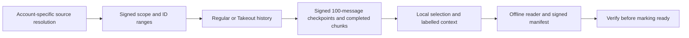

# Faster acquisition with the same evidence boundary

The acquisition engine should share one signed plan, storage and verifier across
regular and Takeout transports. Transport selection must not change what a
signature claims. A snapshot records what an account received within a stated
scope; it does not reconstruct everything that existed before collection.

## Current implementation

[Distributed Takeout](DISTRIBUTED-EXPORT.md#history-acquisition) now removes
Telethon's extra history iterator delay for public-chat exports. It reuses the
existing Takeout request wrapper, preserves account-wide persisted FloodWait and
validates the export handle and Telegram split range on resume. Handles remain
private. There is one outgoing RPC per account.

Sparse numeric ranges can use wider chunks, up to 100,000 IDs. The signed scope
still contains every planned ID. This is a request-count optimization, independent
of deletion analysis. The whole-history count used to choose a width is an
estimate, not a count for a date-filtered selection.

Synthetic protocol tests exercise the installed Telethon iterator: 201 messages
produce the same IDs, with automatic iterator sleeps on regular transport and none
on Takeout. A sparse 500,000-ID fixture containing four messages needs five history
requests with the widened plan, versus 250 fixed 2,000-ID tasks. These establish
local behavior, not a measured Telegram speedup or sustainable quota.

New plans also checkpoint inside a range. Data is durable before its receipt; each
receipt binds the immutable plan, observer, cursor and preceding receipt. An
interrupted range stays with its original account and resumes after the verified
prefix. Old plans keep their whole-chunk format. The standalone verifier can inspect
a stopped working directory without session credentials. These local decoded-message
batches are not raw RPC-page observations. See [recovery details](DISTRIBUTED-EXPORT.md#chunking-and-continuation).

A 201-message protocol fixture interrupted after 100 messages resumes with two
history requests for the remaining 101, preserving the original signed prefix.
Fault tests cover unsigned tails, a real subprocess exit before a receipt, receipt
write failure, free-space exhaustion, cancellation during a write, tampering and
observer changes. Checkpointing adds local signing/sync work; it reduces rereading
after interruptions rather than increasing the uninterrupted network rate.

A larger offline comparison used 10,000 decoded messages in a 500,000-ID plan,
with five 100,000-ID chunks and no attachments. Interrupting the first range after
25 successful history responses retained 2,500 messages with checkpoints, versus
zero with the previous whole-chunk path. Resume needed 80 history calls instead
of 105. Uninterrupted runs used 105 calls in either mode. All four runs produced
identical canonical message-record hashes and passed local receipt verification.
These are synthetic RPC responses through the real Telethon iterator and storage
path. They establish recovery behavior, not network throughput, sustainable
Telegram quotas or a server/account sizing recommendation. Extra signing and sync
costs still need measurement with real network latency and isolated disk load.

## Next changes, in dependency order

1. **A shared decoded-record contract.** Live capture retains more decoded fields
   than distributed export's current projection. Preserve safe source fields with
   an explicit redaction/schema policy and library/layer version. Keep display and
   re-parsing as derivations. Do not claim reserialized objects are original wire
   bytes or that an unknown TL constructor can be decoded generically.
2. **Bounded overlap of network and local work.** While one committed page is being
   indexed/rendered, acquire the next into a bounded queue. Backpressure stops reads
   when storage cannot keep up. Acquisition and required signing stay ahead of
   optional PDF, OCR, translation and analytics. No unbounded in-memory history.
3. **Batch-level Takeout ownership.** For a signed multi-chat plan with compatible
   scope flags, one account can retain a Takeout for that batch. Validate every
   reused handle and bind each page to its source and account. Close at the end of
   the batch; never reuse another job's private handle implicitly.
4. **Measured account scheduling.** Separate username discovery, history and
   participant workloads. Keep account-local peer caches and shared deadlines.
   Increase concurrency only through bounded comparisons with identical scope and
   account access, using committed-message throughput including waits. Persist
   inaccessible sources and unfinished work instead of substituting accounts to
   evade a wait. An account-count recommendation requires measured work volume.

The numbered items are follow-up designs, not completed features. The current
Takeout/checkpoint path has not been benchmarked live while test accounts are under
persisted rate-limit waits. Durable writes run in a drained worker thread, but reads
still await each checkpoint; there is no queued network/write overlap yet.

## Acceptance gates

- The signed plan and account identity cannot change across resume.
- Duplicate, out-of-range, changed or tampered reused data is rejected; an empty
  response is scoped to its observer and request, not universal absence.
- Regular and Takeout runs over a fixed synthetic source yield the same records.
  Live differences must remain observable rather than normalized away.
- New transport metadata does not expose Takeout handles, access hashes or keys.
- A kill, disk-full error, long FloodWait, invalid Takeout and changed split range
  retain verified progress with explicit status.
- Old archives remain verifiable. New page formats require old/new compatibility
  tests and preserved append-only observations.
- Report discovery, acquisition, durable writes, selection and packaging separately.
  Measure peak memory, disk use, requests by method and committed-message throughput.
  A fast network-only counter is insufficient.

The existing text-only benchmark scope remains unchanged. Attachment bytes and
participant enumeration are separate workloads and must be stated explicitly.
