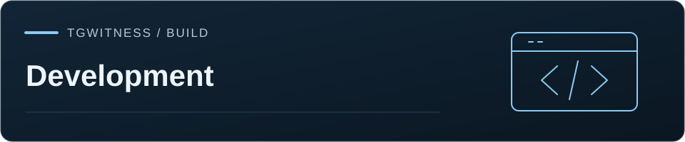

[TgWitness](../README.md) / [Documentation](README.md) · [Development](ARCHITECTURE.md)



# Panel development

Native ES modules and plain DOM, no frontend build step. `python start.py` runs the panel
locally; browser checks make their own temp workspaces and never touch Telegram.

Restart the application after updating panel assets or translation dictionaries.
`panel_assets.PanelFiles` builds the page and its subresource-integrity metadata at
startup, and the locale endpoint caches generated dictionaries. Replacing files in
a running installation does not refresh that metadata.

<details>
<summary>On this page</summary>

- [Language](#language)
- [Modules](#modules)
- [Navigation and requests](#navigation-and-requests)
- [Forms](#forms)
- [Still to extract](#still-to-extract)
- [Checks](#checks)

</details>

## Language

Write new UI text, guides and release notes in English first. English strings are the
translation keys and the fallback. Keep the user's chosen language across reloads, use the
browser's preference until they pick one.

## Modules

| Location | Owns |
| --- | --- |
| `tgwitness/static/app.js` | Bootstrap, session boundary, adapters for old controllers |
| `static/router.js` | Paths, workspace query, journal filters, deep links, Back/Forward |
| `static/core/view-host.js` | Active view, request cancellation, retained roots |
| `static/core/time.js` | UTC/local display, relative time |
| `static/views/` | Sources, Parameters, Accounts, Access, System log, Exports, chat list |
| `static/components/` | Health, notices, journal controls, drafts, connection feedback |

Controllers get their API, translation and permission functions passed in. Don't reach into
another controller's form and don't assume classic-script globals live on `window`.

Only the active view root is in the document, the rest stay in memory so drafts and
listeners survive. Not real code splitting yet: `index.html` still has the initial markup
and `app.js` still has old controllers.

## Navigation and requests

- `/?ws=default` opens the default view. Routes: `/chats`, `/chats/:chatId`, `/journal`,
  `/journal/event/:seq`, `/sources`, `/parameters`, `/accounts`, `/access`,
  `/integrations`, `/exports`, `/extras/:card`.
- A route is just a view, it grants nothing. The API checks permissions and scope every time.
- The static demo uses a `route` query param because GitHub Pages can't serve panel paths.
  Missing API and asset paths must never fall back to HTML.
- `enter(context)` gets an abort signal and a `current()` guard. Stop reads on leave, and
  check request and workspace generation before applying a response.
- Hidden tabs pause periodic reads. Retries repeat status reads only, never a POST after an
  unclear network error.

## Forms

Background updates patch rows in place. Never rebuild a form, steal focus or drop an unsaved
value. On save, compare the sent snapshot with the current draft and keep newer edits.
Clear write-only credentials from the field and the Discard baseline. Tokens and credentials
never go to browser storage, except the panel sign-in token in tab-scoped `sessionStorage`
(cleared on lock).

Use `tr()` for UI text. Keep `tools/i18n_keys.py` aware of dynamic labels. New module files
go into the wheel, demo asset list and source archive.

The panel only reads signed records. Grouping, filters, download history and drafts are not
journal edits.

Keep the daily navigation and reading area compact. Collection health belongs in
the status menu, chat-specific operations in Chat actions, and optional journal
filters in their disclosure. A collapsed control must remain reachable with a
keyboard. Keep selected journal filters visible outside the disclosure, preserve
drafts when navigating, and reset action menus when the workspace or route changes.
`components/layout.css` supplies the shared layout and responsive overrides.

`components/polish.css` loads last and owns depth, motion, icon tiles, dialog and
notification presentation. The page forbids inline styles, so charts set sizes through
the CSS object model and SVG attributes. The counters and charts in `views/pulse.js` read
the status counters and the chat list beside the overview from `views/home.js`.
The report studio in
`views/report-wizard.js` regroups the existing report form into steps beside the live
preview and keeps every control id, so saving, drafts and previews work unchanged.

## Still to extract

1. Request helpers into `core/api.js`, keeping their cancellation, timeout and error behavior.
   One controller at a time, run its stale-response tests.
2. Session/workspace state into `core/store.js` with narrow subscriptions, no global re-render.
3. Remaining chat, journal and integration controllers out of `app.js`. Not together with backend changes.
4. Lazy-load view templates once nothing needs eager markup.

## Checks

```sh
python -m ruff check .
python tools/publication_guard.py --git-index
```

Use the private browser regressions for routing, stale polling responses, source
selection, journal rendering, controls and write-only drafts. Use synthetic data;
keep generated journals, sessions and real-account screenshots out of Git.
