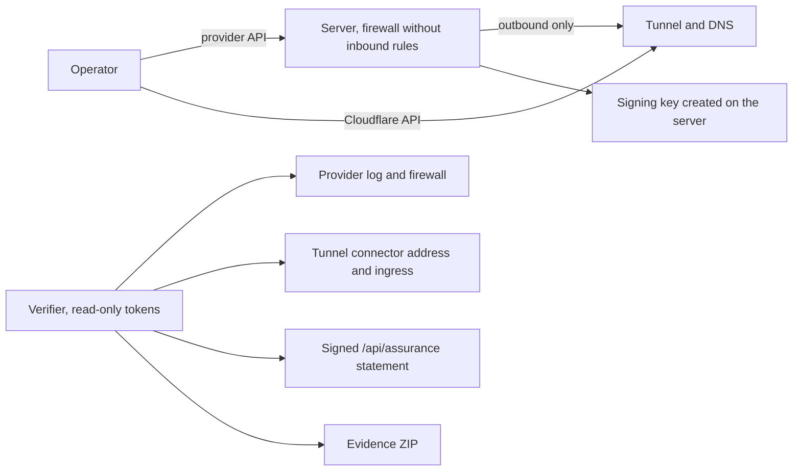

**English** · [Русский](ru/HIGH-ASSURANCE.md)

# High-assurance deployment

A signed journal proves that records were not changed **after** signing. For serious cases
the next question is whether anyone could have shaped the data **before** it was signed:
who ran the collector, on which machine, and whether someone logged in to it. This optional
mode deploys the collector so that a third party can check that, using records kept by the
cloud provider and Cloudflare rather than the operator's word.

Ordinary local and Docker use is unchanged. Nothing here runs unless you deploy with
`python -m tgwitness.cloud`, and the collector reads its host only when the deployment sets
`TGWITNESS_ASSURANCE`.



## What a verifier can check

| Claim | How it is checked | Kept by |
| --- | --- | --- |
| The server was created through the provider API at a known time | Server object and its creation in the provider's own log | Provider |
| Nobody used the provider's access paths | Log of console requests, rescue, password reset, rebuild, ISO, images, backups | Provider |
| Nothing could connect to it | The provider firewall has no inbound rules; SSH is masked from the first boot | Provider (firewall), host (SSH) |
| The panel is reached only through the tunnel | Tunnel ingress forwards to the panel alone; the connector runs from the server's address | Cloudflare |
| This exact software runs | The collector's signed source-tree hash equals a checkout of the deployed commit | Collector, checked against Git |
| The signing key was created on that server | The key signs a statement naming the provider's server ID and the hash of the cloud-init it received | Collector, checked against the provider |
| The journal belongs to that key and server | Every process start in the evidence ZIP carries the host measurement for that server | Evidence ZIP |

Host measurements (SSH listeners and processes, current sessions, logins in `wtmp`, the boot)
are reported by the collector itself and are signed into every process start and into
`host.state` records whenever they change. Root on the server could falsify them; they
support the provider and Cloudflare records rather than replace them.

## Providers

| `--provider` | Credentials | Verifier's read-only access | Provider log for the verifier | Kept for |
| --- | --- | --- | --- | --- |
| `hetzner` | `HCLOUD_TOKEN` | Read token of the same project | Server and firewall actions | While the resources exist |
| `digitalocean` | `DIGITALOCEAN_TOKEN` | Read-only personal access token | Droplet actions | While the Droplet exists |
| `linode` | `LINODE_TOKEN` | `linodes`, `firewall`, `events` read-only scopes | Account events, firewall rule versions | 90 days |
| `vultr` | `VULTR_API_KEY` | User with read access and the `activity_logs` permission | Account activity log (method, path, actor) | 30 days, longer with an audit-log subscription |
| `aws` | `AWS_ACCESS_KEY_ID`, `AWS_SECRET_ACCESS_KEY` | `ec2:DescribeInstances`, `ec2:DescribeSecurityGroups`, `cloudtrail:LookupEvents` | CloudTrail event history | 90 days |
| `generic` | none | none | none: **self-attested** | – |

Use a dedicated project, team, account or sub-account for each case: the verifier's
read-only access then shows only this deployment. Credentials are read from
`--provider-token-file` or the variable above, never from the command line. For AWS the file
holds `ACCESS_KEY_ID SECRET_ACCESS_KEY [SESSION_TOKEN]`; the region is `--location`.

What each provider's records cannot show is printed in every report. In short: Hetzner
logs console requests; DigitalOcean's Recovery Console, Linode's Lish/Glish and Vultr's web
console are not logged as such, so root is locked at the first boot and a console login
would need a password reset or a boot change, which are logged. Vultr returns the console
address to any key that can read the instance; neither the record nor the report stores it.

## Before you start

1. A Cloudflare zone, its account ID, and an API token with **Cloudflare Tunnel Edit**,
   **Zone Read** and **DNS Edit**. For the verifier: **Cloudflare Tunnel Read**, **DNS Read**
   and, for the audit log, **Account Settings Read**.
2. Provider credentials with write access to a dedicated project.
3. The commit to run. A release tag is resolved once to its commit with `git ls-remote`;
   the server only ever receives the 40-character commit.

## Deploy

Look at everything that will be sent first. `plan` makes no provider or Cloudflare request:

```sh
python -m tgwitness.cloud plan --provider hetzner --name case-2026-11 --server-type cpx22 \
    --ref 0123456789abcdef0123456789abcdef01234567 --zone example.org \
    --cloudflare-account CLOUDFLARE_ACCOUNT_ID --panel-host case.example.org
```

Then deploy with the same options and the credentials:

```sh
python -m tgwitness.cloud deploy --provider hetzner --name case-2026-11 --server-type cpx22 \
    --ref 0123456789abcdef0123456789abcdef01234567 --zone example.org \
    --cloudflare-account CLOUDFLARE_ACCOUNT_ID --panel-host case.example.org \
    --witness-host case-witness.example.org \
    --provider-token-file hetzner.token --cloudflare-token-file cloudflare.token
```

Server types to start with: `cpx22` (Hetzner), `s-1vcpu-2gb` (DigitalOcean), `g6-standard-1`
(Linode), `vc2-1c-2gb` (Vultr), `t3.small` (AWS). `--location` and `--image` default to each
provider's Ubuntu 24.04 in a European region.

The command:

1. creates a Cloudflare tunnel whose ingress forwards the panel hostname to the panel and,
   if given, the witness hostname to `/api/witness/head` and `/api/assurance` only;
2. creates proxied CNAME records for those hostnames, refusing names that already exist;
3. creates a provider firewall without inbound rules and a server behind it with no SSH key,
   no backups, no console agent, and cloud-init that masks SSH, locks root, installs
   `cloudflared`, fetches exactly the commit, checks it and starts TgWitness as a
   hardened systemd service;
4. waits for the collector's signed statement and checks that it names this server and the
   hash of this cloud-init.

`deployments/case-2026-11/` then holds:

| File | Contents | Share? |
| --- | --- | --- |
| `deployment.json` | IDs, hashes, the API calls made (method, path, status) and the first signed statement | Yes, with the verifier |
| `cloud-init.redacted.yaml` | The exact cloud-init with its two secrets replaced by `REDACTED` | Yes |
| `panel-token.txt` | The panel token | No |

The provider's root password, the tunnel token and the panel token are never written to
`deployment.json`. Publish the collector fingerprint printed at the end through a channel
you do not control alone, for example a witness channel or a message to the recipient.

Sign in to Telegram at `https://case.example.org` with the panel token, as in the
[account guide](ACCOUNTS.md). Panel actions are recorded in the signed journal; they are not
SSH sessions. A [witness](WITNESS.md) can poll `https://case-witness.example.org`.

There is no SSH: if the bootstrap fails, the collector never answers. Delete the server and
deploy again, or use a debug deployment to find the cause.

### Secrets in the user data

The cloud-init carries two secrets: the panel token and the Cloudflare tunnel token. The
signing key is not among them; it is created on the server. Hetzner, DigitalOcean and Linode
do not return user data through their API. Vultr returns it to any key that can read the
instance, and EC2 through `DescribeInstanceAttribute`. For AWS give the verifier only the three
actions in the table, never `ec2:Describe*`. For Vultr, assume the verifier's key can read both
tokens. A tunnel token lets someone run a second connector: `verify` reports any connector
not on the server, and the collector's statements cannot be forged that way because each one
signs a fresh challenge.

The collector's public statement leaves out the server's address and the sources of logins;
both stay in the signed journal.

## Debug deployment and lock

`--debug-ssh-key KEY --debug-ssh-from 198.51.100.4` keeps SSH for one key from one address
or small network. Such a deployment is recorded as `debug` and is **never** reported as
high-assurance. When you are done, run `sudo tgwitness-lock` as the last command of the last
SSH session, then:

```sh
python -m tgwitness.cloud lock --record deployments/case-2026-11/deployment.json --provider-token-file hetzner.token
```

The firewall loses every inbound rule. Reports then show when SSH was allowed and when it
was closed; that window stays visible.

## Any server (self-attested)

`--provider generic` is for a server bought or installed by hand. `deploy` creates the tunnel
and DNS, writes `install.sh` (private) and `install.redacted.sh` (to publish), and waits.
Copy `install.sh` to a freshly installed Ubuntu 24.04 server and run it there:

```sh
sudo bash install.sh
```

It records the host as it was (logins, accounts, `authorized_keys`, listening sockets,
services, scheduled jobs, packages), installs the commit, enables a host firewall, deletes
itself, masks SSH and ends the session. The report for such a server is at best
**SELF-ATTESTED**: whoever ran the installer had root before it, and no provider record is
available to the verifier. It is still better than an unexplained server: the inventory,
the installer hash and every later login are signed.

## Verify

The verifier needs `deployment.json`, the published installer, read-only credentials and,
ideally, a checkout of the commit and an evidence ZIP:

```sh
git clone -c core.autocrlf=false https://github.com/phishdestroy/TgWitness.git checkout
git -C checkout checkout 0123456789abcdef0123456789abcdef01234567
python -m tgwitness.cloud verify --record deployment.json \
    --provider-token-file read-only.token --cloudflare-token-file cloudflare-read.token \
    --fingerprint COLLECTOR_FINGERPRINT --cloud-init cloud-init.redacted.yaml \
    --source checkout --evidence tgwitness-evidence.zip --report report.md
```

Every provider and Cloudflare value is requested by the verifier at that moment; the record
supplies only the IDs to ask about. The exit code is 0 for **PASS**, 1 for **FAIL** and 2 for
**REVIEW**, **INCOMPLETE** or **SELF-ATTESTED**. `--fingerprint` should come from an independent
channel; without it the key is compared with the operator's record only. `python verify.py`
still verifies the evidence ZIP itself, as in [Evidence](EVIDENCE.md).

Provider actions are classified: creation and start within 30 minutes of creation pass;
console, rescue, password reset, rebuild, ISO, images, snapshots, backups, Systems Manager,
EC2 Instance Connect and firewall openings fail; power actions and anything not expected
are marked for review. An unknown action never passes silently.

## Report for evidence handover

`--report report.md` writes the Markdown report and `report.json` beside it:

1. result, collector key fingerprint, deployment, provider, commit, server, firewall, tunnel;
2. every check with its status and source (provider API, Cloudflare API, collector statement,
   evidence journal);
3. the provider log with each action's assessment and, where the provider records it, the actor;
4. the Cloudflare endpoints holding the tunnel's connections, configuration and audit log;
5. the signed collector statement;
6. what the report establishes and what it does not;
7. commands to reproduce it, and the SHA-256 of every file it was given.

Hand over the report, `report.json`, `deployment.json`, the published installer and the
evidence ZIP. Produce the report early: provider logs are kept for limited periods.

## What this does not establish

- The provider and its staff control the hypervisor, disks and network.
- Host measurements are self-reported by the collector.
- Earlier firewall rule contents are not in every provider log; only Linode keeps rule versions.
- It says nothing new about message authenticity; see [Evidence](EVIDENCE.md).

## Tested here

The deployment, lock and verification logic is covered by automated tests against simulated
Hetzner, DigitalOcean, Linode, Vultr, EC2/CloudTrail and Cloudflare APIs built from their
published API references, and the AWS request signing against AWS's published examples.
It has **not** yet been run against real provider accounts; check the first deployment on
each provider with `plan`, a debug deployment and `verify` before relying on it in a case.
