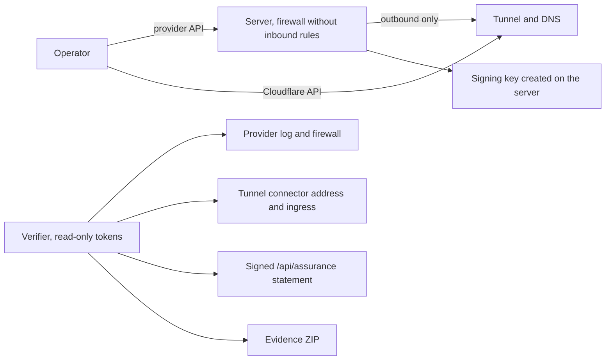

[TgWitness](../README.md) / [Documentation](README.md) · [Assurance levels](https://phishdestroy.github.io/TgWitness/docs/assurance-levels/)


# Verified server

A verified server is an ordinary VPS that TgWitness creates through the provider's API, so
that someone else can check how it was built and that nobody opened it afterwards. The
reviewer reads the provider's records and Cloudflare's with read-only tokens; nobody has to
take the operator's word.

Ordinary local and Docker use is unchanged. Nothing here runs unless you deploy with
`python -m tgwitness.cloud`, and the collector reads its host only when the deployment sets
`TGWITNESS_ASSURANCE`.

The [animated guide](https://phishdestroy.github.io/TgWitness/docs/verified-server/) walks through
the deployment step by step. Next level: [a confidential VM on Phala Cloud](PHALA.md).



<details>
<summary>On this page</summary>

- [What a verifier can check](#what-a-verifier-can-check)
- [How a cloud server is controlled, and what can go unseen](#how-a-cloud-server-is-controlled-and-what-can-go-unseen)
- [Providers, one by one](#providers-one-by-one)
- [Before you start](#before-you-start)
- [From the panel](#from-the-panel)
- [Quick tunnel without a domain](#quick-tunnel-without-a-domain)
- [Deploy](#deploy)
- [Debug deployment and lock](#debug-deployment-and-lock)
- [Remove a deployment](#remove-a-deployment)
- [Any server (self-attested)](#any-server-self-attested)
- [Verify](#verify)
- [Report for evidence handover](#report-for-evidence-handover)
- [Cloudflare as an outside witness](#cloudflare-as-an-outside-witness)
- [Reading the deployment result](#reading-the-deployment-result)

</details>

## What a verifier can check

| Claim | How it is checked | Kept by |
| --- | --- | --- |
| The server was created through the provider API at a known time | Server object and its creation in the provider's own log | Provider |
| Nobody used the provider's access paths | Log of console requests, rescue, password reset, rebuild, ISO, images, backups | Provider |
| Nothing could connect to it | The provider firewall has no inbound rules; SSH is masked from the first boot | Provider (firewall), host (SSH) |
| The panel is reached only through the tunnel | Tunnel ingress forwards to the panel alone; the connector runs from the server's address | Cloudflare |
| This exact software runs | The collector's signed source-tree hash equals a checkout of the deployed commit | Collector, checked against Git |
| The signing key was created on that server | The key signs a statement naming the provider's server ID and the hash of the cloud-init it received | Collector, checked against the provider |
| The journal belongs to that key and server | Every process start in the evidence ZIP carries the host measurement for that server | Evidence ZIP |
| The Telegram key was created in the attested run | `account.authorized` records `key_origin: "created"` | Evidence ZIP |

The collector records SSH state, sessions, login history and boot information in signed
process-start and <code>host.state</code> records. On an ordinary VM these are local inventory
records, which the reviewer compares with the provider's independent records.

An attested deployment does not collect on an imported session key. Sign in by phone or
QR, or use the session file for an independent login: either way the Telegram
authorization key is created inside the attested run, the journal records
<code>key_origin: "created"</code>, and <code>python -m tgwitness.cloud verify</code> passes
<code>account_key</code>. A journal with an imported key fails that check.

## How a cloud server is controlled, and what can go unseen

### What a cloud server physically is

A cloud server is not a separate machine. The provider runs physical hosts,
each with Linux and the **KVM** hypervisor. Every customer server on a host
is a separate **QEMU process** on that host:

- the server's **memory** is memory of that process on the host;
- the server's **disk** is a file or volume on the host or the provider's
  storage cluster;
- the server's **network** passes through the host's virtual switch;
- the server's **clock** is supplied by the host.

Dozens of servers belonging to different customers (companies, banks,
public bodies, individuals) can share one host.

### Two ways to reach a server

**1. The customer control plane: API and web console.**
Everything you, or anyone holding your API token, can do goes through the
provider's API: create, start, stop, console, rescue, password reset,
rebuild, ISO, snapshot, backup, firewall changes. These actions are recorded
in the **provider log of your account**. The reviewer reads that log
independently, and `verify` fails on any action that could open the server.

**2. The provider's infrastructure: the hosts themselves.**
Provider engineers with administrative access to a physical host operate
below the customer control plane. With root on the host, they can pause a
single server, read or change its memory, copy or modify its disk, or move
it to another host. These operations **affect only that one server**:
neighbours on the same host keep running and notice nothing. They are **not
recorded in your account's log**. Whether the provider records them
internally is up to the provider and is not visible to you or the reviewer.

This second path is what no audit log available to customers can rule out.

### Who can use the second path

Not an ordinary attacker. Reaching it requires one of:

- **the provider's own staff** with production host access;
- **a state authority** that compels the provider to act, for example
  through lawful interception or a court order in the provider's
  jurisdiction;
- **an attacker who has compromised the provider's infrastructure itself.**

The neighbours matter here, but not because tampering with one server would
disturb them. The same host access that reaches your server also reaches
every other server on that host: banks, companies, government services.
Providers therefore restrict, monitor and audit host access tightly; Hetzner,
for example, is certified to ISO/IEC 27001. An attacker who holds such access
has an extremely valuable capability that is exposed every time it is used.
Spending it covertly on one evidence server is a decision taken at the level
of a state, not of an ordinary adversary.

Publicly documented provider-level interventions fit this picture. In 2023,
traffic to jabber.ru, hosted at Hetzner and Linode, was intercepted at the
provider level, reportedly as lawful interception requested by German
authorities. That was **network interception**. We know of no public case of
a provider altering data inside a customer's virtual machine.

An ordinary attacker can steal your API token. Every action they take
with it appears in the provider log, and `verify` reports it.

### What each layer can and cannot do to the evidence

| Actor | Path | What they could do | Detected? |
| --- | --- | --- | --- |
| You, or anyone with your API token | Customer control plane | Console, rescue, rebuild, snapshot, firewall opening | **Yes**: provider log, `verify` fails |
| Anyone with the tunnel token | Second Cloudflare connector | Route panel traffic elsewhere | **Yes**: Cloudflare reports connectors not on the server |
| Network interceptor (incl. lawful interception) | Provider network | Block or delay traffic. **Cannot alter Telegram content**: the session key is created on the server and MTProto pins Telegram's server keys | Blocking appears as **gaps** in the journal |
| Provider staff or a compelling state | Host / hypervisor | Read memory, including the collector's signing key; alter data before it is signed; alter the clock | **Not in customer-visible logs** |

### Limits of a host-level attacker

Even with host access, the past is constrained by what already left the
server:

- **Checkpoints published to independent witnesses** cannot be rewritten.
  Anything already witnessed stays fixed.
- **RFC 3161 time stamps and OpenTimestamps** fix when each checkpoint
  existed. The host clock cannot move them.
- **Telegram itself** still holds the messages. Anything forged can be
  contradicted by another capture of the same chat.

The realistic risk is therefore manipulation **at the moment of collection**,
not silent rewriting of an archive afterwards.

### Raising the bar

| Measure | What it removes |
| --- | --- |
| Verified server deployment (this page) | You, as operator, from the circle of trust |
| Cloudflare as a second witness | Reliance on the provider's records alone |
| Two collectors at different providers in different jurisdictions, compared message by message | A single provider or a single state's leverage |

**Our assessment:** a verified server deployment is sufficient unless your
opponent can compel or covertly obtain the provider's cooperation, which in
practice means state-level capabilities. If that is plausible, use two
providers in different jurisdictions, or the next assurance level.

## Providers, one by one

Every provider below runs the same deployment: a firewall without inbound rules, a server
without SSH, a tunnel to Cloudflare. They differ in what their own log records, and that log is
what a verifier reads to see whether anyone reached the server through the provider. What
`verify` makes of each action is set in [`tgwitness/providers/`](../tgwitness/providers/).

| Provider | Log kept | Names who acted | Console in the log | Firewall changes | Panel wizard |
| --- | --- | --- | --- | --- | --- |
| Hetzner Cloud | While the server exists | No | Yes | Logged; earlier rules not kept | Yes |
| Amazon EC2 | 90 days | Yes | Agent and key paths: Instance Connect, Systems Manager, serial console | Logged | No, command line |
| Akamai (Linode) | 90 days | Yes | No | Every rule version kept | No, command line |
| DigitalOcean | While the Droplet exists | No | No | Not logged | No, command line |
| Vultr | 30 days | Yes | Not identified | Logged | No, command line |

Where the console is not in the log, root is locked at the first boot: logging in through the
console would first need a password reset or a changed boot, and those are in the log.

Use a dedicated project, team, account or sub-account for each case: the verifier's
read-only access then shows only this deployment. Credentials are read from
`--provider-token-file` or the variable above, never from the command line. For AWS the file
holds `ACCESS_KEY_ID SECRET_ACCESS_KEY [SESSION_TOKEN]`; the region is `--location`.

A card for each provider with an interactive log, Cloudflare on it, its strength, price and deployment: [providers](https://phishdestroy.github.io/TgWitness/docs/verified-server/#providers).

Every provider bills by the hour or second up to its monthly price, so a test deployment removed
after an hour costs cents. The tunnel, the quick tunnel, Gateway DNS on Cloudflare's free Zero
Trust plan, the drand relay and ntfy.sh cost nothing; a tunnel under your own name needs a domain
in Cloudflare. The wizard shows Hetzner's current price, including VAT for your account, before
anything is created.

## Before you start

1. A Cloudflare zone, its account ID, and an API token with **Cloudflare Tunnel Edit**,
   **Zone Read** and **DNS Edit**, given with `--cloudflare-token-file` or
   `CLOUDFLARE_API_TOKEN`. For the verifier: **Cloudflare Tunnel Read**, **DNS Read** and, for
   the audit log, **Account Settings Read**. Without a domain, a
   [quick tunnel](#quick-tunnel-without-a-domain) needs none of this.
2. Provider credentials with write access to a dedicated project; `lock` uses the same:
   - Hetzner: API token with Read & Write permission;
   - DigitalOcean: personal access token with write access;
   - Linode: personal access token with `linodes`, `firewall` and `events` read/write scopes;
   - Vultr: API key of a dedicated account or sub-account;
   - AWS: IAM credentials allowed `ec2:DescribeVpcs`, `ec2:DescribeImages`,
     `ec2:CreateSecurityGroup`, `ec2:AuthorizeSecurityGroupIngress`, `ec2:RunInstances`,
     `ec2:CreateTags`, `ec2:DescribeInstances`, `ec2:DescribeSecurityGroupRules` and
     `ec2:RevokeSecurityGroupIngress`.
3. The commit to run. A release tag is resolved once to its commit with `git ls-remote`;
   the server only ever receives the 40-character commit.

## From the panel

On your own computer, **More tools → Extras → Server 24/7** runs the same `deploy` for Hetzner in three
steps: choose Europe or the United States, paste a Hetzner token (Read & Write), then review
the server type, monthly price, address and version the panel found with that token. Nothing
is created before you confirm. The panel shows each step as `deploy` reports it, then the
address, the panel token and the signing key fingerprint. Without a domain the server gets a
[quick tunnel](#quick-tunnel-without-a-domain); **Your servers → Find the current address**
looks it up again after a restart. For a fixed address under your own domain, open
**Optional · your own domain** and add a Cloudflare token (the prepared link selects Zone
Read, DNS Edit and Cloudflare Tunnel Edit).

The tokens travel with each request from the browser tab to TgWitness on the same computer
and are not written anywhere; the deployment record, redacted cloud-init, panel token and,
for a quick tunnel, the address key are kept in `deployments/NAME` inside the data directory.
The panel offers this only to the main administrator on a direct loopback connection
(`127.0.0.1`, no proxy or tunnel headers); a panel reached over a network shows the commands
instead. The version defaults to the release tag of the running panel, resolved through the
GitHub API. Location, server type and price come from Hetzner's API: `cpx22` where it is
offered, otherwise the cheapest x86 type with at least 2 GB of memory.

## Quick tunnel without a domain

`--quick-tunnel` replaces `--zone`, `--cloudflare-account` and `--panel-host`; no Cloudflare
account or token is involved:

```sh
python -m tgwitness.cloud deploy --provider hetzner --name case-2026-11 --server-type cpx22 \
    --ref 0123456789abcdef0123456789abcdef01234567 --quick-tunnel --provider-token-file hetzner.token
```

On the server, cloudflared opens a
[quick tunnel](https://developers.cloudflare.com/tunnel/get-started/quick-tunnels/)
to the panel: a random `https://….trycloudflare.com` address that changes whenever cloudflared
or the server restarts. A small service on the server posts each address to a random ntfy.sh
topic, signed (HMAC-SHA256) with a key only the deployment directory holds
(`address-key.txt`), and repeats it every three hours because ntfy.sh keeps posts for 12.
`deploy` and **Find the current address** accept signed posts only, so a forged post cannot
send you, and your panel token, to someone else's address. The topic is in the record and the
published cloud-init: whoever has them can read the current address, which still asks for the
panel token. The server keeps no inbound port either way.

A verifier has no address key, and anyone who reads the topic can post to it. So the collector
also posts the address itself, signed with its own Ed25519 key, and `verify` takes the newest
post signed by the collector key in the deployment record; posts are ordered by the time ntfy.sh
received them, not the time they claim. A collector from before this change signs nothing, and
`verify` then takes the newest post and says so in the `statement` check; a forged post can
only make that check fail, since the address must still answer with the collector's key.

What it costs: no Cloudflare account keeps records of a quick tunnel, so `verify` reports the
tunnel, connector and DNS check as unavailable and the result is at best `incomplete`; the
provider records, firewall, signed statement, host measurements and installer comparison are
checked as usual. The byte comparison with the reference installer needs a deployed commit
that already knows `--quick-tunnel`; a 0.7.0 checkout builds the domain installer and reports
the difference. Cloudflare offers quick tunnels for trials, allows 200 requests in
flight and does not carry Server-Sent Events, so the panel's live updates (versions after 0.7.0)
may not arrive through one and a view needs reloading; that part has not been tried. For a case
that has to stand, use your own domain.

## Deploy

Look at everything that will be sent first. `plan` makes no provider or Cloudflare request:

```sh
python -m tgwitness.cloud plan --provider hetzner --name case-2026-11 --server-type cpx22 \
    --ref 0123456789abcdef0123456789abcdef01234567 --zone example.org \
    --cloudflare-account CLOUDFLARE_ACCOUNT_ID --panel-host case.example.org
```

Then deploy with the same options and the credentials:

```sh
python -m tgwitness.cloud deploy --provider hetzner --name case-2026-11 --server-type cpx22 \
    --ref 0123456789abcdef0123456789abcdef01234567 --zone example.org \
    --cloudflare-account CLOUDFLARE_ACCOUNT_ID --panel-host case.example.org \
    --witness-host case-witness.example.org \
    --provider-token-file hetzner.token --cloudflare-token-file cloudflare.token
```

Server types to start with: `cpx22` (Hetzner), `s-1vcpu-2gb` (DigitalOcean), `g6-standard-1`
(Linode), `vc2-1c-2gb` (Vultr), `t3.small` (AWS). `--location` and `--image` default to each
provider's Ubuntu 24.04 in a European region.

`--repository` takes the commit from another https Git repository, without credentials in the
URL (default `https://github.com/phishdestroy/TgWitness.git`). `deploy` also accepts `--out`
for another deployment directory (default `deployments/NAME`; a directory that already holds a
deployment is refused) and `--wait`, the minutes to wait for the collector's signed statement:
1 to 240, default 20, or 60 for `generic`.

The command:

1. creates a Cloudflare tunnel whose ingress forwards the panel hostname to the panel and,
   if given, the witness hostname to `/api/witness/head` and `/api/assurance` only;
2. creates proxied CNAME records for those hostnames, refusing names that already exist;
3. creates a provider firewall without inbound rules and a server behind it with no SSH key,
   no backups, no console agent, and cloud-init that masks SSH, locks root, installs
   `cloudflared`, fetches exactly the commit, checks it and starts TgWitness as a
   hardened systemd service;
4. waits for the collector's signed statement and checks that it names this server and the
   hash of this cloud-init.

`deployments/case-2026-11/` then holds:

| File | Contents | Share? |
| --- | --- | --- |
| `deployment.json` | IDs, hashes, the API calls made (method, path, status) and the first signed statement | Yes, with the verifier |
| `cloud-init.redacted.yaml` | The exact cloud-init with its two secrets replaced by `REDACTED` | Yes |
| `panel-token.txt` | The panel token | No |

The provider's root password, the tunnel token and the panel token are never written to
`deployment.json`. Publish the collector fingerprint printed at the end through a channel
you do not control alone, for example a witness channel or a message to the recipient.

Sign in to Telegram at `https://case.example.org` with the panel token, as in the
[account guide](ACCOUNTS.md). Panel actions are recorded in the signed journal; they are not
SSH sessions. A [witness](WITNESS.md) can poll `https://case-witness.example.org`.

There is no SSH: if the bootstrap fails, the collector never answers. Delete the server and
deploy again, or use a debug deployment to find the cause.

### Secrets in the user data

The cloud-init carries two secrets: the panel token and the Cloudflare tunnel token. The
signing key is not among them; it is created on the server. Hetzner, DigitalOcean and Linode
do not return user data through their API. Vultr returns it to any key that can read the
instance, and EC2 through `DescribeInstanceAttribute`. For AWS give the verifier only the three
actions in the table, never `ec2:Describe*`. For Vultr, assume the verifier's key can read both
tokens. A tunnel token lets someone run a second connector: `verify` reports any connector
not on the server, and the collector's statements cannot be forged that way because each one
signs a fresh challenge. With `--quick-tunnel` the second secret is the address key instead:
whoever reads it can post a false address that the panel would accept.

The collector's public statement leaves out the server's address and the sources of logins;
both stay in the signed journal.

## Debug deployment and lock

`--debug-ssh-key KEY --debug-ssh-from 198.51.100.4` keeps SSH for one key from one address
or small network, at most a /24 for IPv4 or a /48 for IPv6. `KEY` is already registered with
the provider: the name or ID of an SSH key in the Hetzner project, the ID or fingerprint of an
SSH key in the DigitalOcean team, a Linode username whose profile SSH keys are added to root,
the ID of an SSH key in the Vultr account, or the name of an EC2 key pair in the region. These
options do not apply to `generic`. Such a deployment is recorded as `debug` and is **never** reported as
high-assurance. When you are done, run `sudo tgwitness-lock` as the last command of the last
SSH session, then:

```sh
python -m tgwitness.cloud lock --record deployments/case-2026-11/deployment.json --provider-token-file hetzner.token
```

The firewall loses every inbound rule. Reports then show when SSH was allowed and when it
was closed; that window stays visible.

## Remove a deployment

`destroy` deletes the server and its firewall, found by the deployment's label so that a
deployment which failed half-way is removed as well, then the DNS records that point to its
tunnel, and the tunnel. The server's journal and signing key are deleted with it: export the
evidence first. The record stays, marked `removed`, with the API calls of the removal.

```sh
python -m tgwitness.cloud destroy --record deployments/case-2026-11/deployment.json --confirm case-2026-11 \
    --provider-token-file hetzner.token --cloudflare-token-file cloudflare.token
```

Removal through the API is implemented for Hetzner. For other providers `destroy` stops before
deleting anything and names the label to delete in the provider's console. A hand-installed
server (`generic`) loses only its tunnel and DNS records. A quick tunnel deployment needs no
Cloudflare token: its tunnel ends with the server, and its posts expire from ntfy.sh within
12 hours.

## Any server (self-attested)

`--provider generic` is for a server bought or installed by hand. `deploy` creates the tunnel
and DNS, writes `install.sh` (private) and `install.redacted.sh` (to publish), and waits.
Copy `install.sh` to a freshly installed Ubuntu 24.04 server and run it there:

```sh
sudo bash install.sh
```

It records the host as it was (logins, accounts, `authorized_keys`, listening sockets,
services, scheduled jobs, packages), installs the commit, enables a host firewall, deletes
itself, masks SSH and ends the session. The report for such a server is at best
**SELF-ATTESTED**: whoever ran the installer had root before it, and no provider record is
available to the verifier. It is still better than an unexplained server: the inventory,
the installer hash and every later login are signed.

## Verify

The verifier needs `deployment.json`, the published installer, read-only credentials and,
ideally, a checkout of the commit and an evidence ZIP:

```sh
git clone -c core.autocrlf=false https://github.com/phishdestroy/TgWitness.git checkout
git -C checkout checkout 0123456789abcdef0123456789abcdef01234567
python -m tgwitness.cloud verify --record deployment.json \
    --provider-token-file read-only.token --cloudflare-token-file cloudflare-read.token \
    --fingerprint COLLECTOR_FINGERPRINT --cloud-init cloud-init.redacted.yaml \
    --source checkout --evidence tgwitness-evidence.zip --report report.md
```

Every provider and Cloudflare value is requested by the verifier at that moment; the record
supplies only the IDs to ask about. The exit code is 0 for **PASS**, 1 for **FAIL** and 2 for
**REVIEW**, **INCOMPLETE** or **SELF-ATTESTED**. `--fingerprint` should come from an independent
channel; without it the key is compared with the operator's record only. `python verify.py`
still verifies the evidence ZIP itself, as in [Evidence](EVIDENCE.md).

Provider actions are classified: creation and start within 30 minutes of creation pass;
console, rescue, password reset, rebuild, ISO, images, snapshots, backups, Systems Manager,
EC2 Instance Connect and firewall openings fail; power actions and anything not expected
are marked for review. An unknown action never passes silently.

## Report for evidence handover

`--report report.md` writes the Markdown report and `report.json` beside it:

1. result, collector key fingerprint, deployment, provider, commit, server, firewall, tunnel;
2. every check with its status and source (provider API, Cloudflare API, collector statement,
   evidence journal);
3. the provider log with each action's assessment and, where the provider records it, the actor;
4. the Cloudflare endpoints holding the tunnel's connections, configuration and audit log;
5. the signed collector statement;
6. what the report covers and what lies outside its scope;
7. commands to reproduce it, and the SHA-256 of every file it was given.

Hand over the report, `report.json`, `deployment.json`, the published installer and the
evidence ZIP. Produce the report early: provider logs are kept for limited periods.

## Cloudflare as an outside witness

Everything here is optional. Without a Cloudflare account the server still runs, and two of
these work today:

| What | What it shows | In TgWitness |
| --- | --- | --- |
| Quick tunnel or your domain's tunnel | the panel is reached only through the tunnel | the server wizard, see above |
| drand relay `drand.cloudflare.com` | records after a drand round are newer than it: the journal was written as it went | evidence mode, **More witnesses**, no account ([format](EVIDENCE.md#optional-records-in-evidence-mode-drand-and-telegram-devices)) |
| Tunnel health notifications | when the tunnel was down, by email or webhook from Cloudflare | set them in the Cloudflare dashboard |
| Gateway DNS (`--gateway-dns`, or **Cloudflare Gateway DNS** in the wizard) | every name the server looked up, answered by Cloudflare over TLS; the Hetzner firewall lets DNS reach nothing else; whether a Gateway policy could rewrite answers | Hetzner, free Zero Trust plan, no domain; `verify` checks the firewall, the location, logging, policies, the server's queries and the audit log; evidence mode copies the log into the journal |
| Gateway with the Cloudflare One client on the server, an outbound firewall that allows only Cloudflare | every connection the server made, not just DNS | not built yet |
| Access in front of the panel | who signed in to the panel and when | not built: needs your own domain |
| SSH command logging | each command in a debug session | not built yet |

Logpush, which would keep Cloudflare's own copy in R2, is an Enterprise feature: on the free
plan Cloudflare answers `logpush is not enabled for this account`. Its Gateway log lasts 24
hours there, so evidence mode copies it into the signed journal (**Cloudflare Gateway's log of
this server's DNS queries**, a read-only token with Account Analytics Read).

`--gateway-location ID` (with `--gateway-dns`) uses an existing Gateway DNS location, given by its
32-character ID, instead of creating one; `destroy` leaves it in place.

Without a Zero Trust plan an account has one DNS location. When Cloudflare refuses another,
the server shares the existing one and its queries are told apart by its address; that filter
needs Zero Trust PII Read as well, and `destroy` leaves a shared location. One log query spans
at most three hours, so the copy and `verify` read the day in three-hour windows.

Gateway DNS covers the system resolver. DNS over HTTPS on port 443 to another resolver, and
connections to an address looked up nowhere (Telegram's data centres, for one), are not in
its log.

Cloudflare cannot see inside Telegram's encryption, other devices on the Telegram account
(evidence mode's device list records them from Telegram's side) or the provider's hypervisor.

## Reading the deployment result

For an ordinary VM, the provider controls the host infrastructure, and local inventory
is checked alongside provider records. Read the individual
results to see which checks passed or were unavailable.

Historical firewall detail depends on the provider; Linode retains rule versions.
The [validation record](VERIFICATION.md) lists tested deployments and remaining live
checks, and [verification scope](EVIDENCE.md#verification-scope) connects these environment
checks to archive acquisition and integrity.
