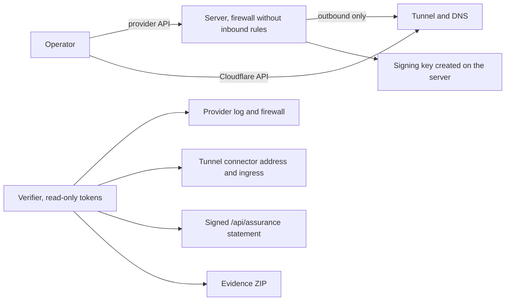

[TgWitness](../README.md) / [Documentation](README.md) · [Deployment and recovery](DEPLOYMENT.md)


# High-assurance deployment

High-assurance deployment adds independent checks of the collection environment to
archive verification. The reviewer queries deployment and access records held by the
cloud provider and Cloudflare, and an Intel TDX deployment adds hardware attestation
of the collector's environment.

Ordinary local and Docker use is unchanged. Nothing here runs unless you deploy with
`python -m tgwitness.cloud`, and the collector reads its host only when the deployment sets
`TGWITNESS_ASSURANCE`.



<details>
<summary>On this page</summary>

- [What a verifier can check](#what-a-verifier-can-check)
- [Providers](#providers)
- [Confidential VM on Phala Cloud (Intel TDX)](#confidential-vm-on-phala-cloud-intel-tdx)
- [Before you start](#before-you-start)
- [From the panel](#from-the-panel)
- [Quick tunnel without a domain](#quick-tunnel-without-a-domain)
- [Deploy](#deploy)
- [Debug deployment and lock](#debug-deployment-and-lock)
- [Remove a deployment](#remove-a-deployment)
- [Any server (self-attested)](#any-server-self-attested)
- [Verify](#verify)
- [Report for evidence handover](#report-for-evidence-handover)
- [Cloudflare as an outside witness](#cloudflare-as-an-outside-witness)
- [Reading the deployment result](#reading-the-deployment-result)

</details>

## What a verifier can check

| Claim | How it is checked | Kept by |
| --- | --- | --- |
| The server was created through the provider API at a known time | Server object and its creation in the provider's own log | Provider |
| Nobody used the provider's access paths | Log of console requests, rescue, password reset, rebuild, ISO, images, backups | Provider |
| Nothing could connect to it | The provider firewall has no inbound rules; SSH is masked from the first boot | Provider (firewall), host (SSH) |
| The panel is reached only through the tunnel | Tunnel ingress forwards to the panel alone; the connector runs from the server's address | Cloudflare |
| This exact software runs | The collector's signed source-tree hash equals a checkout of the deployed commit | Collector, checked against Git |
| The signing key was created on that server | The key signs a statement naming the provider's server ID and the hash of the cloud-init it received | Collector, checked against the provider |
| The journal belongs to that key and server | Every process start in the evidence ZIP carries the host measurement for that server | Evidence ZIP |
| The Telegram key was created in the attested run | `account.authorized` records `key_origin: "created"` | Evidence ZIP |

The collector records SSH state, sessions, login history and boot information in signed
process-start and <code>host.state</code> records. On an ordinary VM these are local inventory
records, which the reviewer compares with the provider's independent records. The
Intel TDX deployment below additionally verifies hardware-backed measurements.

An attested deployment does not collect on an imported session key. Sign in by phone or
QR, or use the session file for an independent login: either way the Telegram
authorization key is created inside the attested run, the journal records
<code>key_origin: "created"</code>, and <code>python -m tgwitness.cloud verify</code> passes
<code>account_key</code>. A journal with an imported key fails that check.

## Providers

| `--provider` | Credentials | Verifier's read-only access | Provider log for the verifier | Kept for |
| --- | --- | --- | --- | --- |
| `hetzner` | `HCLOUD_TOKEN` | Read token of the same project | Server and firewall actions | While the resources exist |
| `digitalocean` | `DIGITALOCEAN_TOKEN` | Read-only personal access token | Droplet actions | While the Droplet exists |
| `linode` | `LINODE_TOKEN` | `linodes`, `firewall`, `events` read-only scopes | Account events, firewall rule versions | 90 days |
| `vultr` | `VULTR_API_KEY` | User with read access and the `activity_logs` permission | Account activity log (method, path, actor) | 30 days, longer with an audit-log subscription |
| `aws` | `AWS_ACCESS_KEY_ID`, `AWS_SECRET_ACCESS_KEY` | `ec2:DescribeInstances`, `ec2:DescribeSecurityGroups`, `cloudtrail:LookupEvents` | CloudTrail event history | 90 days |
| `phala` | `PHALA_CLOUD_API_KEY` | An API key of the same workspace | Application revisions and CVM operations: compose and environment changes, restarts, OS upgrades | While the application exists |
| `generic` | none | none | none: **self-attested** | – |

Use a dedicated project, team, account or sub-account for each case: the verifier's
read-only access then shows only this deployment. Credentials are read from
`--provider-token-file` or the variable above, never from the command line. For AWS the file
holds `ACCESS_KEY_ID SECRET_ACCESS_KEY [SESSION_TOKEN]`; the region is `--location`.

Every report states the scope of each provider's records. In short: Hetzner
logs console requests; DigitalOcean's Recovery Console, Linode's Lish/Glish and Vultr's web
console are not logged as such, so root is locked at the first boot and a console login
would need a password reset or a boot change, which are logged. Vultr returns the console
address to any key that can read the instance; neither the record nor the report stores it.

## Confidential VM on Phala Cloud (Intel TDX)

With `--provider phala` the collector runs in an Intel TDX confidential virtual machine on
[Phala Cloud](https://phala.com/), managed by dstack. The host and Phala's staff cannot read its
memory, and the processor signs an attestation of what the machine booted. The verifier does not
take Phala's word for it: `tgwitness.tdx` checks every attestation itself, up to the pinned Intel
SGX Root CA, against Intel's revocation lists and Intel's signed platform data, and refuses
machines that can be debugged or migrated.

| Report entry | What it shows |
| --- | --- |
| `tdx_binding` | The attestation covers the signed statement of the collector and the random value of this request |
| `tdx_quote` | Intel vouches for the attestation; it passes only when Intel rates the platform as up to date |
| `tdx_compose_hash` | RTMR3, replayed from the dstack event log, measures the app-compose the collector reports |
| `tdx_compose` | That compose is byte for byte the one the code of the deployed commit builds: source files pinned by hash, both images by digest, no other code |
| `tdx_identity` | The attestation comes from the deployed application and instance, with keys from Phala's KMS and an encrypted disk |
| `tdx_os` | MRTD and RTMR0-2 equal the values the verifier computes from the dstack OS image Dstack-TEE publishes, found by the OS image hash the CVM reports, and from the ACPI tables QEMU builds for the VM's shape: firmware, kernel, initrd, command line with the root file system hash, memory, vCPUs and devices. A development image fails |

The OS image (about 180 MB, of which 21 MB are kept) is downloaded once from
[Dstack-TEE/meta-dstack](https://github.com/Dstack-TEE/meta-dstack/releases) into
`dstack-images` beside the record; `--tdx-image FOLDER` uses another folder or an unpacked image,
`--tdx-image none` skips the comparison. The measurement follows `dstack-mr` and the `qemu-acpi`
crate of Dstack-TEE/dstack. Private measurement regressions compare QEMU's own ACPI
output and a retained Phala Cloud quote; live qualification also needs the published image.
`--tdx-measurements` still compares MRTD and RTMR0-2 given as JSON instead.

Every start of the collector recorded in the journal carries such an attestation, so
`verify --evidence` checks each start and the OS image it booted. Phala's application revisions
and the CVM's operations serve as the provider log: a compose changed after the deployment fails
the report, and restarts are listed for review.

In the panel choose **Confidential virtual machine · Phala Cloud** under **More tools → Extras → Server 24/7**
and paste a Phala Cloud API key; the quick tunnel works as on Hetzner. From the command line:

```sh
python -m tgwitness.cloud deploy --provider phala --name case-1 --server-type tdx.small \
    --ref v0.8.0 --repository https://github.com/phishdestroy/TgWitness --quick-tunnel \
    --provider-token-file phala-key.txt
python -m tgwitness.cloud verify --record deployments/case-1/deployment.json \
    --provider-token-file phala-key.txt --cloud-init deployments/case-1/docker-compose.yaml \
    --source CHECKOUT_OF_COMMIT --fingerprint COLLECTOR_FINGERPRINT --report certificate.md
python -m tgwitness.cloud check-report --report certificate.pdf --verifier-fingerprint VERIFIER_KEY
```

`--tdx-collateral` reads Intel's certificates and revocation lists from a file instead of
downloading them from Intel. Gateway DNS is not available here: Phala has no provider firewall
for outgoing traffic.

### Offline check with verify.py

A recipient without a Phala account checks the quotes with the standalone verifier, offline:

```sh
python verify.py tgwitness-evidence.zip --fingerprint COLLECTOR_FINGERPRINT
python verify.py phala-tdx-attestation.json
```

For the quote of every `process.started` record in an evidence archive, and for the quote of a
signed collector statement (also inside a deployment record or a published attestation record),
`verify.py` checks the quote's ECDSA P-256 signature with its attestation key, the quoting
enclave report's signature with the PCK certificate, that this report names the attestation key
(SHA-256 of the key and the QE authentication data), that it comes from Intel's TDX quoting
enclave in production mode, and the chain PCK certificate → Intel SGX PCK Platform or Processor
CA → Intel SGX Root CA, whose SHA-256 is pinned in `verify.py`. It refuses debuggable or
migratable TDs, checks that REPORTDATA is SHA-512 of the start record (journal key, run, source
tree, host) or of the signed statement, and prints MRTD, RTMR0-3 and REPORTDATA.

The collector also stores Intel's collateral (TCB Info, QE Identity, revocation lists and their
issuer chains) with each quote when Intel's service answers. With it, `verify.py` checks Intel's
signatures and revocation lists and computes the TCB status as of the recorded time, or as of
the collateral's issue date when that is later. Without it the result reads "TCB status not
checked (no collateral in the archive)". Which code the VM ran (the compose RTMR3 measures, the
OS image behind MRTD and RTMR0-2), the provider log and Intel's current rating remain checks of
`python -m tgwitness.cloud verify`; the offline check therefore marks the attested collection run
as partial and does not by itself reach the `sealed` tier or the `attested` profile.

### Attestation certificate

For a Phala deployment `verify --report certificate.md` also writes the certificate: a
self-contained `certificate.html` and an A4 `certificate.pdf` with the verdict, the chain of trust
from Intel's root to the collector key, a comparison with ordinary and high-assurance servers,
the measurements next to the values computed from the published image, who vouches for each
part, the Intel certificate chain, every check, the provider log, and how to repeat the
verification. The JSON report stays the authoritative record; the pages render it.

The report is sealed, in `certificate.seal.json` and the `.tsq`/`.tsr` files beside it:

| Seal | What it adds |
| --- | --- |
| Qualified electronic time stamp, `http://tsa.belgium.be/connect` | RFC 3161 time stamp over the exact bytes of `certificate.json` from the Belgian federal government's qualified trust service provider (FPS Policy and Support, BOSA). Its unit is listed as a qualified time-stamping service, status granted, on Belgium's EU trusted list; the root (Belgium Root CA6) and the list's entries, as of the list issued on 20 October 2026, are pinned in `tgwitness/tsa_roots.py`. Under Regulation (EU) No 910/2014, article 41, such a time stamp is presumed accurate as to date and time and as to the integrity of the data in every EU member state |
| RFC 3161 time stamp, FreeTSA | A second, independent time stamp |
| Verifier signature | Ed25519 over a statement naming the report's SHA-256 and every time stamp, with the verifier's own key (`--sign-with FOLDER`, default `~/.tgwitness/verifier`); the PDF carries a signature by the same key |

`--timestamp URL` (repeatable) chooses other authorities, `--timestamp none` none, `--sign-with
none` leaves the seal unsigned. `check-report` checks the report's hash, the verifier signature,
each time stamp to a trusted root and its qualified status, and the PDF's signature. The legal
weight of a qualified time stamp outside the EU, and of the report as a whole, is for the court
or authority that receives it; the seal shows when the report existed and that it has not changed.

The attestation relies on Intel's TDX module and microcode and on the physical integrity of
the memory bus. Whoever controls the application in Phala's account can deploy another compose;
it appears as a new revision with a new compose hash. The host controls the machine's time
source and network.

Deploy, verify with `--evidence`, restarts, the OS image comparison, the sealed certificate and
destroy have run on Phala Cloud itself; see
[the 4 November 2026 run](VERIFICATION.md#live-phala-cloud-deployment--4-november-2026).
On 9 November a deployment collected from a live Telegram account; one run used a session key
created inside the VM. See [the live account run](VERIFICATION.md#phala-cloud-with-live-telegram-account--9-november-2026)
and [the key created in the VM](VERIFICATION.md#session-key-created-inside-the-tdx-vm--9-november-2026).

## Before you start

1. A Cloudflare zone, its account ID, and an API token with **Cloudflare Tunnel Edit**,
   **Zone Read** and **DNS Edit**, given with `--cloudflare-token-file` or
   `CLOUDFLARE_API_TOKEN`. For the verifier: **Cloudflare Tunnel Read**, **DNS Read** and, for
   the audit log, **Account Settings Read**. Without a domain, a
   [quick tunnel](#quick-tunnel-without-a-domain) needs none of this.
2. Provider credentials with write access to a dedicated project; `lock` uses the same:
   - Hetzner: API token with Read & Write permission;
   - DigitalOcean: personal access token with write access;
   - Linode: personal access token with `linodes`, `firewall` and `events` read/write scopes;
   - Vultr: API key of a dedicated account or sub-account;
   - AWS: IAM credentials allowed `ec2:DescribeVpcs`, `ec2:DescribeImages`,
     `ec2:CreateSecurityGroup`, `ec2:AuthorizeSecurityGroupIngress`, `ec2:RunInstances`,
     `ec2:CreateTags`, `ec2:DescribeInstances`, `ec2:DescribeSecurityGroupRules` and
     `ec2:RevokeSecurityGroupIngress`.
3. The commit to run. A release tag is resolved once to its commit with `git ls-remote`;
   the server only ever receives the 40-character commit.

## From the panel

On your own computer, **More tools → Extras → Server 24/7** runs the same `deploy` for Hetzner in three
steps: choose Europe or the United States, paste a Hetzner token (Read & Write), then review
the server type, monthly price, address and version the panel found with that token. Nothing
is created before you confirm. The panel shows each step as `deploy` reports it, then the
address, the panel token and the signing key fingerprint. Without a domain the server gets a
[quick tunnel](#quick-tunnel-without-a-domain); **Your servers → Find the current address**
looks it up again after a restart. For a fixed address under your own domain, open
**Optional · your own domain** and add a Cloudflare token (the prepared link selects Zone
Read, DNS Edit and Cloudflare Tunnel Edit).

The tokens travel with each request from the browser tab to TgWitness on the same computer
and are not written anywhere; the deployment record, redacted cloud-init, panel token and,
for a quick tunnel, the address key are kept in `deployments/NAME` inside the data directory.
The panel offers this only to the main administrator on a direct loopback connection
(`127.0.0.1`, no proxy or tunnel headers); a panel reached over a network shows the commands
instead. The version defaults to the release tag of the running panel, resolved through the
GitHub API. Location, server type and price come from Hetzner's API: `cpx22` where it is
offered, otherwise the cheapest x86 type with at least 2 GB of memory.

## Quick tunnel without a domain

`--quick-tunnel` replaces `--zone`, `--cloudflare-account` and `--panel-host`; no Cloudflare
account or token is involved:

```sh
python -m tgwitness.cloud deploy --provider hetzner --name case-2026-11 --server-type cpx22 \
    --ref 0123456789abcdef0123456789abcdef01234567 --quick-tunnel --provider-token-file hetzner.token
```

On the server, cloudflared opens a
[quick tunnel](https://developers.cloudflare.com/tunnel/get-started/quick-tunnels/)
to the panel: a random `https://….trycloudflare.com` address that changes whenever cloudflared
or the server restarts. A small service on the server posts each address to a random ntfy.sh
topic, signed (HMAC-SHA256) with a key only the deployment directory holds
(`address-key.txt`), and repeats it every three hours because ntfy.sh keeps posts for 12.
`deploy` and **Find the current address** accept signed posts only, so a forged post cannot
send you, and your panel token, to someone else's address. The topic is in the record and the
published cloud-init: whoever has them can read the current address, which still asks for the
panel token. The server keeps no inbound port either way.

A verifier has no address key, and anyone who reads the topic can post to it. So the collector
also posts the address itself, signed with its own Ed25519 key, and `verify` takes the newest
post signed by the collector key in the deployment record; posts are ordered by the time ntfy.sh
received them, not the time they claim. A collector from before this change signs nothing, and
`verify` then takes the newest post and says so in the `statement` check; a forged post can
only make that check fail, since the address must still answer with the collector's key.

What it costs: no Cloudflare account keeps records of a quick tunnel, so `verify` reports the
tunnel, connector and DNS check as unavailable and the result is at best `incomplete` (on Phala
Cloud the check passes instead: the connector runs inside the measured compose); the
provider records, firewall, signed statement, host measurements and installer comparison are
checked as usual. The byte comparison with the reference installer needs a deployed commit
that already knows `--quick-tunnel`; a 0.7.0 checkout builds the domain installer and reports
the difference. Cloudflare offers quick tunnels for trials, allows 200 requests in
flight and does not carry Server-Sent Events, so the panel's live updates (versions after 0.7.0)
may not arrive through one and a view needs reloading; that part has not been tried. For a case
that has to stand, use your own domain.

## Deploy

Look at everything that will be sent first. `plan` makes no provider or Cloudflare request:

```sh
python -m tgwitness.cloud plan --provider hetzner --name case-2026-11 --server-type cpx22 \
    --ref 0123456789abcdef0123456789abcdef01234567 --zone example.org \
    --cloudflare-account CLOUDFLARE_ACCOUNT_ID --panel-host case.example.org
```

Then deploy with the same options and the credentials:

```sh
python -m tgwitness.cloud deploy --provider hetzner --name case-2026-11 --server-type cpx22 \
    --ref 0123456789abcdef0123456789abcdef01234567 --zone example.org \
    --cloudflare-account CLOUDFLARE_ACCOUNT_ID --panel-host case.example.org \
    --witness-host case-witness.example.org \
    --provider-token-file hetzner.token --cloudflare-token-file cloudflare.token
```

Server types to start with: `cpx22` (Hetzner), `s-1vcpu-2gb` (DigitalOcean), `g6-standard-1`
(Linode), `vc2-1c-2gb` (Vultr), `t3.small` (AWS). `--location` and `--image` default to each
provider's Ubuntu 24.04 in a European region.

`--repository` takes the commit from another https Git repository, without credentials in the
URL (default `https://github.com/phishdestroy/TgWitness.git`). `deploy` also accepts `--out`
for another deployment directory (default `deployments/NAME`; a directory that already holds a
deployment is refused) and `--wait`, the minutes to wait for the collector's signed statement:
1 to 240, default 20, or 60 for `generic`.

The command:

1. creates a Cloudflare tunnel whose ingress forwards the panel hostname to the panel and,
   if given, the witness hostname to `/api/witness/head` and `/api/assurance` only;
2. creates proxied CNAME records for those hostnames, refusing names that already exist;
3. creates a provider firewall without inbound rules and a server behind it with no SSH key,
   no backups, no console agent, and cloud-init that masks SSH, locks root, installs
   `cloudflared`, fetches exactly the commit, checks it and starts TgWitness as a
   hardened systemd service;
4. waits for the collector's signed statement and checks that it names this server and the
   hash of this cloud-init.

`deployments/case-2026-11/` then holds:

| File | Contents | Share? |
| --- | --- | --- |
| `deployment.json` | IDs, hashes, the API calls made (method, path, status) and the first signed statement | Yes, with the verifier |
| `cloud-init.redacted.yaml` | The exact cloud-init with its two secrets replaced by `REDACTED` | Yes |
| `panel-token.txt` | The panel token | No |

The provider's root password, the tunnel token and the panel token are never written to
`deployment.json`. Publish the collector fingerprint printed at the end through a channel
you do not control alone, for example a witness channel or a message to the recipient.

Sign in to Telegram at `https://case.example.org` with the panel token, as in the
[account guide](ACCOUNTS.md). Panel actions are recorded in the signed journal; they are not
SSH sessions. A [witness](WITNESS.md) can poll `https://case-witness.example.org`.

There is no SSH: if the bootstrap fails, the collector never answers. Delete the server and
deploy again, or use a debug deployment to find the cause.

### Secrets in the user data

The cloud-init carries two secrets: the panel token and the Cloudflare tunnel token. The
signing key is not among them; it is created on the server. Hetzner, DigitalOcean and Linode
do not return user data through their API. Vultr returns it to any key that can read the
instance, and EC2 through `DescribeInstanceAttribute`. For AWS give the verifier only the three
actions in the table, never `ec2:Describe*`. For Vultr, assume the verifier's key can read both
tokens. A tunnel token lets someone run a second connector: `verify` reports any connector
not on the server, and the collector's statements cannot be forged that way because each one
signs a fresh challenge. With `--quick-tunnel` the second secret is the address key instead:
whoever reads it can post a false address that the panel would accept.

The collector's public statement leaves out the server's address and the sources of logins;
both stay in the signed journal.

## Debug deployment and lock

`--debug-ssh-key KEY --debug-ssh-from 198.51.100.4` keeps SSH for one key from one address
or small network, at most a /24 for IPv4 or a /48 for IPv6. `KEY` is already registered with
the provider: the name or ID of an SSH key in the Hetzner project, the ID or fingerprint of an
SSH key in the DigitalOcean team, a Linode username whose profile SSH keys are added to root,
the ID of an SSH key in the Vultr account, or the name of an EC2 key pair in the region. These
options do not apply to `generic`. Such a deployment is recorded as `debug` and is **never** reported as
high-assurance. When you are done, run `sudo tgwitness-lock` as the last command of the last
SSH session, then:

```sh
python -m tgwitness.cloud lock --record deployments/case-2026-11/deployment.json --provider-token-file hetzner.token
```

The firewall loses every inbound rule. Reports then show when SSH was allowed and when it
was closed; that window stays visible.

## Remove a deployment

`destroy` deletes the server and its firewall, found by the deployment's label so that a
deployment which failed half-way is removed as well, then the DNS records that point to its
tunnel, and the tunnel. The server's journal and signing key are deleted with it: export the
evidence first. The record stays, marked `removed`, with the API calls of the removal.

```sh
python -m tgwitness.cloud destroy --record deployments/case-2026-11/deployment.json --confirm case-2026-11 \
    --provider-token-file hetzner.token --cloudflare-token-file cloudflare.token
```

Removal through the API is implemented for Hetzner. For other providers `destroy` stops before
deleting anything and names the label to delete in the provider's console. A hand-installed
server (`generic`) loses only its tunnel and DNS records. A quick tunnel deployment needs no
Cloudflare token: its tunnel ends with the server, and its posts expire from ntfy.sh within
12 hours.

## Any server (self-attested)

`--provider generic` is for a server bought or installed by hand. `deploy` creates the tunnel
and DNS, writes `install.sh` (private) and `install.redacted.sh` (to publish), and waits.
Copy `install.sh` to a freshly installed Ubuntu 24.04 server and run it there:

```sh
sudo bash install.sh
```

It records the host as it was (logins, accounts, `authorized_keys`, listening sockets,
services, scheduled jobs, packages), installs the commit, enables a host firewall, deletes
itself, masks SSH and ends the session. The report for such a server is at best
**SELF-ATTESTED**: whoever ran the installer had root before it, and no provider record is
available to the verifier. It is still better than an unexplained server: the inventory,
the installer hash and every later login are signed.

## Verify

The verifier needs `deployment.json`, the published installer, read-only credentials and,
ideally, a checkout of the commit and an evidence ZIP:

```sh
git clone -c core.autocrlf=false https://github.com/phishdestroy/TgWitness.git checkout
git -C checkout checkout 0123456789abcdef0123456789abcdef01234567
python -m tgwitness.cloud verify --record deployment.json \
    --provider-token-file read-only.token --cloudflare-token-file cloudflare-read.token \
    --fingerprint COLLECTOR_FINGERPRINT --cloud-init cloud-init.redacted.yaml \
    --source checkout --evidence tgwitness-evidence.zip --report report.md
```

Every provider and Cloudflare value is requested by the verifier at that moment; the record
supplies only the IDs to ask about. The exit code is 0 for **PASS**, 1 for **FAIL** and 2 for
**REVIEW**, **INCOMPLETE** or **SELF-ATTESTED**. `--fingerprint` should come from an independent
channel; without it the key is compared with the operator's record only. `python verify.py`
still verifies the evidence ZIP itself, as in [Evidence](EVIDENCE.md).

Provider actions are classified: creation and start within 30 minutes of creation pass;
console, rescue, password reset, rebuild, ISO, images, snapshots, backups, Systems Manager,
EC2 Instance Connect and firewall openings fail; power actions and anything not expected
are marked for review. An unknown action never passes silently.

## Report for evidence handover

`--report report.md` writes the Markdown report and `report.json` beside it:

1. result, collector key fingerprint, deployment, provider, commit, server, firewall, tunnel;
2. every check with its status and source (provider API, Cloudflare API, collector statement,
   evidence journal);
3. the provider log with each action's assessment and, where the provider records it, the actor;
4. the Cloudflare endpoints holding the tunnel's connections, configuration and audit log;
5. the signed collector statement;
6. what the report covers and what lies outside its scope;
7. commands to reproduce it, and the SHA-256 of every file it was given.

Hand over the report, `report.json`, `deployment.json`, the published installer and the
evidence ZIP. Produce the report early: provider logs are kept for limited periods.

## Cloudflare as an outside witness

Everything here is optional. Without a Cloudflare account the server still runs, and two of
these work today:

| What | What it shows | In TgWitness |
| --- | --- | --- |
| Quick tunnel or your domain's tunnel | the panel is reached only through the tunnel | the server wizard, see above |
| drand relay `drand.cloudflare.com` | records after a drand round are newer than it: the journal was written as it went | evidence mode, **More witnesses**, no account ([format](EVIDENCE.md#optional-records-in-evidence-mode-drand-and-telegram-devices)) |
| Tunnel health notifications | when the tunnel was down, by email or webhook from Cloudflare | set them in the Cloudflare dashboard |
| Gateway DNS (`--gateway-dns`, or **Cloudflare Gateway DNS** in the wizard) | every name the server looked up, answered by Cloudflare over TLS; the Hetzner firewall lets DNS reach nothing else; whether a Gateway policy could rewrite answers | Hetzner, free Zero Trust plan, no domain; `verify` checks the firewall, the location, logging, policies, the server's queries and the audit log; evidence mode copies the log into the journal |
| Gateway with the Cloudflare One client on the server, an outbound firewall that allows only Cloudflare | every connection the server made, not just DNS | not built yet |
| Access in front of the panel | who signed in to the panel and when | not built: needs your own domain |
| SSH command logging | each command in a debug session | not built yet |

Logpush, which would keep Cloudflare's own copy in R2, is an Enterprise feature: on the free
plan Cloudflare answers `logpush is not enabled for this account`. Its Gateway log lasts 24
hours there, so evidence mode copies it into the signed journal (**Cloudflare Gateway's log of
this server's DNS queries**, a read-only token with Account Analytics Read).

Without a Zero Trust plan an account has one DNS location. When Cloudflare refuses another,
the server shares the existing one and its queries are told apart by its address; that filter
needs Zero Trust PII Read as well, and `destroy` leaves a shared location. One log query spans
at most three hours, so the copy and `verify` read the day in three-hour windows.

Gateway DNS covers the system resolver. DNS over HTTPS on port 443 to another resolver, and
connections to an address looked up nowhere (Telegram's data centres, for one), are not in
its log.

Cloudflare cannot see inside Telegram's encryption, other devices on the Telegram account
(evidence mode's device list records them from Telegram's side) or the provider's hypervisor.

## Reading the deployment result

For an ordinary VM, the provider controls the host infrastructure, and local inventory
is checked alongside provider records. For Intel TDX, the verifier additionally checks
the hardware quote, collector binding, compose and OS measurements. Read the individual
results to see which checks passed or were unavailable.

Historical firewall detail depends on the provider; Linode retains rule versions.
The [validation record](VERIFICATION.md) lists tested deployments and remaining live
checks, and [verification scope](EVIDENCE.md#verification-scope) connects these environment
checks to archive acquisition and integrity.
