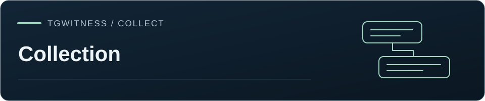

[TgWitness](../README.md) / [Documentation](README.md) · [Collection](COLLECTION-MODES.md)



# Load available history into the workspace

In **More tools → Sources → Chats in scope**, review the enabled chats, pause observation, choose Standard API or
Takeout export, then choose **Load full history**. The run fixes that list of sources and reads their available past messages
into Chats and the signed observation journal. Media uses the existing attachment
settings and durable download queue. This is separate from the per-chat signed
JSON/HTML export.

For account-wide collection, select **Whole account**, start observation to load its
source list, and review that list before starting history. The dialog-list limit still
applies (1,000 by default, adjustable in **More tools → Parameters**); the source list shows which
dialogs the run covered. Chats discovered or enabled later need another run.
Pause observation before starting history; one acquisition owns an account at a time.

Choose one to five attachment workers and whether to preserve available Recent Actions
and compare previously saved versions. Takeout may require approval in Telegram and a
server-specified wait. These options remain fixed on resume. See [Backfill behavior and
evidence contract](BACKFILL.md) for transport, retry and trust details.

## Pause, restart and partial results

- **Pause history** stops reading. **Continue history** resumes from the last committed
  message in each source; restarting the app also leaves the run paused until resumed.
  Resuming requires the same idle Telegram account.
- The message observation, attachment job and cursor commit in one transaction.
  A resumed run does not repeat its already committed observations. Live capture or
  a separate, explicitly started run may independently observe the same message.
- Each source (each Telegram split range in Takeout) fixes an upper message ID on its first read. Newer messages belong to
  live observation, not to that source's remaining historical pages.
- Inaccessible sources and sources disabled during acquisition remain visible as
  failed or skipped. Other sources continue; the overall result is incomplete.
- FloodWait delays respect the saved account backoff. Transient failures retry up to
  five times; exhaustion and low disk space pause with the cursor intact.
- **End this history run** preserves saved observations. It does not remove them or
  cancel standard-API attachment jobs. Ending Takeout marks its remaining Takeout
  files as skipped; pausing keeps them resumable. A new run reads enabled sources anew.

History completion describes history reads only. Attachments may remain pending,
fail, or be excluded by the configured policy. Check media receipts in the journal
and the attachment queue; only a completed receipt with preserved bytes constitutes
a saved attachment. The history operation is an explicit snapshot request and is
separate from switches that select categories of future live events.

## Transfer and verify

Save the **signed progress report**, then use **Export evidence** to download the
journal and saved attachments. A later evidence export may include additional records;
the report binds its counters to the journal prefix at the time it was created.
Run the verifier from a trusted checkout of this version:

```sh
python tgwitness/verify.py tgwitness-history-report.json --evidence evidence.zip --fingerprint TRUSTED_FINGERPRINT
```

Keep the expected signing-key fingerprint independently. The verifier checks the
report signature, the evidence archive, the report checkpoint, source plan, account
and counts of saved/unavailable messages. New runs also bind source progress and
options to signed cursor events. Without `--evidence`, it checks only the
signed report and its internal consistency. Legacy progress fields and attachment
summaries remain signed collector statements. The evidence verifier checks archived media bytes.

Read verified history together with its acquisition intervals, coverage and
available Recent Actions. This workflow reads currently accessible history;
[live monitoring](COLLECTION.md#message-history-and-attribution) preserves versions
and notifications as they arrive, while [Secret Chats](PSEUDO-SECRET.md) use the
enabled endpoint integration. For verification, use the retained checkpoints,
witness records and applicable acquisition attestations described in the
[verification modes](EVIDENCE.md#verification-scope).

The acquisition cursor is local workspace state. Restoring an evidence ZIP alone does
not restore a pending acquisition job or Telegram session. Keep the workspace backup
if continuation of the original job is required.
