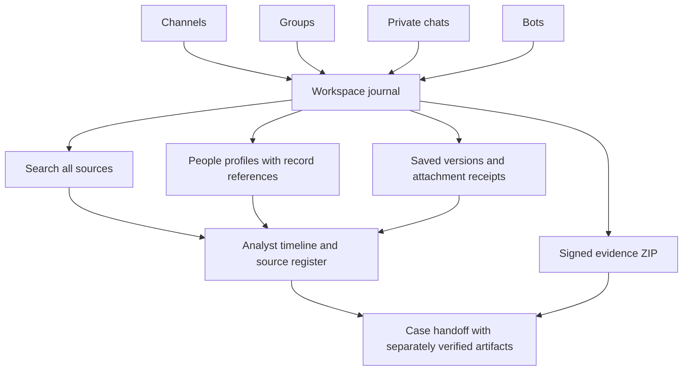

[TgWitness](../README.md) / [Documentation](README.md)


# An investigation across all account-visible chats

Follow a case across channels, groups, private chats and bots, from initial
acquisition to a cited timeline and verifiable handoff. The interactive website
version is at `/docs/cases/`; [preview instructions](internal/PUBLISHING.md#preview-the-website-locally).

<details>
<summary>On this page</summary>

- [Worked case: a destination changes across four conversations](#worked-case-a-destination-changes-across-four-conversations)
- [1. Define the case and collect the whole account](#1-define-the-case-and-collect-the-whole-account)
- [2. Inventory every source and acquire historical context](#2-inventory-every-source-and-acquire-historical-context)
- [3. Preserve the evolving case and deliberate interactions](#3-preserve-the-evolving-case-and-deliberate-interactions)
- [4. Connect observations across chats](#4-connect-observations-across-chats)
- [5. Build the cross-chat timeline](#5-build-the-cross-chat-timeline)
- [6. Add account perspectives without losing their origin](#6-add-account-perspectives-without-losing-their-origin)
- [7. Assemble and verify the case handoff](#7-assemble-and-verify-the-case-handoff)
- [Adapt the investigation](#adapt-the-investigation)

</details>

## Worked case: a destination changes across four conversations

An announcement points to a bot. An operations group discusses a new payment
destination, and the bot's keyboard displays it. The announcement is edited,
a private follow-up repeats the destination, and a group message disappears.

The questions are: what was observed before and after the change, which Telegram
accounts posted each item, where the destination appeared, which attachment bytes
were preserved, and what intervals remain unknown?

All names, IDs, times and journal references in this example are fictional. The
workflow uses current features; the case map is an illustration, not an automatic
graph generated by the application.



## 1. Define the case and collect the whole account

1. Connect the collecting account in its own workspace. In [Case Board](CASE-BOARD.md)
   or your case register, record the case reference, account ID, workspace and
   observation start. Retain the trusted signing-key fingerprint independently.
2. For a dedicated collecting account, open **Sources → Observation scope → Investigation mode**. The preset selects
   **Whole account**, channels/groups/private chats/bots, own actions, source
   profiles and the latest 200 visible messages for newly discovered sources.
   Review it, press **Save scope**, and complete the scope confirmation.
   Main accounts use selected chats or a folder; whole-account collection is
   available to accounts marked for investigation.
3. **Load chats** and compare the sources with the account's dialog list. Check
   exclusions. **Parameters → Chats read from the account's list** defaults to
   1,000 and allows up to 20,000. Sources beyond the list limit are added when
   they become active. Record what was actually enumerated.
4. In **Recording settings**, select **All visible activity** and save the
   monitoring settings. Review attachment types/limits and free disk space.
5. Start observation. Validate a controlled new message, edit and deletion, then
   retain the test references and any failures.

Whole-account scope records account-visible activity within the saved settings, in the
chats the account has joined. Secret Chats are recorded by the [Secret Chat module](PSEUDO-SECRET.md),
and existing conversations are backfilled through [History](HISTORY.md). See [collection scope](COLLECTION.md#observation-scope-chosen-chats-a-folder-or-the-whole-account).

## 2. Inventory every source and acquire historical context

Keep a source register with one row per chat:

| Field | Record |
| --- | --- |
| Identity | Workspace, account ID, numeric chat ID, title and type |
| Visibility | Membership/role, access confirmed or unconfirmed, exclusions |
| Live capture | Start time, selected event types and later policy changes |
| Journal history | Snapshot requested/completed, limit, time and record references |
| Full history | Signed per-chat export filename, boundary and completion/failure |
| Attachments | Completed media receipts, hashes, sizes and skipped/failed outcomes |
| Coverage | Outages, incomplete intake, FloodWait, unavailable messages and other gaps |

Use the right acquisition for each source:

- **Load full history** in **Sources** loads available past
  messages from enabled sources into the workspace journal. It supports pause/resume
  and a signed progress report. See [history acquisition](HISTORY.md).
- **History snapshot** saves recent visible messages into the observation journal.
  Its default maximum is 500; **Parameters → Largest history snapshot** can raise
  that to 10,000. These are current history observations, not reconstructed edits.
- **Full chat export → Export full chat**, or **Chats → Export chat**, fetches the
  currently visible history of one chat into a separate signed `chat.json` /
  `chat.html` bundle. Repeat for the case's sources and retain each result.
- **When a new chat or bot appears** can save its profile and up to 1,000 recent
  messages; Investigation mode selects 200. Existing chats do not receive that
  intake retroactively when the mode is enabled.
- **Download visible attachments** preserves bytes under the configured policy.
  Require a completed `media.saved` receipt with SHA-256 and byte count. A queued
  job, thumbnail or filename is not the preserved attachment.

A full chat export does **not** populate the journal or people profiles with all
its messages. Use **Load full history** or bounded journal snapshots for history you need
to analyze inside TgWitness. Review the enabled source list before starting
a history run. Neither route recovers material Telegram no longer returns.

## 3. Preserve the evolving case and deliberate interactions

Star active case chats as priority sources. Review recheck intervals, continued
catch-up and media outcomes. Keep the collector observing while using the account.
Use **Chats → Profile → Save profile now** to retain source metadata such as
descriptions and bot commands. This is separate from people profiles derived
from saved messages.

Where the case involves following a source or interacting with a bot:

1. **Open Telegram link → Save preview** records the supplied link and returned
   preview before an action.
2. **Join / open and observe** performs the join/open, and sends a bot's start
   parameter when supplied. A join request awaiting approval is recorded as pending.
3. Panel-issued text replies and supported button presses retain
   `interaction.requested` and `interaction.result`. Callback receipts can retain
   returned popup text, alert state and URL.

Those are real account actions. Callback presses in another Telegram app are not
visible to the collector, although resulting messages or edits may be. The
mini-client does not perform web-app, payment, phone or location workflows.
For exact behavior, see [panel interactions](COLLECTION.md#act-from-the-panel).

## 4. Connect observations across chats

In **Journal**, select **All sources** and search recorded content. Open matching
records and retain the workspace, chat, message ID, sequence and record hash.

In a relevant chat, open **People → Turn on profiles** and inspect a person:

- Names/usernames observed over time and the numeric Telegram ID.
- Reply relationships with source-record references.
- **Also in…** other chats in this workspace journal where that ID wrote.
- Activity, edits/deletions and mentioned wallets, phones, usernames and links.
- Saved avatar metadata and similar cached avatars, with their separate origin.

Open the cited records before using a derived profile in a finding. Profiles cover
people with saved messages, not every member of the group. **Parameters → Records
cited per fact** limits the reference list, not the underlying activity count.
Mentions and avatar similarity are leads; ownership and identity rest on numeric IDs and attributed senders.

In the worked example:

| Link | Records | Supported observation |
| --- | --- | --- |
| Same sender account | Group #146 and private follow-up #205 | Both supply Telegram sender ID 71001 |
| Same destination | #146, bot keyboard #173, channel edit #188, private message #205 | All contain `pay.example.invalid/new`; a repeated destination links the material |
| Same saved file | Completed media receipts #151 and #209 | The full SHA-256 values agree for the preserved bytes |
| Channel attribution | #101 and #188 | Do not attribute a channel post to user 71001 without an attributed sender |

Compare attachment hashes and their associated message references, and keep account
timelines grouped by the Telegram IDs supplied in those records.

Keep the team's working notes on [Case Board](CASE-BOARD.md): bookmark the records
you rely on, such as #146, #188 and #205, highlight the exact destination string, and
save a slice of every recorded action between two records or in a time range. Notes
and statuses retain the team's review in their own signed history, separately
identifiable from the source observations.

## 5. Build the cross-chat timeline

Use saved versions in **Chats** and their **Journal record #…** links. In
**Journal**, combine **All sources** with **Edits**, **Deletions** and **Coverage**.
Keep both `source_at`, where supplied, and `observed_at`.

| Illustrative observation time | Reference | Observation |
| --- | --- | --- |
| 09:00 | Channel #101 | Original destination captured |
| 09:12 | Group #146; media #151 | New destination posted; file download completed |
| 09:16 | Bot #173 | Keyboard points to the new destination |
| 09:20 | Channel #188 | Announcement edited; both saved versions remain |
| 09:24 | Private #205; media #209 | Same sender ID repeats destination; same file bytes preserved |
| 09:28 | Group #231 | Deletion notice received; deleter and exact deletion time unknown |

Other records occur between these example references. Sequence numbers order
observations; history snapshots can contain older source dates and arrive later
than live events. Distinguish snapshots, recovered messages, deletion notices and
missing-on-recheck outcomes. Mark coverage gaps as unknown intervals. Later
history acquisition does not retroactively establish uninterrupted observation.

## 6. Add account perspectives without losing their origin

Use a separate workspace for every distinct account and repeat its inventory.
Keep account ID, role, signing-key fingerprint and source references with every
comparison. Message numbers are not global identifiers across chats/accounts.

Case Board keeps source-linked notes and collections within each workspace.
The group screen reviews account status together and can bundle separate workspace
exports. Correlate those sources in your case notes or analysis tools; each journal
retains its own origin and signing key. A global search or merged cross-workspace
timeline is not generated. Multi-account export of one channel/supergroup
acquires that chat's history using the eligible accounts.

For longer work, retain boundaries with an [independent witness](WITNESS.md).
Use controlled delivery checks to qualify
each account's capture path and visibility.

## 7. Assemble and verify the case handoff

Keep these together in an analyst-assembled case directory:

| Material | Purpose |
| --- | --- |
| Case notes and source register | Question, collection policy, access/role, findings, alternate explanations and gaps |
| Timeline | Both times and workspace/chat/message/sequence references for each entry |
| Case Board export and slices, if used | Source-linked bookmarks, quotes, team notes, collections, revision history and selected records checked against the evidence ZIP |
| Signed evidence ZIP per workspace | Complete recorded journal, manifest and included preserved media; panel filters do not narrow the journal export |
| Separately signed people-profile files | Derived references checked against the matching workspace evidence |
| Signed full chat exports | Current visible-history acquisition, separate from the observation journal |
| Trusted fingerprints, TSA root certificates and earlier checkpoints | Key identity, external time of the last record and retained journal boundaries |
| Witness artifacts, if configured | Separate journal, signed posts and witness fingerprint |
| Verification results and delivered-file hashes | What was checked, which bytes were transferred and to whom |

From a trusted installation, with filenames and each workspace's actual fingerprint:

```sh
python -m tgwitness.verify evidence.zip --fingerprint TRUSTED_PUBLIC_KEY_SHA256 --tsa-ca TSA-ROOT.pem --checkpoint retained-checkpoint.json --require evidence
python -m tgwitness.verify profiles-operations.json --fingerprint TRUSTED_PUBLIC_KEY_SHA256 --evidence evidence.zip
python -m tgwitness.verify history-channel.zip --fingerprint TRUSTED_PUBLIC_KEY_SHA256
python -m tgwitness.verify board-slice.json --evidence evidence.zip --fingerprint TRUSTED_PUBLIC_KEY_SHA256
```

`--require evidence` exits with code 2 unless the fingerprint matches and external time
from a third party covers the last record; the checkpoint is a supporting check.

Retain the actual verification results and original artifacts. Export workspace
notes from Case Board alongside the cited source material. Assemble cross-workspace
findings in the top-level case directory; each TgWitness artifact has its own
signature and verification procedure.

## Adapt the investigation

| Case | Trace | Deliver |
| --- | --- | --- |
| Bot-driven order/payment dispute | Entry announcement → saved link preview → bot start parameter → message and keyboard versions → panel callback receipts → private/group follow-up | Observed offer/response timeline and verified sources; payment confirmation comes from the payment record |
| Removed messages after an incident | All affected chats → saved originals/edits → deletion or missing-on-recheck outcomes → preserved media → coverage and other account perspectives | Preserved versions and explicit unknown intervals; no invented deletion actor |
| A participant changes names across chats | Numeric sender ID → name/username history → replies → other observed chats → cited destinations/files | A Telegram-account activity timeline with links to its source records |

[Collection reference](COLLECTION.md) · [People-profile verification](EVIDENCE.md#people-profiles) ·
[Evidence handoff](EVIDENCE.md#investigation-handoff) · [Completed validation](VERIFICATION.md)
