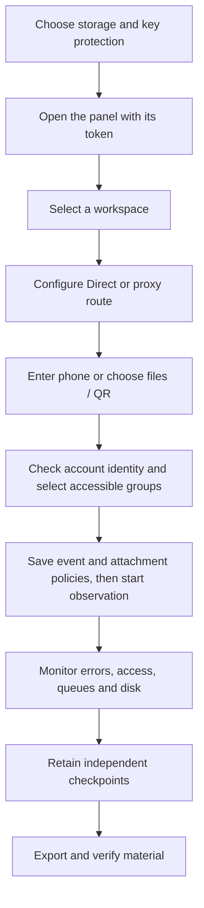

# Workflows and operations

For your first connection, use [accounts and session formats](ACCOUNTS.md).
For an explanation of saved versions, event policies, and gaps, see
[how collection works](COLLECTION.md). This guide covers daily operation and recovery.

## Operator workflow



Authorization, transport connectivity, access to a group and completeness of
delivery are different properties. A green connection status does not imply all
events have been captured.

## Share work without sharing the main key

Open **Access** to give a reviewer or analyst their own token. Choose the accounts
and chats they can open, then allow viewing, export or operational actions.
An operator who starts/stops collection needs whole-workspace access; a reviewer
can be limited to a single chat. Session limits, expiry and IP rules are separate
from Telegram account authorization. See [access and permissions](ACCESS.md).

Use **Open sessions** to end a connection or revoke the access to end all of its
sessions. The administrator console combines current-process activity across
workspaces. Session closure leaves collection running.

## Runtime modes

| Mode | Action | Behavior |
| --- | --- | --- |
| Demo | scripts\Demo.cmd or `--demo` | Synthetic data; real account connections disabled |
| Observation | Start observation | Record delivered updates for selected sources |
| History snapshot | Sources → history snapshot | Up to 500 current messages; no reconstruction of all past changes |
| Pause | Pause observation | Stop collection while retaining data and queued jobs |
| Review/handoff | Exports | ZIP, JSONL/CSV/HTML, checkpoint, process receipt and timestamp request |
| Multiple accounts | Workspaces or the top **+** button | Any number of separate workspaces in one process |

Local demo access opens automatically without manual token entry. It uses a
process-lifetime capability valid only for direct loopback access to an isolated
synthetic demo; the main panel token is not disclosed. Real workspaces and remote
or proxied demo access retain token authentication. Demo entry grants no Telegram authorization.

## Monitoring categories


In **Sources → Capture settings → Choose which changes to preserve**, select new messages, edits,
deletion notices, reaction updates and membership events independently. The default
retains all categories. **Messages, edits & deletions** keeps the original context
while disabling separate reaction/member updates. **All visible activity** restores
all five. Presets change the form; press **Save monitoring settings** to apply.

The saved policy applies to all selected sources in that workspace. Other
workspaces retain their own settings. Each actual change records signed before/after
values; the current policy is also included in process receipts and observation
start records. Disabling a category does not delete earlier observations. Re-enabling
does not retrieve missed changes. There is no per-group category override in this version.

Keep new messages enabled when prior content matters: a deletion notice cannot
recover text that was never captured. Operational/coverage records and other group
service events are always retained. Explicit history snapshots are separate from
live-category selection and may include service messages. These switches do not
redact reaction/member metadata embedded in an otherwise captured Telegram object.

A history snapshot may queue attachments while paused. Start observation to process
them. Queued does not mean downloaded. An unavailable original file is not replaced
with a newer edited version; outcomes are recorded separately.

**Lock** clears browser access and secret fields but leaves collection running.
Closing a tab also leaves the process running. Stopping the Python process or service
stops collection regardless of the browser state.

Deleting an additional workspace stops its collector and removes its local data. If a
locked file or filesystem error interrupts removal, the panel reports the failure and
keeps the workspace listed as unavailable (`DeletionPending`). Close programs holding its
files and retry **Delete**. Restarting TgWitness leaves that workspace stopped and does
not recreate its partially removed journal or keys. A successful deletion is recorded
only after the directory has been removed; separately exported or backed-up copies remain
under their own retention policy.

## Notifications

Open **Sources → Notifications → Alerts and a daily summary**. TgWitness uses
Apprise to send alerts to Matrix, Telegram, Discord, Slack, ntfy, email and other
supported services. You can add several destinations to one workspace.

1. Enter one Apprise destination URL per line. Use the
   [service catalogue and URL formats](https://appriseit.com/services/) for your service.
2. Turn on **Send notifications**, then choose problem alerts, changes in observed
   chats and a daily summary. The summary hour uses the server's time.
3. Turn on **Include short excerpts** if you want saved text from deleted and edited
   messages in the alerts.
4. Press **Save notifications**, then **Send test** to check delivery.

For your own receiver, use Apprise's [JSON webhook](https://appriseit.com/services/json/).
For example, `jsons://notify.example.org/tgwitness` sends JSON over HTTPS to that
endpoint. This is a fictional example; replace it with your own destination.

Destinations and settings belong to the selected workspace. Change notifications
cover its observed sources, including newly added chats. The bell in the top bar
also lists recent problems and chat changes.

In the demo, the notification controls are visible but sending is disabled. Configure
delivery in a real workspace. Notifications use that workspace's Direct, SOCKS5 or
HTTP route; MTProxy cannot carry them. Non-HTTP destinations such as SMTP require
a direct route.

## Panel layout


**Journal** shows observations, search and filters. An edit opens captured versions;
a deletion opens prior content if available. Unknown attribution remains explicit.
Counts are available under **Overview**; acquisition details stay in the local guide.

**Sources** contains the observation scope (chosen chats, a Telegram folder or the whole
account), accessible chats of every type, selected sources with priority stars, attachment
and recheck settings and history snapshots. Private sources are selected by dialog/ID
without a public link. Access status describes the most recent check, not permanent permissions.

**Chats → People** lists everyone with saved messages; with people profiles switched on
for the chat, a click opens that person's profile with links to the journal records.

**Witness** creates read-only witness tokens, shows when each witness last checked and
gives the commands and options to run one ([independent witness](WITNESS.md)).

**Parameters** holds every limit and pace of the workspace that is not on another page:
how many dialogs are read, how often the chat list is re-read, heartbeat and checkpoint
intervals, the startup buffer, how rechecks spread their requests (first delay, chats per
pass, pause between chats, messages recovered and re-requested), disk reserve, timeouts and
retries of downloads, what people profiles look for (including your own regular expressions),
size and pace of notifications, snapshot, ZIP and browser-download limits, and Telegram
client timeouts and retries. Each field shows its range and default; changed fields are
marked and can be restored one by one or all together. Every change is recorded as
`parameters.changed` with the values before and after, and observation start records name
the values in force. Values apply from their next use; client timeouts and retries from the
next connection. Recheck intervals, attachment types and sizes, evidence and off-site copy
intervals stay on their own pages and take any value in their range, not only presets.

The bell in the top bar lists recent problems and changes in observed chats; unread ones
are counted until marked as read. Changes are grouped per chat and hour ("12 deleted,
1 edited, 0 not found"), and problems such as a sign-out or a full disk stay in the list
however busy the chats are.

**Account** starts on the phone-number field. **Continue** leads directly to
code entry, asking for API credentials only when missing. QR and file import are
alternative tabs. Saved API credentials are reused only within their own workspace.
The entry screen has no sidebar, statistics, or setup paragraphs. The **Settings**
icon opens API, proxy, storage, and additional-account controls. New installations
start here; connected accounts with no selected sources start on **Choose chats**.
Changing the route requires paused observation and cancels unfinished login. An existing
journal cannot be silently rebound to a different Telegram account.

**Exports** checks journal integrity and produces portable files. Its workspace ID
can be passed to the download CLI. Every export pins a full journal prefix; later
events enter a subsequent export. Search filters do not change the package scope.
Detailed signing and coverage information is under **Verification & limitations**.

The panel reports collector state, queued/failed media, oldest pending media, free
disk, request pauses and sources whose access is unconfirmed under **Collector
health**. These details are collapsed initially and hidden on Account. A setup
card shows the next step: connect an account, choose sources, or start observation.
The account list is a load-time snapshot;
the selected workspace refreshes periodically. This is not a multi-process SLA monitor.

The UI uses local assets and text rendering for source content. Desktop and narrow
Chromium layouts are tested. This is not a complete accessibility certification;
screen-reader and human usability evaluation remain separate work.

## Deployment environments

| Environment | Installation | Verification status |
| --- | --- | --- |
| Windows PC/server | Python 3.11+, scripts\Setup.cmd/Start.cmd, private data directory | Locally checked on Windows/Python 3.12 |
| Linux server/VPS | Python venv, dedicated service user, HTTPS/SSH | Code, CI and systemd example provided; not executed on this host |
| macOS | Python venv, foreground process or user agent | launchd example provided; separate installation check needed |
| Docker/Compose | Persistent volume, one worker | Definition and CI runtime check provided; Docker unavailable locally |
| Phone browser | Connect to the protected panel on a running server | Narrow Chromium layout tested; collector does not run on iOS/Android |

Portability means no mandatory cloud service or frontend build. Each target still
needs compatible Python/crypto dependencies, local disk and network access. See
[DEPLOYMENT.md](DEPLOYMENT.md) and [service templates](../deploy/README.md).

Workspaces share CPU, memory and an event loop. For process isolation, use distinct
instances, ports, data directories and account authorizations. There is no unified
panel across separate instances. Never point several workers at one database.

## Startup checks and exports

Run `python start.py --check` before starting a prepared environment. Add `--json`
for machine-readable checks or pass the intended `--data-dir`, `--host` and `--port`.
The command checks prerequisites without Telegram login or creating a journal.
It does not verify a journal or prove capture readiness; journal verification runs
during application startup. An occupied port may simply be an existing instance.

Browsers supporting the File System Access API save exports through a writable
stream. Other browsers buffer at most 128 MiB. Use the streaming CLI for larger
exports or browsers without file streaming:

```sh
python -m tgwitness.download --token-file data/live/panel-token.txt --out evidence.zip
```

Add `--profile ID` from Exports for a child workspace. Use `--url https://server`
for remote access. Plain HTTP is accepted only for loopback destinations. The token
is read from a file and sent in a header, not printed or put in a URL. Redirects are
refused. Existing destinations are not overwritten. Failed transfers remove their
temporary part file. The reported SHA-256 is a transfer checksum; verify the signed
ZIP separately with a trusted fingerprint/checkpoint.

## Backup, restore and interruptions

1. Pause observation and stop the process cleanly.
2. Copy the entire data directory: databases, WAL/SHM if present, media,
   `credentials.enc`, `signing.enc`, `network.enc`, vault keys/metadata, token,
   checkpoints and every `profiles/` directory.
3. For external-key mode, separately preserve the master key and retain each
   `vault.external.json`. Generating a new key cannot recover the old secrets.
4. Restore while the destination is stopped; configure the original key, restrict
   access, and verify integrity before resuming.
5. Record downtime and verification results. A history snapshot cannot prove that
   no deletions happened during the interruption.

Evidence ZIPs exclude sessions/private keys and are not full service backups.
Four things are protected differently:

| What | Protection |
| --- | --- |
| Export files without a password (the default) | Not encrypted. Signed, so changes are detectable, but anyone holding the file can read it |
| Export files with a password | If you set a password, the finished export goes unchanged into a WinZip AES-256 ZIP that 7-Zip and WinRAR open; the password is not stored ([evidence handling](EVIDENCE.md)) |
| The journal database and saved attachments on disk | Not encrypted by TgWitness; use an encrypted disk or volume |
| Telegram sessions and signing keys | Encrypted in the data directory (`credentials.enc`, `signing.enc`, `network.enc`) |

A full service backup is the stopped data directory described above, not an export.
Use protected storage and a deliberate transfer mechanism for both. Temporary server exports live in each workspace's
`temporary-exports/`; completed responses are cleaned up, and interrupted export
files are removed on the next startup while that workspace's instance lock is held.

A connection-restored event does not guarantee recovery of intermediate changes.
Persistent media jobs and the Telegram update position survive restart; see
[evidence format](EVIDENCE.md#durable-collection-and-process-receipts-02).

## Capacity and retention

Default limits, all changeable under **Parameters**: the first 1,000 dialogs, 500 messages
per snapshot, 4 GiB uncompressed signed ZIP content (larger archives need
`verify.py --max-gib N`) and a 128 MiB browser fallback. Attachments take 1–2,000 MiB per
type under **Sources → Attachments**. The download CLI defaults to 5 GiB transferred. Available disk can be a
lower limit. Reserve space for journals, media, WAL, temporary exports and backups.
Exports use the data volume rather than Compose's 512 MiB `/tmp`.

Measure events/second, queue age, media bytes and disk latency rather than counting
groups alone. Synthetic local benchmarks do not guarantee Telegram delivery.
There is no automatic retention deletion. Removing a journal tail invalidates its
relationship to retained checkpoints.

Priority rechecks already exist: starred sources are rechecked every 15 minutes by default,
others every 6 hours (see [recheck tiers](COLLECTION.md#recheck-tiers)). Password-protected
exports exist as described above. Live Telegram/proxy acceptance, durable replay,
admin-log and reaction polling, isolated workers, encryption of the local journal and media
by TgWitness itself and independent review remain separate work. Scoped access is
documented in [access and permissions](ACCESS.md). See
[READINESS.md](internal/READINESS.md), [LIVE_ACCEPTANCE.md](internal/LIVE_ACCEPTANCE.md) and
[VERIFICATION.md](VERIFICATION.md).
