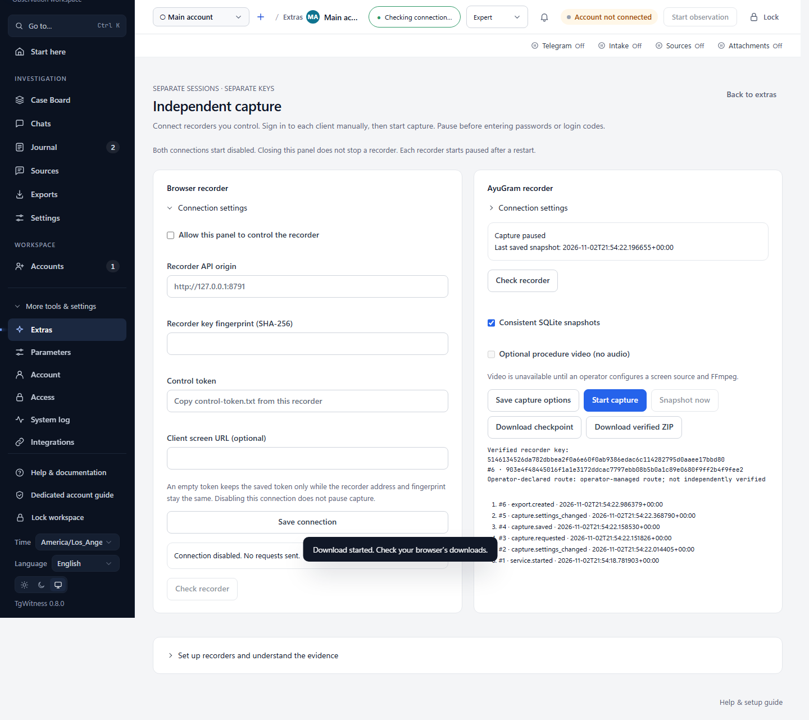

# Optional independent browser and AyuGram capture

[Project](../README.md) · [Installation and controls](../addons/capture/README.md)

The optional `tgwitness-capture` package provides independently operated recorders.
It does not change the main collector's defaults or existing signed formats.

- **Extras → Independent capture** in the main panel, plus standalone English panels.
- Separate processes, data volumes, Ed25519 keys, client sessions and exports.
- Capture disabled at every service start; video separately enabled and off by default.
- Chromium: selected-tab PNG, MHTML and rendered-text snapshots, change polling.
- AyuGram: consistent copies of a configured local SQLite database, including WAL.
- Signed event chain, downloadable checkpoints, separately operated witness receipts.
- Signed ZIP with originals and an HTML report; standalone verification CLI.

Use the `capture-browser` and `capture-ayugram` profiles in
[`addons/capture/compose.yaml`](../addons/capture/compose.yaml), or install the package
in its own Python environment. Ordinary `docker compose up` for TgWitness starts
neither recorder. Main-panel connections are disabled by default and send no automatic
requests. An administrator saves a recorder URL, control token and independently
obtained key fingerprint, then checks the recorder before sending commands. Tokens
are encrypted in the active workspace vault and are never returned by the API.

The panel supports browser tab selection, capture options, start/pause, immediate
snapshots, recent events, checkpoint download and original signed ZIP download.
It challenges the pinned signing key before commands and checks the complete export
against that key and the retained boundary before releasing it. Neither panel closure
nor disabling a connection stops a recorder; **pause capture first** when needed.
Recorders restart paused, even when a main-panel connection remains enabled.

## Connect from the main panel

For a native TgWitness installation, start the standalone recorders using the
[installation guide](../addons/capture/README.md). Use `http://127.0.0.1:8791`
for the browser recorder and `http://127.0.0.1:8792` for AyuGram on the same host.
For another host, use HTTPS with a valid certificate. URLs are origins without paths,
query strings or embedded credentials; redirects are refused. These explicitly
configured control requests go directly to the recorder, separately from the main
collector's Connection settings. Configure each client's collection proxy separately.

Read `control-token.txt` and the SHA-256 key fingerprint from the recorder's standalone
panel or `python -m tgwitness_capture identity --data /data` using a trusted local
connection to its container (use the recorder's actual data directory for a native
installation). In **Extras → Independent
capture**, open the appropriate connection settings, enter both values and the API
origin, enable panel control, then save and select **Check recorder**. The optional
client-screen link opens Neko or your own remote desktop. Enter Telegram codes there
manually while capture is paused; the main panel does not collect those credentials.

For a main panel and recorders in Docker, configure the upstream proxy, Neko passwords
and AyuGram database mount as described in the installation guide, then run from the
repository root:

```sh
docker compose --project-directory . -f compose.yaml -f addons/capture/compose.yaml -f deploy/compose/compose.capture-panel.yaml --profile capture-browser --profile capture-ayugram up -d --build
```

Omit either profile to deploy only the recorder you need. The final overlay preserves
the main `tgwitness` Compose project and its existing volume names, and gives it
private control-network access. In the panel use `http://capture-browser:8791` and
`http://capture-ayugram:8792`; `localhost` inside the main container is not a sidecar.
The Neko client-screen URL is `http://127.0.0.1:8081` when accessing the Docker host
locally. Remote screen access needs the separately configured HTTPS/WebRTC route.
No Docker socket is mounted into the main panel.

The main panel accepts exports up to 512 MiB, with a two-minute download deadline
and a shorter per-read timeout. Larger exports use the standalone recorder. Downloaded
ZIPs retain the recorder's original signature and include `report.html`; they are not
imported into the Telegram message journal. Main-journal audit events record control
actions and verified export boundaries without copying recorder tokens or content.
The main administrator can control both recorders: separate signing identities and
runtime processes do not imply independent operators or host administrators.



The browser profile includes an optional Neko/Chromium environment and dedicated
upstream HTTP proxy forwarding. AyuGram's GUI, login and separate proxy/WARP route
must already be configured; its profile starts the database recorder only.

This is a preview with explicit coverage limits. See the installation guide for
the deployed isolation assumptions, unfinished video handling, key pinning,
independent checkpoints, storage limits and Linux acceptance procedure. Database
schema interpretation, WACZ/rrweb, native signed PDF and automatic journal import are not
implemented in this version.
