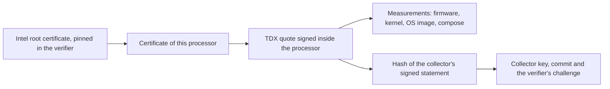

[TgWitness](../README.md) / [Documentation](README.md) · [Assurance levels](https://phishdestroy.github.io/TgWitness/docs/assurance-levels/)


# Phala Cloud and Intel TDX

The highest of the three [assurance levels](https://phishdestroy.github.io/TgWitness/docs/assurance-levels/).
The collector runs in a confidential virtual machine whose memory the host cannot read, and the
processor itself signs what runs inside it.



<details>
<summary>On this page</summary>

- [Why](#why)
- [What it means for a court](#what-it-means-for-a-court)
- [What it means for you](#what-it-means-for-you)
- [What the trust rests on](#what-the-trust-rests-on)
- [Who uses it](#who-uses-it)
- [What if TDX is broken](#what-if-tdx-is-broken)
- [Rollback of the disk by the host](#rollback-of-the-disk-by-the-host)
- [Price](#price)
- [Technical reference](#technical-reference)

</details>

<a name="confidential-vm-on-phala-cloud-intel-tdx"></a>
## Why

On a [verified server](HIGH-ASSURANCE.md) the provider's log shows everything done through the
API. It cannot show what someone with root on the physical host does: read the server's memory
and its signing key, or change data before it is signed. The provider's staff, a state that
compels the provider, or someone who has broken into the provider can do that, and no log you
can see would record it.

Intel TDX closes that gap. The processor encrypts the virtual machine's memory and protects its
integrity, so the host, its hypervisor and Phala's staff can neither read nor change it. The
processor also signs a TDX quote: measurements of the firmware, the kernel, the OS image and the
exact compose that runs, tied to the collector's key. Anyone can check that quote against Intel's
root certificate without trusting Phala, TgWitness or you.

## What it means for a court

- The evidence comes with a statement signed by Intel hardware: this published code, at this
  commit, ran in a sealed virtual machine that neither the hosting company nor the operator could
  read or change.
- Anyone can repeat the check offline with the standalone `verify.py`, without a Phala account,
  without a TgWitness server and without trusting whoever produced the evidence.
- The verification report is sealed with a qualified EU time stamp and a second, independent
  time stamp, and signed by the verifier.
- The attestation shows how the evidence was collected. It does not show that what someone wrote
  in a message is true. What weight it carries is for the court or authority to decide.

## What it means for you

- You deploy from the panel: **More tools → Extras → Server 24/7 → Confidential virtual machine ·
  Phala Cloud**, with a Phala Cloud API key. Without a domain the server gets a quick tunnel.
- There is no SSH and no console, for you as well. You work through the panel, and data leaves
  the machine only as exports.
- Sign in to Telegram inside the VM by phone or QR code: the session key is then created there,
  and the report shows it.
- Every restart and every change of the application is listed. Do not change the application
  after the deployment: a changed compose fails the report.
- You pay by the hour; see [Price](#price).

## What the trust rests on

| Party | Trusted? | How it is checked instead |
| --- | --- | --- |
| Intel | **Yes** | Nothing replaces it: the TDX module, the microcode, Intel's signing keys and the physical integrity of the memory bus. The verifier pins Intel's root certificate and checks the revocation lists and the platform's security level |
| dstack, the operating system | No | The verifier rebuilds the firmware, kernel and command-line measurements from the OS image Dstack-TEE publishes and compares them with the quote. A development image fails |
| TgWitness code | No | The compose pins every source file of the deployed commit by hash and both container images by digest. The processor measures it, and the verifier builds the same compose from the commit and compares byte for byte |
| Phala Cloud | No | It cannot read the machine's memory. Any change of the application is a new revision with a new compose hash, which fails the report; restarts are listed |
| You, the operator | No | No SSH and no console; the Telegram key is created inside the machine; any change of the application shows as above |

The host still controls the network and the clock. Blocked traffic shows as gaps in the
journal, and time comes from outside anchors: RFC 3161 time stamps, OpenTimestamps and drand.

## Who uses it

- **dstack**, the open-source framework the machine runs on, is a project of the Linux
  Foundation's Confidential Computing Consortium, has been audited by zkSecurity and is described
  in [arXiv:2509.11555](https://arxiv.org/abs/2509.11555), *Dstack: A Zero Trust Framework for
  Confidential Containers*. OpenRouter and NEAR AI build on it.
  Source: [Dstack-TEE/dstack](https://github.com/Dstack-TEE/dstack).
- **Phala Cloud**, the hosting service, reports SOC 2 Type I and HIPAA compliance. Both concern
  how Phala runs its service. The proof on this page does not rely on them.

## What if TDX is broken

Flaws in processor security features are found and fixed with microcode updates; Intel then
rates platforms without the fix as out of date. Suppose someone breaks TDX on the machine that
runs your collector:

| They can | They cannot |
| --- | --- |
| Read the memory of a machine on that host, the signing key included | Change checkpoints that witnesses already hold |
| Sign false new records from then on | Move RFC 3161 time stamps or OpenTimestamps receipts |
| Produce quotes that look valid for new records | Change copies already stored under S3 Object Lock |
| | Change what Telegram itself still holds: another capture contradicts a forgery |
| | Change the result of earlier quotes: the security level of each quote is computed as of the time it was recorded |

What was anchored outside the machine before the break stays as it was. A break reaches forward,
not back.

## Rollback of the disk by the host

dstack encrypts the machine's disk, but the host can put back an older copy of it. dstack
acknowledges this limit. The machine would then start again from an earlier journal.

Two things catch it:

- **Checkpoints kept outside the machine.** A [witness](WITNESS.md) and time stamps hold a later
  length and hash of the journal; a journal rolled back behind them no longer matches and is
  reported.
- **Copies under S3 Object Lock.** An [off-site copy](STORAGE.md) under Object Lock keeps the later
  journal, and nobody can delete or overwrite it during its retention period.

Run a witness and an off-site copy with Object Lock for every deployment on this level.

## Price

| Type | vCPU · memory | Per hour | Per month (730 hours) |
| --- | --- | --- | --- |
| `tdx.small` | 1 · 2 GB | $0.06 | About $43.80 |
| `tdx.medium` | 2 · 4 GB | $0.12 | About $87.60 |
| `tdx.large` | 4 · 8 GB | $0.23 | About $167.90 |

Disk costs $0.000139 per GB an hour, about $0.10 per GB a month, for as long as the machine
exists, stopped or running. Prices from [Phala's price list](https://phala.com/pricing) on
21 November 2026. The wizard picks `tdx.small` and shows the current price before anything is
created.

## Technical reference

### The six checks

| Check | What it shows |
| --- | --- |
| `tdx_binding` | The quote covers the collector's signed statement and the random challenge of this check |
| `tdx_quote` | The quote's signatures lead to Intel's root, Intel rates the platform as up to date, and the machine can be neither debugged nor migrated |
| `tdx_compose_hash` | RTMR3, replayed from dstack's event log, equals the hash of the compose the collector reports |
| `tdx_compose` | That compose is byte for byte the one the deployed commit builds |
| `tdx_identity` | The quote comes from the deployed application and instance, with keys from Phala's KMS and an encrypted disk |
| `tdx_os` | MRTD and RTMR0-2 equal the values computed from the published dstack OS image for this machine's size; a development image fails |

`verify` downloads the OS image once (about 180 MB, of which 21 MB are kept) from
[Dstack-TEE/meta-dstack](https://github.com/Dstack-TEE/meta-dstack/releases) into `dstack-images`
beside the record. `--tdx-image FOLDER` uses another folder, `--tdx-image none` skips the
comparison, `--tdx-measurements` compares values given as JSON, and `--tdx-collateral` reads
Intel's certificates and revocation lists from a file. With `--evidence`, every collector start
in the journal is checked against the image it booted.

### Deploy and verify from the command line

```sh
python -m tgwitness.cloud deploy --provider phala --name case-1 --server-type tdx.small \
    --ref v1.0.0 --quick-tunnel --provider-token-file phala-key.txt
python -m tgwitness.cloud verify --record deployments/case-1/deployment.json \
    --provider-token-file phala-key.txt --cloud-init deployments/case-1/docker-compose.yaml \
    --source CHECKOUT_OF_COMMIT --fingerprint COLLECTOR_FINGERPRINT \
    --evidence tgwitness-evidence.zip --report certificate.md
python -m tgwitness.cloud check-report --report certificate.pdf --verifier-fingerprint VERIFIER_KEY
```

`--source` builds the reference compose from your checkout, which runs that checkout's code on
your computer; for a repository other than the official one, `verify` also wants
`--trust-source`. Gateway DNS is not available here: Phala has no provider firewall for outgoing
traffic.

### Offline check with verify.py

```sh
python verify.py tgwitness-evidence.zip --fingerprint COLLECTOR_FINGERPRINT
python verify.py phala-tdx-attestation.json
```

Without a network, `verify.py` checks each quote's signature, the chain from the processor's
certificate to Intel's root (pinned in the file), that the quote comes from Intel's production
quoting enclave, that the machine cannot be debugged or migrated, and that the quote covers the
start record or the signed statement. With Intel's collateral stored beside the quote, it also
computes the platform's security level as of the time of the record. Which code ran, the
provider log and Intel's current rating stay with `python -m tgwitness.cloud verify`, so the
offline result is marked partial.

<a name="attestation-certificate"></a>
### Attestation certificate

`verify --report certificate.md` also writes `certificate.html` and an A4 `certificate.pdf`: the
verdict, the chain of trust from Intel's root to the collector key, the measurements next to the
values computed from the published image, every check, the provider log and how to repeat it.
`certificate.json` stays the authoritative record. Its seal, in `certificate.seal.json`:

| Seal | What it adds |
| --- | --- |
| Qualified time stamp, `http://tsa.belgium.be/connect` | RFC 3161 time stamp from the Belgian federal government's qualified trust service (BOSA), on the EU trusted list; under Regulation (EU) No 910/2014, article 41, it is presumed accurate in every EU member state |
| RFC 3161 time stamp, FreeTSA | A second, independent time stamp |
| Verifier signature | Ed25519 over the report's SHA-256 and every time stamp, with the verifier's own key; the PDF is signed with the same key |

`check-report` checks all of them. `--timestamp URL` chooses other authorities, `--sign-with`
another key.

### Tested on Phala Cloud

Deployment, verification with `--evidence`, restarts, the OS image comparison, the sealed
certificate and removal have run on Phala Cloud: see
[the 4 November 2026 run](VERIFICATION.md#live-phala-cloud-deployment--4-november-2026),
[the live Telegram account](VERIFICATION.md#phala-cloud-with-live-telegram-account--9-november-2026)
and [the session key created inside the machine](VERIFICATION.md#session-key-created-inside-the-tdx-vm--9-november-2026).
