[TgWitness](../README.md) / [Documentation](README.md) · [Project reference](README.md)

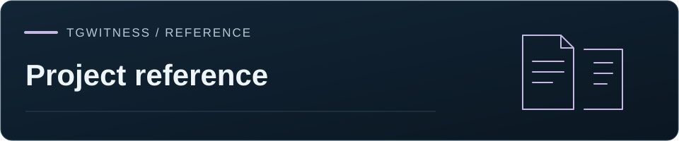

# Complete project guide

[Project home](../README.md) · [GitHub Wiki](https://github.com/phishdestroy/TgWitness/wiki)

<picture>
  <source media="(max-width: 640px)" srcset="assets/presentation/mobile.svg">
  <source media="(prefers-reduced-motion: reduce)" srcset="assets/presentation/tgwitness-investigation-static.svg">
  
</picture>

<p align="center">
  <strong>Telegram observation workspace you run yourself.</strong><br>
  Saves conversations, keeps edits and deletions, exports things others can verify.
</p>

<p align="center">
  <a href="CHANGELOG.md">v0.9.3</a> &nbsp; · &nbsp;
  <a href="QUICKSTART.md">Python 3.11+</a> &nbsp; · &nbsp;
  <a href="../LICENSE">MIT license</a>
</p>

<p align="center">
  <a href="#quick-start">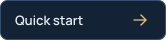</a>
  <a href="wiki/Home.md"></a>
  <a href="README.md">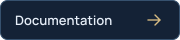</a>
  <a href="#repository-map">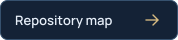</a>
</p>
<p align="center"><a href="#screenshots">Take a look at the workspace</a> · <a href="../.github/CONTRIBUTING.md">Contribute</a></p>

<picture>
  <source media="(prefers-color-scheme: dark)" srcset="assets/chats-dark.png">
  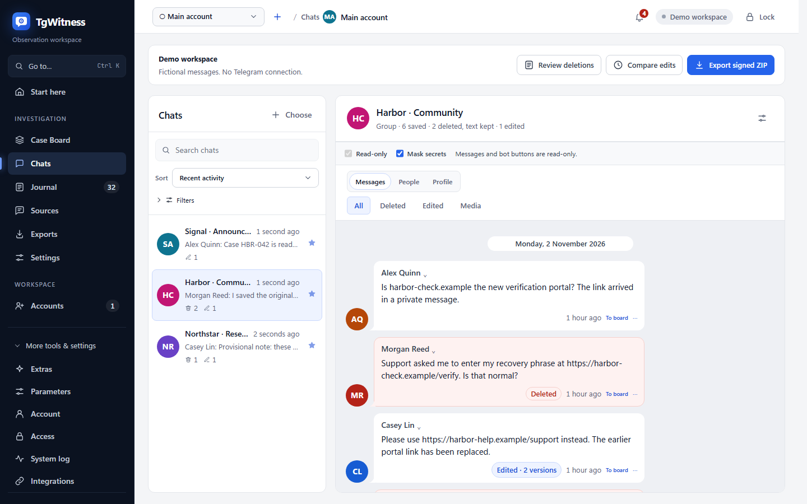
</picture>
<p align="center"><sub>Light and dark theme. Fictional demo data.</sub></p>

## Features

<table>
<tr>
<td width="50%" valign="top"><h3>Messages with history</h3><p>Every edit is kept as its own version. A deletion never wipes what was already saved.</p></td>
<td width="50%" valign="top"><h3>Your scope</h3><p>A few chats, a folder or the whole account. Each account has its own journal and settings.</p></td>
</tr>
<tr>
<td valign="top"><h3>Exports you can check</h3><p>Signed records, files, an offline report and a standalone verifier. Optional password.</p></td>
<td valign="top"><h3>Connections</h3><p>Search everything, build timelines, see who talks to whom and which files show up where.</p></td>
</tr>
<tr>
<td valign="top"><h3>Daily use</h3><p>Dark theme, 25 languages, keyboard navigation, act right from the chat view.</p></td>
<td valign="top"><h3>Extras</h3><p>Witness bot, external timestamps, notifications. Each has its own guide.</p></td>
</tr>
</table>

<details>
<summary>All features and their limits</summary>

- **Journal of what the account sees.** New messages, edits, deletions, reactions, joins/leaves and gaps in coverage.
- **Scope.** Chosen chats, a Telegram folder or the whole account, by type (channels, groups, private, bots). New chats get picked up as they appear ([collection](COLLECTION.md#observation-scope-chosen-chats-a-folder-or-the-whole-account)).
- **Investigation mode.** For a dedicated account that joins groups and talks to bots: everything it sees and sends is recorded, bot buttons are kept, every new chat gets its profile and visible history saved ([details](COLLECTION.md#investigation-mode-joining-teams-and-talking-to-bots)). The panel's **Dedicated account guide** explains why never to use your main account.
- **Act from Chats.** Send messages, press bot buttons, preview and join invites. All of it lands in the signed journal ([mini-client](COLLECTION.md#act-from-the-panel)).
- **Recorded coverage and changes.** Reports retain observation intervals, captured versions, deletion notifications, recheck results and recovery gaps, each linked to its source records.
- **People profiles** (opt-in per chat). Name/username history, avatars, activity, who replies to whom, mentioned wallets, phones and links. Every fact points to its record ([evidence model](EVIDENCE.md#people-profiles)).
- **Independent witness.** Separate process with its own key and bot, posts journal heads to a channel ([witness](WITNESS.md)).
- **Parameters page.** All limits and timings with ranges and defaults, every change goes into the journal ([below](#settings-and-parameters)).
- **Signed exports.** SHA-256 hash chain + Ed25519 signatures. The ZIP has JSONL, CSV, an HTML report, media and the verifier. Optional AES-256 password ([evidence model](EVIDENCE.md#investigation-handoff)).
- **Notifications** through [Apprise](https://github.com/caronc/apprise) (Matrix, Telegram, Discord, Slack, ntfy, email…). No message text unless you turn on excerpts.
- **Multiple accounts**, each with its own session, journal, key, proxy and policy.
- **Sign-in** by phone, QR, Telethon/Pyrogram `.session`, TData ZIP, StringSession or Auth Key.
- **Proxies per account.** SOCKS5, HTTP CONNECT, MTProxy. A dead proxy never quietly falls back to direct.
- **Private.** Runs on your machine. No Node.js, no hosted service, no telemetry. Secrets live in an encrypted vault.

</details>

## Quick start

Start with the demo, no Telegram account needed:

| Windows | Linux / macOS |
| --- | --- |
| Double-click **`scripts\Demo.cmd`** | Run **`sh start.sh --demo`** |

Needs Python 3.11+ from a source checkout, the launcher installs the rest. Open **http://127.0.0.1:8787**.

When you're ready, stop the demo and run **`Start.cmd`** (Windows) or **`sh start.sh`**.
Paste the token from `data/live/panel-token.txt` and [connect a dedicated account](#connect-a-telegram-account).
The one-line installer, portable builds and Docker: [installation guide](QUICKSTART.md#install-and-start).


## Screenshots

| Compare captured edits | Choose what to observe |
| --- | --- |
| [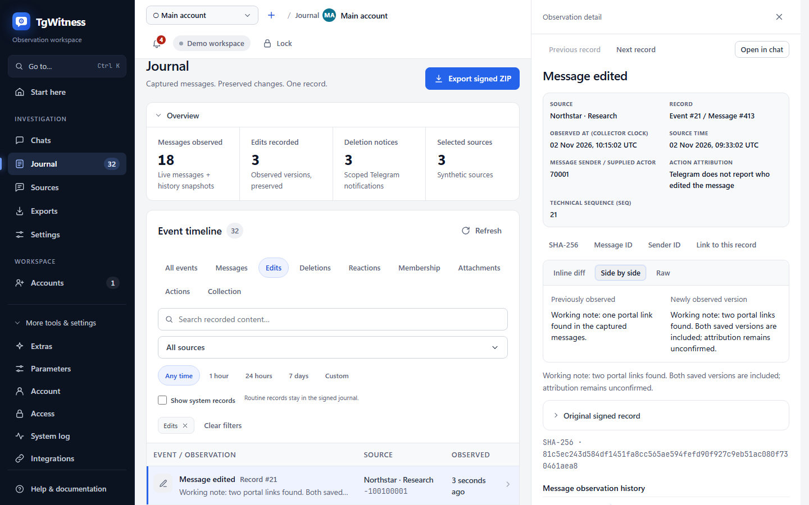](assets/detail.png) | [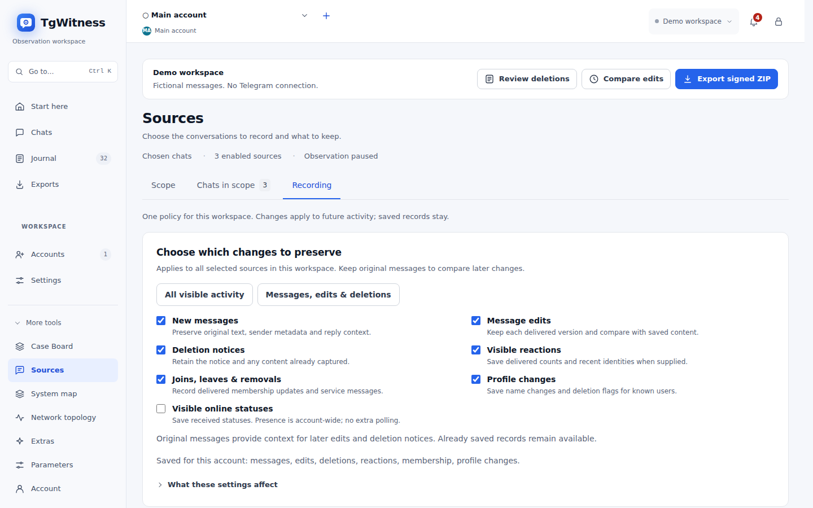](assets/sources.png) |
| **Prepare a signed handoff** | **Review the observation journal** |
| [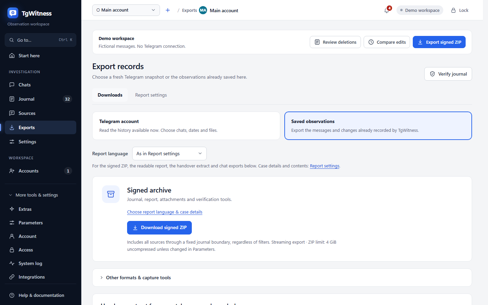](assets/exports.png) | [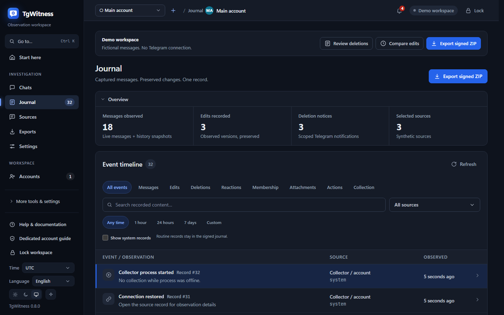](assets/workspace-dark.png) |

Fictional demo data everywhere.

## How it works

Every observed change becomes a record linked to the previous one by its hash and signed.


1. **Observe** the chats your account can see.
2. **Preserve** events in a signed append-only journal, with versions and gaps.
3. **Verify** an export with a key fingerprint you kept somewhere else.

The signed journal keeps what the account received, source IDs and every captured
version. A recipient checks signatures and file hashes, external time from a third
party for the last record, and compares the journal with checkpoints kept elsewhere.
[More on the evidence model →](HOW-IT-WORKS.md)

<details>
<summary>What each observation keeps</summary>

| Observation | Kept |
| --- | --- |
| New message | Text, sender, reply, metadata, time seen, for selected sources |
| Edit | A new version |
| Deletion | Message ID + everything saved before |
| Reactions | Counts and recent users if Telegram sends them |
| Membership | Service messages and participant updates |
| Attachment | File with SHA-256 (optional) and the download outcome |
| Coverage | Starts, stops, disconnects, heartbeats |
| History snapshot | Latest visible messages (500 by default) |

More in [collection](COLLECTION.md).

</details>


## Connect a Telegram account

> [!WARNING]
> **Use a dedicated account you can afford to lose.** Telegram can restrict or ban accounts.
> Don't connect your personal account and don't create API credentials on it.
> [Account guide](ACCOUNTS.md).

Sign in by phone, QR or a session file, pick sources, save the policy and press
**Start observation**. **Pause observation** stops collecting, **Lock** only closes the browser panel.

<details>
<summary>Sign-in formats and the built-in API pool</summary>

You don't need your own API ID. TgWitness ships 50 public API pairs already used by
other open-source clients and tries the next one if Telegram refuses. Have your own?
Enter it under **API ID + Hash**; Telegram's
[API terms](https://core.telegram.org/api/obtaining_api_id) apply to every client.

| What you have | Where |
| --- | --- |
| Phone with access to the account | **Phone** tab (code, then 2FA if set) |
| A logged-in Telegram app | **QR code** tab: Settings → Devices → Link Desktop Device |
| Telethon / Pyrogram `.session` | **Files** tab |
| `name.session` + `name.json` | **Files** tab, select both |
| Telegram Desktop `tdata` | ZIP `key_datas` + `D877F783D5D3EF8Cs`, then **Files** |
| StringSession, `.txt`, `.tgwitness-session` | **Files** or *Passcode or session text* |
| Account JSON with session or Auth Key | **Files** tab |
| Auth Key (512 hex) + DC ID | **Auth key** tab |

Not supported: TDLib, Pyrogram session strings, bot tokens, multi-account TData.
Details for every format: [accounts guide](ACCOUNTS.md).

</details>

## Evidence and verification

Hand over the **signed ZIP**. It has the records, media, coverage, an offline report
and the verifier. Keep the key fingerprint and a checkpoint separately.
[Step by step →](wiki/Exports-and-Verification.md)

<details>
<summary>Export formats and verify commands</summary>

| Export | Contents | Integrity |
| --- | --- | --- |
| **Signed ZIP** | JSONL, CSV, HTML, coverage, media, manifest, verifier | Signed events + signed manifest. Use this one |
| JSONL | Records with hashes and signatures | Per-event signatures, hash chain |
| CSV / HTML | Spreadsheet / offline report | Only covered inside the ZIP |
| Checkpoint JSON | Journal length and head hash | Signed separately, keep it elsewhere |
| Run receipt JSON | Code hashes, versions, scope, settings | Signed separately |
| People profiles JSON | Profiles of one chat | Signed, checked against the ZIP |
| Witness journal ZIP | What the witness saw and posted | Signed by the witness key |

Exports always contain the full journal up to a fixed point, filters only affect browsing.

```sh
python -m pip install cryptography
python tgwitness/verify.py tgwitness-evidence.zip --fingerprint TRUSTED_PUBLIC_KEY_SHA256 --tsa-ca TSA-ROOT.pem --require evidence
# with a witness and its public channel (post dates read from Telegram)
python tgwitness/verify.py tgwitness-evidence.zip --fingerprint TRUSTED_PUBLIC_KEY_SHA256 \
    --witness witness.zip --witness-fingerprint WITNESS_SHA256 --channel https://t.me/s/WITNESS_CHANNEL
```

The verifier prints who signed, observed periods, gaps and never-seen message IDs, and
fails if the journal doesn't match what the witness saw.

Keep the key fingerprint and checkpoints outside the collector, so the recipient has an
independent reference. [GitHub Actions capture](SEALED-ACTIONS.md) also checks the archive
against the approved hosted workflow and collector version.

The minimum for evidence is the confirmed fingerprint plus time from a third party
covering the last record; a checkpoint is signed with the collector key and does not
meet it alone. Evidence mode stamps checkpoints with RFC 3161 and OpenTimestamps, and
witness posts read from t.me also count. The panel can also prepare
an offline RFC 3161 request. See [timestamps](TIMESTAMP.md), the
[verification record](VERIFICATION.md) and the [handoff checklist](EVIDENCE.md#investigation-handoff).

</details>


## Deployment

Run it locally or use the Docker, HTTPS and service templates.
[Server setup](DEPLOYMENT.md) · [Backup and recovery](wiki/Backup-and-Recovery.md) · [Connection settings](CONNECTION-SECURITY.md)

<details>
<summary>Commands and environment variables</summary>

**Docker:**

```sh
docker compose up -d --build --wait
docker compose exec tgwitness cat /data/panel-token.txt
```

Non-root, read-only filesystem, listens on `127.0.0.1:8787`, data in a named volume.

**Public server with HTTPS (Caddy):** copy `deploy/env.example` to `.env`, set
`TGWITNESS_DOMAIN`, point DNS, open 80/443:

```sh
docker compose -f compose.yaml -f deploy/compose/compose.https.yaml up -d --build --wait
```

**Windows portable:** the release ZIP has Python and all deps inside. To update, unpack
the new version and copy the `data` folder over.

**No Docker:** systemd, Windows logon task and launchd templates are in [deploy/](../deploy/README.md).

### Command line

```text
python start.py [--demo] [--setup-only] [--check [--json]] [--host HOST] [--port PORT] [--data-dir DIR]
```

| Task | Command |
| --- | --- |
| Check readiness without starting | `python start.py --check` |
| Convert a Telethon session offline | `python -m tgwitness.sessions account.session --out account.tgwitness-session` |
| Stream a big export to disk | `python -m tgwitness.download --token-file data/live/panel-token.txt --out evidence.zip` |
| Verify an archive | `python tgwitness/verify.py tgwitness-evidence.zip --fingerprint SHA256` |
| Verify an archive over 4 GiB | `python tgwitness/verify.py big-evidence.zip --fingerprint SHA256 --max-gib 16` |
| Run a witness from config | `python -m tgwitness.witness run --config witness.json` |

Run `python -m tgwitness…` commands inside `.venv`.

| Variable | Purpose |
| --- | --- |
| `TGWITNESS_HOST`, `TGWITNESS_PORT` | Listen address (default `127.0.0.1:8787`) |
| `TGWITNESS_DATA` | Data directory (default `data/live`) |
| `TGWITNESS_TOKEN` | Fixed panel token, 24+ characters |
| `TGWITNESS_VAULT_KEY_FILE` | External vault key for new installs |
| `TGWITNESS_DOMAIN`, `TGWITNESS_IMAGE` | Docker HTTPS hostname and image |
| `TGWITNESS_WITNESS_*` | Witness options ([witness](WITNESS.md#options)) |

</details>

<details>
<summary>Collection settings and parameters</summary>

## Settings and parameters

Everything is set in the panel, per workspace. Every change goes into the signed journal
with before/after values.

| Where | What |
| --- | --- |
| **More tools → Sources** | Scope, source types, exclusions, own actions, which changes to keep, attachment types and sizes, recheck intervals |
| **Exports** | Password for downloads |
| **Settings** or **More tools → Extras** | Evidence mode, off-site S3 copy, notifications |
| **More tools → Extras → Independent witness** | Read-only witness tokens and ready-made commands |
| **More tools → Parameters** | Everything else: list sizes, intervals, rechecks, disk reserve, download limits, people-profile patterns, notification pace, ZIP limits, Telegram timeouts |

Values show their range and default, changed ones are marked and can be reset.
A ZIP limit over 4 GiB needs `verify.py --max-gib N` ([operations](OPERATIONS.md#panel-layout)).

</details>


## Security and project status

The panel listens on localhost by default. Sessions, credentials and keys are in an
encrypted vault. Messages and files aren't, so use disk encryption if that matters.
[Security model](CONNECTION-SECURITY.md) · [Report a vulnerability](../.github/SECURITY.md)

Still a pre-release. What's been tested and what hasn't: [verification record](VERIFICATION.md).

<details>
<summary>Data protection details</summary>

- For remote access use the HTTPS profile or an SSH tunnel, never plain HTTP.
- The vault is Fernet-encrypted. Its key sits in the data directory unless you set
  `TGWITNESS_VAULT_KEY_FILE`.
- Data, sessions, tokens, keys and exports are excluded from git and Docker builds.
- Report vulnerabilities privately, see [SECURITY.md](../.github/SECURITY.md).

</details>

<details>
<summary>Responsibility and data protection (GDPR)</summary>

## Responsibility and data protection (GDPR)

TgWitness is a tool. Whoever runs it decides what is collected, why and for how long, and is
responsible for it — under the EU/UK GDPR usually as the *controller* of that personal data.
Telegram messages contain personal data of people who never agreed to be recorded: names,
usernames, IDs, photos, phone numbers, opinions. Apply the law that governs your work and
Telegram's terms; the points below summarize common practice.

- **Have a lawful basis and a purpose.** Fraud prevention, network and information security
  and the defence of legal claims are commonly relied on as legitimate interests
  (GDPR Art. 6(1)(f), Recitals 47 and 49; Art. 9(2)(f) for legal claims). Write the purpose
  down per case. Public authorities work under their own legal bases.
- **Collect as little as the purpose needs.** Start with chosen chats. Folder and whole-account
  modes record private chats and third parties' messages: use them only on dedicated
  accounts; the panel asks for confirmation and the signed journal records it. Turn off event
  types, attachment types and own actions you do not need, and exclude chats.
- **People profiles are profiling.** They are off by default and switched on per chat. Use
  them for a specific investigation, do not base automated decisions about people on them
  (Art. 22), and switch them off or remove the chat when done — that deletes them. Systematic
  monitoring of many people usually calls for a data protection impact assessment (Art. 35).
- **Keep it secure.** Sessions, credentials and keys are in an encrypted vault; put the data
  directory on an encrypted disk, give exports a password (AES-256 ZIP), keep the panel behind
  HTTPS, and give a witness only its read-only token. Notifications carry no message text
  unless you turn on excerpts, which sends text to the notification service.
- **Retention and erasure.** The journal is append-only so that its integrity can be proven;
  single records cannot be removed without breaking the signature chain. Plan retention per
  workspace and delete an added workspace (Accounts → Delete) when the purpose ends. The main
  workspace cannot be deleted from the panel: sign out of Telegram on the **More tools → Account** page, stop
  TgWitness and remove its data directory. Off-site copies under S3 Object Lock cannot be deleted before their
  retention date — choose the period accordingly. The right to erasure has exceptions, for
  example for the establishment or defence of legal claims (Art. 17(3)(e)).
- **Requests from the people recorded.** Chat exports and profile files make it possible to
  find what is held about a person (Art. 15).
- **Nothing is sent to the authors.** TgWitness has no telemetry and no hosted service; data
  leaves your machine only through the routes you configure (Telegram, timestamp services,
  S3 copy, notifications, witness).

</details>


## Development

PRs welcome. Read the [contribution guide](../.github/CONTRIBUTING.md) and use fake data in examples.

<details>
<summary>Dev setup and checks</summary>

```sh
python -m venv .venv && source .venv/bin/activate     # Windows: .venv\Scripts\Activate.ps1
python -m pip install -c deploy/constraints.txt -e ".[dev]"
python -m ruff check .
python -m playwright install chromium
python tools/build_portable.py                         # Windows portable ZIP
python tools/build_source.py                           # source ZIP + SHA-256 manifest
python tools/build_site.py                             # site in dist/site
```

Browser checks use synthetic Telegram data.

</details>

## Documentation

| Use it | Understand it | Work on it |
| --- | --- | --- |
| [Quick start](QUICKSTART.md) | [How it works](HOW-IT-WORKS.md) | [Contributing](../.github/CONTRIBUTING.md) |
| [Project wiki](wiki/Home.md) | [Evidence and trust](EVIDENCE.md) | [Architecture](ARCHITECTURE.md) |
| [Investigations](INVESTIGATION.md) | [Collection and coverage](COLLECTION.md) | [Changelog](CHANGELOG.md) |
| [Troubleshooting](wiki/Troubleshooting.md) | [Independent witness](wiki/Independent-Witness.md) | [Website and publishing](internal/PUBLISHING.md) |

[All guides →](README.md) &nbsp; · &nbsp; [Get help →](../.github/SUPPORT.md)

<details>
<summary>Read the project overview in your language</summary>

**English** · [Русский](ru/README.md) · [Українська](uk/README.md) · [Español](es/README.md) · [Português (Brasil)](pt/README.md) · [Türkçe](tr/README.md) · [العربية](ar/README.md) · [فارسی](fa/README.md) · [اردو](ur/README.md) · [हिन्दी](hi/README.md) · [Bahasa Indonesia](id/README.md) · [Tiếng Việt](vi/README.md) · [简体中文](zh/README.md)

</details>


## License

[MIT License](../LICENSE). Our
[position on Taylor Wessing](OPERATOR-INCOMPATIBILITY.md) is a statement, not a licence condition.

## Repository map

| Where | What |
| --- | --- |
| [Application](../tgwitness/README.md) | Collectors, journals, exports and the panel |
| [Documentation](README.md) · [Wiki](wiki/Home.md) | Setup, investigations, operations, verification |
| [Tools](../tools/README.md) | Builds, browser checks, screenshots, packaging |
| [Deployment](../deploy/README.md) | Service templates and HTTPS |
| [Website](../website/README.md) | Public pages, guides, translations |
| [GitHub configuration](../.github/AUTOMATION.md) | Automation, issue forms, dependency updates |

## Archive and integrations

[Workflow guide](https://phishdestroy.github.io/TgWitness/docs/archive/) ·
[History loading](HISTORY.md) · [Archive analysis](ANALYSIS.md) · [MCP](MCP.md) ·
[OCR / transcription](MEDIA-ANALYSIS.md) · [Webhooks](WEBHOOKS.md)
