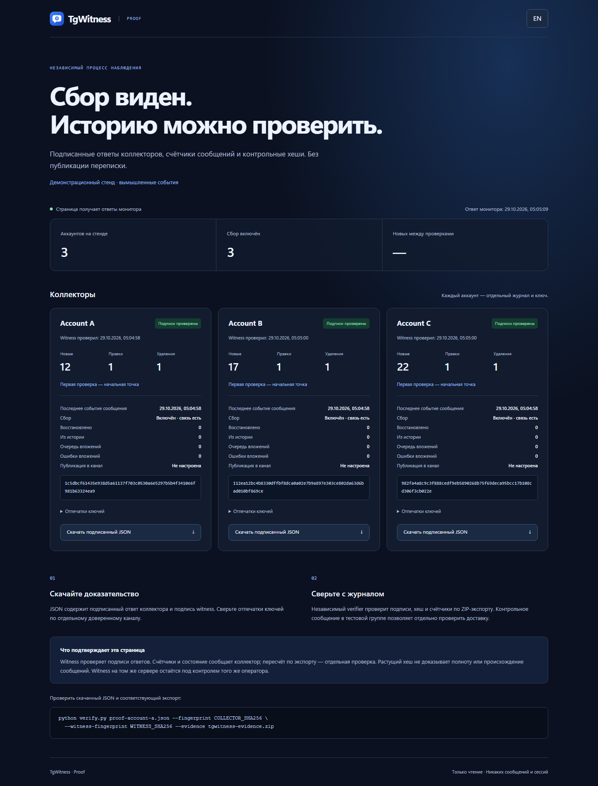
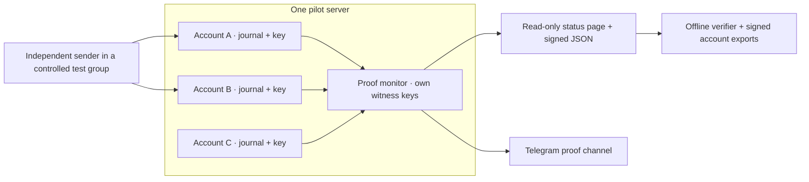

# A verifiable collection pilot

One collector server can host several account workspaces. The **Proof monitor** is a
separate, read-only process that polls each workspace with its own witness token, pins
each collector key, retains a witness journal and serves a public status page. It can
also publish signed observations through the existing Telegram witness bot.

[Инструкция на русском](ru/PROOF.md).





## Three different checks

| Check | What it establishes |
| --- | --- |
| Signed head retained outside the collector | A later export matches the exact journal prefix witnessed earlier |
| Signed capture counters | The collector reports message activity; the verifier can recount the corresponding export |
| Independent canary: send → edit → delete | Those particular events reached each tested account and were preserved in order |

A hash alone does not establish Telegram origin or complete delivery. Heartbeats and
configuration changes also extend the journal. Proof therefore counts new messages,
edits, deletion notices, recovered messages and history snapshots separately. These are
event counts, not unique people or unique conversations. Last-message time includes
message changes/deletions; quiet sources can remain connected without new messages.

## Set up two or three accounts on one server

1. Start the collector and add separate workspaces in **Accounts**. Connect a distinct
   dedicated account to each one, select the controlled test group and start observation.
   Keep production messages out of public acceptance fixtures.
2. In each workspace's **Extras → A bot in your channel** setup, create a witness token. Retain the workspace's
   signing-key fingerprint separately. A witness token can read checkpoints, counters
   and operational health, but cannot read messages or control the collector.
3. Create `proof-config/`, copy [the example](../deploy/proof.config.example) to
   `proof-config/proof.json`, and save tokens in `account-a-token.txt`, `account-b-token.txt`,
   etc. Replace the example URLs, workspace IDs and key fingerprints. Use neutral public
   labels. This directory is ignored by Git and Docker builds; restrict its permissions
   to the operator and the container user (UID 10001).
4. Check and start the overlay:

```sh
docker compose -f compose.yaml -f deploy/compose/compose.proof.yaml run --rm --no-deps proof \
  python -m tgwitness.proof --config /proof-config/proof.json --check-config
docker compose -f compose.yaml -f deploy/compose/compose.proof.yaml up -d --build
```

The monitor listens on `127.0.0.1:8790`, with its own keys/journals in `proof-data`.
The default interval is five minutes; set `interval` to 1–1440 minutes in the config.
Expose only this read-only service through an HTTPS reverse proxy for a public page;
[a native Caddy example](../deploy/Caddyfile.proof.example) uses a separate hostname.
Keep the account-control panel private or separately authenticated.

Without Docker, change `data_dir` in the config to `../proof-data` and the collector URLs
to the actual loopback/HTTPS addresses, then run in the installed project environment:

```sh
python -m tgwitness.proof --config proof-config/proof.json --check-config
python -m tgwitness.proof --config proof-config/proof.json
```

Configuration checking reads the secret files but opens no network connection. The
monitor requires distinct pinned fingerprints, preventing one journal being counted
twice as separate accounts. A dead workspace does not stop the others. The page marks
late checks, missing answers, key changes, rollbacks and invalid signatures; inability
to reach the monitor also invalidates its displayed online status.

### Broadcast to a channel

Create a bot/channel you control and allow the bot to post there. Add these fields to
each workspace entry; the bot-token path is relative to the config file:

```json
{"channel": "@your_proof_channel", "bot_token_file": "proof-bot-token.txt"}
```

The monitor posts each check, including missing/invalid answers, through that workspace's
witness. Posts include the journal head, message counters, changes since the previous
valid check and a signed `TGW1` statement. The first check is a baseline. Save each
witness fingerprint outside the server; the page exposes public fingerprints, never
the tokens or user sessions. [Witness export and channel verification](WITNESS.md#verify)
also apply; export each alias directory, for example `/witness/account-a` in Docker.

Each workspace entry also accepts `proxy` (HTTP/SOCKS5 URL) and `bot_api` (your Bot API
server URL; default `https://api.telegram.org`). These configure witness HTTP traffic.
The collecting account's MTProxy is configured separately. For a standalone bot, use
the panel's [setup form](WITNESS.md#run-a-witness).

## Check a downloaded proof

Download a workspace's JSON from the page. Obtain the matching account's signed evidence
ZIP separately, using the authenticated collector panel. With an independently trusted
copy of `verify.py`:

```sh
python tgwitness/verify.py proof-account-a.json --fingerprint COLLECTOR_SHA256 \
  --witness-fingerprint WITNESS_SHA256 --evidence tgwitness-evidence.zip
```

The verifier authenticates the witness receipt and collector signatures, checks the
exact prefix hash and recomputes every capture counter from the evidence. A collector
can sign an inaccurate counter, so this recount is stronger than viewing the page.
Without `--evidence`, only the signatures are checked. The signed health flags are
collector reports, not independent network measurements. Each HTTP poll also sends a
fresh random challenge that the collector signs, rejecting replayed capture answers.

## A reproducible live canary

Generate a nonce on the independent sender's machine; this command sends nothing:

```sh
python tools/verify_live_probe.py --new
```

From an independent Telegram client, send `TGW-PROBE.<generated nonce> version 1` to the
controlled group. Confirm both collectors have recorded it. Edit the **same** message
to `TGW-PROBE.<same nonce> version 2`; confirm both versions are saved, then delete it.
Wait for the deletion notices and the next published witness checks. Export each journal:

```sh
python tools/verify_live_probe.py --nonce TGW-PROBE.REPLACE_WITH_GENERATED_NONCE \
  --workspace account-a account-a.zip FINGERPRINT_A \
  --workspace account-b account-b.zip FINGERPRINT_B --out probe-result.json
```

The command verifies both complete archives and distinct keys, then finds one new
message, a changed version and a later deletion notice for the same message in each
journal. History-only imports, duplicate nonce messages, absent edits/deletions and
repeated exports of the same account do not pass. Any reported capture delay compares
the Telegram source time with the collector clock; it is not a trusted-clock benchmark.

Repeat the controlled procedure across several days, a scheduled restart and a bounded
network interruption. Record expected events, received events, delays and failures.
Compare both accounts only where their Telegram visibility and configured policies agree.
Telegram can return `channelDifferenceTooLong` when old updates have expired; saved
cursor state alone cannot recover those events ([Telegram update handling](https://core.telegram.org/api/updates)).

## Independence and remaining deployment work

On one VPS, the collector and monitor share the operator and host failure. If the VPS
goes down, its local witness cannot announce the outage. Channel copies and retained
keys are useful external anchors; stronger assurance requires a witness on another
machine/operator, plus an external uptime check. Do not copy the collector's sessions
or signing keys to that witness.

The supplied browser acceptance uses **three synthetic profiles on one local server**.
It is not a completed multi-account Telegram pilot or evidence of a Docker deployment.
Run the controlled live procedure on the chosen host and retain its real results before
claiming broader delivery or outage qualification.
