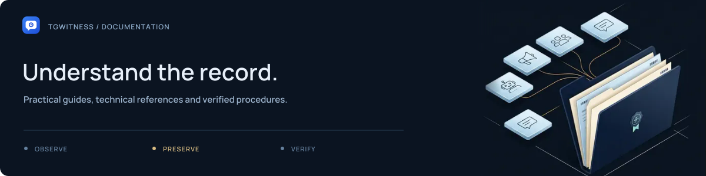

# TgWitness documentation

[Project overview](../README.md) · [GitHub Wiki](https://github.com/phishdestroy/TgWitness/wiki) · [Offline handbook](wiki/Home.md) · [FAQ](wiki/FAQ.md)


## Start here

Linux / macOS (root on an Ubuntu server, normal user on a desktop):

```sh
curl -fsSL https://get.destroy.tools/install.sh | bash
```

Windows (PowerShell or CMD, no admin needed):

```powershell
powershell.exe -NoProfile -ExecutionPolicy Bypass -Command "irm https://get.destroy.tools/install.ps1 | iex"
```

Python comes bundled. Everything runs on your machine, only the download files sit
on Cloudflare. [Signatures, panel access, updates and removal](INSTALLATION.md).

**Licence:** [MIT License](../LICENSE). Our
[position on Taylor Wessing](TAYLOR-WESSING-EXCLUSION.md) adds no condition to it.

> **Ethical Notice & Historical Continuity**
> [Read our author statement](ETHICAL-NOTICE.md) and its source record.

First time? Do it in this order:

1. [Try the demo](QUICKSTART.md#explore-the-interface), fake data, no Telegram login
2. [Connect and collect](wiki/Getting-Started.md) a message from a chat you control
3. [Read how the record works](HOW-IT-WORKS.md) and what a signature does and doesn't prove

## Find your workflow

| I want to… | Read |
| --- | --- |
| Try the interface | [Quick start](QUICKSTART.md#explore-the-interface) |
| Connect my account | [Account setup](ACCOUNTS.md) |
| Pick a goal and tweak settings | [First setup and settings](SETTINGS.md) |
| Understand every screen | [Panel guide](PANEL.md) |
| Add browser or AyuGram capture | [Optional capture](OPTIONAL-CAPTURE.md) (preview) |
| See how protected a workspace is | [Protection modes](PANEL.md#protection-modes) |
| Check the program matches GitHub | [Code check](PANEL.md#code-check) |
| Run several accounts | [Account groups](ACCOUNTS.md#bulk-import-and-account-groups) |
| Capture one chat from my fork | [GitHub Actions capture](SEALED-ACTIONS.md) (preview) |
| Load older messages | [Source history](HISTORY.md) |
| Export an account | [Account export](ACCOUNT-EXPORT.md) |
| Send a trimmed copy to a lawyer | [Minimized disclosure](ACCOUNT-EXPORT.md#prepare-a-disclosure-for-a-lawyer-or-another-recipient) |
| Give someone limited access | [Access and permissions](ACCESS.md) |
| Connect an AI client | [Read-only MCP](MCP.md) |
| Ask questions, write a report | [Archive analysis](ANALYSIS.md) |
| Find messages by word forms, domains or @usernames | [Full-text search](SEARCH.md) (preview) |
| Keep team notes on a case | [Case Board](CASE-BOARD.md) |
| Hand over a readable report | [Case reports](CASE_REPORTS.md) |
| Read text in images and audio | [Local OCR and transcription](MEDIA-ANALYSIS.md) |
| Connect n8n or a SIEM | [Signed webhooks](WEBHOOKS.md) |
| Investigate a whole account | [Investigation walkthrough](INVESTIGATION.md) |
| Pick a connection route | [Proxy settings](CONNECTION-SECURITY.md) |
| Share something verifiable | [Export and verify](EVIDENCE.md#investigation-handoff) |
| Publish checkpoints to a channel | [Witness bot](WITNESS.md#run-a-witness) |
| Run it on a server | [Deployment](DEPLOYMENT.md) |
| Let others check the server itself | [High-assurance deployment](HIGH-ASSURANCE.md) |
| Fix a problem | [Operations](OPERATIONS.md) |

Also: [panel safeguards](PANEL-SAFETY.md), [storage and recovery](STORAGE.md),
[what's been tested](VERIFICATION.md), [wiki](wiki/Home.md), [glossary](wiki/Glossary.md).

<details>
<summary>Technical reference</summary>

- [Collection and visibility](COLLECTION.md)
- [Complete project guide](PROJECT-GUIDE.md)
- [Evidence format and trust boundaries](EVIDENCE.md)
- [Architecture](ARCHITECTURE.md)
- [Security model and data handling](SECURITY-MODEL.md)
- [Access scopes, permissions and sessions](ACCESS.md)
- [Connection and secret storage](CONNECTION-SECURITY.md)
- [Readiness and known limits](internal/READINESS.md)
- [Live acceptance procedure](internal/LIVE_ACCEPTANCE.md)
- [External timestamps](TIMESTAMP.md)
- [Release procedure](internal/RELEASE.md)
- [Website preview and publishing](internal/PUBLISHING.md#preview-the-website-locally) · [SEO](internal/SEO.md)

</details>


## Browse the source

[Repository map](../README.md#repository-map) · [Documentation assets](assets/README.md) · [Wiki source](wiki/README.md)
