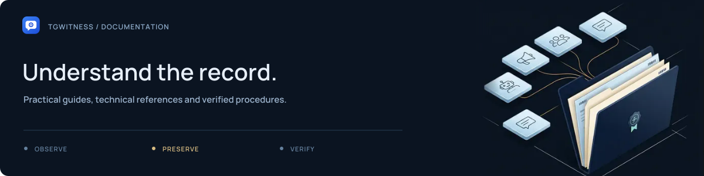
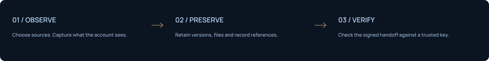

# TgWitness documentation

**Choose a workflow. Find the details. Keep a record you can explain.**

[Project overview](../README.md) · [GitHub Wiki](https://github.com/phishdestroy/TgWitness/wiki) · [Videos and animations](SHOWCASE.md) · [Offline handbook](wiki/Home.md) · [FAQ](wiki/FAQ.md)

## Start here

Start with a local demo, then connect one account and check a captured message.
The proxy, witness bot and public status page are separate options.

1. [Try the demo](QUICKSTART.md#explore-the-interface) — explore the workspace with fictional data.
2. [Connect and collect](wiki/Getting-Started.md) — capture a message from a chat you control.
3. [Understand the record](HOW-IT-WORKS.md) — learn what signatures and coverage can establish.

## Find your workflow

| I want to… | Start here | What I should see |
| --- | --- | --- |
| Try the interface | [Quick start](QUICKSTART.md#explore-the-interface) | Fictional conversations; no Telegram login |
| Connect my account | [Account setup](ACCOUNTS.md) | A new test message in the journal |
| Investigate across the whole account | [Complete investigation walkthrough](INVESTIGATION.md) | A source register, cited cross-chat timeline, people/file connections and verified evidence per workspace |
| Choose a connection route | [Proxy settings](CONNECTION-SECURITY.md) | A successful Telegram connection check |
| Share a verifiable record | [Export and verify](EVIDENCE.md#investigation-handoff) | Valid signatures and the expected key fingerprint |
| Publish checkpoints to a channel | [Witness bot](WITNESS.md#run-a-witness) | A signed post from the running witness |
| Monitor several accounts publicly | [Proof pilot](PROOF.md) | Signed counters and a checked send/edit/delete scenario |
| Leave it running on a server | [Deployment](DEPLOYMENT.md) | Persistent storage and capture after a restart |
| Diagnose a problem | [Operations](OPERATIONS.md) | A concrete cause and a way to check recovery |

**What has actually been tested:** [verification record](VERIFICATION.md).
Real Telegram observations, synthetic tests and remaining live qualification work
are recorded separately. A signed journal establishes integrity relative to a
trusted key; a controlled delivery test checks particular Telegram events.

For step-by-step instructions, use the [wiki](wiki/Home.md).
For terminology, use the [glossary](wiki/Glossary.md).

Technical reference

- [Collection and visibility](COLLECTION.md)
- [Complete project guide](PROJECT-GUIDE.md)
- [Evidence format and trust boundaries](EVIDENCE.md)
- [Architecture](ARCHITECTURE.md)
- [Connection and secret storage](CONNECTION-SECURITY.md)
- [Readiness and known limits](internal/READINESS.md)
- [Live acceptance procedure](internal/LIVE_ACCEPTANCE.md)
- [External timestamps](TIMESTAMP.md)
- [Release procedure](internal/RELEASE.md)

The project also includes a documentation website in 13 languages, with light and dark
themes and local search,
animated message history, an interactive hash-chain sandbox, witness scenarios,
a delivery chart, a complete investigation across channels, groups, private
chats and bots, and a security guide that shows what leaves your machine. Its
reference section renders every document listed here, with animated diagrams.
The examples run in your browser with fictional data; they do not contact Telegram.
[Preview it locally or publish it to GitHub Pages](internal/PUBLISHING.md#preview-the-website-locally).
[Website structure and SEO](internal/SEO.md) describes the metadata and post-deployment checks.

## Browse the source

[Repository map](../README.md#repository-map) · [Documentation assets](assets/README.md) · [Wiki source](wiki/README.md)
