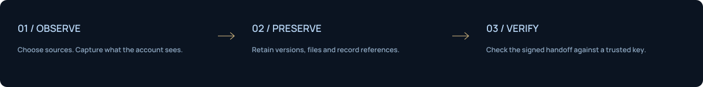

[TgWitness](../README.md)

<picture>
  <source media="(max-width: 640px) and (prefers-reduced-motion: reduce)" srcset="assets/presentation/section-docs-mobile-static.svg">
  <source media="(prefers-reduced-motion: reduce)" srcset="assets/presentation/section-docs-static.svg">
  <source media="(max-width: 640px)" srcset="assets/presentation/section-docs-mobile.svg">
  
</picture>

# TgWitness documentation

[Offline handbook](wiki/Home.md) · [FAQ](wiki/FAQ.md) ·
[GitHub Wiki](https://github.com/phishdestroy/TgWitness/wiki)

[Current capabilities](STATUS.md) · [Verification record](VERIFICATION.md) ·
[Performance graphs](https://phishdestroy.github.io/TgWitness/docs/validation/) ·
[Signed English audit](../website/validation/audit/README.md)



## Start here

Linux / macOS (root on an Ubuntu server, normal user on a desktop):

```sh
curl -fsSL https://get.destroy.tools/install.sh | bash
```

Windows (PowerShell or CMD, no admin needed):

```powershell
powershell.exe -NoProfile -ExecutionPolicy Bypass -Command "irm https://get.destroy.tools/install.ps1 | iex"
```

Python comes bundled. Everything runs on your machine, only the download files sit
on Cloudflare. [Signatures, panel access, updates and removal](INSTALLATION.md).

**Licence:** [MIT License](../LICENSE). Our
[position on Taylor Wessing](OPERATOR-INCOMPATIBILITY.md) adds no condition to it.

> **Ethical Notice & Historical Continuity**
> [Read our author statement](ETHICAL-NOTICE.md) and its source record.

First time? Do it in this order:

1. [Try the demo](QUICKSTART.md#explore-the-interface), fake data, no Telegram login
2. [Connect and collect](wiki/Getting-Started.md) a message from a chat you control
3. [Read how the record works](HOW-IT-WORKS.md) and what a signature does and doesn't prove

## Find your workflow

### Set up a workspace

| I want to… | Read |
| --- | --- |
| Try the interface | [Quick start](QUICKSTART.md#explore-the-interface) |
| Connect my account | [Account setup](ACCOUNTS.md) |
| Pick a goal and tweak settings | [First setup and settings](SETTINGS.md) |
| Understand every screen | [Panel guide](PANEL.md) |
| Add browser or AyuGram capture | [Optional capture](OPTIONAL-CAPTURE.md) (preview) |
| See how protected a workspace is | [Protection modes](PANEL.md#protection-modes) |
| Check the program matches GitHub | [Code check](PANEL.md#code-check) |
| Run several accounts | [Account groups](ACCOUNTS.md#bulk-import-and-account-groups) |

### Collect and investigate

| I want to… | Read |
| --- | --- |
| Capture one chat from my fork | [GitHub Actions capture](SEALED-ACTIONS.md) (preview) |
| Understand Secret Chat support and try its interface | [Secret Chat installation and recording](PSEUDO-SECRET.md) |
| Load older messages | [Source history](HISTORY.md) |
| Export an account | [Account export](ACCOUNT-EXPORT.md) |
| Ask questions, write a report | [Archive analysis](ANALYSIS.md) |
| Find messages by word forms, domains or @usernames | [Full-text search](SEARCH.md) (preview) |
| Keep team notes on a case | [Case Board](CASE-BOARD.md) |
| Read text in images and audio | [Local OCR and transcription](MEDIA-ANALYSIS.md) |
| Follow Telegram's similar-channel suggestions | [Similar channels](SIMILAR-CHANNELS.md) |
| See what a mini application loads | [Mini applications](MINI-APPS.md) |
| Investigate a whole account | [Investigation walkthrough](INVESTIGATION.md) |
| Document a conversation for court | [Investigation mode](INVESTIGATION-MODE.md) |
| See how the installation reaches Telegram and outside services | [System map](SYSTEM-MAP.md) |

### Share and verify

| I want to… | Read |
| --- | --- |
| Send a trimmed copy to a lawyer | [Minimized disclosure](ACCOUNT-EXPORT.md#prepare-a-disclosure-for-a-lawyer-or-another-recipient) |
| Give someone limited access | [Access and permissions](ACCESS.md) |
| Hand over a readable report | [Case reports](CASE_REPORTS.md) |
| Describe a verified evidence archive | [Evidence narratives](NARRATIVE.md) · [Configuration examples](examples/README.md) |
| Share something verifiable | [Export and verify](EVIDENCE.md#investigation-handoff) |
| Publish checkpoints to a channel | [Witness bot](WITNESS.md#run-a-witness) |
| Let others check the server itself | [High-assurance deployment](HIGH-ASSURANCE.md) |

### Operate and connect

| I want to… | Read |
| --- | --- |
| Connect an AI client | [Read-only MCP](MCP.md) |
| Script searches, statistics and exports | [Command line](CLI.md) (preview) |
| Connect n8n or a SIEM | [Signed webhooks](WEBHOOKS.md) · [Integration examples](../integrations/README.md) |
| Pick a connection route | [Proxy settings](CONNECTION-SECURITY.md) |
| Run it on a server | [Deployment](DEPLOYMENT.md) |
| Fix a problem | [Operations](OPERATIONS.md) |

Also: [panel safeguards](PANEL-SAFETY.md), [storage and recovery](STORAGE.md),
[what's been tested](VERIFICATION.md), [limits and objections](LIMITS-AND-OBJECTIONS.md), [wiki](wiki/Home.md), [glossary](wiki/Glossary.md).

<details>
<summary>Technical reference</summary>

- [Investigation mode](INVESTIGATION-MODE.md)
- [System map and network observations](SYSTEM-MAP.md)
- [Collection and visibility](COLLECTION.md)
- [Complete project guide](PROJECT-GUIDE.md)
- [Evidence format and trust boundaries](EVIDENCE.md)
- [Architecture](ARCHITECTURE.md)
- [Security model and data handling](SECURITY-MODEL.md)
- [Access scopes, permissions and sessions](ACCESS.md)
- [Connection and secret storage](CONNECTION-SECURITY.md)
- [Release checks](internal/READINESS.md)
- [Live acceptance procedure](internal/LIVE_ACCEPTANCE.md)
- [External timestamps](TIMESTAMP.md)
- [Release procedure](internal/RELEASE.md)
- [Website preview and publishing](internal/PUBLISHING.md#preview-the-website-locally) · [SEO](internal/SEO.md)

</details>


## Browse the source

| Area | Guide |
| --- | --- |
| Application and recorder code | [Application](../tgwitness/README.md) · [Independent capture](../tgwitness_capture/README.md) |
| Install and run | [Deployment](../deploy/README.md) · [Launchers](../scripts/README.md) |
| Configure an export or integration | [Export examples](../examples/README.md) · [Webhooks and n8n](../integrations/README.md) |
| Build and contribute | [Tools](../tools/README.md) · [Contribution guide](../.github/CONTRIBUTING.md) |
| Maintain the documentation | [Website](../website/README.md) · [Wiki source](wiki/README.md) · [Assets](assets/README.md) |

[Full repository map](../README.md#repository-map) · [Maintainer procedures](internal/README.md)
